My nephews and I had been playing Teenage Mutant Ninja Turtles: Shredder's Revenge on my old PS4 whenever they visited. It's a recreation of the OG beat 'em up arcade game I used to play for hours on a solo arcade machine at my local pool.

One day, my younger nephew, Aiden, came to me with a proposal. Since I knew how to write code, could I make him his own TMNT-style game for his birthday?

He had drawn up some game design docs for his game.

His proposal was that the heroes would be based on the family, each with their own special powers based on their interests.

He had also drawn up the bosses and some aspects of the story. One objective would be to rescue their puppy, Pudding, and Mum and Dad would be special characters you could unlock.

| Heroes                                                                     | The Battle Wagon                                                                       | The villains, numbered 1st to 12th                                                    |
| -------------------------------------------------------------------------- | -------------------------------------------------------------------------------------- | ------------------------------------------------------------------------------------- |
| 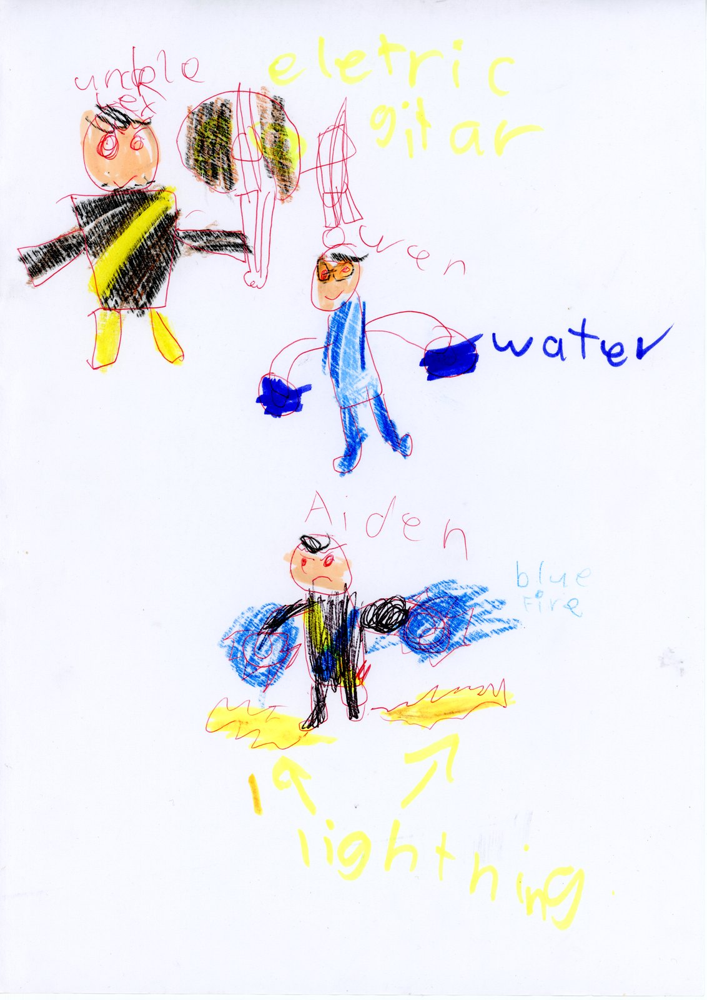 | 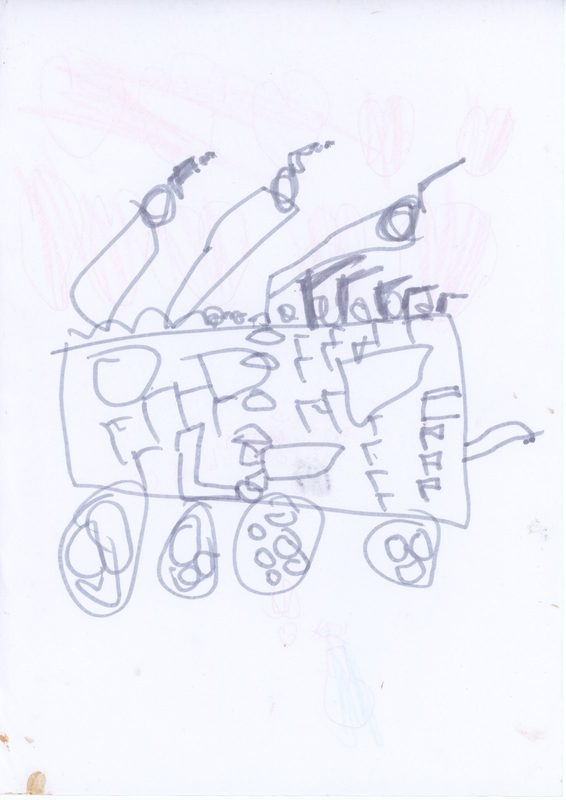 | 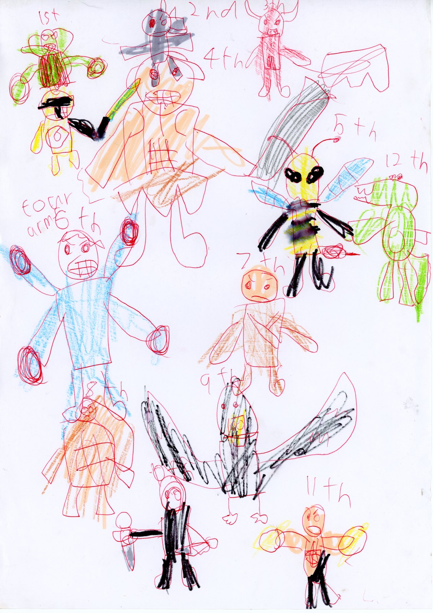 |

At the time, building an indie game from scratch was a pretty unreasonable ask for a birthday present, and I did warn him to temper his expectations. Still, I thought it would be a fun exercise to test the agentic tools at my disposal.

I shipped a first version for his birthday in June, mostly with Codex and GPT 5.5. It worked, but it wasn't worth playing for more than a couple of minutes.

Aiden was appreciative, but it clearly wasn't the game he'd imagined.

He gave me notes on what was missing, which I half-agreed to take on, but I was also kinda hoping he'd forget - I really didn't have time to make an indie game.

Unfortunately, he did not forget. Every time I saw him, he asked about the game.

## Enter: Opus 5.5

I was lucky enough to get an early look at Opus 5.5, and was told to try it on "my most ambitious use case". Finishing this game immediately sprang to mind.

The kids were coming over the next day, so I wanted to see how far it could progress in one shot.

Before bed, I let it rip with this prompt:

> I want you to help me finish this game. Make it as fun as possible. It should be similar to a modern-day Ninja Turtles arcade game. An action-packed beat 'em up.
>
> Make the graphics amazing. You can use OpenAI's ChatGPT Images 2.5 for images. And ElevenLabs for sound effects. OpenAI key is /path/to/openai-key. ElevenLabs key is /path/to/elevenlabs-key
>
> You can redo any characters. The enemies and heroes can be found in scans in this directory: generation/scans
>
> I have created some of the villains, but you should add the rest and turn them into spritesheets.
>
> Use any assets you find online. Create new sprites for the henchmen. Create backgrounds and power-ups in the levels. If possible, I'd like to plug in a controller to allow 2 people to play.
>
> Use your own judgment - main goal is to make it similar to TMNT - and other classic beat 'em ups like Streets of Rage.
>
> Make it one of the best games you can possibly make. You are a truly world-class game developer. Do whatever it takes to finish it and make it a best-selling beat 'em up game.
>
> Commit as you go. Don't worry about destroying what exists. Start fresh where it makes sense.

When I woke up, the game was waiting for me.

And I couldn't believe my eyes!

Opus had generated a game that was fun. Like, a lot of fun. And there were just so many unexpected details that I hadn't asked for: power-ups, cutscenes, crates to smash and even an ending.

It threw away most of my code and rewrote the game. It generated roughly 175 images and 140 audio clips.

Reviewing the reasoning traces, I noted that it had written a bot to play the game, run it through all twelve stages in a headless browser, to check screenshots for problems. 

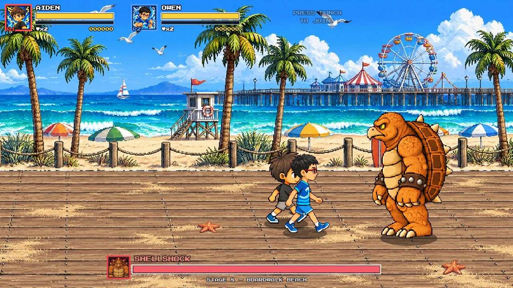

## Play testing

Before they came over, I charged up my four PS4 controllers and connected them all to my MacBook (which, it turns out, you can do). They worked perfectly.

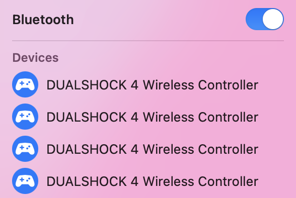

When they arrived, Aiden was absolutely delighted. "It's exactly as I imagined," he squealed.

| The afternoon shift                                                                                          | Hulk Owen takes on Shellshock                                                                                                       | Everyone in                                                                                           |
| ------------------------------------------------------------------------------------------------------------ | ----------------------------------------------------------------------------------------------------------------------------------- | ----------------------------------------------------------------------------------------------------- |
| 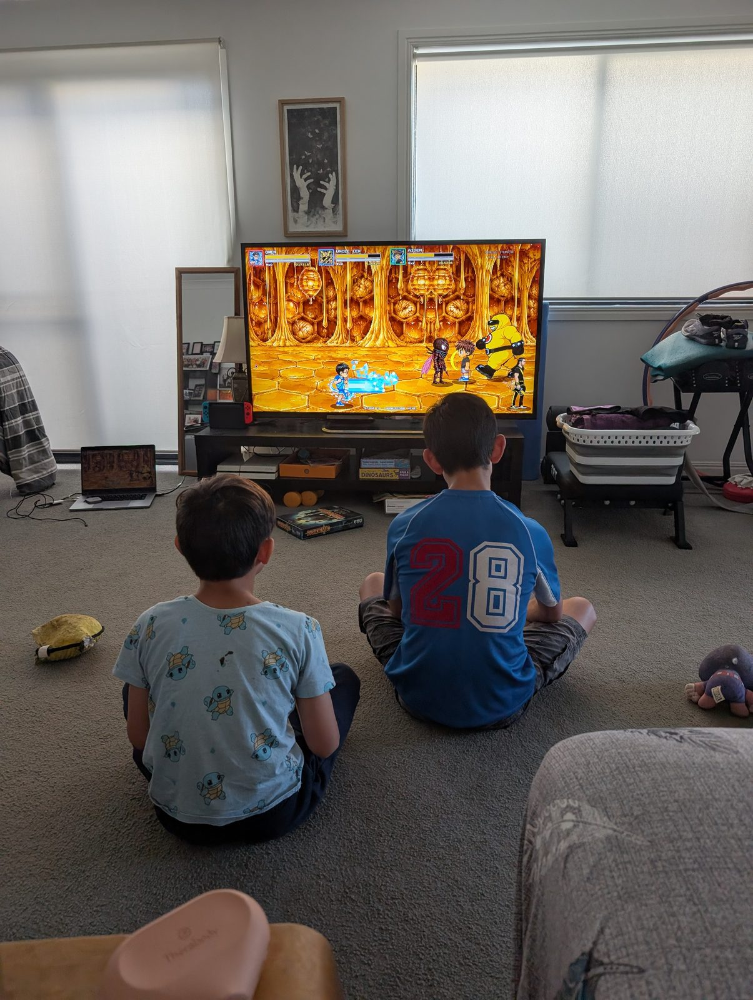 | 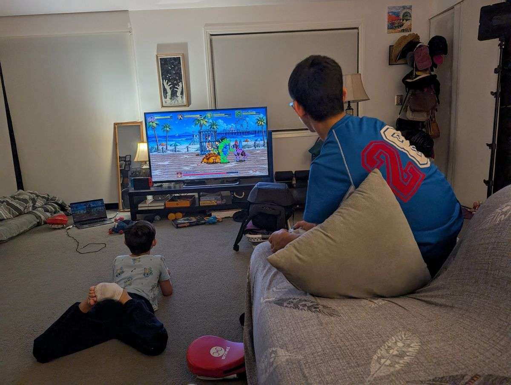 | 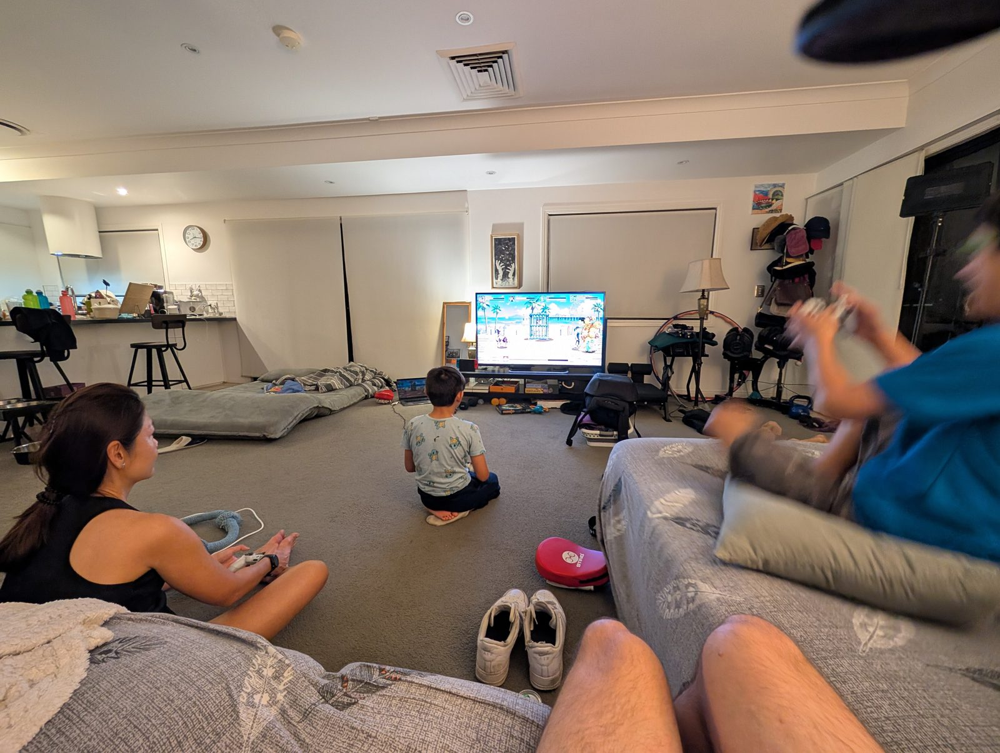 |

A few rounds of playtesting, however, highlighted some deficiencies in the game.

First, my older nephew, Owen, felt his character lacked a Hulk Smash move. Aiden had already put a lot of thought into Owen's character water power, based on Owen's favourite T-shirt. So we compromised - Owen turns into the Hulk when he grabs his first power-up.

Opus made the change, with a special case for this character, and Owen was very happy with the results.

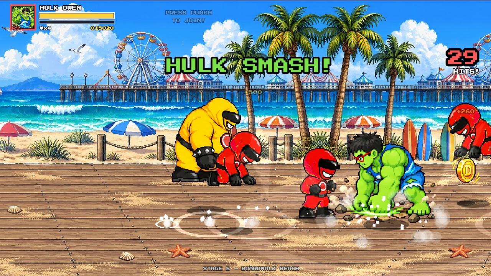

Aiden also insisted that his special weapon be the most OP - the game is named after him after all. Opus obliged.

Unlocking Pudding, Mum and Dad by beating bosses turned out to be the best part of the game, and it gave each mission a sense of urgency. So we added more family: his uncles, aunties, grandma, grandpa and great-grandma. For each one, I just gave Opus a few photos for reference and the special move Aiden picked. When he couldn't decide, he had us call them up in Penang and ask what they wanted.

Each time we added someone, Opus redrew the cutscene art and updated the story.

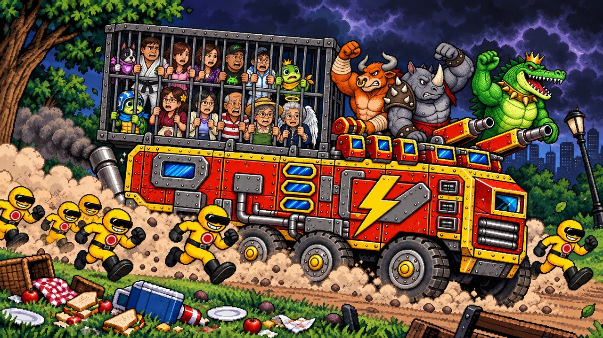

| Ah Gong's Card Storm                                                                           | Ahma's Super Bloom                                                                                         | Uncle Kev's Cheat Code                                                                                   |
| ---------------------------------------------------------------------------------------------- | ---------------------------------------------------------------------------------------------------------- | -------------------------------------------------------------------------------------------------------- |
| 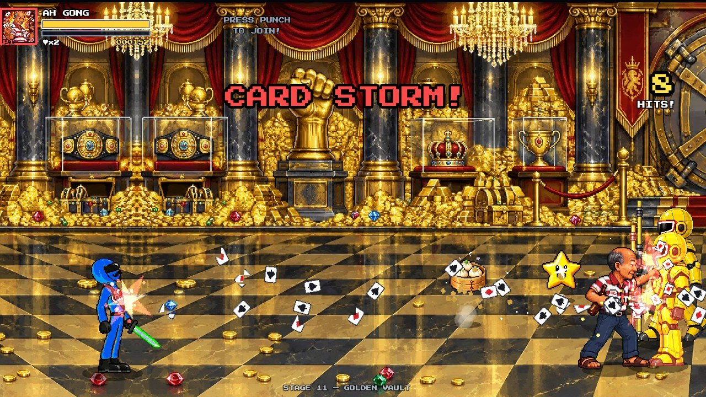 | 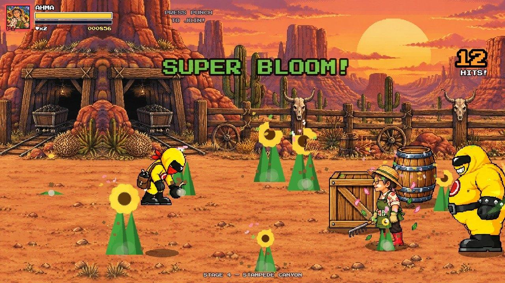 | 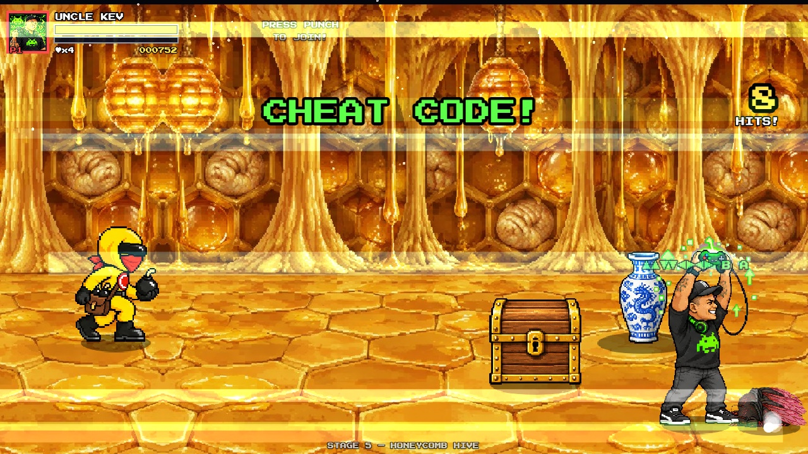 |

On top of human family members, they decided that their pet turtles, Goldie and Billy should be in the game as unlockable characters. Goldie wears a crown. Billy started out in a cowboy hat, which Aiden vetoed, so now he has purple eyes and a racing helmet.

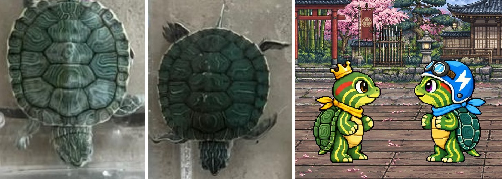

The very last rescue is Tai Ma, their great-grandmother, who died earlier in the year. She's an angel sensei with a walking stick, and her super heals the whole team.

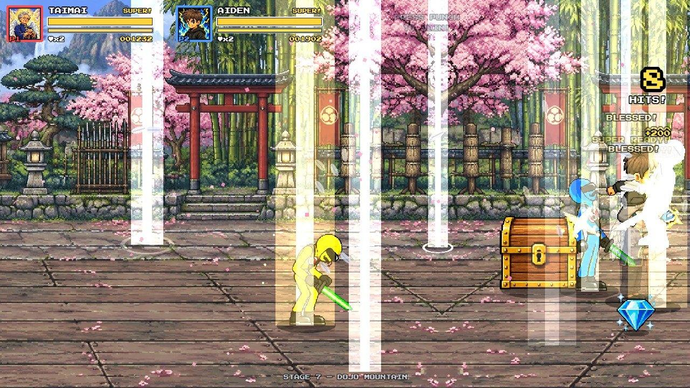

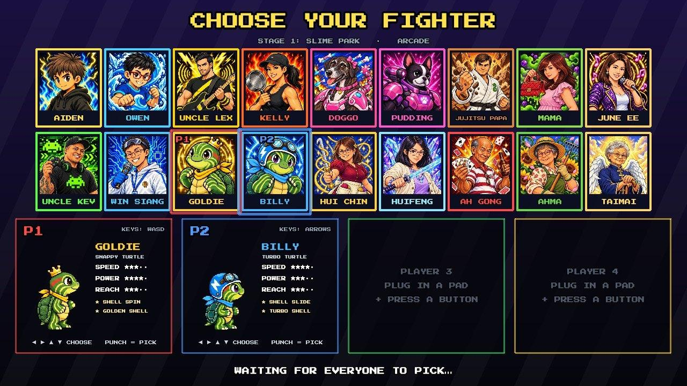

*Five heroes became eighteen.*

## The drawings and the game

Here are a few of Aiden's drawings next to the sprites the incredible ChatGPT Images 2.5 made from them.

**Uncle Lex**: "eletric gitar".

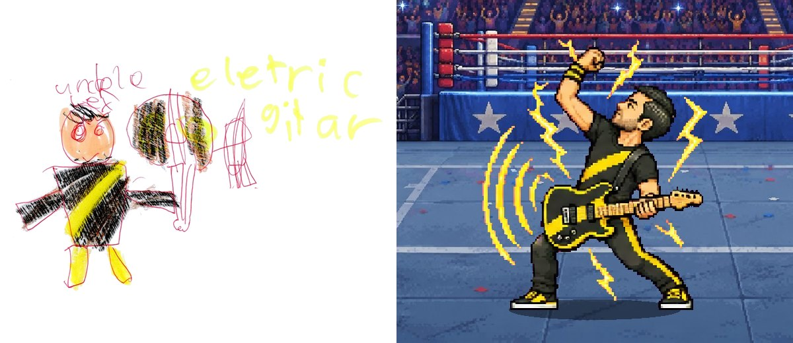

**Doggo**: she bites, and the spiky tail is her kick.

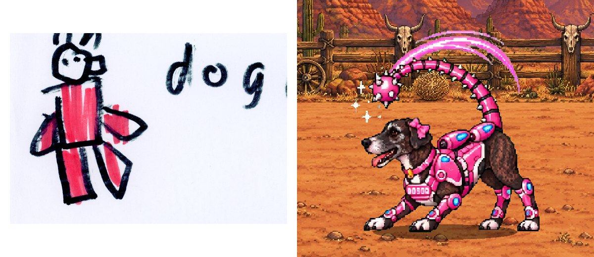

**The Battle Wagon**: the villains steal it, which kicks off the whole game. It's also a power-up: grab the horn and it drives across the screen, flattening everything.

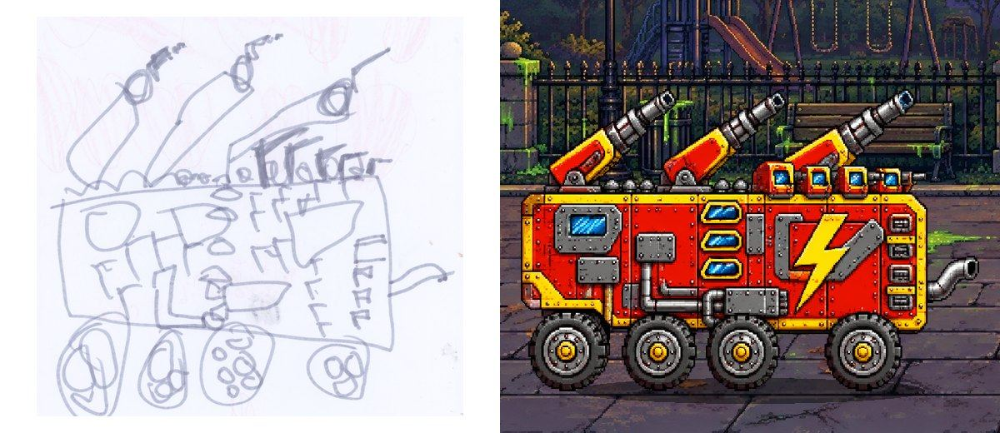

**8th: Shellshock**. Aiden numbered his villains 1st to 12th, and the game uses that as the boss order.

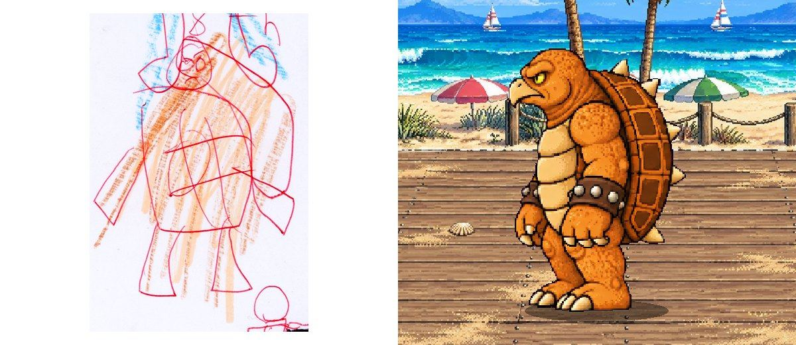

## What it used

The final token tally looked something like this:

| | What was used |
| --- | --- |
| Claude | roughly 600 requests over two days: about 320M tokens read from cache, 19M written to cache, 1M output |
| OpenAI images | about 500 images: sprite sheets, character designs, portraits, backgrounds and key art |
| ElevenLabs | 11 music tracks, about 100 sound effects and 90 announcer lines |

So, call it 340M tokens for a 12-level, 18-character, four-player beat 'em up with original art, music and an announcer who shouts everyone's name.

---

This is a pretty wild milestone - Opus is capable of making *fun* games in one shot.
