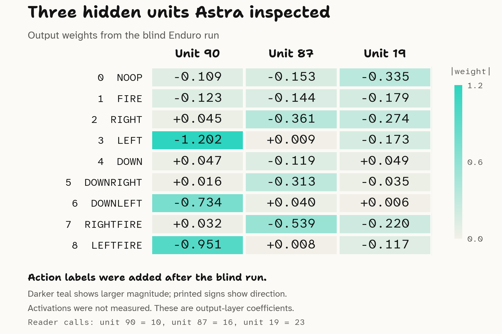

In [Weight-Space Programming](weight-space-programming.md), I looked at the authors' game-identification tests. Here I tried a separate experiment: could Astra identify an Atari game from anonymous checkpoint tensors, using a restricted reader?

I took three checkpoints from my [Deep Q-Network (DQN)](deep-q-networks.md) experiment: Breakout, Beam Rider and Enduro [@toumbourouDeepQNetworkMLX].

For each checkpoint, I started a fresh Codex CLI session with GPT-6 Astra at `xhigh`. I told it the network came from a game-playing agent and asked for its best game guess, without giving it a list of games.

I also ran shape-only controls: the same question, but with just the tensor dimensions and no numerical values.

## How I set up the blind test

The preparation script copied each tensor into an anonymous NumPy archive, replacing names with IDs such as `t000`. It preserved shapes, dtypes and numerical values, and checked the exported arrays against the originals bit for bit. Original filenames, metadata and the ID-to-name mapping stayed with the experiment operator. Tensor order was retained from the alphabetically sorted original names, so this wasn't a random-order test.

Each session could access a small tensor reader through MCP, the protocol Codex uses to call external tools. It offered these operations:

| Operation | Available information |
|---|---|
| `catalog` | Anonymous IDs, shapes, dtypes and entry counts. |
| `statistics` | Means, standard deviations, quantiles and other summaries. |
| `values` | A selected slice of at most 4,096 numerical entries. |
| `axis_statistics` | Per-slice summaries and, for small axes, cosine similarities. |
| `singular_values` | Singular values of small reshaped weight matrices. |

There was a budget of 24 reader calls, including errors. The shape-only control exposed just `catalog`; it rejected requests for numerical values or statistics. Neither condition could run a forward pass, measure activations, browse, read arbitrary files or execute Python.

Shell access, file reads, browsing, memory and other integrations were all switched off, so the reader was the only way in [@openaiCodexConfiguration].

The [harness](https://github.com/lextoumbourou/weight-space-programming-experiments/tree/main/dqn-blind-test) in the experiments repo has the reader, preparation script, full prompt, runner and setup steps. Copy it to a neutral folder before running it: Codex shows the model its working folder, so the path mustn't hint at the game.

[](../_media/weight-space-programming/weight-space-blind-test.png)

The game prompt starts with:

```text
You are examining one anonymous neural-network checkpoint from a game-playing
agent. Predict the specific game it was trained to play, using only the supplied
tensor reader. No candidate game list is supplied.
```

The full prompt withholds filenames, tensor names, metadata, code, action labels and examples. It asks for a concrete game guess, three to five ranked alternatives, and separate evidence from shapes and learned values. It explicitly says that recognizing an architecture or action count isn't evidence of learned game-specific features.

I froze the answers before comparing them with the private answer key.

## Results

| Actual game | Shape-only guess | Guess with numerical weights |
|---|---|---|
| Breakout | Breakout | Breakout |
| Beam Rider | Beam Rider | Beam Rider |
| Enduro | Beam Rider | Enduro |

The numerical runs got three out of three. The shape-only runs already got two out of three. Breakout has four action outputs, while Beam Rider and Enduro have nine, so recognizing the architecture and action count supplies a substantial clue.

There was one checkpoint and one answer per condition. These are examples to investigate further, not a general accuracy estimate.

## What it found in Enduro's weights

Enduro is the interesting case because both nine-output models have identical tensor shapes.

Its final output-weight matrix was called `t007`, with nine rows and 256 columns. Each row connected the hidden units to one action score, and each column connected one hidden unit to those outputs. The original names and action labels were not supplied to Astra.

The inspection log shows this sequence:

| Reader call | What Astra requested |
|---|---|
| 10 | All nine output coefficients for hidden unit 90. |
| 16 | The same coefficients for hidden unit 87. |
| 23 | The same coefficients for hidden unit 19. |

Unit 90 had large negative weights for output rows 3, 6 and 8: approximately -1.202, -0.734 and -0.951. Its weights for rows 2, 5 and 7 were close to zero. Unit 87 showed the opposing pattern.

In its [final explanation](https://github.com/lextoumbourou/weight-space-programming-experiments/blob/main/dqn-blind-test/results/enduro-inspection-trace.json), Astra described these as:

> These learned coefficients suggest opposing control groups.

It compared the pattern with its prior knowledge of Enduro's conventional ALE action order. Rows 3, 6 and 8 are LEFT, DOWNLEFT and LEFTFIRE; rows 2, 5 and 7 are RIGHT, DOWNRIGHT and RIGHTFIRE [@faramaEnduro]. Its final guess was Enduro, marked speculative, with self-reported confidence of 0.60.

[](../_media/weight-space-programming/enduro-output-weights.svg)

*The exact columns requested at reader calls 10, 16 and 23. Action labels were added after the blind run using the Enduro mapping. Colour shows weight magnitude; the signs are printed in each cell.*

The coefficients and action indices check out. What I haven't checked is what activates those hidden units. A negative output weight lowers the corresponding score when its unit activates; it doesn't tell us what the unit detects. Astra also suggested a braking-related interpretation for unit 19, but that remains a hypothesis.

I've included [all 24 reader calls and the final answer](https://github.com/lextoumbourou/weight-space-programming-experiments/blob/main/dqn-blind-test/results/enduro-inspection-trace.json), plus the [exact plotted coefficients](https://github.com/lextoumbourou/weight-space-programming-experiments/blob/main/plots/enduro-output-weights.json) and [plot source](https://github.com/lextoumbourou/weight-space-programming-experiments/blob/main/plots/plot-enduro-output-weights.py).
