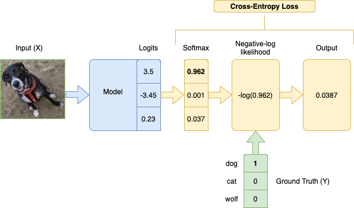

Categorical Cross-Entropy Loss Function, also known as Softmax Loss, is a [Loss Function](loss-function.md) used in multiclass classification model training. It applies the [Softmax Function](softmax-function.md) to a model's output (logits) before applying the [Negative Log-Likelihood](negative-log-likelihood.md) function.

Lower loss means closer to the ground truth.

In math, expressed as

$$P = \text{softmax}(O)$$

$$-\sum\limits_{i=1}^{N} Y_{i} \times \log(P_{i})$$

where $N$ is the number of classes, $Y$ is the ground truth labels, and $O$ is the model outputs. Since $Y$ is one-hot encoded, the labels that don't correspond to the ground truth will be multiplied by 0, so we effectively take the log of only the prediction for the true label.



In the PyTorch implementation, the index of the ground truth label is passed instead of one-hot encoded $Y$ vector.

```python
import torch
from torch import nn, tensor

torch.set_printoptions(sci_mode=False)

dog_class_index = 0

label = tensor([dog_class_index])
logits = tensor([[3.5, -3.45, 0.23]])

nn.CrossEntropyLoss()(logits, label)
```
<!-- nb-output hash="9522f3ccc33e3ad7" format="html" -->
<div class="nb-output">
<pre class="nb-stream-stdout">tensor(0.0382)
</pre>
</div>
<!-- /nb-output -->

We can also achieve the same result by manually calling softmax and negative-log loss.

```python
softmax_probs = nn.Softmax(dim=1)(logits)
softmax_probs
```
<!-- nb-output hash="61bc27e33195892d" format="html" -->
<div class="nb-output">
<pre class="nb-stream-stdout">tensor([[0.9625, 0.0009, 0.0366]])
</pre>
</div>
<!-- /nb-output -->

```python
-torch.log(softmax_probs[:,label])
```
<!-- nb-output hash="f328635f6a22b629" format="html" -->
<div class="nb-output">
<pre class="nb-stream-stdout">tensor([[0.0382]])
</pre>
</div>
<!-- /nb-output -->
Based on [Cross-Entropy](cross-entropy.md) in Information Theory, which is a measure of difference between 2 probability distributions.

[@howardDeepLearningCoders2020] *(pg. 222-231)*
