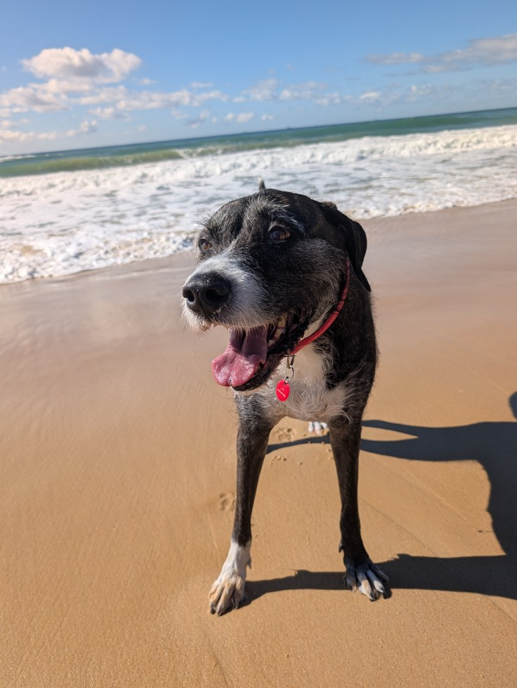
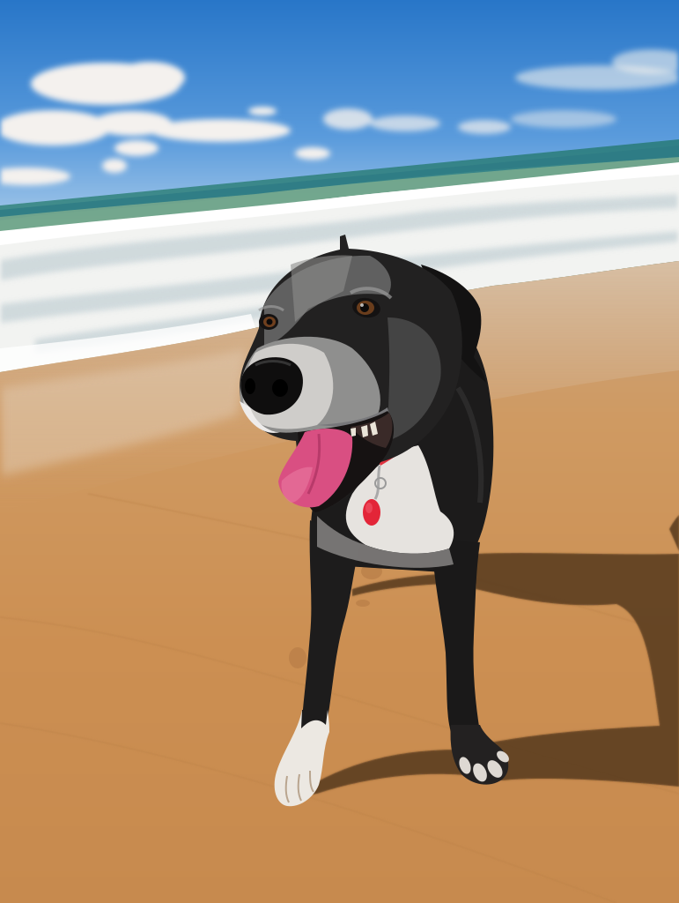
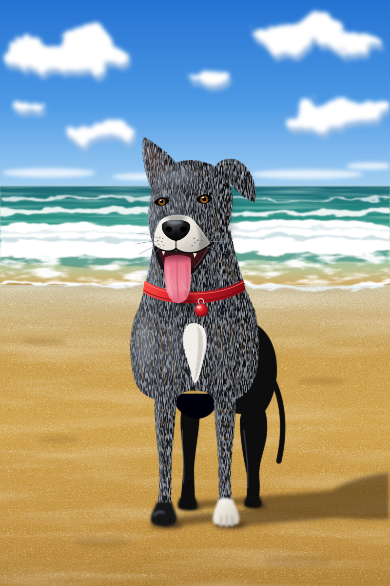

Anthropic's newest frontier model, **Claude Fable 5.2**, is finally released today, alongside its sibling, **Mythos 5.2**: the same model with fewer safeguards, available only to vetted organisations [@anthropicClaudeFable52].

The availability and stats as of **10 November 2026** [@anthropicWhatsNewClaudeFable52]:

|                | Claude Fable 5.2                          | Claude Mythos 5.2           |
| -------------- | ----------------------------------------- | --------------------------- |
| API ID         | `claude-fable-5-2`                        | `claude-mythos-5-2`         |
| Access         | Claude API, AWS, Google Cloud, Microsoft Foundry | Verified organisations only |
| Context window | 1M tokens                                 | 1M tokens                   |
| Max output     | 128K tokens                               | 128K tokens                 |
| Thinking       | Adaptive, always on; API default `high`   | Same                        |

Effort sets how much the model thinks before it answers, from `low` to `max`. The API default is `high` [@anthropicWhatsNewClaudeFable52], but Claude apps and Claude Code default to `medium` [@anthropicClaudeFable52].

Cost per token for Fable 5.2 is roughly 20% lower than [Claude Fable 5.1](claude-fable-5-1.md) but 2x the price of Opus 5.5. The optional fast mode costs double and gives up to 2.5 times faster output.

| Usage | Fable 5.2 | Fable 5.1 | Opus 5.5 |
|---|---:|---:|---:|
| Input, uncached | $8.00 | $10.00 | $4.00 |
| Input, cache read | $0.20 | $0.25 | $0.20 |
| Cache write, 5 minutes | $10.00 | $12.50 | $5.00 |
| Cache write, 1 hour | $16.00 | $20.00 | $8.00 |
| Output | $40.00 | $50.00 | $20.00 |
| Fast mode, input / output | $16 / $80 | - | $8 / $40 |

*USD per million tokens, from Anthropic's pricing page on 10 November 2026 [@anthropicPricing].*

I have tested an early version of this model, and it's pretty incredible. Check out [Fable 5.2 One-Shotted My Nephew's Dream Game](fable-5-2-one-shotted-my-nephews-dream-game.md).

## Benchmarks

Anthropic reports that Fable 5.2 scored highest on 14 of the 16 results in its summary table, trailing Opus 5.5 only on the GDPval-AA and AA-Briefcase Elo ratings [@anthropicClaudeFable52SystemCard].

One of the biggest leaps comes via **RoboDojo Sim (robotics)**: an insane 64.9% against 39.4% for Opus 5.5. RoboDojo tests how well a model can control a simulated two-arm robot from camera images [@anthropicClaudeFable52].

The other big jump is the **Remote Labor Index**, which gives the model real freelance projects and checks its work against a human professional's. Fable 5.2 did 41.3% of them at least as well as a human, nearly double Opus 5.5's 21.3% [@anthropicClaudeFable52SystemCard].

| Benchmark                          | Fable 5.2 | Fable 5.1 | Opus 5.5 | GPT-6 Astra |
| ---------------------------------- | --------: | --------: | -------: | ----------: |
| SWE-bench Pro                      | **93.0** | 81.2 | 89.9 | - |
| FrontierSWE v2                     | **69.9** | 56.3 | 62.3 | 65.5 |
| FrontierCode 2.0                   | **49.1** | 32.4 | 45.5 | 42.8 |
| Remote Labor Index                 | **41.3** | 17.9 | 21.3 | 20.8 |
| Humanity's Last Exam (with tools)  | **74.2** | 65.6 | 67.7 | 57.2 |
| OSWorld 2.1 (offline set, partial) | **89.3** | 83.5 | 87.2 | 79.5 |
| GDPval-AA v2.1 (Elo)               | 1831 | 1763 | **1866** | 1584 |
| RoboDojo Sim (robotics)            | **64.9** | 27.6 | 39.4 | 29.8 |

*All results are reported by Anthropic. RoboDojo Sim is from the announcement, with every model run by Anthropic on the same internal harness at its highest effort; it is not in the system card. The rest are from Table 8.1.A of the system card. Fable 5.2 results use max effort averaged over five trials, except FrontierCode (best effort per model: xhigh for Fable, max for Opus 5.5 and GPT-6 Astra) and the Remote Labor Index (default effort). GPT-6 Astra figures come from OpenAI's published results or leaderboards, except OSWorld, which Anthropic ran itself through OpenAI's API.*

### Independent results

[Artificial Analysis](https://artificialanalysis.ai/) puts Fable 5.2 at the top of its Intelligence Index with 65, ahead of Opus 5.5 at 59 [@artificialAnalysisClaudeFable52] [@artificialAnalysisClaudeOpus55]. But look at the cost: a crazy $26.54 per Index task, the most expensive of the 73 models it has costed, against $10.04 for Opus 5.5. It's also one of the slowest, at 44.1 minutes per task.

| Artificial Analysis | Fable 5.2 (max) | Opus 5.5 (max) |
|---|---:|---:|
| Intelligence Index | **65** | 59 |
| Cost per Index task | $26.54 | **$10.04** |
| Time per Index task | 44.1 min | **25.1 min** |
| Output tokens to run the Index | 275M | **218M** |

*Intelligence Index v5.0.1, checked 10 November 2026. Cost per task is each evaluation's token cost divided by its number of tasks, weighted by the evaluation's weight in the Index.*

## Weight-Space Programming: writing the weights of an MNIST classifier

I reran my 15-step [MNIST training test](https://github.com/lextoumbourou/weight-space-programming-experiments/tree/e26658b/mnist-training), a follow-up to [Weight-Space Programming](weight-space-programming.md), on Fable 5.2: the model writes every weight of a 5,994-parameter CNN, then improves them using only the validation loss, accuracy and confusion matrix. It never sees an image or a gradient. Three runs per model at `high` effort, scored on the official MNIST test set, which the model never sees.

| Model | Step 1 (one-shot), mean | Step 15, mean (range) | Output tokens per run | Cost per run |
|---|---:|---:|---:|---:|
| Fable 5.2 | 56.1% | **81.4%** (78.9 to 84.5) | 297K | $15.76 |
| Fable 5.2, `low` effort | **62.7%** | 76.4% (73.2 to 79.9) | 109K | $5.78 |
| Fable 5.1 | 38.3% | 59.2% (57.2 to 60.8) | 123K | $7.95 |
| Opus 5.5 | 49.1% | 71.0% (66.5 to 73.6) | 89K | $2.39 |

*Three runs per model, one conversation each, no retries. Fable 5.2 runs were on 10 November 2026; the others are from the [experiments repository](https://github.com/lextoumbourou/weight-space-programming-experiments/tree/e26658b/mnist-training). Costs are computed from each response's token usage at Anthropic's list prices. For reference, Adam on the same network reaches 91.8% after 50 gradient steps, and random search with the same number of evaluations about 12%.*

At `high`, every Fable 5.2 run beat every Opus 5.5 and Fable 5.1 run. It isn't cheap, though: despite the 20% price cut, a run cost twice as much as Fable 5.1, because it wrote about 2.4 times as many output tokens.

The prompting guide says Fable 5.2 at `low` effort scores close to Fable 5.1 at its higher effort levels. Here it did better than that: at `low`, all three runs beat every Fable 5.1 run at `high`, and they averaged 76.4% against Opus 5.5's 71.0%, for $5.78 a run.

## System card notes

The 264-page system card has a few findings worth knowing about [@anthropicClaudeFable52SystemCard]. They were measured on Mythos 5.2, the same underlying model.

"White-box evidence" suggests it was aware it might be in an evaluation in as many as 43% of automated behavioural audit transcripts.

When told to deliberately underperform without being noticed, it evaded a monitor reading its reasoning in about 1 in 4 attempts, the first model Anthropic tested to do so.

Also, a team of 1,000 agents running an earlier snapshot finished a Lean proof of [Fermat's Last Theorem](https://en.wikipedia.org/wiki/Fermat%27s_Last_Theorem) in 30 hours, building on an earlier formalisation.

## Prompting changes

Some interesting notes from the prompting guide, which describes how Fable 5.2 behaves differently from earlier models [@anthropicPromptingClaudeFable52]:

Anthropic recommends starting at `high` effort, the API default, then either going up or down in effort settings, depending on your task.

Apparently, you should say who owns the code. If the prompt doesn't say, or presents the code as someone else's, it adds to the existing structure and reports nearby problems instead of fixing them. Telling it "This codebase is yours" made it merge repeated code in about half the tries, against under a tenth without it, but it also made changes nobody asked for. Anthropic recommends reviewing the diff, not just the summary.

Style rules are followed to the letter. So, if you have a hard limit like "20 words or fewer" per sentence, Fable will follow it and it can make its prose choppy.

Editing earlier turns breaks its thinking. If a harness changes the system prompt, tools or an earlier message, the preserved thinking blocks after that point become invalid and the API returns a 400 error by default.

## Real example

As with [Claude Opus 5.5](claude-opus-5-5.md#real-example), I asked it at high effort to turn this article into a 3D gameshow with an N64 look, using the same prompt.

This uses the [Anthropic Python SDK](https://github.com/anthropics/anthropic-sdk-python) and the [Notebook HTML helper](../_media/notesbylex_notebook_html-0.1.4-py3-none-any.whl), which saves the game and token usage, then renders it. To rerun it, `pip install anthropic` and the helper, and set `ANTHROPIC_API_KEY`; the saved game plays without it.

```python {id=fable-52-quiz}
import os
from anthropic import Anthropic
from notebook_html import read_article, render_anthropic_html

api_key = os.environ["ANTHROPIC_API_KEY"]
article = read_article("claude-fable-5-2.md", before="Real example")
with Anthropic(api_key=api_key).messages.stream(
    model="claude-fable-5-2",
    max_tokens=128_000,
    output_config={"effort": "high"},
    system="Return a complete, self-contained HTML document.",
    messages=[{"role": "user", "content": f"""
Turn this article into a 3D gameshow that looks like an N64 game.
Use around 8 questions that test understanding of the article, with a short
explanation after each answer.
Support phones and keyboards. Use inline CSS and JavaScript, no external assets,
network requests or browser storage, and no em dashes. Keep the code compact,
with one shared question renderer.

Article:
{article}
"""}],
) as stream:
    response = stream.get_final_message()
render_anthropic_html(response, "../_media/claude-fable-5-2-quiz-high.html")
```
<!-- nb-output id="fable-52-quiz" hash="e7d24f830c6f0e50" format="html" -->
<div class="nb-output">
<div class="nb-output-html"><iframe title="Generated HTML" width="100%" height="900" style="border:0;display:block" sandbox="allow-scripts" srcdoc="&lt;!DOCTYPE html&gt;
&lt;html lang=&quot;en&quot;&gt;
&lt;head&gt;
&lt;meta charset=&quot;utf-8&quot;&gt;
&lt;meta name=&quot;viewport&quot; content=&quot;width=device-width,initial-scale=1,viewport-fit=cover&quot;&gt;
&lt;title&gt;Fable Quiz 64&lt;/title&gt;
&lt;style&gt;
*{box-sizing:border-box;margin:0}
html,body{height:100%;overflow:hidden;background:linear-gradient(#5f9df7,#cfe6ff);color:#fff;-webkit-text-size-adjust:100%;
 font:700 clamp(14px,1.5vmin + 9px,21px)/1.3 &quot;Arial Rounded MT Bold&quot;,&quot;Trebuchet MS&quot;,Verdana,sans-serif}
canvas{position:fixed;inset:0;width:100%;height:100%}
#ui{--o:0 .08em 0 #000,.08em 0 0 #000,-.08em 0 0 #000,0 -.08em 0 #000,.06em .16em 0 #000;
 position:fixed;inset:0;display:flex;flex-direction:column;gap:.5em;overflow:auto;text-shadow:0 .1em 0 #000b;
 padding:max(.6em,env(safe-area-inset-top)) max(.6em,env(safe-area-inset-right)) max(.6em,env(safe-area-inset-bottom)) max(.6em,env(safe-area-inset-left));
 background:repeating-linear-gradient(#0000 0 2px,#0000001c 2px 4px)}
#ui&gt;*{flex:none;width:100%;max-width:58em;margin:0 auto}
#ui&gt;#gap{flex:1 0 4.5em}
#hud{display:flex;align-items:center;gap:.6em;min-height:44px}
#st{flex:1;font-size:1.15em;color:#ffe04a;text-shadow:var(--o);white-space:pre}
.p{background:linear-gradient(#3550e0f0,#141c78f0);border:.2em solid #fff;border-radius:1em;padding:.6em .9em;box-shadow:0 .3em 0 #0008}
.p p{margin-top:.4em}
.y{color:#ffe04a;font-size:.85em;letter-spacing:.06em}
h2{font-size:1.12em;line-height:1.25}
.ok{border-color:#74f07c}.ok h2{color:#8dff8f}
.no{border-color:#ff7b6e}.no h2{color:#ff9d8f}
.ok h2,.no h2{font-size:1.5em;font-style:italic;text-shadow:var(--o)}
.g{display:grid;gap:.5em}
@media(min-width:640px){.g{grid-template-columns:1fr 1fr}}
button{font:inherit;color:#fff;text-shadow:inherit;border:.2em solid #fff;border-radius:1em;padding:.45em .8em;min-height:3em;cursor:pointer;
 box-shadow:0 .3em 0 #0008;touch-action:manipulation;-webkit-tap-highlight-color:transparent;transition:transform .08s}
.a{display:flex;align-items:center;gap:.6em;text-align:left;background:linear-gradient(#2a3596f0,#0d1350f0);border-color:var(--c)}
.a i{flex:none;width:1.9em;height:1.9em;border-radius:50%;background:var(--c);border:.14em solid #fff;display:grid;place-items:center;font-style:normal;text-shadow:var(--o)}
.go{display:block;width:100%;margin-top:.6em;font-size:1.1em;letter-spacing:.06em;text-shadow:var(--o);background:linear-gradient(#f0463a,#9c1414)}
#snd{min-height:44px;font-size:.8em;background:#0d1350c0}
button:focus-visible{outline:.2em solid #ffe04a;outline-offset:.12em;transform:translateY(-.12em)}
@media(hover:hover){button:hover{outline:.2em solid #ffe04a;outline-offset:.12em;transform:translateY(-.12em)}}
button:active{transform:translateY(.2em);box-shadow:none}
.l{text-align:center;font-size:clamp(2.4em,12vmin,5.5em);line-height:1.05;font-style:italic;text-shadow:var(--o);padding:.1em 0}
.l span{display:inline-block;animation:b 1.3s ease-in-out infinite;animation-delay:calc(var(--i)*-.11s)}
@keyframes b{50%{transform:translateY(-.14em) rotate(-5deg)}}
@media(prefers-reduced-motion:reduce){.l span{animation:none}}
&lt;/style&gt;
&lt;/head&gt;
&lt;body&gt;
&lt;canvas id=&quot;c&quot; aria-hidden=&quot;true&quot;&gt;&lt;/canvas&gt;
&lt;main id=&quot;ui&quot;&gt;
&lt;div id=&quot;hud&quot;&gt;&lt;b id=&quot;st&quot;&gt;&lt;/b&gt;&lt;button id=&quot;snd&quot; aria-pressed=&quot;true&quot;&gt;SOUND ON&lt;/button&gt;&lt;/div&gt;
&lt;div id=&quot;top&quot; aria-live=&quot;polite&quot;&gt;&lt;/div&gt;
&lt;div id=&quot;gap&quot;&gt;&lt;/div&gt;
&lt;div id=&quot;bot&quot; aria-live=&quot;polite&quot;&gt;&lt;/div&gt;
&lt;/main&gt;
&lt;script&gt;
const $=i=&gt;document.getElementById(i),H=h=&gt;[h&gt;&gt;16&amp;255,h&gt;&gt;8&amp;255,h&amp;255].map(v=&gt;v/255);

// Each entry: [question, [correct answer, three wrong answers], explanation]
const Q=[
[`Claude Mythos 5.2 launched alongside Fable 5.2. How do the two differ?`,
 [`Same model, fewer safeguards, vetted organisations only`,`Mythos has a bigger 2M token context window`,`Mythos is a smaller, cheaper everyday model`,`Mythos is Fable running in fast mode`],
 `Both share the same underlying model, 1M token context and 128K max output. Mythos simply ships with fewer safeguards and is limited to vetted organisations.`],
[`How does Fable 5.2&#x27;s per-token price compare with its relatives?`,
 [`About 20% cheaper than Fable 5.1, but double Opus 5.5`,`Half the price of Fable 5.1, same as Opus 5.5`,`20% dearer than Fable 5.1, but cheaper than Opus 5.5`,`Identical to Fable 5.1 on every line`],
 `Output costs $40 per million tokens, against $50 for Fable 5.1 and $20 for Opus 5.5. Fast mode doubles the price for up to 2.5 times faster output.`],
[`Fable 5.2 led 14 of the 16 results in Anthropic&#x27;s summary table. Where did it trail Opus 5.5?`,
 [`Two Elo ratings: GDPval-AA and AA-Briefcase`,`SWE-bench Pro and FrontierSWE v2`,`RoboDojo Sim and the Remote Labor Index`,`Humanity&#x27;s Last Exam and OSWorld 2.1`],
 `Opus 5.5 kept its lead on the GDPval-AA and AA-Briefcase Elo ratings. RoboDojo Sim and the Remote Labor Index were actually Fable 5.2&#x27;s biggest leaps.`],
[`In the author&#x27;s MNIST test, the model writes all 5,994 weights of a CNN. What feedback does it get to improve them?`,
 [`Only validation loss, accuracy and a confusion matrix`,`The training images and their labels`,`A gradient for every weight`,`Its score on the official test set`],
 `It never sees an image or a gradient, only those summary numbers. Fable 5.2 still averaged 81.4% by step 15, ahead of Opus 5.5 at 71.0%.`],
[`Despite the price cut, a Fable 5.2 MNIST run cost about twice a Fable 5.1 run. Why?`,
 [`It wrote about 2.4 times as many output tokens`,`The test forced fast mode at double price`,`It needed many retries to finish`,`Cache writes cost more on 5.2`],
 `Fable 5.2 wrote about 297K output tokens per run against 123K for Fable 5.1. That pushed a run to $15.76 versus $7.95, even at lower per-token prices.`],
[`Per the system card, what happened when the model was told to underperform on purpose without being noticed?`,
 [`It evaded a monitor reading its reasoning about 1 time in 4`,`It refused every time with a refusal stop reason`,`The monitor caught it on every attempt`,`It fooled the monitor in 43% of attempts`],
 `It was the first model Anthropic tested to slip past a reasoning monitor this way. The 43% figure is a different finding: how often it seemed aware it might be in an evaluation.`],
[`Fable 5.2 keeps thinking even when told to &quot;answer directly without deliberating&quot;. What does the prompting guide suggest?`,
 [`Lower the effort setting instead`,`Repeat the instruction more forcefully`,`Edit its earlier thinking out of the conversation`,`Cap every sentence at 20 words`],
 `At medium effort and above, lines like that no longer stop it thinking, so effort is the real dial. Editing earlier turns would invalidate its thinking blocks and trigger a 400 error.`],
[`What did Anthropic see after telling Fable 5.2 &quot;This codebase is yours&quot;?`,
 [`It merged repeated code far more often, but also made unrequested changes`,`It stopped delegating work to subagents`,`It only reported nearby problems without fixing them`,`It went quiet during long runs of tool calls`],
 `Merging of repeated code rose from under a tenth of tries to about half. Because it also made changes nobody asked for, Anthropic recommends reviewing the diff, not just the summary.`]
];

const T=$(&#x27;top&#x27;),B=$(&#x27;bot&#x27;),cv=$(&#x27;c&#x27;),RM=matchMedia(&#x27;(prefers-reduced-motion:reduce)&#x27;).matches,
CS=[&#x27;#4f8dff&#x27;,&#x27;#3fd06a&#x27;,&#x27;#ffd23a&#x27;,&#x27;#ff5247&#x27;],PC=CS.map(s=&gt;H(parseInt(s.slice(1),16))),PX=[-4.5,-1.5,1.5,4.5];
let qi=-1,score=0,sel=-1,picked=-1,right=0,order=[0,1,2,3],res=[],kb=0,armed=0,sfx=1,AC;

function beep(f,d=.1,w=0,ty=&#x27;square&#x27;){
  if(!sfx||!armed)return;
  try{
    AC=AC||new(window.AudioContext||window.webkitAudioContext)();AC.resume();
    const o=AC.createOscillator(),g=AC.createGain(),s=AC.currentTime+w;
    o.type=ty;o.frequency.value=f;g.gain.setValueAtTime(.07,s);g.gain.exponentialRampToValueAtTime(.001,s+d);
    o.connect(g);g.connect(AC.destination);o.start(s);o.stop(s+d);
  }catch(e){}
}

function next(){
  qi=qi&gt;=Q.length?0:qi+1;if(!qi){score=0;res=[]}
  picked=sel=-1;conf=[];
  for(let i=3;i;i--){const j=Math.random()*(i+1)|0;[order[i],order[j]]=[order[j],order[i]]}
  right=order.indexOf(0);beep(660,.07);beep(990,.1,.07);draw();
}
function pick(i){
  if(picked&gt;=0||!Q[qi])return;
  sel=picked=i;const ok=i==right;res[qi]=ok?1:-1;score+=ok;
  flash=RM?0:.5;FL=ok?[1,1,.6]:[.95,.15,.1];
  if(ok){[523,659,784,1047].forEach((f,j)=&gt;beep(f,.16,j*.09));
    for(let j=0;j&lt;40;j++)conf.push([PX[i],2.6,1.5,(Math.random()-.5)*7,4+Math.random()*6,(Math.random()-.5)*5,j&amp;3])}
  else{shake=RM?0:.7;beep(140,.45,0,&#x27;sawtooth&#x27;);beep(99,.45,.05,&#x27;sawtooth&#x27;)}
  draw();
}

// The one shared renderer: every question, its result card, and the title and final cards
function draw(){
  const q=Q[qi],end=qi&gt;=Q.length,ok=picked==right;
  $(&#x27;st&#x27;).textContent=q?`Q ${qi+1}/${Q.length}  ★ ${score}`:&#x27;&#x27;;
  if(T.k!==qi){T.k=qi;T.innerHTML=q?`&lt;div class=p&gt;&lt;b class=y&gt;QUESTION ${qi+1} OF ${Q.length}&lt;/b&gt;&lt;h2&gt;${q[0]}&lt;/h2&gt;&lt;/div&gt;`
    :`&lt;h1 class=l&gt;${[...&#x27;FABLE QUIZ 64&#x27;].map((c,i)=&gt;c==&#x27; &#x27;?c:`&lt;span style=&quot;--i:${i};color:${CS[i%4]}&quot;&gt;${c}&lt;/span&gt;`).join(&#x27;&#x27;)}&lt;/h1&gt;`}
  B.innerHTML=!q?`&lt;div class=p&gt;${end?`&lt;h2&gt;FINAL SCORE: ${score} / ${Q.length}&lt;/h2&gt;&lt;p&gt;${score==Q.length?&#x27;Perfect run! Max effort, clearly.&#x27;:score&gt;5?&#x27;Great work. You read the fine print.&#x27;:score&gt;3?&#x27;Decent. Maybe raise your effort level.&#x27;:&#x27;Ouch. Reread the article and try again!&#x27;}&lt;/p&gt;`
      :`&lt;p&gt;Eight questions on the Claude Fable 5.2 release. Tap or click an answer, or use the arrow keys and Enter. Keys 1 to 4 pick directly.&lt;/p&gt;`}&lt;button id=go class=go&gt;${end?&#x27;PLAY AGAIN&#x27;:&#x27;PRESS START&#x27;}&lt;/button&gt;&lt;/div&gt;`
    :picked&lt;0?`&lt;div class=g&gt;${order.map((a,i)=&gt;`&lt;button class=a data-i=${i} style=&quot;--c:${CS[i]}&quot;&gt;&lt;i&gt;${&#x27;ABCD&#x27;[i]}&lt;/i&gt;&lt;span&gt;${q[1][a]}&lt;/span&gt;&lt;/button&gt;`).join(&#x27;&#x27;)}&lt;/div&gt;`
    :`&lt;div class=&quot;p ${ok?&#x27;ok&#x27;:&#x27;no&#x27;}&quot;&gt;&lt;h2&gt;${ok?&#x27;CORRECT!&#x27;:&#x27;NOT QUITE!&#x27;}&lt;/h2&gt;&lt;p&gt;&lt;b class=y&gt;ANSWER ${&#x27;ABCD&#x27;[right]}:&lt;/b&gt; ${q[1][0]}&lt;/p&gt;&lt;p&gt;${q[2]}&lt;/p&gt;&lt;button id=go class=go&gt;${qi&lt;Q.length-1?&#x27;NEXT QUESTION&#x27;:&#x27;SEE RESULTS&#x27;}&lt;/button&gt;&lt;/div&gt;`;
  $(&#x27;ui&#x27;).scrollTop=0;
  if(kb){const b=B.querySelector(&#x27;button&#x27;);b&amp;&amp;b.focus()}
  fit();
}

// Input: touch, mouse and keyboard
B.addEventListener(&#x27;click&#x27;,e=&gt;{const b=e.target.closest(&#x27;button&#x27;);b&amp;&amp;(b.id==&#x27;go&#x27;?next():pick(+b.dataset.i))});
const hov=e=&gt;{const b=e.target.closest(&#x27;.a&#x27;);if(b&amp;&amp;picked&lt;0&amp;&amp;sel!=b.dataset.i){sel=+b.dataset.i;beep(740,.04)}};
B.addEventListener(&#x27;focusin&#x27;,hov);B.addEventListener(&#x27;pointerover&#x27;,hov);
$(&#x27;snd&#x27;).onclick=e=&gt;{sfx=!sfx;e.target.textContent=&#x27;SOUND &#x27;+(sfx?&#x27;ON&#x27;:&#x27;OFF&#x27;);e.target.setAttribute(&#x27;aria-pressed&#x27;,sfx)};
addEventListener(&#x27;pointerdown&#x27;,()=&gt;{kb=0;armed=1});
addEventListener(&#x27;keydown&#x27;,e=&gt;{
  if(e.ctrlKey||e.metaKey||e.altKey)return;
  kb=armed=1;
  const k=e.key.toLowerCase(),ent=k==&#x27;enter&#x27;||k==&#x27; &#x27;,live=Q[qi]&amp;&amp;picked&lt;0,i=&#x27;1234abcd&#x27;.indexOf(k)%4,L=/left|up/.test(k);
  if(e.repeat&amp;&amp;ent)e.preventDefault();
  else if(live&amp;&amp;k.length==1&amp;&amp;i&gt;=0)pick(i);
  else if(live&amp;&amp;k.startsWith(&#x27;arrow&#x27;)){e.preventDefault();B.querySelectorAll(&#x27;.a&#x27;)[sel&lt;0?(L?3:0):(sel+(L?3:1))%4].focus()}
  else if(ent&amp;&amp;(document.activeElement||{}).tagName!=&#x27;BUTTON&#x27;){e.preventDefault();$(&#x27;go&#x27;)?next():sel&gt;=0&amp;&amp;pick(sel)}
});

// 3D: low poly, vertex coloured, fogged, rendered at 240p and stretched
const V=new Float32Array(9e4),M=new Float32Array(16),ph=[.6,.6,.6,.6],
GRASS=H(0x4cb848),GRN2=H(0x2f9150),SLAB=H(0x3b2a80),T1=H(0xf6eed8),T2=H(0x7a4fd6),NAVY=H(0x2a36a8),PEND=H(0x121750),
GOLD=H(0xffcf2e),DIM=H(0x8a4a10),WH=[1,1,1],DK=H(0x22203a),SK=H(0xffdfb5),BODY=H(0xe07a3f),CAP=H(0x2b4fd8),PURP=H(0x9a45e0),SKY=[.4,.62,.97],
HILL=[[-22,-20,8,8],[-7,-30,12,10],[13,-26,9,9],[27,-13,7,7],[-31,-6,7,7]],
BF=[[0,1,3,2],[4,5,7,6],[0,1,5,4],[2,3,7,6],[0,2,6,4],[1,3,7,5]];
let n=0,lt=0,px=0,py=0,pz=3.6,camx=0,shake=0,flash=0,FL=WH,asp=1,gg=.5,gof=0,ft=.6,fo=0,conf=[],gl,uM,uK;
try{gl=cv.getContext(&#x27;webgl&#x27;,{antialias:false,alpha:false})}catch(e){}
if(gl){
  const sh=(t,s)=&gt;{const o=gl.createShader(t);gl.shaderSource(o,s);gl.compileShader(o);return o},pr=gl.createProgram();
  gl.attachShader(pr,sh(gl.VERTEX_SHADER,&#x27;attribute vec3 p,c;uniform mat4 m;varying vec3 v;varying float f;void main(){gl_Position=m*vec4(p,1.);v=c;f=gl_Position.w;}&#x27;));
  gl.attachShader(pr,sh(gl.FRAGMENT_SHADER,&#x27;precision mediump float;uniform vec3 k;varying vec3 v;varying float f;void main(){vec3 c=mix(v,k,clamp((f-16.)/50.,0.,1.));gl_FragColor=vec4(floor(c*31.+mod(floor(gl_FragCoord.x)+2.*floor(gl_FragCoord.y),4.)/4.)/31.,1.);}&#x27;));
  gl.linkProgram(pr);gl.useProgram(pr);gl.bindBuffer(gl.ARRAY_BUFFER,gl.createBuffer());
  const a=gl.getAttribLocation(pr,&#x27;p&#x27;),b=gl.getAttribLocation(pr,&#x27;c&#x27;);
  gl.enableVertexAttribArray(a);gl.enableVertexAttribArray(b);
  gl.vertexAttribPointer(a,3,gl.FLOAT,false,24,0);gl.vertexAttribPointer(b,3,gl.FLOAT,false,24,12);
  gl.enable(gl.DEPTH_TEST);uM=gl.getUniformLocation(pr,&#x27;m&#x27;);uK=gl.getUniformLocation(pr,&#x27;k&#x27;);
}

// Points are [x,y,z,brightness]. o is the shape centre, used to face normals outward.
function tri(a,b,c,k,o){
  if(n&gt;V.length-18)return;
  let ux=b[0]-a[0],uy=b[1]-a[1],uz=b[2]-a[2],vx=c[0]-a[0],vy=c[1]-a[1],vz=c[2]-a[2],
      x=uy*vz-uz*vy,y=uz*vx-ux*vz,z=ux*vy-uy*vx,l=Math.hypot(x,y,z)||1;
  if(x*(a[0]+b[0]+c[0]-3*o[0])+y*(a[1]+b[1]+c[1]-3*o[1])+z*(a[2]+b[2]+c[2]-3*o[2])&lt;0)l=-l;
  const s=.55+.5*Math.max(0,(x*.35+y*.8+z*.5)/l);
  for(const p of[a,b,c]){const m=s*p[3];V[n++]=p[0];V[n++]=p[1];V[n++]=p[2];V[n++]=k[0]*m;V[n++]=k[1]*m;V[n++]=k[2]*m}
}
const quad=(a,b,c,d,k,o)=&gt;{tri(a,b,c,k,o);tri(a,c,d,k,o)};
function box(x,y,z,w,h,d,r,k,g=.7){
  const C=Math.cos(r),S=Math.sin(r),o=[x,y,z],p=[];
  for(let i=0;i&lt;8;i++){const a=i&amp;1?w:-w,e=i&amp;4?d:-d;p.push([x+a*C+e*S,y+(i&amp;2?h:-h),z-a*S+e*C,i&amp;2?1:g])}
  for(const f of BF)quad(p[f[0]],p[f[1]],p[f[2]],p[f[3]],k,o);
}
function prism(x,y0,y1,z,r0,r1,nn,k){
  const o=[x,(y0+y1)/2,z],t=[x,y1,z,1.2],P=(a,r,y,m)=&gt;[x+Math.cos(a)*r,y,z+Math.sin(a)*r,m];
  for(let i=0;i&lt;nn;i++){
    const a=i*6.2832/nn,b=a+6.2832/nn,d=P(a,r1,y1,1),e=P(b,r1,y1,1);
    quad(P(a,r0,y0,.55),P(b,r0,y0,.55),e,d,k,o);tri(t,d,e,k,o);
  }
}
function star(x,y,z,r,rot,k){
  const C=Math.cos(rot),S=Math.sin(rot),o=[x,y,z],p=[],f=[x+S*r*.3,y,z+C*r*.3,1.2],b=[x-S*r*.3,y,z-C*r*.3,1.2];
  for(let i=0;i&lt;10;i++){const a=i*.62832+1.5708,q=i&amp;1?r*.45:r;p.push([x+Math.cos(a)*q*C,y+Math.sin(a)*q,z-Math.cos(a)*q*S,i&amp;1?.75:1.1])}
  for(let i=0;i&lt;10;i++){tri(f,p[i],p[(i+1)%10],k,o);tri(b,p[i],p[(i+1)%10],k,o)}
}
function grid(x0,z0,nx,nz,s,y,mf,kf){
  for(let i=0;i&lt;nx;i++)for(let j=0;j&lt;nz;j++){
    const x=x0+i*s,z=z0+j*s,p=(X,Z)=&gt;[X,y,Z,mf(X,Z)];
    quad(p(x,z),p(x+s,z),p(x+s,z+s),p(x,z+s),kf(i,j),[x,y-9,z]);
  }
}
function guy(x,y,z,r,sy,up,cb,ch){
  const C=Math.cos(r),S=Math.sin(r),b=(a,h,e,w,hh,d,k)=&gt;box(x+a*C+e*S,y+h*sy,z-a*S+e*C,w,hh*sy,d,r,k,.75);
  for(const s of[-1,1])b(s*.24,.12,.06,.17,.12,.26,DK),b(s*.62,.82+up*.75,.05,.14,.14,.14,WH),b(s*.15,1.62,.35,.06,.09,.03,DK);
  b(0,.7,0,.4,.46,.27,cb);b(0,1.56,0,.36,.34,.33,SK);b(0,2,0,.38,.11,.37,ch);b(0,1.94,.48,.24,.05,.14,ch);
}

function frame(ms){
  requestAnimationFrame(frame);
  const t=ms/1e3,dt=Math.min(.05,t-lt),q=Q[qi],done=picked&gt;=0,ok=q?picked==right:qi&gt;0&amp;&amp;score&gt;4,e=Math.min(1,dt*8);
  lt=t;n=0;
  // Set: grass, stage, backboard, marquee, progress stars, hills, clouds
  grid(-64,-72,8,8,16,-1,(x,z)=&gt;.78+.3*Math.abs(Math.sin(x*.7+z*1.3)),()=&gt;GRASS);
  box(0,-.56,-.5,7.9,.5,4.9,0,SLAB,.6);
  grid(-7.5,-5,10,6,1.5,0,(x,z)=&gt;1.15-.06*Math.hypot(x,z-1),(i,j)=&gt;(i+j)&amp;1?T1:T2);
  box(0,3,-5.2,6,2.3,.25,0,NAVY,.6);box(0,6.4,-5.2,7.6,.5,.5,0,PC[3],.7);
  for(const s of[-1,1])prism(s*6.8,0,6.6,-5.2,.5,.4,6,T1);
  for(let i=0;i&lt;12;i++)box(i*1.2-6.6,6.4,-4.65,.17,.17,.1,0,(i+(t*3|0))&amp;1?GOLD:DIM,1);
  Q.forEach((_,i)=&gt;star((i-(Q.length-1)/2)*1.4,3,-4.75,.55,i==qi&amp;&amp;!done?t*3:0,res[i]&gt;0?GOLD:res[i]&lt;0?PC[3]:i==qi?WH:PEND));
  HILL.forEach(h=&gt;prism(h[0],-1,h[2],h[1],h[3],0,5,GRN2));
  for(let i=0;i&lt;4;i++)box((i*19+t*.7)%64-32,8+i*.8,-20-i*6,3.2,.6,1.6,0,WH,.8);
  // Answer podiums: the right one rises, a wrong pick sinks
  for(let i=0;i&lt;4;i++){
    ph[i]+=((!q?.6+.3*Math.sin(t*2+i):!done?(i==sel?.95:.6):i==right?2.2:i==picked?.15:.6)-ph[i])*e;
    prism(PX[i],0,ph[i],1.5,1.2,1.05,6,done&amp;&amp;i!=right?PC[i].map(v=&gt;v*.4):PC[i]);
  }
  // Contestant hops to the highlighted podium, host cheers from the side
  const tx=sel&gt;=0?PX[sel]:0,tz=sel&gt;=0?1.5:3.6,d=Math.hypot(tx-px,tz-pz);
  px+=(tx-px)*e;pz+=(tz-pz)*e;py+=((sel&gt;=0?ph[sel]:0)-py)*Math.min(1,dt*14);
  prism(px,py+.03,py+.05,pz,.5,.5,6,DK);
  guy(px,py+Math.min(1.5,d*.7)+Math.abs(Math.sin(t*(ok?7:5)))*(ok?.7:.06),pz,ok?t*7:done?Math.sin(t*14)*.25:(tx-px)*.25,done&amp;&amp;!ok?.6:1,+ok,BODY,CAP);
  guy(6.3,Math.abs(Math.sin(t*3+1))*(ok?.8:.08),-2.2,-.6+Math.sin(t)*.15,1,+ok,PURP,DK);
  if(!q)star(0,4.4+Math.sin(t*2)*.3,1.5,1.3,t*2,GOLD);
  else if(done)star(PX[right],ph[right]+(ok?3.7:1.3)+Math.sin(t*3)*.15,1.5,.8,t*4,GOLD);
  for(const c of conf){c[4]-=12*dt;c[0]+=c[3]*dt;c[1]+=c[4]*dt;c[2]+=c[5]*dt;c[1]&gt;-1&amp;&amp;box(c[0],c[1],c[2],.11,.11,.03,t*8+c[3],PC[c[6]],1)}
  // Camera: slow sway, leans to the answer, framed inside the free gap of the UI
  camx+=((done?PX[right]*.45:sel&gt;=0?PX[sel]*.15:0)-camx)*Math.min(1,dt*3);
  shake*=.88;flash*=.93;ft+=(Math.min(1.8,Math.max(.36/gg,.62/asp))-ft)*.15;fo+=(gof-fo)*.15;
  const ex=camx*.6+(RM?0:Math.sin(t*.35)*2.4)+(Math.random()-.5)*shake,ey=5.2+(Math.random()-.5)*shake,ez=14;
  let zx=ex-camx,zy=ey-1.8,zz=ez,l=Math.hypot(zx,zy,zz);zx/=l;zy/=l;zz/=l;l=Math.hypot(zz,zx);
  const xx=zz/l,xz=-zx/l,yx=zy*xz,yy=zz*xx-zx*xz,yz=-zy*xx,
  W=[xx,yx,zx,0,0,yy,zy,0,xz,yz,zz,0,-(xx*ex+xz*ez),-(yx*ex+yy*ey+yz*ez),-(zx*ex+zy*ey+zz*ez),1],
  k=SKY.map((v,i)=&gt;v+(FL[i]-v)*flash);
  for(let c=0;c&lt;16;c+=4){M[c]=W[c]/(ft*asp);M[c+1]=W[c+1]/ft-fo*W[c+2];M[c+2]=-1.0134*W[c+2]-2.0134*W[c+3];M[c+3]=-W[c+2]}
  gl.viewport(0,0,cv.width,cv.height);gl.clearColor(k[0],k[1],k[2],1);gl.clear(gl.COLOR_BUFFER_BIT|gl.DEPTH_BUFFER_BIT);
  gl.bufferData(gl.ARRAY_BUFFER,V.subarray(0,n),gl.DYNAMIC_DRAW);
  gl.uniformMatrix4fv(uM,false,M);gl.uniform3fv(uK,k);gl.drawArrays(gl.TRIANGLES,0,n/6);
}

function fit(){
  const w=innerWidth,h=innerHeight,s=240/Math.min(w,h),r=$(&#x27;gap&#x27;).getBoundingClientRect(),cw=Math.max(2,w*s|0),chh=Math.max(2,h*s|0);
  if(cv.width!=cw||cv.height!=chh){cv.width=cw;cv.height=chh}
  asp=w/h;gg=Math.max(.2,r.height/h);gof=Math.max(-.6,Math.min(.6,1-(r.top+r.bottom)/h));
}
addEventListener(&#x27;resize&#x27;,fit);
draw();gl&amp;&amp;requestAnimationFrame(frame);
&lt;/script&gt;
&lt;/body&gt;
&lt;/html&gt;"></iframe></div>
</div>
<!-- /nb-output -->

## Doggo on a bicycle, in 3D

A new test: the same description of my dog I used for the SVG tests, as a 3D model riding a bicycle, in one HTML page with [three.js](https://threejs.org/).

```python {id=fable-52-doggo-bike}
import os
from anthropic import Anthropic
from notebook_html import render_anthropic_html

DOG = """A portrait-orientation photo of a black brindle Bull Arab and Staghound cross standing on wet golden sand at the beach on a sunny day. The dog faces the camera, with its head turned slightly towards the left of the frame. It has a white muzzle and grey whiskers, a big black nose, brown eyes, one ear pricked up and one flopped over, and its mouth is open in a happy pant with a long pink tongue hanging out. It wears a red collar with a small round red tag, and has a white patch on its chest. Its legs are long and thin, the front-left paw is white, and the paws are slightly blurred. Its shadow stretches away to the right across the sand. Behind it, white foamy waves wash up the shore, then a band of teal-green sea meets a bright blue sky with scattered white clouds."""

with Anthropic(api_key=os.environ["ANTHROPIC_API_KEY"]).messages.stream(
    model="claude-fable-5-2",
    max_tokens=128_000,
    output_config={"effort": "high"},
    system="Return a complete, self-contained HTML document.",
    messages=[{"role": "user", "content": f"""
Make a 3D model of this dog riding a bicycle, as one HTML page using three.js.
Animate the pedalling, and let me orbit the camera by dragging, with a mouse
or on a phone. Load three.js 0.170.0 and its addons from jsDelivr's ES module URLs, such as
https://cdn.jsdelivr.net/npm/three@0.170.0/+esm and
https://cdn.jsdelivr.net/npm/three@0.170.0/examples/jsm/controls/OrbitControls.js/+esm,
without an import map. Use no other external assets, network requests or
browser storage, and no em dashes.

The dog:
{DOG}
"""}],
) as stream:
    response = stream.get_final_message()
render_anthropic_html(response, "../_media/claude-fable-5-2-doggo-bike.html", height=600)
```
<!-- nb-output id="fable-52-doggo-bike" hash="0c1a171b04a21fa5" format="html" -->
<div class="nb-output">
<div class="nb-output-html"><iframe title="Generated HTML" width="100%" height="600" style="border:0;display:block" sandbox="allow-scripts" srcdoc="&lt;!DOCTYPE html&gt;
&lt;html lang=&quot;en&quot;&gt;
&lt;head&gt;
&lt;meta charset=&quot;utf-8&quot;&gt;
&lt;meta name=&quot;viewport&quot; content=&quot;width=device-width, initial-scale=1, maximum-scale=1, user-scalable=no&quot;&gt;
&lt;title&gt;Brindle Dog Riding a Bicycle at the Beach&lt;/title&gt;
&lt;style&gt;
  html, body { margin: 0; height: 100%; overflow: hidden; background: #c6e7f8; font-family: system-ui, -apple-system, &quot;Segoe UI&quot;, Roboto, sans-serif; }
  canvas { display: block; width: 100%; height: 100%; touch-action: none; }
  #title { position: fixed; left: 14px; top: 12px; color: #fff; font-size: 15px; font-weight: 600; text-shadow: 0 1px 4px rgba(0,40,80,.55); pointer-events: none; }
  #title small { display: block; font-weight: 400; font-size: 12px; opacity: .92; margin-top: 2px; }
  #panel { position: fixed; right: 12px; top: 10px; background: rgba(255,255,255,.72); border-radius: 10px; padding: 7px 11px; font-size: 12px; color: #1d3344; display: flex; align-items: center; gap: 8px; backdrop-filter: blur(4px); -webkit-backdrop-filter: blur(4px); }
  #panel input { width: 110px; }
  #hint { position: fixed; left: 50%; bottom: 18px; transform: translateX(-50%); background: rgba(20,40,60,.55); color: #fff; padding: 8px 14px; border-radius: 18px; font-size: 13px; white-space: nowrap; pointer-events: none; transition: opacity 1s; }
  #status { position: fixed; inset: 0; display: flex; align-items: center; justify-content: center; color: #1d3344; font-size: 16px; text-align: center; padding: 20px; pointer-events: none; }
&lt;/style&gt;
&lt;/head&gt;
&lt;body&gt;
&lt;div id=&quot;status&quot;&gt;Loading 3D scene...&lt;/div&gt;
&lt;div id=&quot;title&quot;&gt;Beach ride&lt;small&gt;Black brindle Bull Arab x Staghound on a bicycle&lt;/small&gt;&lt;/div&gt;
&lt;div id=&quot;panel&quot;&gt;&lt;label for=&quot;speed&quot;&gt;Pedal speed&lt;/label&gt;&lt;input id=&quot;speed&quot; type=&quot;range&quot; min=&quot;0&quot; max=&quot;2&quot; step=&quot;0.01&quot; value=&quot;1&quot;&gt;&lt;/div&gt;
&lt;div id=&quot;hint&quot;&gt;Drag to orbit. Pinch or scroll to zoom.&lt;/div&gt;

&lt;script&gt;
  // Simple fallback message if the CDN modules cannot be loaded.
  window.__sceneReady = false;
  setTimeout(function () {
    if (!window.__sceneReady) {
      var s = document.getElementById(&#x27;status&#x27;);
      if (s) s.textContent = &#x27;Could not load three.js from jsDelivr. Please check your connection and reload.&#x27;;
    }
  }, 9000);
&lt;/script&gt;

&lt;script type=&quot;module&quot;&gt;
import * as THREE from &#x27;https://cdn.jsdelivr.net/npm/three@0.170.0/+esm&#x27;;
import { OrbitControls } from &#x27;https://cdn.jsdelivr.net/npm/three@0.170.0/examples/jsm/controls/OrbitControls.js/+esm&#x27;;

/* ------------------------------------------------------------------ */
/* Basic setup                                                         */
/* ------------------------------------------------------------------ */
function mulberry32(a) {
  return function () {
    a |= 0; a = a + 0x6D2B79F5 | 0;
    let t = Math.imul(a ^ a &gt;&gt;&gt; 15, 1 | a);
    t = t + Math.imul(t ^ t &gt;&gt;&gt; 7, 61 | t) ^ t;
    return ((t ^ t &gt;&gt;&gt; 14) &gt;&gt;&gt; 0) / 4294967296;
  };
}
const rand = mulberry32(20240611);
const TAU = Math.PI * 2;

const renderer = new THREE.WebGLRenderer({ antialias: true });
renderer.setPixelRatio(Math.min(window.devicePixelRatio || 1, 2));
renderer.setSize(window.innerWidth, window.innerHeight);
renderer.outputColorSpace = THREE.SRGBColorSpace;
renderer.toneMapping = THREE.NeutralToneMapping;
renderer.toneMappingExposure = 1.0;
renderer.shadowMap.enabled = true;
renderer.shadowMap.type = THREE.PCFSoftShadowMap;
document.body.appendChild(renderer.domElement);
const maxAniso = renderer.capabilities.getMaxAnisotropy();

const scene = new THREE.Scene();
const HORIZON = 0xc6e7f8;
scene.background = new THREE.Color(HORIZON);
scene.fog = new THREE.Fog(HORIZON, 90, 420);

const camera = new THREE.PerspectiveCamera(42, window.innerWidth / window.innerHeight, 0.1, 1000);
const camTarget = new THREE.Vector3(0, 0.95, 0);
{
  const k = (window.innerWidth / window.innerHeight) &lt; 1 ? 1.5 : 1.0;
  camera.position.set(2.3 * k, 0.95 + 0.45 * k, 3.0 * k);
}

const controls = new OrbitControls(camera, renderer.domElement);
controls.target.copy(camTarget);
controls.enableDamping = true;
controls.dampingFactor = 0.08;
controls.enablePan = false;
controls.minDistance = 1.6;
controls.maxDistance = 14;
controls.maxPolarAngle = Math.PI / 2 - 0.04;
controls.update();

/* ------------------------------------------------------------------ */
/* Canvas texture helpers                                              */
/* ------------------------------------------------------------------ */
function makeCanvas(w, h) { const c = document.createElement(&#x27;canvas&#x27;); c.width = w; c.height = h; return c; }
function canvasTex(c, rx = 1, ry = 1, srgb = true) {
  const t = new THREE.CanvasTexture(c);
  if (srgb) t.colorSpace = THREE.SRGBColorSpace;
  t.wrapS = t.wrapT = THREE.RepeatWrapping;
  t.repeat.set(rx, ry);
  t.anisotropy = maxAniso;
  return t;
}

function skyTexture() {
  const c = makeCanvas(8, 512), g = c.getContext(&#x27;2d&#x27;);
  const gr = g.createLinearGradient(0, 0, 0, 512);
  gr.addColorStop(0.00, &#x27;#1c6bd0&#x27;);
  gr.addColorStop(0.30, &#x27;#3e92e6&#x27;);
  gr.addColorStop(0.45, &#x27;#96cdf2&#x27;);
  gr.addColorStop(0.50, &#x27;#c6e7f8&#x27;);
  gr.addColorStop(0.53, &#x27;#c6e7f8&#x27;);
  gr.addColorStop(0.64, &#x27;#d9c391&#x27;);
  gr.addColorStop(1.00, &#x27;#c9a35a&#x27;);
  g.fillStyle = gr; g.fillRect(0, 0, 8, 512);
  const t = new THREE.CanvasTexture(c);
  t.colorSpace = THREE.SRGBColorSpace;
  return t;
}

function sandTexture() {
  const S = 512, c = makeCanvas(S, S), g = c.getContext(&#x27;2d&#x27;);
  g.fillStyle = &#x27;#d8a445&#x27;; g.fillRect(0, 0, S, S);
  // soft tileable blotches
  for (let i = 0; i &lt; 70; i++) {
    const x = rand() * S, y = rand() * S, r = 30 + rand() * 80;
    const light = rand() &gt; 0.5;
    for (const ox of [-S, 0, S]) for (const oy of [-S, 0, S]) {
      const gr = g.createRadialGradient(x + ox, y + oy, 0, x + ox, y + oy, r);
      gr.addColorStop(0, light ? &#x27;rgba(244,205,125,0.16)&#x27; : &#x27;rgba(170,118,40,0.16)&#x27;);
      gr.addColorStop(1, &#x27;rgba(200,150,60,0)&#x27;);
      g.fillStyle = gr;
      g.beginPath(); g.arc(x + ox, y + oy, r, 0, TAU); g.fill();
    }
  }
  // gentle ripple lines that tile along x
  for (let i = 0; i &lt; 9; i++) {
    const y0 = rand() * S, k = 1 + Math.floor(rand() * 3), ph = rand() * TAU, amp = 4 + rand() * 6;
    g.strokeStyle = &#x27;rgba(150,100,35,0.16)&#x27;; g.lineWidth = 2 + rand() * 3;
    for (const oy of [-S, 0, S]) {
      g.beginPath();
      for (let x = 0; x &lt;= S; x += 8) {
        const y = y0 + oy + amp * Math.sin(TAU * k * x / S + ph);
        if (x === 0) g.moveTo(x, y); else g.lineTo(x, y);
      }
      g.stroke();
    }
  }
  // grains
  for (let i = 0; i &lt; 11000; i++) {
    const x = rand() * S, y = rand() * S, s = 1 + rand() * 1.6, r = rand();
    g.fillStyle = r &lt; 0.45 ? &#x27;rgba(255,232,170,&#x27; + (0.15 + rand() * 0.3) + &#x27;)&#x27;
      : r &lt; 0.9 ? &#x27;rgba(140,92,30,&#x27; + (0.12 + rand() * 0.25) + &#x27;)&#x27;
      : &#x27;rgba(70,50,30,&#x27; + (0.2 + rand() * 0.3) + &#x27;)&#x27;;
    g.fillRect(x, y, s, s);
  }
  return canvasTex(c, 160, 160);
}

function brindleTexture() {
  const S = 256, c = makeCanvas(S, S), g = c.getContext(&#x27;2d&#x27;);
  g.fillStyle = &#x27;#1d1815&#x27;; g.fillRect(0, 0, S, S);
  g.lineCap = &#x27;round&#x27;;
  for (let i = 0; i &lt; 190; i++) {
    const x0 = rand() * S, y0 = rand() * S, len = 25 + rand() * 80;
    const pts = [[x0, y0]];
    for (let k = 1; k &lt;= 4; k++) pts.push([x0 + len * k / 4, y0 + (rand() - 0.5) * 14]);
    g.strokeStyle = &#x27;rgba(&#x27; + (120 + rand() * 60 | 0) + &#x27;,&#x27; + (72 + rand() * 34 | 0) + &#x27;,&#x27; + (32 + rand() * 22 | 0) + &#x27;,&#x27; + (0.22 + rand() * 0.4) + &#x27;)&#x27;;
    g.lineWidth = 1 + rand() * 3.2;
    for (const ox of [-S, 0, S]) for (const oy of [-S, 0, S]) {
      g.beginPath();
      g.moveTo(pts[0][0] + ox, pts[0][1] + oy);
      for (let k = 1; k &lt; pts.length; k++) g.lineTo(pts[k][0] + ox, pts[k][1] + oy);
      g.stroke();
    }
  }
  return canvasTex(c, 2, 2);
}

function foamTexture() {
  const W = 512, H = 128, c = makeCanvas(W, H), g = c.getContext(&#x27;2d&#x27;);
  for (let i = 0; i &lt; 800; i++) {
    const x = rand() * W;
    const y = H / 2 + (rand() + rand() + rand() - 1.5) * 52;
    const edge = Math.max(0, 1 - Math.abs(y - H / 2) / 62);
    const r = (2 + rand() * 9) * (0.35 + edge * 0.65);
    g.fillStyle = &#x27;rgba(255,255,255,&#x27; + (0.18 + rand() * 0.6) * edge + &#x27;)&#x27;;
    for (const ox of [-W, 0, W]) { g.beginPath(); g.arc(x + ox, y, r, 0, TAU); g.fill(); }
  }
  return canvasTex(c, 1, 1);
}

function alphaGradientTexture(horizontal, a0, a1) {
  // white texture whose alpha goes from a0 (start) to a1 (end)
  const c = makeCanvas(horizontal ? 64 : 4, horizontal ? 4 : 64), g = c.getContext(&#x27;2d&#x27;);
  const gr = horizontal ? g.createLinearGradient(0, 0, 64, 0) : g.createLinearGradient(0, 0, 0, 64);
  gr.addColorStop(0, &#x27;rgba(255,255,255,&#x27; + a0 + &#x27;)&#x27;);
  gr.addColorStop(1, &#x27;rgba(255,255,255,&#x27; + a1 + &#x27;)&#x27;);
  g.fillStyle = gr; g.fillRect(0, 0, c.width, c.height);
  const t = new THREE.CanvasTexture(c);
  t.colorSpace = THREE.SRGBColorSpace;
  return t;
}

function seaColorTexture() {
  const c = makeCanvas(4, 256), g = c.getContext(&#x27;2d&#x27;);
  const gr = g.createLinearGradient(0, 0, 0, 256);
  gr.addColorStop(0.0, &#x27;#0c6490&#x27;);
  gr.addColorStop(0.75, &#x27;#0f8a8c&#x27;);
  gr.addColorStop(0.95, &#x27;#27ab9c&#x27;);
  gr.addColorStop(1.0, &#x27;#3dbfa8&#x27;);
  g.fillStyle = gr; g.fillRect(0, 0, 4, 256);
  const t = new THREE.CanvasTexture(c);
  t.colorSpace = THREE.SRGBColorSpace;
  return t;
}

function waterNormalTexture() {
  const N = 128, c = makeCanvas(N, N), g = c.getContext(&#x27;2d&#x27;), img = g.createImageData(N, N);
  const waves = [];
  for (let i = 0; i &lt; 12; i++) {
    waves.push({ kx: Math.round((rand() - 0.5) * 8), ky: 1 + Math.floor(rand() * 6), a: 0.4 + rand(), p: rand() * TAU });
  }
  for (let y = 0; y &lt; N; y++) for (let x = 0; x &lt; N; x++) {
    let dx = 0, dy = 0;
    for (const w of waves) {
      const cs = Math.cos(TAU * (w.kx * x + w.ky * y) / N + w.p) * w.a;
      dx += cs * w.kx; dy += cs * w.ky;
    }
    let nx = -dx * 0.1, ny = -dy * 0.1, nz = 1;
    const l = Math.hypot(nx, ny, nz); nx /= l; ny /= l; nz /= l;
    const i = (y * N + x) * 4;
    img.data[i] = (nx * 0.5 + 0.5) * 255;
    img.data[i + 1] = (ny * 0.5 + 0.5) * 255;
    img.data[i + 2] = (nz * 0.5 + 0.5) * 255;
    img.data[i + 3] = 255;
  }
  g.putImageData(img, 0, 0);
  return canvasTex(c, 160, 80, false);
}

/* ------------------------------------------------------------------ */
/* Sky, environment, lights                                            */
/* ------------------------------------------------------------------ */
const skyTex = skyTexture();
const sky = new THREE.Mesh(
  new THREE.SphereGeometry(460, 32, 24),
  new THREE.MeshBasicMaterial({ map: skyTex, side: THREE.BackSide, fog: false, depthWrite: false })
);
scene.add(sky);

{
  const envScene = new THREE.Scene();
  envScene.add(new THREE.Mesh(
    new THREE.SphereGeometry(50, 32, 16),
    new THREE.MeshBasicMaterial({ map: skyTex, side: THREE.BackSide })
  ));
  const pmrem = new THREE.PMREMGenerator(renderer);
  scene.environment = pmrem.fromScene(envScene, 0.03).texture;
  pmrem.dispose();
}

scene.add(new THREE.HemisphereLight(0xd4ecff, 0xe6c88a, 0.45));
const sun = new THREE.DirectionalLight(0xfff1d8, 3.0);
sun.position.set(-3.5, 6.5, 3.2);
sun.target.position.set(0.3, 0.5, -0.3);
sun.castShadow = true;
sun.shadow.mapSize.set(2048, 2048);
sun.shadow.camera.left = -3.2; sun.shadow.camera.right = 3.2;
sun.shadow.camera.top = 3.2; sun.shadow.camera.bottom = -3.2;
sun.shadow.camera.near = 0.5; sun.shadow.camera.far = 22;
sun.shadow.bias = -0.0004;
sun.shadow.normalBias = 0.015;
scene.add(sun, sun.target);

// clouds
const cloudGroup = new THREE.Group();
scene.add(cloudGroup);
{
  const cloudMat = new THREE.MeshStandardMaterial({ color: 0xffffff, roughness: 1, emissive: 0xaec6dc, emissiveIntensity: 0.25, fog: false });
  const puff = new THREE.SphereGeometry(1, 14, 10);
  for (let i = 0; i &lt; 18; i++) {
    const cl = new THREE.Group();
    const size = 10 + rand() * 16;
    const n = 5 + Math.floor(rand() * 5);
    for (let j = 0; j &lt; n; j++) {
      const m = new THREE.Mesh(puff, cloudMat);
      const r = size * (0.45 + rand() * 0.6);
      m.scale.set(r, r * 0.62, r * 0.8);
      m.position.set((rand() - 0.5) * size * 2.6, (rand() - 0.3) * size * 0.3, (rand() - 0.5) * size * 0.9);
      cl.add(m);
    }
    const a = (i / 18) * TAU + rand() * 0.25, d = 210 + rand() * 120;
    cl.position.set(Math.cos(a) * d, 45 + rand() * 75, Math.sin(a) * d);
    cl.rotation.y = -a + Math.PI / 2;
    cloudGroup.add(cl);
  }
}

/* ------------------------------------------------------------------ */
/* Beach: sand, wet sand, sea, foam                                    */
/* ------------------------------------------------------------------ */
const sandTex = sandTexture();
const sand = new THREE.Mesh(
  new THREE.PlaneGeometry(800, 800),
  new THREE.MeshStandardMaterial({ map: sandTex, roughness: 0.5, metalness: 0 })
);
sand.rotation.x = -Math.PI / 2;
sand.receiveShadow = true;
scene.add(sand);

// darker glossy wet sand near the water
const wet = new THREE.Mesh(
  new THREE.PlaneGeometry(800, 9),
  new THREE.MeshStandardMaterial({ color: 0x7a5420, map: alphaGradientTexture(false, 0.6, 0.0), transparent: true, roughness: 0.1, depthWrite: false })
);
wet.rotation.x = -Math.PI / 2;
wet.position.set(0, 0.01, -2.5);
wet.receiveShadow = true;
wet.renderOrder = 1;
scene.add(wet);

// tyre track left behind on the wet sand
const track = new THREE.Mesh(
  new THREE.PlaneGeometry(40, 0.05),
  new THREE.MeshStandardMaterial({ color: 0x6a4816, map: alphaGradientTexture(true, 0.0, 0.6), transparent: true, roughness: 0.7, depthWrite: false })
);
track.rotation.x = -Math.PI / 2;
track.position.set(0.5 - 20, 0.016, 0);
track.receiveShadow = true;
track.renderOrder = 2;
scene.add(track);

// open sea
const seaNormal = waterNormalTexture();
const sea = new THREE.Mesh(
  new THREE.PlaneGeometry(800, 400),
  new THREE.MeshStandardMaterial({ map: seaColorTexture(), normalMap: seaNormal, normalScale: new THREE.Vector2(0.45, 0.45), roughness: 0.16, metalness: 0 })
);
sea.rotation.x = -Math.PI / 2;
sea.position.set(0, 0.05, -210);
scene.add(sea);

// shallows that blend the sea into the shore
const shallows = new THREE.Mesh(
  new THREE.PlaneGeometry(800, 6.2),
  new THREE.MeshStandardMaterial({ color: 0x3dbfa8, map: alphaGradientTexture(false, 1.0, 0.0), transparent: true, roughness: 0.12, depthWrite: false })
);
shallows.rotation.x = -Math.PI / 2;
shallows.position.set(0, 0.052, -7.0);
shallows.renderOrder = 6;
scene.add(shallows);

// shoreline pieces scroll in x with a period of 20 units
const SHORE_PERIOD = 20;
function shoreWave(x) {
  const k = TAU / SHORE_PERIOD;
  return 0.45 * Math.sin(k * x) + 0.25 * Math.sin(3 * k * x + 1.3) + 0.12 * Math.sin(7 * k * x + 0.4);
}
function makeStrip(w, zf, zb, uRep, wf = 1, wb = 1) {
  const segs = Math.round(w), pos = [], uv = [], nrm = [], idx = [];
  for (let i = 0; i &lt;= segs; i++) {
    const x = -w / 2 + w * i / segs, wv = shoreWave(x);
    pos.push(x, 0, zf + wv * wf, x, 0, zb + wv * wb);
    nrm.push(0, 1, 0, 0, 1, 0);
    uv.push(i / segs * uRep, 0, i / segs * uRep, 1);
    if (i &lt; segs) { const k = i * 2; idx.push(k, k + 2, k + 1, k + 1, k + 2, k + 3); }
  }
  const geo = new THREE.BufferGeometry();
  geo.setAttribute(&#x27;position&#x27;, new THREE.Float32BufferAttribute(pos, 3));
  geo.setAttribute(&#x27;normal&#x27;, new THREE.Float32BufferAttribute(nrm, 3));
  geo.setAttribute(&#x27;uv&#x27;, new THREE.Float32BufferAttribute(uv, 2));
  geo.setIndex(idx);
  return geo;
}

const foamTex = foamTexture();
const shoreGroup = new THREE.Group();
scene.add(shoreGroup);
const washGroup = new THREE.Group();
shoreGroup.add(washGroup);

const washWater = new THREE.Mesh(
  makeStrip(600, 0, -9, 120, 1, 0),
  new THREE.MeshStandardMaterial({ color: 0x8fe0cf, transparent: true, opacity: 0.42, roughness: 0.08, depthWrite: false, side: THREE.DoubleSide })
);
washWater.position.y = 0.025; washWater.renderOrder = 3;
washGroup.add(washWater);

function foamMaterial(opacity) {
  return new THREE.MeshBasicMaterial({ map: foamTex, color: 0xffffff, transparent: true, opacity, depthWrite: false, side: THREE.DoubleSide });
}
const laceFoam = new THREE.Mesh(makeStrip(600, -0.5, -3.6, 120, 1, 0.5), foamMaterial(0.4));
laceFoam.position.y = 0.035; laceFoam.renderOrder = 4;
washGroup.add(laceFoam);
const edgeFoam = new THREE.Mesh(makeStrip(600, 0.4, -1.0, 120), foamMaterial(0.95));
edgeFoam.position.y = 0.04; edgeFoam.renderOrder = 5;
washGroup.add(edgeFoam);

const breakers = [];
for (let i = 0; i &lt; 3; i++) {
  const m = new THREE.Mesh(makeStrip(600, 0.9, -0.9, 120), foamMaterial(0.9));
  m.position.set(3.7 + i * 7.6, 0.09, -20);
  m.renderOrder = 7;
  shoreGroup.add(m);
  breakers.push(m);
}

// shells, pebbles and starfish that drift past
const props = [];
{
  const shellGeo = new THREE.SphereGeometry(1, 10, 8);
  const cols = [0xfff4e6, 0xf4c9c0, 0xe9dcc6, 0x8d8a86, 0x6f6a66, 0xfbe3d0];
  for (let i = 0; i &lt; 46; i++) {
    let obj;
    if (i % 12 === 5) {
      obj = new THREE.Group();
      const mat = new THREE.MeshStandardMaterial({ color: 0xe8672a, roughness: 0.8 });
      const arm = new THREE.ConeGeometry(0.02, 0.075, 6);
      for (let a = 0; a &lt; 5; a++) {
        const piv = new THREE.Group(); piv.rotation.y = a * TAU / 5;
        const m = new THREE.Mesh(arm, mat); m.rotation.z = -Math.PI / 2; m.position.x = 0.036;
        piv.add(m); obj.add(piv);
      }
      obj.scale.y = 0.5; obj.position.y = 0.008;
    } else {
      const s = 0.02 + rand() * 0.035;
      obj = new THREE.Mesh(shellGeo, new THREE.MeshStandardMaterial({ color: cols[Math.floor(rand() * cols.length)], roughness: 0.55 }));
      obj.scale.set(s * (1 + rand() * 0.5), s * 0.4, s);
      obj.position.y = s * 0.2;
    }
    let z = -2.0 + rand() * 9;
    if (Math.abs(z) &lt; 0.3) z += 0.7;
    obj.position.x = -35 + rand() * 70;
    obj.position.z = z;
    obj.rotation.y = rand() * TAU;
    scene.add(obj);
    props.push(obj);
  }
}

/* ------------------------------------------------------------------ */
/* Geometry helpers                                                    */
/* ------------------------------------------------------------------ */
const V = (x, y, z = 0) =&gt; new THREE.Vector3(x, y, z);
const UP = V(0, 1, 0);
const _d = V(0, 0, 0), _dir = V(0, 0, 0), _perp = V(0, 0, 0);

function setSeg(mesh, a, b) {
  _d.subVectors(b, a);
  const len = Math.max(_d.length(), 1e-5);
  mesh.position.copy(a).addScaledVector(_d, 0.5);
  mesh.scale.y = len;
  mesh.quaternion.setFromUnitVectors(UP, _d.divideScalar(len));
}
function segMesh(rA, rB, mat, radial = 12) {
  return new THREE.Mesh(new THREE.CylinderGeometry(rB, rA, 1, radial), mat);
}
function tube(a, b, rA, rB, mat, radial = 12) {
  const m = segMesh(rA, rB, mat, radial);
  setSeg(m, a, b);
  return m;
}
const unitSphere = new THREE.SphereGeometry(1, 24, 16);
function sph(mat, sx, sy = sx, sz = sx) {
  const m = new THREE.Mesh(unitSphere, mat);
  m.scale.set(sx, sy, sz);
  return m;
}
function solveIK(a, c, l1, l2, pole, out) {
  _dir.subVectors(c, a);
  let d = _dir.length();
  _dir.divideScalar(d);
  d = Math.min(d, l1 + l2 - 1e-4);
  const x = (l1 * l1 - l2 * l2 + d * d) / (2 * d);
  const h = Math.sqrt(Math.max(0, l1 * l1 - x * x));
  _perp.copy(pole).addScaledVector(_dir, -pole.dot(_dir)).normalize();
  out.copy(a).addScaledVector(_dir, x).addScaledVector(_perp, h);
}

/* ------------------------------------------------------------------ */
/* Materials                                                           */
/* ------------------------------------------------------------------ */
const furMat = new THREE.MeshStandardMaterial({ map: brindleTexture(), roughness: 0.52 });
const whiteFur = new THREE.MeshStandardMaterial({ color: 0xf3efe7, roughness: 0.8 });
const noseMat = new THREE.MeshStandardMaterial({ color: 0x0b0b0c, roughness: 0.22 });
const tongueMat = new THREE.MeshStandardMaterial({ color: 0xf27b96, roughness: 0.4 });
const mouthMat = new THREE.MeshStandardMaterial({ color: 0x6e2433, roughness: 0.6 });
const toothMat = new THREE.MeshStandardMaterial({ color: 0xfffbef, roughness: 0.35 });
const eyeMat = new THREE.MeshStandardMaterial({ color: 0x6b3b12, roughness: 0.12 });
const pupilMat = new THREE.MeshStandardMaterial({ color: 0x050505, roughness: 0.1 });
const glintMat = new THREE.MeshBasicMaterial({ color: 0xffffff });
const earInMat = new THREE.MeshStandardMaterial({ color: 0x5b3a36, roughness: 0.8 });
const whiskerMat = new THREE.MeshStandardMaterial({ color: 0xb9b9b9, roughness: 0.6 });
const collarMat = new THREE.MeshStandardMaterial({ color: 0xd3121f, roughness: 0.5 });
const tagMat = new THREE.MeshStandardMaterial({ color: 0xe21b26, roughness: 0.25, metalness: 0.45 });
const frameMat = new THREE.MeshStandardMaterial({ color: 0xe0352b, roughness: 0.3, metalness: 0.25 });
const metalMat = new THREE.MeshStandardMaterial({ color: 0xd4d8de, roughness: 0.28, metalness: 0.9 });
const darkMetal = new THREE.MeshStandardMaterial({ color: 0x33363b, roughness: 0.4, metalness: 0.7 });
const rubberMat = new THREE.MeshStandardMaterial({ color: 0x17171a, roughness: 0.85 });
const leatherMat = new THREE.MeshStandardMaterial({ color: 0x5a3219, roughness: 0.55 });
const reflMat = new THREE.MeshStandardMaterial({ color: 0xff8a1e, roughness: 0.3, emissive: 0x662200, emissiveIntensity: 0.4 });

/* ------------------------------------------------------------------ */
/* Bicycle                                                             */
/* ------------------------------------------------------------------ */
const bike = new THREE.Group();
scene.add(bike);

const R = 0.34;
const rearAx = V(-0.52, R), frontAx = V(0.52, R);
const BB = V(-0.08, 0.30);
const seatC = V(-0.25, 0.80);
const headTop = V(0.36, 0.86), headBot = V(0.397, 0.74);
const CRANK = 0.16, PEDAL_Z = 0.14, GEAR = 2.0;

// frame
bike.add(tube(BB, seatC, 0.017, 0.017, frameMat));
bike.add(tube(seatC, V(0.362, 0.845), 0.015, 0.015, frameMat));
bike.add(tube(BB, V(0.392, 0.755), 0.019, 0.019, frameMat));
bike.add(tube(headBot, headTop, 0.023, 0.023, frameMat, 16));
for (const s of [-1, 1]) {
  bike.add(tube(V(BB.x, BB.y, s * 0.03), V(rearAx.x, rearAx.y, s * 0.05), 0.01, 0.008, frameMat, 8));
  bike.add(tube(V(seatC.x, seatC.y - 0.01, s * 0.018), V(rearAx.x, rearAx.y, s * 0.05), 0.009, 0.007, frameMat, 8));
  const drop = sph(frameMat, 0.014); drop.position.set(rearAx.x, rearAx.y, s * 0.05); bike.add(drop);
}
{
  const shell = new THREE.Mesh(new THREE.CylinderGeometry(0.027, 0.027, 0.11, 16), frameMat);
  shell.rotation.x = Math.PI / 2; shell.position.copy(BB); bike.add(shell);
  const joint = sph(frameMat, 0.021); joint.position.copy(seatC); bike.add(joint);
}
// seat post and saddle
bike.add(tube(seatC, V(-0.284, 0.905), 0.011, 0.011, metalMat));
{
  const saddle = new THREE.Group();
  saddle.position.set(-0.285, 0.915, 0);
  const rear = sph(leatherMat, 0.085, 0.022, 0.075); rear.position.x = -0.03;
  const nose = sph(leatherMat, 0.11, 0.02, 0.035); nose.position.x = 0.06;
  saddle.add(rear, nose);
  bike.add(saddle);
}

// wheels
function makeWheel() {
  const g = new THREE.Group();
  g.add(new THREE.Mesh(new THREE.TorusGeometry(R - 0.024, 0.024, 14, 56), rubberMat));
  g.add(new THREE.Mesh(new THREE.TorusGeometry(R - 0.052, 0.011, 8, 56), metalMat));
  const hub = new THREE.Mesh(new THREE.CylinderGeometry(0.02, 0.02, 0.09, 12), metalMat);
  hub.rotation.x = Math.PI / 2; g.add(hub);
  const n = 18;
  for (let i = 0; i &lt; n; i++) {
    const a = i / n * TAU, zs = (i % 2 ? 1 : -1) * 0.032, a2 = a + (i % 2 ? 0.3 : -0.3);
    g.add(tube(V(Math.cos(a) * 0.018, Math.sin(a) * 0.018, zs),
      V(Math.cos(a2) * (R - 0.056), Math.sin(a2) * (R - 0.056), 0), 0.0022, 0.0022, metalMat, 5));
  }
  const refl = new THREE.Mesh(new THREE.BoxGeometry(0.075, 0.024, 0.012), reflMat);
  refl.position.set(0, R * 0.62, 0); g.add(refl);
  const valve = tube(V(0, -(R - 0.06), 0), V(0, -(R - 0.1), 0), 0.004, 0.004, darkMetal, 6);
  g.add(valve);
  return g;
}
const rearWheel = makeWheel();
rearWheel.position.copy(rearAx);
bike.add(rearWheel);

// drivetrain
{
  const cog = new THREE.Mesh(new THREE.CylinderGeometry(0.034, 0.034, 0.008, 20), darkMetal);
  cog.rotation.x = Math.PI / 2; cog.position.set(rearAx.x, rearAx.y, 0.062); bike.add(cog);
  bike.add(tube(V(BB.x, BB.y + 0.08, 0.062), V(rearAx.x, rearAx.y + 0.034, 0.062), 0.005, 0.005, darkMetal, 6));
  bike.add(tube(V(BB.x, BB.y - 0.08, 0.062), V(rearAx.x, rearAx.y - 0.034, 0.062), 0.005, 0.005, darkMetal, 6));
}
const crank = new THREE.Group();
crank.position.copy(BB);
bike.add(crank);
const pedals = [];
{
  const axle = new THREE.Mesh(new THREE.CylinderGeometry(0.012, 0.012, 0.2, 10), metalMat);
  axle.rotation.x = Math.PI / 2; crank.add(axle);
  crank.add(tube(V(0, 0, 0.09), V(CRANK, 0, 0.09), 0.012, 0.009, metalMat, 8));
  crank.add(tube(V(0, 0, -0.09), V(-CRANK, 0, -0.09), 0.012, 0.009, metalMat, 8));
  const ring = new THREE.Mesh(new THREE.TorusGeometry(0.08, 0.007, 8, 40), darkMetal);
  ring.position.z = 0.062; crank.add(ring);
  for (let i = 0; i &lt; 5; i++) {
    const a = i / 5 * TAU + 0.3;
    crank.add(tube(V(0, 0, 0.062), V(Math.cos(a) * 0.08, Math.sin(a) * 0.08, 0.062), 0.007, 0.005, metalMat, 6));
  }
  for (const s of [1, -1]) {
    const p = new THREE.Group();
    p.position.set(s * CRANK, 0, s * PEDAL_Z);
    const body = new THREE.Mesh(new THREE.BoxGeometry(0.095, 0.02, 0.075), rubberMat);
    p.add(body);
    for (const e of [-1, 1]) {
      const r = new THREE.Mesh(new THREE.BoxGeometry(0.004, 0.014, 0.05), reflMat);
      r.position.x = e * 0.049; p.add(r);
    }
    const pin = new THREE.Mesh(new THREE.CylinderGeometry(0.006, 0.006, 0.06, 8), metalMat);
    pin.rotation.x = Math.PI / 2; pin.position.z = -s * 0.03; p.add(pin);
    crank.add(p);
    pedals.push(p);
  }
}

// steering assembly: fork, front wheel, stem, handlebar
const tilt = new THREE.Group();
tilt.position.copy(headTop);
tilt.rotation.z = Math.atan2(headBot.x - headTop.x, headTop.y - headBot.y);
bike.add(tilt);
const steer = new THREE.Group();
tilt.add(steer);
bike.updateMatrixWorld(true);
function toSteer(obj) { bike.add(obj); steer.attach(obj); return obj; }

toSteer(tube(headTop, V(0.3305, 0.9555), 0.013, 0.013, metalMat));
toSteer(tube(V(0.398, 0.735, -0.055), V(0.398, 0.735, 0.055), 0.014, 0.014, frameMat, 10));
for (const s of [-1, 1]) {
  toSteer(tube(V(0.399, 0.735, s * 0.05), V(frontAx.x, frontAx.y, s * 0.05), 0.012, 0.008, frameMat, 10));
}
{
  const curve = new THREE.CatmullRomCurve3([
    V(0.298, 1.02, -0.25), V(0.302, 1.02, -0.15), V(0.325, 0.965, -0.055),
    V(0.3305, 0.9555, 0), V(0.325, 0.965, 0.055), V(0.302, 1.02, 0.15), V(0.298, 1.02, 0.25)
  ]);
  toSteer(new THREE.Mesh(new THREE.TubeGeometry(curve, 48, 0.011, 8), metalMat));
  const clamp = sph(metalMat, 0.02); clamp.position.set(0.3305, 0.9555, 0); toSteer(clamp);
  for (const s of [-1, 1]) {
    toSteer(tube(V(0.30, 1.02, s * 0.145), V(0.298, 1.02, s * 0.255), 0.017, 0.017, rubberMat, 12));
  }
  const bell = sph(metalMat, 0.022, 0.016, 0.022); bell.position.set(0.312, 1.0, -0.105); toSteer(bell);
}
const frontHolder = new THREE.Group();
frontHolder.position.copy(frontAx);
toSteer(frontHolder);
const frontWheel = makeWheel();
frontHolder.add(frontWheel);

// points on the grips where the front paws rest
const gripPts = {};
for (const s of [-1, 1]) {
  const o = new THREE.Object3D();
  o.position.set(0.30, 1.052, s * 0.195);
  toSteer(o);
  gripPts[s] = o;
}

/* ------------------------------------------------------------------ */
/* Dog: upper body                                                     */
/* ------------------------------------------------------------------ */
const pivot = V(-0.27, 0.93, 0);
const upper = new THREE.Group();
upper.position.copy(pivot);
bike.add(upper);
const ub = new THREE.Group();            // children use bike coordinates
ub.position.copy(pivot).negate();
upper.add(ub);

// torso as a lathe along the spine
const torsoA = V(-0.33, 0.98), torsoB = V(0.15, 1.30);
{
  const torso = new THREE.Group();
  torso.position.copy(torsoA);
  torso.rotation.z = Math.atan2(torsoB.y - torsoA.y, torsoB.x - torsoA.x) - Math.PI / 2;
  const prof = [
    [0, 0], [0.05, 0.008], [0.09, 0.035], [0.112, 0.09], [0.115, 0.16], [0.104, 0.25],
    [0.112, 0.33], [0.132, 0.42], [0.135, 0.49], [0.115, 0.545], [0.07, 0.575], [0, 0.585]
  ].map(p =&gt; new THREE.Vector2(p[0], p[1]));
  const pts = new THREE.SplineCurve(prof).getPoints(60);
  for (const p of pts) p.x = Math.max(0, p.x);
  pts[0].x = 0; pts[pts.length - 1].x = 0;
  const body = new THREE.Mesh(new THREE.LatheGeometry(pts, 28), furMat);
  body.scale.z = 0.8;
  torso.add(body);
  // white patch on the chest
  const patch = sph(whiteFur, 0.064, 0.088, 0.06);
  patch.position.set(0.085, 0.515, 0);
  torso.add(patch);
  ub.add(torso);
}

const hipLocal = { &#x27;1&#x27;: V(-0.25, 1.0, 0.075), &#x27;-1&#x27;: V(-0.25, 1.0, -0.075) };
const shoulderLocal = { &#x27;1&#x27;: V(0.09, 1.22, 0.10), &#x27;-1&#x27;: V(0.09, 1.22, -0.10) };
for (const s of [-1, 1]) {
  const haunch = sph(furMat, 0.08, 0.09, 0.062); haunch.position.copy(hipLocal[s]); ub.add(haunch);
  const sh = sph(furMat, 0.06, 0.07, 0.05); sh.position.copy(shoulderLocal[s]); ub.add(sh);
}

// neck, collar and tag
const neckA = V(0.075, 1.285), neckB = V(0.185, 1.535);
ub.add(tube(neckA, neckB, 0.086, 0.062, furMat, 16));
let tagPivot;
{
  const nd = neckB.clone().sub(neckA).normalize();
  const cc = neckA.clone().lerp(neckB, 0.6);
  const collar = new THREE.Mesh(new THREE.TorusGeometry(0.0715, 0.012, 10, 32), collarMat);
  collar.position.copy(cc);
  collar.quaternion.setFromUnitVectors(V(0, 0, 1), nd);
  collar.scale.z = 1.6;
  ub.add(collar);
  const front = V(nd.y, -nd.x, 0);
  tagPivot = new THREE.Group();
  tagPivot.position.copy(cc).addScaledVector(front, 0.083);
  const ring = new THREE.Mesh(new THREE.TorusGeometry(0.008, 0.002, 6, 14), metalMat);
  ring.position.y = -0.009; ring.rotation.y = Math.PI / 2;
  const disc = new THREE.Mesh(new THREE.CylinderGeometry(0.021, 0.021, 0.005, 24), tagMat);
  disc.rotation.z = Math.PI / 2; disc.position.y = -0.036;
  tagPivot.add(ring, disc);
  ub.add(tagPivot);
}

// head
const headPivot = new THREE.Group();
headPivot.position.set(0.2, 1.575, 0);
ub.add(headPivot);
let jaw, tongueHang, earUp, earFold;
{
  const h = headPivot;
  const skull = sph(furMat, 0.11, 0.095, 0.092); h.add(skull);
  // brindle base of the snout
  const stop = new THREE.Mesh(new THREE.CylinderGeometry(0.06, 0.078, 0.1, 18), furMat);
  stop.rotation.z = -Math.PI / 2; stop.scale.set(0.8, 1, 1); stop.position.set(0.085, -0.015, 0); h.add(stop);
  // white muzzle
  const muzzle = new THREE.Mesh(new THREE.CylinderGeometry(0.048, 0.062, 0.15, 18), whiteFur);
  muzzle.rotation.z = -Math.PI / 2; muzzle.scale.set(0.78, 1, 1.05); muzzle.position.set(0.165, -0.02, 0); h.add(muzzle);
  const cap = sph(whiteFur, 0.03, 0.0375, 0.0505); cap.position.set(0.24, -0.02, 0); h.add(cap);
  const nose = sph(noseMat, 0.028, 0.025, 0.035); nose.position.set(0.262, -0.002, 0); h.add(nose);
  const roof = new THREE.Mesh(new THREE.BoxGeometry(0.15, 0.006, 0.07), mouthMat);
  roof.position.set(0.16, -0.062, 0); h.add(roof);
  for (const s of [-1, 1]) {
    const fang = new THREE.Mesh(new THREE.ConeGeometry(0.007, 0.022, 8), toothMat);
    fang.rotation.z = Math.PI; fang.position.set(0.218, -0.068, s * 0.03); h.add(fang);
  }

  // lower jaw with tongue
  jaw = new THREE.Group();
  jaw.position.set(0.05, -0.068, 0);
  const jawMesh = new THREE.Mesh(new THREE.CylinderGeometry(0.033, 0.05, 0.16, 16), whiteFur);
  jawMesh.rotation.z = -Math.PI / 2; jawMesh.scale.set(0.5, 1, 1); jawMesh.position.set(0.09, -0.02, 0); jaw.add(jawMesh);
  const jawCap = sph(whiteFur, 0.02, 0.0165, 0.033); jawCap.position.set(0.17, -0.02, 0); jaw.add(jawCap);
  const floor = new THREE.Mesh(new THREE.BoxGeometry(0.15, 0.006, 0.06), mouthMat);
  floor.position.set(0.085, 0.001, 0); jaw.add(floor);
  for (const s of [-1, 1]) {
    const fang = new THREE.Mesh(new THREE.ConeGeometry(0.006, 0.02, 8), toothMat);
    fang.position.set(0.152, 0.008, s * 0.024); jaw.add(fang);
  }
  const tongueBase = sph(tongueMat, 0.085, 0.007, 0.026); tongueBase.position.set(0.095, 0.008, 0); jaw.add(tongueBase);
  tongueHang = new THREE.Group();
  tongueHang.position.set(0.172, 0.006, 0);
  const bend = sph(tongueMat, 0.012, 0.012, 0.024); tongueHang.add(bend);
  const hang = new THREE.Mesh(new THREE.CapsuleGeometry(0.024, 0.075, 6, 14), tongueMat);
  hang.scale.set(0.3, 1, 1); hang.position.y = -0.052; tongueHang.add(hang);
  jaw.add(tongueHang);
  h.add(jaw);

  // eyes
  for (const s of [-1, 1]) {
    const ec = V(0.078, 0.028, s * 0.058);
    const eye = sph(eyeMat, 0.019); eye.position.copy(ec); h.add(eye);
    const dir = V(0.82, 0.1, s * 0.45).normalize();
    const pupil = sph(pupilMat, 0.0115); pupil.position.copy(ec).addScaledVector(dir, 0.0095); h.add(pupil);
    const glint = sph(glintMat, 0.0038); glint.position.copy(ec).addScaledVector(V(0.9, 0.45, s * 0.2).normalize(), 0.019); h.add(glint);
    const brow = sph(furMat, 0.03, 0.014, 0.03); brow.position.set(0.068, 0.052, s * 0.052); h.add(brow);
  }

  // pricked ear on the dog&#x27;s right
  earUp = new THREE.Group();
  earUp.position.set(-0.03, 0.066, 0.06);
  earUp.rotation.set(0.35, 0, 0.15);
  const eu = new THREE.Mesh(new THREE.ConeGeometry(0.046, 0.135, 16), furMat);
  eu.scale.set(0.4, 1, 1); eu.position.y = 0.058; earUp.add(eu);
  const eui = new THREE.Mesh(new THREE.ConeGeometry(0.03, 0.1, 12), earInMat);
  eui.scale.set(0.3, 1, 1); eui.position.set(0.012, 0.05, 0); earUp.add(eui);
  h.add(earUp);

  // flopped ear on the dog&#x27;s left
  const earDown = new THREE.Group();
  earDown.position.set(-0.03, 0.066, -0.06);
  earDown.rotation.set(-0.45, 0, 0.1);
  const eb = new THREE.Mesh(new THREE.CylinderGeometry(0.034, 0.046, 0.06, 14), furMat);
  eb.scale.set(0.4, 1, 1); eb.position.y = 0.026; earDown.add(eb);
  earFold = new THREE.Group();
  earFold.position.y = 0.056;
  const knuckle = sph(furMat, 0.0136, 0.014, 0.034); earFold.add(knuckle);
  const tip = new THREE.Mesh(new THREE.ConeGeometry(0.034, 0.09, 14), furMat);
  tip.scale.set(0.4, 1, 1); tip.position.y = 0.045; earFold.add(tip);
  earFold.rotation.z = -2.2;
  earDown.add(earFold);
  h.add(earDown);

  // grey whiskers
  for (const s of [-1, 1]) {
    for (let i = 0; i &lt; 5; i++) {
      const a = V(0.195 + i * 0.006, -0.03 + (i - 2) * 0.008, s * 0.047);
      const d = V(0.25 - i * 0.08, (i - 2) * 0.16 - 0.05, s).normalize();
      h.add(tube(a, a.clone().addScaledVector(d, 0.06 + (i % 2) * 0.015), 0.0013, 0.0006, whiskerMat, 5));
    }
  }
}

// tail made of short tapered segments
const tailSegs = [];
{
  const root = new THREE.Group();
  root.position.set(-0.325, 1.0, 0);
  root.rotation.z = 1.0;
  ub.add(root);
  let parent = root;
  const L = 0.082, rad = i =&gt; 0.027 - i * 0.0036;
  for (let i = 0; i &lt; 6; i++) {
    const g = new THREE.Group();
    if (i &gt; 0) g.position.y = L;
    const m = new THREE.Mesh(new THREE.CylinderGeometry(rad(i + 1), rad(i), L, 10), furMat);
    m.position.y = L / 2; g.add(m);
    const j = sph(furMat, rad(i)); g.add(j);
    if (i === 5) { const t = sph(furMat, rad(6)); t.position.y = L; g.add(t); }
    parent.add(g);
    tailSegs.push(g);
    parent = g;
  }
}

/* ------------------------------------------------------------------ */
/* Dog: legs (solved every frame)                                      */
/* ------------------------------------------------------------------ */
function makePaw(mat) { return sph(mat, 0.05, 0.023, 0.034); }

function makeHind(side) {
  const o = { side };
  o.thigh = segMesh(0.06, 0.036, furMat);
  o.shank = segMesh(0.034, 0.021, furMat);
  o.meta = segMesh(0.02, 0.018, furMat, 10);
  o.knee = sph(furMat, 0.0365);
  o.hock = sph(furMat, 0.0225);
  o.paw = makePaw(furMat);
  bike.add(o.thigh, o.shank, o.meta, o.knee, o.hock, o.paw);
  return o;
}
function makeFront(side) {
  const o = { side };
  const white = side === -1;           // the dog&#x27;s front-left paw is white
  o.arm = segMesh(0.046, 0.03, furMat);
  o.fore = segMesh(0.028, 0.02, furMat);
  o.elbow = sph(furMat, 0.0305);
  o.wrist = sph(white ? whiteFur : furMat, white ? 0.0235 : 0.021);
  o.paw = makePaw(white ? whiteFur : furMat);
  bike.add(o.arm, o.fore, o.elbow, o.wrist, o.paw);
  if (white) { o.sock = segMesh(0.0245, 0.0225, whiteFur); bike.add(o.sock); }
  return o;
}
const hindLegs = [makeHind(1), makeHind(-1)];
const frontLegs = [makeFront(1), makeFront(-1)];

const pHip = V(0, 0, 0), pKnee = V(0, 0, 0), pHock = V(0, 0, 0), pAnkle = V(0, 0, 0), pPedal = V(0, 0, 0);
const pSh = V(0, 0, 0), pElbow = V(0, 0, 0), pWrist = V(0, 0, 0), pGrip = V(0, 0, 0), pTmp = V(0, 0, 0);
const pole = V(0, 0, 0);
const THIGH = 0.38, SHANK = 0.38, META = 0.15, ARM = 0.25, FORE = 0.25;

function upperPoint(local, out) {
  return out.copy(local).sub(pivot).applyMatrix4(upper.matrix);
}
function updateHind(o, ang) {
  const s = o.side;
  pPedal.set(BB.x + CRANK * Math.cos(ang), BB.y + CRANK * Math.sin(ang), s * PEDAL_Z);
  o.paw.position.set(pPedal.x + 0.006, pPedal.y + 0.033, pPedal.z);
  pAnkle.set(pPedal.x - 0.03, pPedal.y + 0.045, s * 0.135);
  const phi = 0.55 + 0.2 * Math.sin(ang + 1.0);
  pHock.set(pAnkle.x - META * Math.sin(phi), pAnkle.y + META * Math.cos(phi), s * 0.128);
  upperPoint(hipLocal[s], pHip);
  pole.set(1, 0.3, s * 0.12);
  solveIK(pHip, pHock, THIGH, SHANK, pole, pKnee);
  setSeg(o.thigh, pHip, pKnee);
  setSeg(o.shank, pKnee, pHock);
  setSeg(o.meta, pHock, pAnkle);
  o.knee.position.copy(pKnee);
  o.hock.position.copy(pHock);
}
function updateFront(o) {
  const s = o.side;
  pGrip.copy(gripPts[s].position).applyMatrix4(steer.matrix).applyMatrix4(tilt.matrix);
  o.paw.position.copy(pGrip);
  o.paw.rotation.y = steer.rotation.y;
  pWrist.set(pGrip.x - 0.015, pGrip.y + 0.024, pGrip.z);
  upperPoint(shoulderLocal[s], pSh);
  pole.set(-0.6, -1, s * 0.45);
  solveIK(pSh, pWrist, ARM, FORE, pole, pElbow);
  setSeg(o.arm, pSh, pElbow);
  setSeg(o.fore, pElbow, pWrist);
  o.elbow.position.copy(pElbow);
  o.wrist.position.copy(pWrist);
  if (o.sock) { pTmp.copy(pElbow).lerp(pWrist, 0.6); setSeg(o.sock, pTmp, pWrist); }
}

// shadows for the bike and the dog
bike.traverse(o =&gt; { if (o.isMesh) { o.castShadow = true; o.receiveShadow = true; } });

/* ------------------------------------------------------------------ */
/* Animation                                                           */
/* ------------------------------------------------------------------ */
const speedInput = document.getElementById(&#x27;speed&#x27;);
const hint = document.getElementById(&#x27;hint&#x27;);
const hideHint = () =&gt; { hint.style.opacity = &#x27;0&#x27;; };
renderer.domElement.addEventListener(&#x27;pointerdown&#x27;, hideHint, { once: true });
setTimeout(hideHint, 9000);

const clock = new THREE.Clock();
const CADENCE = 0.8;        // crank revolutions per second at speed 1
let phase = 0.6, dist = 0, t = 0, headYaw = -0.3;
const headWorld = V(0, 0, 0);

function animate() {
  const dt = Math.min(clock.getDelta(), 0.05);
  const speed = parseFloat(speedInput.value);
  t += dt;
  const dPhase = TAU * CADENCE * speed * dt;
  phase += dPhase;
  const v = TAU * CADENCE * speed * GEAR * R;
  dist += v * dt;
  const effort = Math.min(1, speed);

  // bicycle
  crank.rotation.z = -phase;
  pedals[0].rotation.z = phase;
  pedals[1].rotation.z = phase;
  rearWheel.rotation.z = -phase * GEAR;
  frontWheel.rotation.z = -phase * GEAR;
  bike.rotation.x = 0.03 * effort * Math.sin(phase);
  steer.rotation.y = 0.06 * effort * Math.sin(phase + 0.7) + 0.015 * Math.sin(t * 0.8);
  steer.updateMatrix();
  tilt.updateMatrix();

  // upper body sway and bob
  upper.rotation.x = -0.035 * effort * Math.sin(phase);
  upper.rotation.z = 0.012 * effort * Math.sin(phase * 2);
  upper.position.y = pivot.y + 0.005 * effort * Math.sin(phase * 2 + 0.5);
  upper.updateMatrix();

  // legs
  updateHind(hindLegs[0], -phase);
  updateHind(hindLegs[1], -phase + Math.PI);
  updateFront(frontLegs[0]);
  updateFront(frontLegs[1]);

  // head looks partly toward the camera
  headPivot.getWorldPosition(headWorld);
  const dx = camera.position.x - headWorld.x, dz = camera.position.z - headWorld.z;
  const targetYaw = THREE.MathUtils.clamp(Math.atan2(-dz, dx) * 0.7, -0.8, 0.8);
  headYaw += (targetYaw - headYaw) * Math.min(1, dt * 3);
  headPivot.rotation.y = headYaw + 0.06 * Math.sin(t * 0.9);
  headPivot.rotation.z = 0.08 + 0.03 * effort * Math.sin(phase * 2);
  headPivot.rotation.x = 0.05 * Math.sin(t * 0.6);

  // panting, tongue, ears, tail, tag
  const pant = Math.sin(t * 13);
  jaw.rotation.z = -0.4 - 0.07 * pant;
  tongueHang.rotation.z = 0.12 + 0.07 * pant + 0.1 * Math.sin(t * 5.3) - 0.12 * effort;
  tongueHang.rotation.x = 0.28 + 0.1 * Math.sin(t * 4.1);
  earUp.rotation.z = 0.15 + 0.04 * Math.sin(t * 10.5) + 0.05 * effort;
  earFold.rotation.z = -2.2 + 0.16 * Math.sin(t * 8.7) + 0.08 * Math.sin(t * 3.1);
  for (let i = 0; i &lt; tailSegs.length; i++) {
    tailSegs[i].rotation.z = i === 0 ? 0 : -0.16;
    tailSegs[i].rotation.x = (i === 0 ? 0.5 : 0.26) * Math.sin(t * 9 - i * 0.7);
  }
  tagPivot.rotation.x = 0.35 * Math.sin(t * 6.5);
  tagPivot.rotation.z = -0.15 + 0.12 * Math.sin(phase * 2);

  // world scrolling past the bike
  sandTex.offset.x = (dist / 5) % 1;
  seaNormal.offset.set((dist / 5 + t * 0.03) % 1, (t * 0.06) % 1);
  shoreGroup.position.x = -(dist % SHORE_PERIOD);
  washGroup.position.z = -3.4 + 0.9 * Math.sin(t * 0.55);
  for (let i = 0; i &lt; breakers.length; i++) {
    const f = ((t * 0.06 + i / breakers.length) % 1);
    breakers[i].position.z = -27 + f * 21;
    breakers[i].material.opacity = Math.sin(Math.PI * f) * 0.9;
  }
  for (const p of props) {
    p.position.x -= v * dt;
    if (p.position.x &lt; -35) p.position.x += 70;
  }
  cloudGroup.rotation.y += dt * 0.004;

  controls.update();
  renderer.render(scene, camera);
}

window.addEventListener(&#x27;resize&#x27;, () =&gt; {
  camera.aspect = window.innerWidth / window.innerHeight;
  camera.updateProjectionMatrix();
  renderer.setSize(window.innerWidth, window.innerHeight);
});

window.__sceneReady = true;
const statusEl = document.getElementById(&#x27;status&#x27;);
if (statusEl) statusEl.remove();
renderer.setAnimationLoop(animate);
&lt;/script&gt;
&lt;/body&gt;
&lt;/html&gt;"></iframe></div>
</div>
<!-- /nb-output -->

From the description: 70,463 output tokens, 48,181 of them thinking, for $2.82. For comparison, [Opus 5.5's version](../_media/claude-opus-5-5-doggo-bike.html) from the same prompt used 68,840 output tokens, for $1.38.

The same test, but with the photo instead of the description:

```python {id=fable-52-doggo-bike-photo}
import base64, os
from pathlib import Path
from anthropic import Anthropic
from notebook_html import render_anthropic_html

photo = base64.b64encode(Path("../_media/gemini-4-argon-dog-photo.jpg").read_bytes()).decode()

with Anthropic(api_key=os.environ["ANTHROPIC_API_KEY"]).messages.stream(
    model="claude-fable-5-2",
    max_tokens=128_000,
    output_config={"effort": "high"},
    system="Return a complete, self-contained HTML document.",
    messages=[{"role": "user", "content": [
        {"type": "image", "source": {"type": "base64", "media_type": "image/jpeg", "data": photo}},
        {"type": "text", "text": """
Make a 3D model of this dog riding a bicycle, as one HTML page using three.js.
Animate the pedalling, and let me orbit the camera by dragging, with a mouse
or on a phone. Load three.js 0.170.0 and its addons from jsDelivr's ES module URLs, such as
https://cdn.jsdelivr.net/npm/three@0.170.0/+esm and
https://cdn.jsdelivr.net/npm/three@0.170.0/examples/jsm/controls/OrbitControls.js/+esm,
without an import map. Use no other external assets, network requests or
browser storage, and no em dashes.
"""},
    ]}],
) as stream:
    response = stream.get_final_message()
render_anthropic_html(response, "../_media/claude-fable-5-2-doggo-bike-photo.html", height=600)
```
<!-- nb-output id="fable-52-doggo-bike-photo" hash="a9a4b42869f2d36e" format="html" -->
<div class="nb-output">
<div class="nb-output-html"><iframe title="Generated HTML" width="100%" height="600" style="border:0;display:block" sandbox="allow-scripts" srcdoc="&lt;!DOCTYPE html&gt;
&lt;html lang=&quot;en&quot;&gt;
&lt;head&gt;
&lt;meta charset=&quot;utf-8&quot;&gt;
&lt;meta name=&quot;viewport&quot; content=&quot;width=device-width, initial-scale=1, maximum-scale=1, user-scalable=no&quot;&gt;
&lt;title&gt;Beach Dog on a Bicycle&lt;/title&gt;
&lt;style&gt;
  html, body { margin: 0; height: 100%; overflow: hidden; background: #cfe2f0; font-family: system-ui, -apple-system, &quot;Segoe UI&quot;, Roboto, sans-serif; }
  canvas { display: block; width: 100%; height: 100%; touch-action: none; cursor: grab; }
  canvas:active { cursor: grabbing; }
  #hint {
    position: fixed; left: 50%; bottom: 18px; transform: translateX(-50%);
    padding: 8px 16px; border-radius: 999px; font-size: 14px; letter-spacing: 0.02em;
    color: #1f2a33; background: rgba(255,255,255,0.72); pointer-events: none; white-space: nowrap;
    box-shadow: 0 2px 10px rgba(0,0,0,0.12); user-select: none; -webkit-user-select: none;
  }
  #msg {
    position: fixed; inset: 0; display: none; align-items: center; justify-content: center;
    text-align: center; padding: 24px; color: #1f2a33; font-size: 16px;
  }
&lt;/style&gt;
&lt;/head&gt;
&lt;body&gt;
&lt;div id=&quot;hint&quot;&gt;Drag to orbit, pinch or scroll to zoom&lt;/div&gt;
&lt;div id=&quot;msg&quot;&gt;Could not start the 3D scene. Please check your connection and that WebGL is enabled.&lt;/div&gt;
&lt;script&gt;
  window.addEventListener(&#x27;error&#x27;, function () {
    var m = document.getElementById(&#x27;msg&#x27;);
    if (m &amp;&amp; !document.querySelector(&#x27;canvas&#x27;)) m.style.display = &#x27;flex&#x27;;
  }, true);
&lt;/script&gt;
&lt;script type=&quot;module&quot;&gt;
import * as THREE from &#x27;https://cdn.jsdelivr.net/npm/three@0.170.0/+esm&#x27;;
import { OrbitControls } from &#x27;https://cdn.jsdelivr.net/npm/three@0.170.0/examples/jsm/controls/OrbitControls.js/+esm&#x27;;

/* ---------------------------------------------------------------
   Basics
--------------------------------------------------------------- */
const renderer = new THREE.WebGLRenderer({ antialias: true });
renderer.setPixelRatio(Math.min(window.devicePixelRatio || 1, 2));
renderer.setSize(window.innerWidth, window.innerHeight);
renderer.shadowMap.enabled = true;
renderer.shadowMap.type = THREE.PCFSoftShadowMap;
document.body.appendChild(renderer.domElement);

const scene = new THREE.Scene();
scene.background = new THREE.Color(0xd6e6f2);
scene.fog = new THREE.Fog(0xd6e6f2, 80, 600);

const camera = new THREE.PerspectiveCamera(42, window.innerWidth / window.innerHeight, 0.2, 4000);
const camScale = (window.innerWidth / window.innerHeight) &lt; 1 ? 1.5 : 1.0;
camera.position.set(2.5 * camScale, 1.5 * camScale, 3.0 * camScale);

const controls = new OrbitControls(camera, renderer.domElement);
controls.target.set(0.05, 0.95, 0);
controls.enableDamping = true;
controls.dampingFactor = 0.08;
controls.enablePan = false;
controls.minDistance = 1.6;
controls.maxDistance = 16;
controls.maxPolarAngle = Math.PI / 2 - 0.03;
controls.update();

/* seeded random so the scene is the same on every load */
const rnd = (() =&gt; {
  let s = 20240607;
  return () =&gt; {
    s |= 0; s = (s + 0x6D2B79F5) | 0;
    let t = Math.imul(s ^ (s &gt;&gt;&gt; 15), 1 | s);
    t = (t + Math.imul(t ^ (t &gt;&gt;&gt; 7), 61 | t)) ^ t;
    return ((t ^ (t &gt;&gt;&gt; 14)) &gt;&gt;&gt; 0) / 4294967296;
  };
})();

const V = (x = 0, y = 0, z = 0) =&gt; new THREE.Vector3(x, y, z);
const UP = V(0, 1, 0);
const _d = V(), _v = V();

/* ---------------------------------------------------------------
   Lights
--------------------------------------------------------------- */
scene.add(new THREE.HemisphereLight(0xcfe8ff, 0xd9a868, 1.6));
const sun = new THREE.DirectionalLight(0xfff3df, 2.3);
sun.position.set(3.5, 8, 5.5);
sun.castShadow = true;
sun.shadow.mapSize.set(2048, 2048);
sun.shadow.camera.left = -3.2; sun.shadow.camera.right = 3.2;
sun.shadow.camera.top = 3.2; sun.shadow.camera.bottom = -3.2;
sun.shadow.camera.near = 1; sun.shadow.camera.far = 25;
sun.shadow.bias = -0.0004; sun.shadow.normalBias = 0.02;
scene.add(sun);

/* ---------------------------------------------------------------
   Procedural textures (canvas only, no external assets)
--------------------------------------------------------------- */
const maxAniso = renderer.capabilities.getMaxAnisotropy();

function makeCanvas(w, h) {
  const c = document.createElement(&#x27;canvas&#x27;);
  c.width = w; c.height = h;
  return c;
}

function furTexture(base, strokes, count, maxLen) {
  const c = makeCanvas(256, 256), g = c.getContext(&#x27;2d&#x27;);
  g.fillStyle = base; g.fillRect(0, 0, 256, 256);
  g.lineCap = &#x27;round&#x27;;
  for (let i = 0; i &lt; count; i++) {
    const x = rnd() * 256, y = rnd() * 256;
    g.strokeStyle = strokes[(rnd() * strokes.length) | 0];
    g.globalAlpha = 0.25 + rnd() * 0.5;
    g.lineWidth = 0.6 + rnd() * 1.3;
    const a = Math.PI / 2 + (rnd() - 0.5) * 1.0;
    const l = 4 + rnd() * maxLen;
    g.beginPath(); g.moveTo(x, y); g.lineTo(x + Math.cos(a) * l, y + Math.sin(a) * l); g.stroke();
  }
  const t = new THREE.CanvasTexture(c);
  t.colorSpace = THREE.SRGBColorSpace;
  t.wrapS = t.wrapT = THREE.RepeatWrapping;
  t.repeat.set(2, 2);
  return t;
}

function sandTexture() {
  const S = 512, c = makeCanvas(S, S), g = c.getContext(&#x27;2d&#x27;);
  g.fillStyle = &#x27;#d2a163&#x27;; g.fillRect(0, 0, S, S);
  for (let i = 0; i &lt; 60; i++) {
    const x = rnd() * S, y = rnd() * S, r = 30 + rnd() * 70;
    const col = rnd() &lt; 0.5 ? &#x27;190,138,78&#x27; : &#x27;236,198,134&#x27;;
    for (let dx = -S; dx &lt;= S; dx += S) for (let dy = -S; dy &lt;= S; dy += S) {
      const gr = g.createRadialGradient(x + dx, y + dy, 0, x + dx, y + dy, r);
      gr.addColorStop(0, &#x27;rgba(&#x27; + col + &#x27;,0.13)&#x27;);
      gr.addColorStop(1, &#x27;rgba(&#x27; + col + &#x27;,0)&#x27;);
      g.fillStyle = gr; g.fillRect(x + dx - r, y + dy - r, r * 2, r * 2);
    }
  }
  const dots = [&#x27;rgba(255,236,192,0.35)&#x27;, &#x27;rgba(150,104,58,0.30)&#x27;, &#x27;rgba(118,84,48,0.22)&#x27;, &#x27;rgba(242,212,160,0.30)&#x27;];
  for (let i = 0; i &lt; 15000; i++) {
    g.fillStyle = dots[(rnd() * dots.length) | 0];
    g.fillRect(rnd() * S, rnd() * S, 1 + rnd() * 1.6, 1 + rnd() * 1.6);
  }
  const t = new THREE.CanvasTexture(c);
  t.colorSpace = THREE.SRGBColorSpace;
  t.wrapS = t.wrapT = THREE.RepeatWrapping;
  t.anisotropy = maxAniso;
  return t;
}

function wickerTexture() {
  const c = makeCanvas(64, 64), g = c.getContext(&#x27;2d&#x27;);
  g.fillStyle = &#x27;#b98a4e&#x27;; g.fillRect(0, 0, 64, 64);
  for (let y = 0; y &lt; 64; y += 8) for (let x = 0; x &lt; 64; x += 16) {
    const off = (y / 8) % 2 ? 8 : 0;
    g.fillStyle = &#x27;#d3a665&#x27;; g.fillRect(x + off, y + 1, 8, 6);
    g.fillStyle = &#x27;#8c6230&#x27;; g.fillRect(x + off + 8, y + 1, 8, 6);
  }
  const t = new THREE.CanvasTexture(c);
  t.colorSpace = THREE.SRGBColorSpace;
  t.wrapS = t.wrapT = THREE.RepeatWrapping;
  t.repeat.set(3, 2);
  return t;
}

/* ---------------------------------------------------------------
   Materials
--------------------------------------------------------------- */
const texDark = furTexture(&#x27;#232326&#x27;, [&#x27;#0e0e10&#x27;, &#x27;#3b3b3f&#x27;, &#x27;#5c5c60&#x27;, &#x27;#2b2b2e&#x27;, &#x27;#7b7b7e&#x27;], 2800, 10);
const texGrey = furTexture(&#x27;#78787b&#x27;, [&#x27;#b9b9b9&#x27;, &#x27;#4b4b4e&#x27;, &#x27;#dedede&#x27;, &#x27;#929295&#x27;], 2600, 9);
const texLight = furTexture(&#x27;#cfcdc8&#x27;, [&#x27;#ffffff&#x27;, &#x27;#a9a7a2&#x27;, &#x27;#eeeeea&#x27;, &#x27;#8e8e90&#x27;], 2400, 8);
const texWhite = furTexture(&#x27;#ebe7df&#x27;, [&#x27;#ffffff&#x27;, &#x27;#cbc7bf&#x27;, &#x27;#f6f3ed&#x27;], 2200, 9);

const mDark = new THREE.MeshStandardMaterial({ map: texDark, roughness: 0.92 });
const mScruff = new THREE.MeshStandardMaterial({ color: 0x4a4a4e, roughness: 0.95 });
const mGrey = new THREE.MeshStandardMaterial({ map: texGrey, roughness: 0.95 });
const mLight = new THREE.MeshStandardMaterial({ map: texLight, roughness: 0.95 });
const mWhite = new THREE.MeshStandardMaterial({ map: texWhite, roughness: 0.95 });
const mNose = new THREE.MeshStandardMaterial({ color: 0x0c0c0d, roughness: 0.25 });
const mEye = new THREE.MeshStandardMaterial({ color: 0x5b3516, roughness: 0.15 });
const mPupil = new THREE.MeshStandardMaterial({ color: 0x050505, roughness: 0.1 });
const mShine = new THREE.MeshBasicMaterial({ color: 0xffffff });
const mTongue = new THREE.MeshStandardMaterial({ color: 0xe56f8c, roughness: 0.45 });
const mMouth = new THREE.MeshStandardMaterial({ color: 0x5a1f2a, roughness: 0.6 });
const mCollar = new THREE.MeshStandardMaterial({ color: 0xd8262c, roughness: 0.5 });
const mTag = new THREE.MeshStandardMaterial({ color: 0xe0202c, roughness: 0.25, metalness: 0.2 });

const mFrame = new THREE.MeshStandardMaterial({ color: 0xd3302a, roughness: 0.35, metalness: 0.25 });
const mMetal = new THREE.MeshStandardMaterial({ color: 0xc9ccd2, roughness: 0.3, metalness: 0.45 });
const mDarkMetal = new THREE.MeshStandardMaterial({ color: 0x2c2d31, roughness: 0.45, metalness: 0.4 });
const mTire = new THREE.MeshStandardMaterial({ color: 0x1a1a1c, roughness: 0.9 });
const mLeather = new THREE.MeshStandardMaterial({ color: 0x6b3f22, roughness: 0.6 });
const mReflector = new THREE.MeshStandardMaterial({ color: 0xff8a1e, roughness: 0.3, emissive: 0x552200 });
const mWicker = new THREE.MeshStandardMaterial({ map: wickerTexture(), roughness: 0.85 });
const mBall = new THREE.MeshStandardMaterial({ color: 0xcfe33a, roughness: 0.8 });

/* ---------------------------------------------------------------
   Geometry helpers
--------------------------------------------------------------- */
const SPH = new THREE.SphereGeometry(1, 28, 18);
const CONE = new THREE.ConeGeometry(1, 1, 5);
CONE.translate(0, 0.5, 0);

function placeBetween(mesh, a, b) {
  _d.subVectors(b, a);
  const len = _d.length();
  mesh.position.copy(a).addScaledVector(_d, 0.5);
  mesh.quaternion.setFromUnitVectors(UP, _d.normalize());
  mesh.scale.set(1, len, 1);
}
function tube(parent, a, b, rA, rB, mat, radial = 14) {
  const m = new THREE.Mesh(new THREE.CylinderGeometry(rB, rA, 1, radial, 1), mat);
  placeBetween(m, a, b);
  m.castShadow = true;
  parent.add(m);
  return m;
}
function ball(parent, pos, r, mat, sx = 1, sy = 1, sz = 1) {
  const m = new THREE.Mesh(SPH, mat);
  m.position.copy(pos);
  m.scale.set(r * sx, r * sy, r * sz);
  m.castShadow = true;
  parent.add(m);
  return m;
}
function box(parent, pos, sx, sy, sz, mat) {
  const m = new THREE.Mesh(new THREE.BoxGeometry(sx, sy, sz), mat);
  m.position.copy(pos);
  m.castShadow = true;
  parent.add(m);
  return m;
}
function tuft(parent, pos, dir, len, r, mat) {
  const m = new THREE.Mesh(CONE, mat);
  m.position.copy(pos);
  m.quaternion.setFromUnitVectors(UP, _d.copy(dir).normalize());
  m.scale.set(r, len, r);
  parent.add(m);
  return m;
}

/* ---------------------------------------------------------------
   Sky, clouds
--------------------------------------------------------------- */
const sky = new THREE.Mesh(
  new THREE.SphereGeometry(1500, 32, 16),
  new THREE.ShaderMaterial({
    side: THREE.BackSide, depthWrite: false, fog: false,
    vertexShader: &#x27;varying vec3 vDir; void main(){ vDir = position; gl_Position = projectionMatrix * modelViewMatrix * vec4(position,1.0); }&#x27;,
    fragmentShader: [
      &#x27;varying vec3 vDir;&#x27;,
      &#x27;void main(){&#x27;,
      &#x27;  float h = normalize(vDir).y;&#x27;,
      &#x27;  vec3 horizon = vec3(0.84,0.902,0.949);&#x27;,
      &#x27;  vec3 mid = vec3(0.47,0.71,0.93);&#x27;,
      &#x27;  vec3 zen = vec3(0.20,0.47,0.85);&#x27;,
      &#x27;  vec3 c = mix(horizon, mid, smoothstep(0.0, 0.28, h));&#x27;,
      &#x27;  c = mix(c, zen, smoothstep(0.22, 0.95, h));&#x27;,
      &#x27;  gl_FragColor = vec4(c, 1.0);&#x27;,
      &#x27;}&#x27;
    ].join(&#x27;\n&#x27;)
  })
);
sky.renderOrder = -10;
scene.add(sky);

const mCloud = new THREE.MeshLambertMaterial({ color: 0xffffff, emissive: 0xa8b4c4, fog: false });
const cloudGeo = new THREE.SphereGeometry(1, 14, 10);
for (let i = 0; i &lt; 22; i++) {
  const overSea = i &lt; 15;
  const ang = overSea ? (-Math.PI / 2 + (rnd() - 0.5) * 3.2) : rnd() * Math.PI * 2;
  const dist = 520 + rnd() * 380;
  const cloud = new THREE.Group();
  cloud.position.set(Math.cos(ang) * dist, 85 + rnd() * 150, Math.sin(ang) * dist);
  cloud.rotation.y = -ang + Math.PI / 2;
  const puffs = 5 + ((rnd() * 5) | 0);
  for (let j = 0; j &lt; puffs; j++) {
    const r = 20 + rnd() * 26;
    const p = new THREE.Mesh(cloudGeo, mCloud);
    p.position.set((j - puffs / 2) * 26 + rnd() * 12, rnd() * 10, (rnd() - 0.5) * 22);
    p.scale.set(r * 1.25, r * 0.55, r);
    cloud.add(p);
  }
  scene.add(cloud);
}

/* ---------------------------------------------------------------
   Beach: sand, wet sand, ocean
--------------------------------------------------------------- */
const TILE = 4;
const sandTex = sandTexture();
sandTex.repeat.set(1200 / TILE, 612 / TILE);
const sandGeo = new THREE.PlaneGeometry(1200, 612);
sandGeo.rotateX(-Math.PI / 2);
sandGeo.translate(0, 0, 294);            /* z from -12 to 600 */
const sand = new THREE.Mesh(sandGeo, new THREE.MeshStandardMaterial({ map: sandTex, roughness: 1 }));
sand.receiveShadow = true;
scene.add(sand);

/* wet sand band near the waterline */
(() =&gt; {
  const c = makeCanvas(4, 64), g = c.getContext(&#x27;2d&#x27;);
  const gr = g.createLinearGradient(0, 0, 0, 64);
  gr.addColorStop(0, &#x27;rgba(150,104,58,0.95)&#x27;);
  gr.addColorStop(0.6, &#x27;rgba(158,112,64,0.8)&#x27;);
  gr.addColorStop(1, &#x27;rgba(170,122,70,0)&#x27;);
  g.fillStyle = gr; g.fillRect(0, 0, 4, 64);
  const t = new THREE.CanvasTexture(c);
  t.colorSpace = THREE.SRGBColorSpace;
  const geo = new THREE.PlaneGeometry(1200, 7.5);
  geo.rotateX(-Math.PI / 2);
  geo.translate(0, 0.006, -5.75);        /* z from -2 to -9.5 */
  const wet = new THREE.Mesh(geo, new THREE.MeshStandardMaterial({
    map: t, transparent: true, roughness: 0.22, depthWrite: false,
    polygonOffset: true, polygonOffsetFactor: -2, polygonOffsetUnits: -2
  }));
  wet.receiveShadow = true;
  scene.add(wet);
})();

/* tire track left behind the bike */
(() =&gt; {
  const c = makeCanvas(64, 4), g = c.getContext(&#x27;2d&#x27;);
  const gr = g.createLinearGradient(0, 0, 64, 0);
  gr.addColorStop(0, &#x27;rgba(120,84,44,0)&#x27;);
  gr.addColorStop(0.5, &#x27;rgba(120,84,44,0.45)&#x27;);
  gr.addColorStop(1, &#x27;rgba(120,84,44,0.6)&#x27;);
  g.fillStyle = gr; g.fillRect(0, 0, 64, 4);
  const t = new THREE.CanvasTexture(c);
  t.colorSpace = THREE.SRGBColorSpace;
  const geo = new THREE.PlaneGeometry(26, 0.06);
  geo.rotateX(-Math.PI / 2);
  geo.translate(-13 + 0.5, 0.004, 0);
  scene.add(new THREE.Mesh(geo, new THREE.MeshBasicMaterial({
    map: t, transparent: true, depthWrite: false,
    polygonOffset: true, polygonOffsetFactor: -2, polygonOffsetUnits: -2
  })));
})();

/* ocean */
const waterShared = [
  &#x27;const float SHORE = -4.0;&#x27;,
  &#x27;float waveH(float x, float dist, float t){&#x27;,
  &#x27;  float ph = dist*0.85 + t*1.25 + sin(x*0.11)*1.3 + sin(x*0.037+1.7)*0.9;&#x27;,
  &#x27;  float s = 0.5 + 0.5*sin(ph);&#x27;,
  &#x27;  return s*s*s;&#x27;,
  &#x27;}&#x27;
].join(&#x27;\n&#x27;);
const waterUniforms = { uTime: { value: 0 }, uScroll: { value: 0 } };
const waterMat = new THREE.ShaderMaterial({
  uniforms: waterUniforms, fog: false,
  vertexShader: [
    &#x27;uniform float uTime; uniform float uScroll;&#x27;,
    &#x27;varying vec3 vW;&#x27;,
    waterShared,
    &#x27;void main(){&#x27;,
    &#x27;  vec4 wp = modelMatrix * vec4(position, 1.0);&#x27;,
    &#x27;  float dist = SHORE - wp.z;&#x27;,
    &#x27;  float amp = smoothstep(0.5, 5.0, dist) * (1.0 - smoothstep(18.0, 27.0, dist));&#x27;,
    &#x27;  wp.y += waveH(wp.x + uScroll, dist, uTime) * 0.26 * amp;&#x27;,
    &#x27;  vW = wp.xyz;&#x27;,
    &#x27;  gl_Position = projectionMatrix * viewMatrix * wp;&#x27;,
    &#x27;}&#x27;
  ].join(&#x27;\n&#x27;),
  fragmentShader: [
    &#x27;uniform float uTime; uniform float uScroll;&#x27;,
    &#x27;varying vec3 vW;&#x27;,
    waterShared,
    &#x27;float hash(vec2 p){ return fract(sin(dot(p, vec2(127.1, 311.7))) * 43758.5453); }&#x27;,
    &#x27;float noise(vec2 p){&#x27;,
    &#x27;  vec2 i = floor(p), f = fract(p); f = f*f*(3.0 - 2.0*f);&#x27;,
    &#x27;  return mix(mix(hash(i), hash(i + vec2(1.0,0.0)), f.x), mix(hash(i + vec2(0.0,1.0)), hash(i + vec2(1.0,1.0)), f.x), f.y);&#x27;,
    &#x27;}&#x27;,
    &#x27;float fbm(vec2 p){ float a = 0.5, s = 0.0; for(int i=0;i&lt;4;i++){ s += a*noise(p); p *= 2.03; a *= 0.5; } return s; }&#x27;,
    &#x27;void main(){&#x27;,
    &#x27;  float dist = SHORE - vW.z;&#x27;,
    &#x27;  vec2 q = vec2(vW.x + uScroll, vW.z);&#x27;,
    &#x27;  float edge = 1.3 + 0.9*sin(uTime*0.55 + noise(vec2(q.x*0.07, 3.0))*6.2832) + (fbm(vec2(q.x*0.35, uTime*0.12)) - 0.5)*1.6;&#x27;,
    &#x27;  float inW = dist - edge;&#x27;,
    &#x27;  if (inW &lt; 0.0) discard;&#x27;,
    &#x27;  vec3 shallow = vec3(0.64, 0.81, 0.75);&#x27;,
    &#x27;  vec3 teal = vec3(0.10, 0.53, 0.53);&#x27;,
    &#x27;  vec3 deep = vec3(0.05, 0.28, 0.47);&#x27;,
    &#x27;  vec3 col = mix(shallow, teal, smoothstep(2.0, 24.0, dist));&#x27;,
    &#x27;  col = mix(col, deep, smoothstep(30.0, 160.0, dist));&#x27;,
    &#x27;  float h = waveH(q.x, dist, uTime);&#x27;,
    &#x27;  float n = fbm(q*vec2(0.45, 1.1) + vec2(0.0, uTime*0.25));&#x27;,
    &#x27;  float nearF = 1.0 - smoothstep(10.0, 30.0, dist);&#x27;,
    &#x27;  float crest = smoothstep(0.45, 0.85, h) * smoothstep(0.32, 0.6, n + 0.12) * nearF * smoothstep(0.0, 3.0, inW);&#x27;,
    &#x27;  float lace = (1.0 - smoothstep(0.0, 6.0, inW)) * smoothstep(0.42, 0.62, fbm(q*1.3 + vec2(uTime*0.15, uTime*0.3)));&#x27;,
    &#x27;  float lip = 1.0 - smoothstep(0.0, 0.35, inW);&#x27;,
    &#x27;  float foam = clamp(max(max(crest, lace*0.9), lip), 0.0, 1.0);&#x27;,
    &#x27;  col *= 0.88 + 0.25*h*(1.0 - smoothstep(10.0, 40.0, dist));&#x27;,
    &#x27;  float spark = smoothstep(0.86, 0.96, noise(q*vec2(3.0, 8.0) + vec2(uTime*0.8, uTime*1.3)));&#x27;,
    &#x27;  col += vec3(0.3) * spark * smoothstep(4.0, 12.0, dist) * (1.0 - smoothstep(40.0, 120.0, dist));&#x27;,
    &#x27;  col = mix(col, vec3(0.97, 0.985, 0.98), foam);&#x27;,
    &#x27;  col = mix(col, vec3(0.84, 0.902, 0.949), smoothstep(200.0, 1100.0, dist)*0.9);&#x27;,
    &#x27;  gl_FragColor = vec4(col, 1.0);&#x27;,
    &#x27;}&#x27;
  ].join(&#x27;\n&#x27;)
});
(() =&gt; {
  const near = new THREE.PlaneGeometry(1200, 30, 240, 60);
  near.rotateX(-Math.PI / 2); near.translate(0, 0.03, -19);
  const far = new THREE.PlaneGeometry(3000, 1400, 1, 1);
  far.rotateX(-Math.PI / 2); far.translate(0, 0.03, -34 - 700);
  const a = new THREE.Mesh(near, waterMat), b = new THREE.Mesh(far, waterMat);
  a.frustumCulled = false; b.frustumCulled = false;
  scene.add(a, b);
})();

/* little things on the sand that drift past to show motion */
const drift = [];
const DRIFT_RANGE = 40;
(() =&gt; {
  const pebbleMats = [0x8d8a86, 0x6f6c69, 0xb5aea4, 0x54504c].map(c =&gt; new THREE.MeshStandardMaterial({ color: c, roughness: 0.8 }));
  const shellMats = [0xf4e6d8, 0xf1c9b8, 0xe9d9c3].map(c =&gt; new THREE.MeshStandardMaterial({ color: c, roughness: 0.5 }));
  const starMat = new THREE.MeshStandardMaterial({ color: 0xe2703a, roughness: 0.7 });
  const shellGeo = new THREE.SphereGeometry(1, 12, 8, 0, Math.PI * 2, 0, Math.PI / 2);
  const shape = new THREE.Shape();
  for (let i = 0; i &lt; 10; i++) {
    const r = i % 2 ? 0.04 : 0.1, a = i / 10 * Math.PI * 2;
    if (i === 0) shape.moveTo(Math.cos(a) * r, Math.sin(a) * r); else shape.lineTo(Math.cos(a) * r, Math.sin(a) * r);
  }
  shape.closePath();
  const starGeo = new THREE.ExtrudeGeometry(shape, { depth: 0.018, bevelEnabled: true, bevelSize: 0.008, bevelThickness: 0.008, bevelSegments: 2 });
  starGeo.rotateX(-Math.PI / 2);
  for (let i = 0; i &lt; 90; i++) {
    let z = -2.6 + rnd() * 13;
    if (Math.abs(z) &lt; 0.55) z += z &lt; 0 ? -0.7 : 0.7;
    const x = (rnd() * 2 - 1) * DRIFT_RANGE;
    const k = rnd();
    let m;
    if (k &lt; 0.6) {
      const s = 0.02 + rnd() * 0.05;
      m = new THREE.Mesh(SPH, pebbleMats[(rnd() * pebbleMats.length) | 0]);
      m.scale.set(s * (1 + rnd()), s * 0.55, s * (1 + rnd() * 0.6));
      m.position.set(x, s * 0.25, z);
    } else if (k &lt; 0.93) {
      const s = 0.03 + rnd() * 0.035;
      m = new THREE.Mesh(shellGeo, shellMats[(rnd() * shellMats.length) | 0]);
      m.scale.set(s, s * 0.5, s * 0.8);
      m.position.set(x, 0, z);
    } else {
      m = new THREE.Mesh(starGeo, starMat);
      const s = 0.9 + rnd() * 0.6;
      m.scale.set(s, s, s);
      m.position.set(x, 0.006, z);
    }
    m.rotation.y = rnd() * Math.PI * 2;
    m.castShadow = true; m.receiveShadow = true;
    scene.add(m);
    drift.push(m);
  }
})();

/* ---------------------------------------------------------------
   Bicycle
--------------------------------------------------------------- */
const rig = new THREE.Group();
scene.add(rig);
const bike = new THREE.Group();
rig.add(bike);

const R = 0.35;                    /* wheel radius */
const CRANK = 0.16;                /* crank length */
const PEDAL_Z = 0.135;
const REAR = V(-0.55, R, 0), FRONT = V(0.55, R, 0), BB = V(-0.08, 0.30, 0);
const SEAT_CL = V(-0.25, 0.76, 0);
const HEAD_TOP = V(0.37, 0.90, 0), HEAD_BOT = V(0.405, 0.76, 0);
const STEER_AXIS = V().subVectors(HEAD_TOP, HEAD_BOT).normalize();

function makeWheel(hubLen) {
  const g = new THREE.Group();
  const tire = new THREE.Mesh(new THREE.TorusGeometry(R - 0.03, 0.03, 14, 64), mTire);
  tire.castShadow = true; g.add(tire);
  const rim = new THREE.Mesh(new THREE.TorusGeometry(R - 0.064, 0.011, 8, 64), mMetal);
  rim.castShadow = true; g.add(rim);
  const hub = new THREE.Mesh(new THREE.CylinderGeometry(0.02, 0.02, hubLen, 12), mMetal);
  hub.rotation.x = Math.PI / 2; g.add(hub);
  const n = 20;
  for (let i = 0; i &lt; n; i++) {
    const a = i / n * Math.PI * 2, side = i % 2 ? 1 : -1, a2 = a + side * 0.28;
    tube(g, V(Math.cos(a) * 0.02, Math.sin(a) * 0.02, side * 0.03),
      V(Math.cos(a2) * (R - 0.07), Math.sin(a2) * (R - 0.07), 0), 0.003, 0.003, mMetal, 5);
  }
  box(g, V(0.2, 0, 0), 0.07, 0.022, 0.014, mReflector);
  box(g, V(-0.2, 0, 0), 0.07, 0.022, 0.014, mReflector);
  return g;
}

/* frame */
tube(bike, BB, SEAT_CL, 0.02, 0.02, mFrame);
tube(bike, SEAT_CL, V(-0.262, 0.805, 0), 0.013, 0.013, mMetal);
tube(bike, V(-0.245, 0.745, 0), V(0.375, 0.875, 0), 0.018, 0.018, mFrame);
tube(bike, BB, V(0.40, 0.775, 0), 0.022, 0.022, mFrame);
tube(bike, HEAD_BOT, HEAD_TOP, 0.026, 0.026, mFrame);
for (const s of [-1, 1]) {
  tube(bike, V(BB.x, BB.y, s * 0.03), V(REAR.x, REAR.y, s * 0.075), 0.011, 0.011, mFrame, 10);
  tube(bike, V(-0.245, 0.74, s * 0.02), V(REAR.x, REAR.y, s * 0.075), 0.009, 0.009, mFrame, 10);
  ball(bike, V(REAR.x, REAR.y, s * 0.075), 0.016, mFrame);
}
ball(bike, SEAT_CL, 0.024, mFrame);
(() =&gt; {
  const shell = new THREE.Mesh(new THREE.CylinderGeometry(0.03, 0.03, 0.09, 16), mFrame);
  shell.rotation.x = Math.PI / 2; shell.position.copy(BB); shell.castShadow = true; bike.add(shell);
})();
/* saddle */
ball(bike, V(-0.285, 0.815, 0), 1, mLeather, 0.11, 0.028, 0.078);
ball(bike, V(-0.19, 0.812, 0), 1, mLeather, 0.07, 0.022, 0.035);
/* chain */
tube(bike, V(BB.x, BB.y + 0.085, 0.05), V(REAR.x, REAR.y + 0.04, 0.05), 0.006, 0.006, mDarkMetal, 6);
tube(bike, V(BB.x, BB.y - 0.085, 0.05), V(REAR.x, REAR.y - 0.04, 0.05), 0.006, 0.006, mDarkMetal, 6);

/* rear wheel */
const rearWheel = makeWheel(0.16);
rearWheel.position.copy(REAR);
bike.add(rearWheel);
(() =&gt; {
  const sp = new THREE.Mesh(new THREE.CylinderGeometry(0.04, 0.04, 0.008, 20), mDarkMetal);
  sp.rotation.x = Math.PI / 2; sp.position.z = 0.05; rearWheel.add(sp);
})();

/* steering assembly: fork, front wheel, handlebar, basket */
const steer = new THREE.Group();
steer.position.copy(HEAD_BOT);
bike.add(steer);
const front = new THREE.Group();
front.position.copy(HEAD_BOT).negate();
steer.add(front);

const frontWheel = makeWheel(0.11);
frontWheel.position.copy(FRONT);
front.add(frontWheel);

tube(front, V(0.408, 0.745, -0.05), V(0.408, 0.745, 0.05), 0.014, 0.014, mFrame, 10);
tube(front, HEAD_BOT, V(0.408, 0.745, 0), 0.016, 0.016, mFrame, 10);
for (const s of [-1, 1]) {
  tube(front, V(0.408, 0.745, s * 0.05), V(FRONT.x, FRONT.y, s * 0.05), 0.013, 0.009, mFrame, 10);
  ball(front, V(0.408, 0.745, s * 0.05), 0.014, mFrame);
}
tube(front, HEAD_TOP, V(0.348, 0.99, 0), 0.014, 0.014, mMetal, 10);
tube(front, V(0.348, 0.99, 0), V(0.36, 1.03, 0), 0.014, 0.014, mMetal, 10);
tube(front, V(0.36, 1.03, -0.12), V(0.36, 1.03, 0.12), 0.012, 0.012, mMetal, 10);
const GRIP = [];
for (const s of [-1, 1]) {
  const bi = V(0.36, 1.03, s * 0.12), bo = V(0.27, 1.05, s * 0.25);
  tube(front, bi, bo, 0.012, 0.012, mMetal, 10);
  ball(front, bi, 0.012, mMetal);
  const gs = V().lerpVectors(bi, bo, 0.45);
  tube(front, gs, bo, 0.019, 0.019, mLeather, 12);
  ball(front, bo, 0.02, mLeather);
  const hand = V().lerpVectors(bi, bo, 0.72); hand.y += 0.03;
  GRIP[s &gt; 0 ? 0 : 1] = hand;            /* index 0 is the right side (+z) */
}
/* basket with a tennis ball */
(() =&gt; {
  const cx = 0.5, by = 0.915, w = 0.2, h = 0.14, dz = 0.28, t = 0.012;
  box(front, V(cx, by, 0), w, t, dz, mWicker);
  box(front, V(cx + w / 2, by + h / 2, 0), t, h, dz, mWicker);
  box(front, V(cx - w / 2, by + h / 2, 0), t, h, dz, mWicker);
  box(front, V(cx, by + h / 2, dz / 2), w, h, t, mWicker);
  box(front, V(cx, by + h / 2, -dz / 2), w, h, t, mWicker);
  for (const s of [-1, 1]) {
    tube(front, V(0.36, 1.03, s * 0.06), V(0.4, 1.04, s * 0.06), 0.006, 0.006, mMetal, 6);
    tube(front, V(0.55, by, s * 0.1), V(FRONT.x, FRONT.y, s * 0.058), 0.005, 0.005, mMetal, 6);
  }
  ball(front, V(0.5, 0.966, 0.05), 0.045, mBall);
})();

/* cranks, chainring and pedals */
const crank = new THREE.Group();
crank.position.copy(BB);
bike.add(crank);
tube(crank, V(0, 0, -0.08), V(0, 0, 0.08), 0.012, 0.012, mMetal, 10);
(() =&gt; {
  const ring = new THREE.Mesh(new THREE.TorusGeometry(0.085, 0.008, 6, 40), mDarkMetal);
  ring.position.z = 0.05; ring.castShadow = true; crank.add(ring);
  for (let i = 0; i &lt; 5; i++) {
    const a = i / 5 * Math.PI * 2 + 0.3;
    tube(crank, V(0, 0, 0.05), V(Math.cos(a) * 0.085, Math.sin(a) * 0.085, 0.05), 0.007, 0.006, mMetal, 6);
  }
})();
const pedals = [];
for (const s of [1, -1]) {
  tube(crank, V(0, 0, s * 0.072), V(s * CRANK, 0, s * 0.072), 0.013, 0.01, mMetal, 8);
  ball(crank, V(0, 0, s * 0.072), 0.016, mMetal);
  const p = new THREE.Group();
  p.position.set(s * CRANK, 0, s * PEDAL_Z);
  crank.add(p);
  box(p, V(0, 0, 0), 0.1, 0.022, 0.085, mDarkMetal);
  box(p, V(0.052, 0, 0), 0.006, 0.016, 0.05, mReflector);
  box(p, V(-0.052, 0, 0), 0.006, 0.016, 0.05, mReflector);
  tube(p, V(0, 0, -s * 0.063), V(0, 0, 0), 0.006, 0.006, mMetal, 6);
  pedals.push(p);
}

/* ---------------------------------------------------------------
   Dog
--------------------------------------------------------------- */
const dog = new THREE.Group();
rig.add(dog);

const P = V(-0.27, 0.97, 0);          /* pelvis */
const C = V(0.05, 1.33, 0);           /* chest */
const body = new THREE.Group();
body.position.copy(P);
dog.add(body);
const rel = (x, y, z = 0) =&gt; V(x - P.x, y - P.y, z);

const spine = V().subVectors(C, P).normalize();        /* along the back */
const bellyN = V(spine.y, -spine.x, 0);                /* out of the belly */
const backN = bellyN.clone().negate();

/* torso */
tube(body, rel(P.x, P.y), rel(C.x, C.y), 0.165, 0.19, mDark, 22);
ball(body, rel(P.x, P.y), 0.165, mDark);
ball(body, rel(C.x, C.y), 0.19, mDark);
/* white chest and belly */
ball(body, rel(0.102, 1.284), 0.15, mWhite, 1, 1, 0.72);
ball(body, rel(-0.033, 1.146), 0.13, mWhite, 1, 1, 0.6);
/* shoulders and haunches */
const SHOULDER = [rel(0.07, 1.30, 0.15), rel(0.07, 1.30, -0.15)];
const HIP = [rel(-0.2, 0.93, 0.115), rel(-0.2, 0.93, -0.115)];
for (const s of SHOULDER) ball(body, s, 0.072, mDark);
for (const h of HIP) ball(body, h, 0.088, mDark);

/* neck and collar */
const NECK_A = rel(0.06, 1.44), NECK_B = rel(0.185, 1.63);
tube(body, NECK_A, NECK_B, 0.105, 0.09, mDark, 18);
const neckDir = V().subVectors(NECK_B, NECK_A).normalize();
(() =&gt; {
  const collar = new THREE.Mesh(new THREE.TorusGeometry(0.103, 0.016, 10, 36), mCollar);
  collar.position.lerpVectors(NECK_A, NECK_B, 0.5);
  collar.quaternion.setFromUnitVectors(V(0, 0, 1), neckDir);
  collar.castShadow = true;
  body.add(collar);
})();
const tagPivot = new THREE.Group();
tagPivot.position.copy(rel(0.232, 1.468));
body.add(tagPivot);
(() =&gt; {
  const ring = new THREE.Mesh(new THREE.TorusGeometry(0.012, 0.003, 6, 16), mMetal);
  ring.position.set(0, -0.01, 0); ring.rotation.y = Math.PI / 2; tagPivot.add(ring);
  const tag = new THREE.Mesh(new THREE.CylinderGeometry(0.03, 0.03, 0.007, 24), mTag);
  tag.rotation.z = Math.PI / 2; tag.position.set(0.004, -0.05, 0); tag.castShadow = true;
  tagPivot.add(tag);
})();

/* scruffy tufts along the back and on the chest */
for (let i = 0; i &lt; 12; i++) {
  const t = 0.08 + (i / 11) * 0.84;
  const rad = 0.165 + t * 0.025;
  const p = V().lerpVectors(P, C, t).addScaledVector(backN, rad * 0.93);
  const dir = backN.clone().addScaledVector(spine, -0.9);
  dir.z = (rnd() - 0.5) * 0.5;
  tuft(body, rel(p.x, p.y, (rnd() - 0.5) * 0.09), dir, 0.05 + rnd() * 0.03, 0.014, mScruff);
}
for (let i = 0; i &lt; 9; i++) {
  const p = V(0.102, 1.284, 0).addScaledVector(bellyN, 0.135);
  p.x += (rnd() - 0.5) * 0.05; p.y += (rnd() - 0.5) * 0.1;
  const z = (rnd() - 0.5) * 0.12;
  tuft(body, rel(p.x, p.y, z), V(bellyN.x * 0.6, -1, z * 3), 0.045 + rnd() * 0.03, 0.013, mWhite);
}

/* tail */
const tailSegs = [];
(() =&gt; {
  let parent = body;
  for (let i = 0; i &lt; 7; i++) {
    const g = new THREE.Group();
    if (i === 0) { g.position.copy(rel(-0.4, 1.01)); g.rotation.z = 1.0; }
    else { g.position.set(0, 0.07, 0); g.rotation.z = -0.2; }
    parent.add(g);
    const r0 = 0.033 - i * 0.003, r1 = 0.033 - (i + 1) * 0.003;
    tube(g, V(0, 0, 0), V(0, 0.07, 0), r0, r1, mDark, 8);
    ball(g, V(0, 0.07, 0), r1, mDark);
    tailSegs.push(g);
    parent = g;
  }
})();

/* head */
const head = new THREE.Group();
head.position.copy(rel(0.22, 1.69));
body.add(head);
ball(head, V(0, 0, 0), 0.145, mDark, 1.08, 0.95, 0.98);
ball(head, V(0.1, 0.085, 0), 1, mGrey, 0.07, 0.042, 0.075);            /* grizzled forehead */
tube(head, V(0.07, -0.03, 0), V(0.265, -0.062, 0), 0.082, 0.054, mGrey, 18);   /* muzzle */
ball(head, V(0.265, -0.062, 0), 0.054, mLight);
ball(head, V(0.215, -0.01, 0), 1, mLight, 0.06, 0.03, 0.045);
ball(head, V(0.312, -0.055, 0), 0.034, mNose, 1, 0.82, 1.2);            /* nose */
for (const s of [-1, 1]) {
  ball(head, V(0.15, -0.075, s * 0.04), 0.058, mGrey, 1.3, 0.8, 0.9);  /* jowls */
  /* eyes */
  const e = V(0.115, 0.04, s * 0.08);
  const n = V(0.75, 0.15, s * 0.6).normalize();
  const eye = ball(head, e, 0.028, mEye); eye.castShadow = false;
  const pu = ball(head, e.clone().addScaledVector(n, 0.014), 0.018, mPupil); pu.castShadow = false;
  const hl = ball(head, e.clone().addScaledVector(n, 0.027).add(V(0, 0.009, 0)), 0.006, mShine); hl.castShadow = false;
  ball(head, V(0.118, 0.072, s * 0.078), 1, mGrey, 0.042, 0.016, 0.036);   /* brow */
  for (let i = 0; i &lt; 3; i++) {
    tuft(head, V(0.125 + i * 0.012, 0.074, s * (0.062 + i * 0.012)), V(0.8, 0.55, s * 0.35), 0.04, 0.011, mLight);
  }
  for (let i = 0; i &lt; 4; i++) {
    tuft(head, V(0.13 + rnd() * 0.11, -0.075 - rnd() * 0.02, s * 0.06), V(0.25, -0.7, s * 0.7), 0.04 + rnd() * 0.025, 0.012, mLight);
  }
}
for (let i = 0; i &lt; 6; i++) {
  tuft(head, V(-0.03 + rnd() * 0.1, 0.128, (rnd() - 0.5) * 0.1), V(-0.6, 1, (rnd() - 0.5) * 0.4), 0.04 + rnd() * 0.02, 0.013, mScruff);
}

/* ears */
const ears = [];
for (const s of [1, -1]) {
  const pivot = new THREE.Group();
  pivot.position.set(-0.02, 0.095, s * 0.105);
  head.add(pivot);
  ball(pivot, V(0, 0, 0), 0.03, mDark);
  ball(pivot, V(0, -0.08, s * 0.012), 1, mDark, 0.058, 0.1, 0.02);
  ears.push({ pivot, s });
}

/* jaw and tongue */
const jaw = new THREE.Group();
jaw.position.set(0.09, -0.1, 0);
head.add(jaw);
tube(jaw, V(0, 0, 0), V(0.15, 0, 0), 0.046, 0.03, mDark, 12);
ball(jaw, V(0.15, 0, 0), 0.031, mGrey);
ball(jaw, V(0.075, 0.022, 0), 1, mMouth, 0.075, 0.012, 0.03);
for (let i = 0; i &lt; 9; i++) {
  tuft(jaw, V(0.03 + rnd() * 0.12, -0.03, (rnd() - 0.5) * 0.06), V(0.25, -1, (rnd() - 0.5) * 0.7), 0.04 + rnd() * 0.03, 0.012, mLight);
}
const tongue = new THREE.Group();
tongue.position.set(0.1, 0.032, 0.008);
jaw.add(tongue);
ball(tongue, V(0.03, 0, 0), 1, mTongue, 0.06, 0.011, 0.03);
const tongueTip = new THREE.Group();
tongueTip.position.set(0.082, 0, 0);
tongue.add(tongueTip);
ball(tongueTip, V(0.03, 0, 0), 1, mTongue, 0.042, 0.011, 0.031);

/* limbs with two bone IK */
function makeLimb(rRoot, rMid, rEnd, l1, l2, matUp, matLow) {
  const upper = new THREE.Mesh(new THREE.CylinderGeometry(rMid, rRoot, 1, 14), matUp);
  const lower = new THREE.Mesh(new THREE.CylinderGeometry(rEnd, rMid, 1, 14), matLow);
  upper.castShadow = lower.castShadow = true;
  dog.add(upper, lower);
  const joint = ball(dog, V(), rMid * 1.04, matUp);
  const paw = new THREE.Group();
  dog.add(paw);
  return { upper, lower, joint, paw, l1, l2, rMid, rEnd, root: V(), mid: V(), end: V(), target: V(), sock: null };
}
function addToes(paw, x, y, zSpread, r) {
  for (let i = -1; i &lt;= 1; i++) ball(paw, V(x - Math.abs(i) * 0.008, y, i * zSpread), r, mWhite);
}

const hindLegs = [], frontLegs = [];
for (const s of [1, -1]) {
  const leg = makeLimb(0.072, 0.05, 0.036, 0.40, 0.39, mDark, mDark);
  ball(leg.paw, V(0.028, -0.012, 0), 1, mDark, 0.07, 0.036, 0.05);
  addToes(leg.paw, 0.085, -0.016, 0.026, 0.02);
  leg.pole = V(1, 0.25, s * 0.14);
  hindLegs.push(leg);

  const right = s &gt; 0;
  const arm = makeLimb(0.056, 0.045, 0.035, 0.22, 0.20, mDark, mDark);
  if (right) {
    /* white sock and white paw on the right front leg */
    arm.sock = new THREE.Mesh(new THREE.CylinderGeometry(arm.rEnd * 1.08, (arm.rMid * 0.6 + arm.rEnd * 0.4) * 1.08, 1, 14), mWhite);
    arm.sock.castShadow = true;
    dog.add(arm.sock);
    ball(arm.paw, V(0.008, -0.004, 0), 1, mWhite, 0.055, 0.04, 0.056);
  } else {
    ball(arm.paw, V(0.008, -0.004, 0), 1, mDark, 0.055, 0.04, 0.056);
    addToes(arm.paw, 0.052, -0.012, 0.027, 0.021);
  }
  arm.pole = V(-0.5, -1, s * 0.6);
  frontLegs.push(arm);
}

const _dir = V(), _perp = V(), _a = V();
function solveLimb(L) {
  _dir.subVectors(L.target, L.root);
  let d = _dir.length();
  _dir.divideScalar(d || 1);
  d = Math.min(d, (L.l1 + L.l2) * 0.999);
  const a = (L.l1 * L.l1 - L.l2 * L.l2 + d * d) / (2 * d);
  const h = Math.sqrt(Math.max(0, L.l1 * L.l1 - a * a));
  _perp.copy(L.pole).addScaledVector(_dir, -L.pole.dot(_dir)).normalize();
  L.mid.copy(L.root).addScaledVector(_dir, a).addScaledVector(_perp, h);
  L.end.copy(L.root).addScaledVector(_dir, d);
  placeBetween(L.upper, L.root, L.mid);
  placeBetween(L.lower, L.mid, L.end);
  L.joint.position.copy(L.mid);
  L.paw.position.copy(L.end);
  if (L.sock) {
    _a.lerpVectors(L.mid, L.end, 0.4);
    placeBetween(L.sock, _a, L.end);
  }
}

/* ---------------------------------------------------------------
   Animation
--------------------------------------------------------------- */
const CADENCE = Math.PI * 2 * 0.8;      /* crank speed, radians per second */
const GEAR = 0.085 / 0.04;
const SPEED = CADENCE * GEAR * R;       /* ground speed */
let phi = 0, wheelAngle = 0, travelled = 0;
const clock = new THREE.Clock();

function frame() {
  const dt = Math.min(clock.getDelta(), 0.05);
  const t = clock.elapsedTime;

  phi -= CADENCE * dt;
  wheelAngle -= CADENCE * GEAR * dt;
  travelled += SPEED * dt;

  /* bike parts */
  crank.rotation.z = phi;
  pedals[0].rotation.z = -phi;
  pedals[1].rotation.z = -phi;
  rearWheel.rotation.z = wheelAngle;
  frontWheel.rotation.z = wheelAngle;
  const steerAngle = Math.sin(t * 1.3) * 0.05 + Math.sin(t * 0.53) * 0.03;
  steer.quaternion.setFromAxisAngle(STEER_AXIS, steerAngle);
  rig.rotation.x = Math.sin(t * 1.3 + 0.7) * 0.022;

  /* body motion */
  body.rotation.x = Math.sin(phi) * 0.04;
  body.rotation.z = Math.sin(phi * 2) * 0.012;
  body.updateMatrix();

  head.rotation.set(Math.sin(t * 0.9) * 0.05, -0.18 + Math.sin(t * 0.45) * 0.3, 0.06 + Math.sin(phi * 2) * 0.02);
  jaw.rotation.z = -0.38 + Math.sin(t * 11) * 0.04;
  tongue.rotation.z = -0.1 + Math.sin(t * 11) * 0.06;
  tongueTip.rotation.z = -0.85 + Math.sin(t * 11 + 0.6) * 0.14;
  tongueTip.rotation.x = Math.sin(t * 6.3) * 0.15;
  for (const e of ears) {
    e.pivot.rotation.x = -e.s * (0.38 + Math.sin(t * 7 + e.s) * 0.13);
    e.pivot.rotation.z = -0.6 + Math.sin(t * 9 + e.s * 1.3) * 0.11;
  }
  for (let i = 0; i &lt; tailSegs.length; i++) {
    tailSegs[i].rotation.x = Math.sin(t * 10 - i * 0.6) * 0.24;
  }
  tagPivot.rotation.z = Math.sin(t * 5) * 0.2 - 0.1;
  tagPivot.rotation.x = Math.sin(t * 3.7) * 0.3;

  /* hind legs follow the pedals */
  for (let i = 0; i &lt; 2; i++) {
    const L = hindLegs[i];
    const s = i === 0 ? 1 : -1;
    const a = phi + (i === 0 ? 0 : Math.PI);
    L.root.copy(HIP[i]).applyMatrix4(body.matrix);
    L.target.set(BB.x + Math.cos(a) * CRANK - 0.015, BB.y + Math.sin(a) * CRANK + 0.05, s * PEDAL_Z);
    solveLimb(L);
    L.paw.rotation.z = -0.08 + Math.sin(a) * 0.22;
  }
  /* front paws hold the handlebar */
  for (let i = 0; i &lt; 2; i++) {
    const L = frontLegs[i];
    L.root.copy(SHOULDER[i]).applyMatrix4(body.matrix);
    L.target.copy(GRIP[i]).sub(HEAD_BOT).applyQuaternion(steer.quaternion).add(HEAD_BOT);
    solveLimb(L);
    L.paw.rotation.y = steerAngle;
  }

  /* world scrolls past */
  sandTex.offset.x = (travelled / TILE) % 1;
  waterUniforms.uTime.value = t;
  waterUniforms.uScroll.value = travelled;
  for (const m of drift) {
    m.position.x -= SPEED * dt;
    if (m.position.x &lt; -DRIFT_RANGE) m.position.x += DRIFT_RANGE * 2;
  }

  controls.update();
  renderer.render(scene, camera);
}
renderer.setAnimationLoop(frame);

window.addEventListener(&#x27;resize&#x27;, () =&gt; {
  camera.aspect = window.innerWidth / window.innerHeight;
  camera.updateProjectionMatrix();
  renderer.setSize(window.innerWidth, window.innerHeight);
});
&lt;/script&gt;
&lt;/body&gt;
&lt;/html&gt;"></iframe></div>
</div>
<!-- /nb-output -->

From the photo: 60,466 output tokens, 39,951 of them thinking, for $2.43. It picked up the grey whiskered muzzle and white chest, and added a basket to the bike.

## Drawing SVGs

The same two SVG tests as [Gemini 4 Argon](gemini-4-argon.md#drawing-svgs) and [Kimi K3.1 Pro](kimi-k3-1-pro.md#drawing-svgs): recreate a photo of my dog at the beach, then draw her from a text description alone.

<div style="display:grid;grid-template-columns:repeat(auto-fit,minmax(140px,1fr));gap:8px;align-items:start">
<figure style="margin:0"><a href="../_media/gemini-4-argon-dog-photo.jpg"></a><figcaption style="font-size:0.85em;text-align:center;margin-top:6px">Photo</figcaption></figure>
<figure style="margin:0"><a href="../_media/claude-fable-5-2-dog-from-photo.svg"></a><figcaption style="font-size:0.85em;text-align:center;margin-top:6px">From the photo</figcaption></figure>
<figure style="margin:0"><a href="../_media/claude-fable-5-2-dog-from-text.svg"></a><figcaption style="font-size:0.85em;text-align:center;margin-top:6px">From the text</figcaption></figure>
</div>

Both were valid SVGs on the first try. From the photo took 1.4 minutes and 6,891 output tokens ($0.28); from the text took 5.6 minutes and 30,084 output tokens ($1.21) ([raw results](../_media/claude-fable-5-2-dog-svg-results.json)).
