**TL;DR** - Fable 5.2 one-shotted my nephew's dream game from a bunch of drawings, and it's a lot of fun. You can try it [here](https://aidens-revenge.netlify.app/).

---

My nephews and I had been playing [Teenage Mutant Ninja Turtles: Shredder's Revenge](https://store.playstation.com/en-au/product/EP1470-CUSA30992_00-TMNTSRDOTEMUSIEE) on my old PS4 whenever they visited. It's a recreation of the OG beat 'em up arcade game I used to play for hours on a solo arcade machine at my local pool.

One day, my younger nephew, Aiden, came to me with a proposal. Since I "knew about computers", could I make him his own TMNT-style game for his birthday?

He had already drawn up the game design docs. There were to be 5 selectable heroes based on the family - including our dog, Doggo - each with their own special powers based on their interests. He had 12 bosses drawn up and a loose outline of a story. One objective would be to rescue their puppy, Pudding, and Mum and Dad would be special characters you could unlock.

| Heroes                                                                     | The Battle Wagon                                                                       | The villains, numbered 1st to 12th                                                    |
| -------------------------------------------------------------------------- | -------------------------------------------------------------------------------------- | ------------------------------------------------------------------------------------- |
| 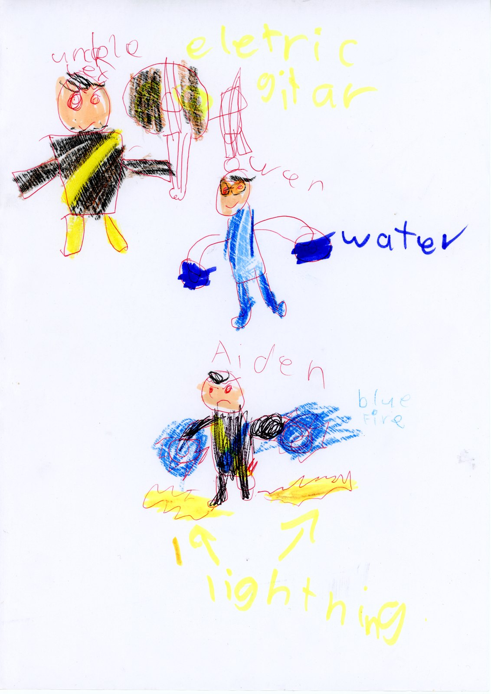 | 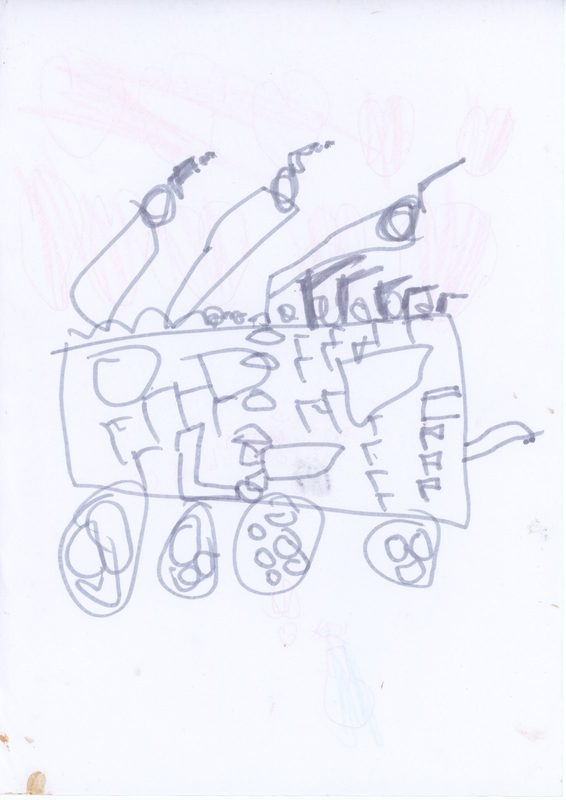 | 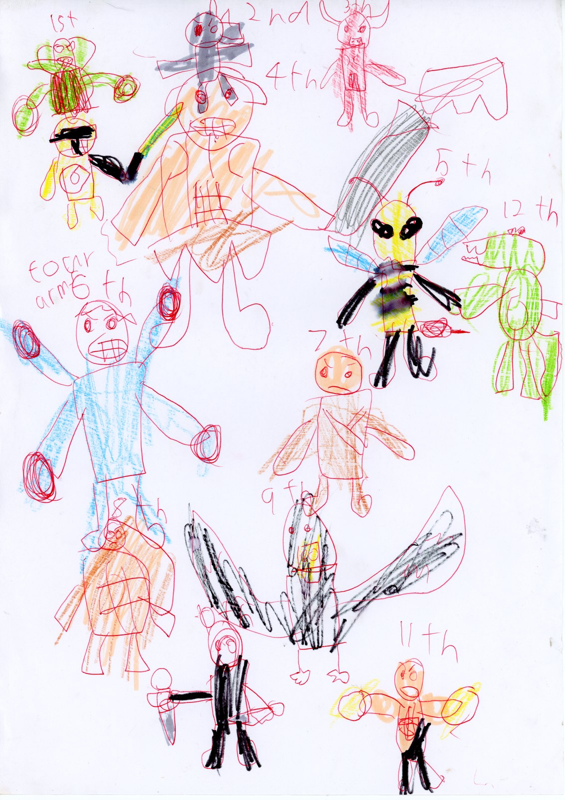 |

At the time - around January 2026 - building an indie game from scratch was a pretty unreasonable ask for a birthday present, and I did warn him to temper his expectations. Still, I thought it would be a fun exercise to test the agentic tools at my disposal.

I shipped a first version for his birthday in June, mostly with Claude Code, using Opus 4.8 and Fable 5. It worked, but it wasn't worth playing for more than a couple of minutes.

Aiden was appreciative, but it clearly wasn't the game he'd imagined.

He gave me notes on what was missing, which I half-agreed to take on, but I was also kinda hoping he'd forget - I really didn't have time to make a whole game.

Unfortunately, he did not forget. Every time I saw him, he asked about the game.

## Enter: Fable 5.2

I was lucky enough to get an early look at [Claude Fable 5.2](claude-fable-5-2.md), and was told to try it on "my most ambitious use case". Finishing this game immediately sprang to mind.

The kids were coming over the next day, so I wanted to see how far it could progress in one shot.

Before bed, I let it rip with this prompt:

> I want you to help me finish this game. Make it as fun as possible. It should feel like a modern-day Ninja Turtles arcade game. An action-packed beat 'em up.
>
> Make the graphics amazing. You can use OpenAI's ChatGPT Images 2.5 for images. And ElevenLabs for sound effects. OpenAI key is /path/to/openai-key. ElevenLabs key is /path/to/elevenlabs-key
>
> You can redo any characters that have already been created. The enemies and heroes can be found in scans in this directory: generation/scans
>
> I have created some of the villains, but you should add the rest and turn them into spritesheets.
>
> Use any assets you find online. Create new sprites for the henchmen. Create backgrounds and power-ups in the levels. I'd like to plug in a controller so up to 4 people can play.
>
> Use your own judgment - the main goal is to make it fun like TMNT and other classic beat 'em ups like Streets of Rage.
>
> Make it one of the best games you can possibly make. You are a truly world-class game developer. Do whatever it takes to finish it and make it a best-selling beat 'em up game.
>
> Commit as you go. Don't worry about destroying what exists. Start fresh where it makes sense.

When I woke up, the game was waiting for me. And I couldn't believe my eyes!

Fable had generated a game that was fun. Like, a lot of fun. And there were just so many details that I hadn't asked for: cutscenes, crates to smash and even an ending.

It threw away most of my code and rewrote the game. It generated roughly 175 images and 140 audio clips.

Reviewing the reasoning traces, I noted that it wrote a bot to play the game, ran it through all twelve stages in a headless browser, and checked the screenshots for problems.

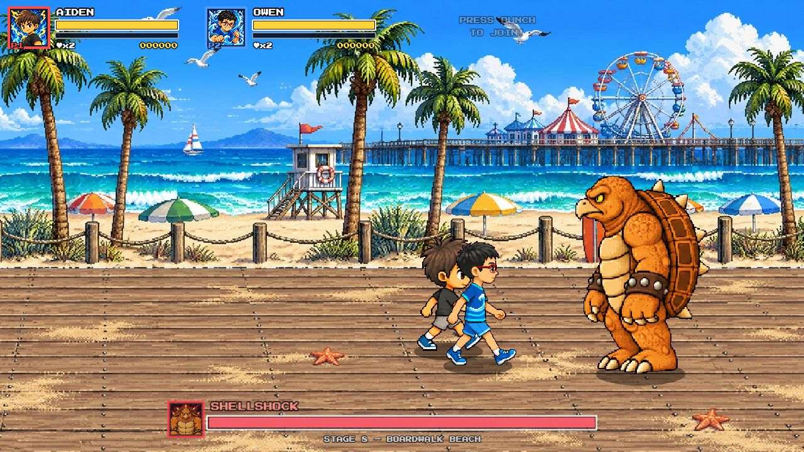

## Play testing

Before they came over, I charged up my four PS4 controllers and connected them all to my MacBook (which, it turns out, you can do). They worked perfectly.

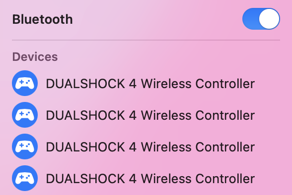

When they arrived, Aiden was absolutely delighted. "It's exactly as I imagined," he squealed.

<figure style="margin:0"><a href="../_media/aidens-revenge/playtest-afternoon.jpg">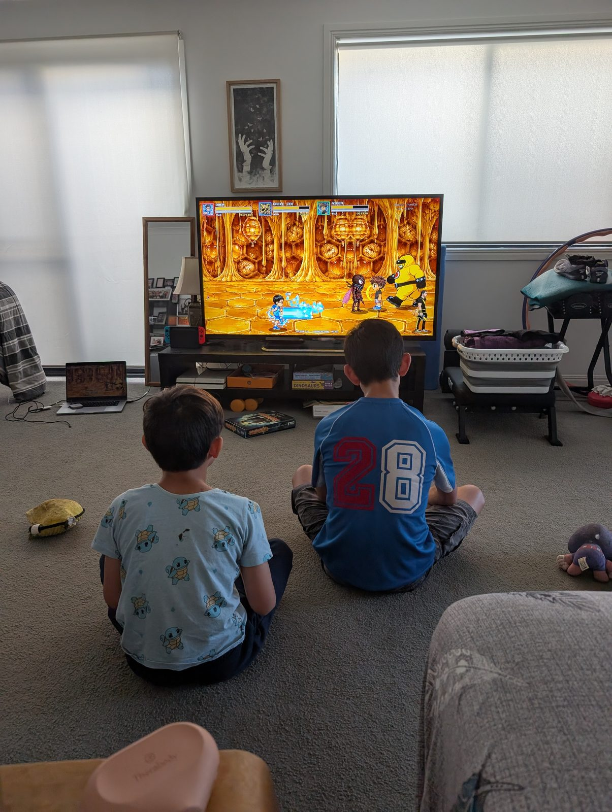</a><figcaption style="font-size:0.85em;text-align:center;margin-top:6px">The afternoon shift</figcaption></figure>
<figure style="margin:0"><a href="../_media/aidens-revenge/playtest-hulk-owen.jpg">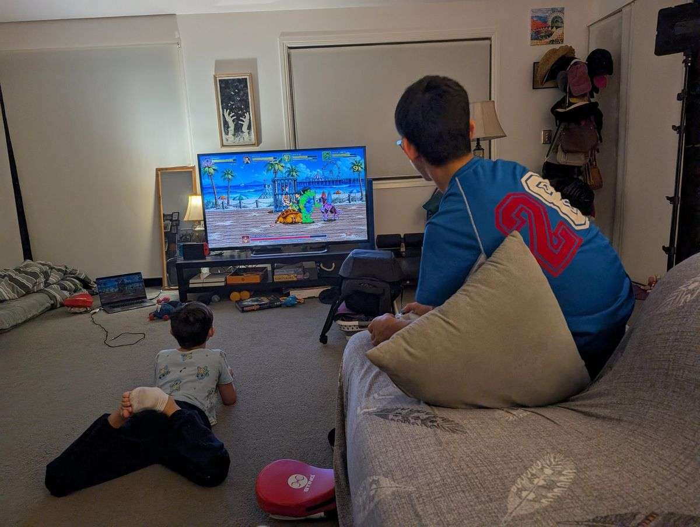</a><figcaption style="font-size:0.85em;text-align:center;margin-top:6px">Hulk Owen takes on Shellshock</figcaption></figure>
<figure style="margin:0"><a href="../_media/aidens-revenge/playtest-family.jpg">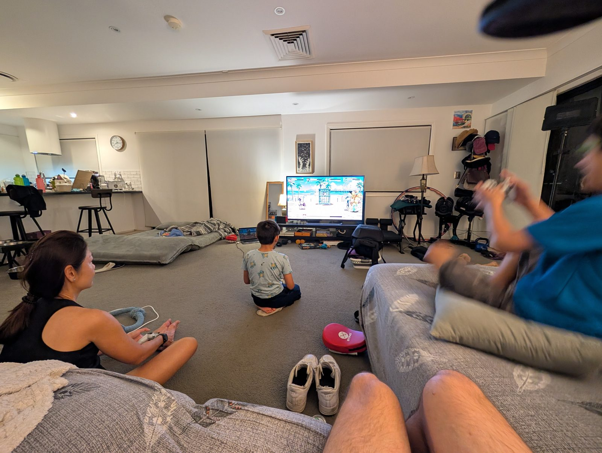</a><figcaption style="font-size:0.85em;text-align:center;margin-top:6px">Everyone in</figcaption></figure>

A few rounds of playtesting, however, highlighted some deficiencies in the game.

First, my older nephew, Owen, felt his character lacked a Hulk Smash move. Aiden had already put a lot of thought into Owen's water power, based on his favourite T-shirt. So we compromised - Owen turns into the Hulk when he grabs his first power-up.

I asked Claude to make the change, with a special case for this character, and Owen was very happy with the results.

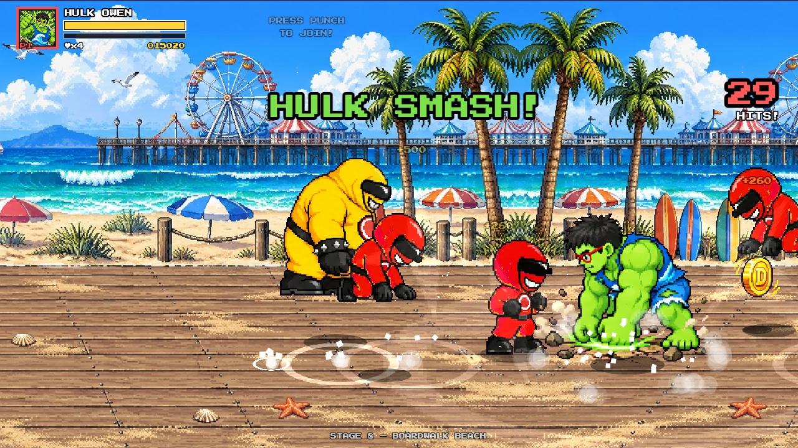

Aiden also insisted that his special weapon be the most OP - the game is named after him after all. Fable obliged, and turned it into a room-destroying thunder shock wave.

Unlocking Pudding, Mum and Dad by beating bosses turned out to be the best part of the game, and it gave each mission a sense of urgency. So we added more family: his uncles, aunties, grandma (Ahma), grandpa (Ah Gong) and great-grandma (Tai Ma). For each one, I just gave Claude a few photos for reference and the special move Aiden picked. When he couldn't decide, he had us call them up and ask what they wanted.

Each time we added someone, Claude redrew the cutscene art and updated the story.

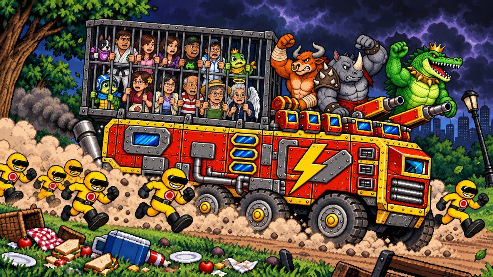

| Grandpa's Card Storm                                                                           | Grandma's Super Bloom                                                                                      | Uncle Kev's Cheat Code                                                                                                                                |
| ---------------------------------------------------------------------------------------------- | ---------------------------------------------------------------------------------------------------------- | ----------------------------------------------------------------------------------------------------------------------------------------------------- |
| 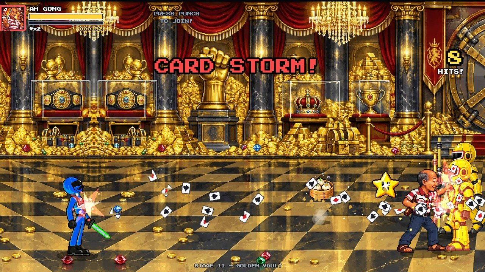 | 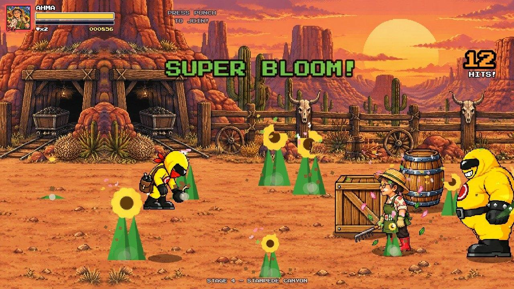 | 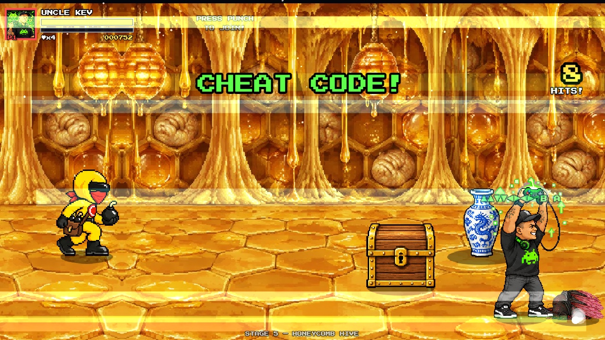 |

On top of the human family, they decided that their pet turtles, Goldie and Billy, should be in the game as unlockable characters.

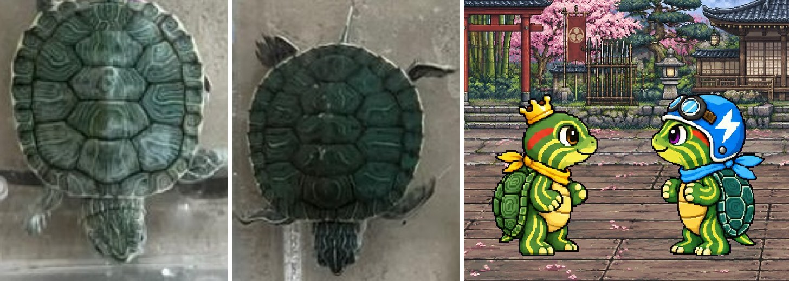

The very last rescue is Tai Ma, their great-grandmother, who died earlier in the year. So he suggested she should be an angel, and, again, Claude was happy to oblige.

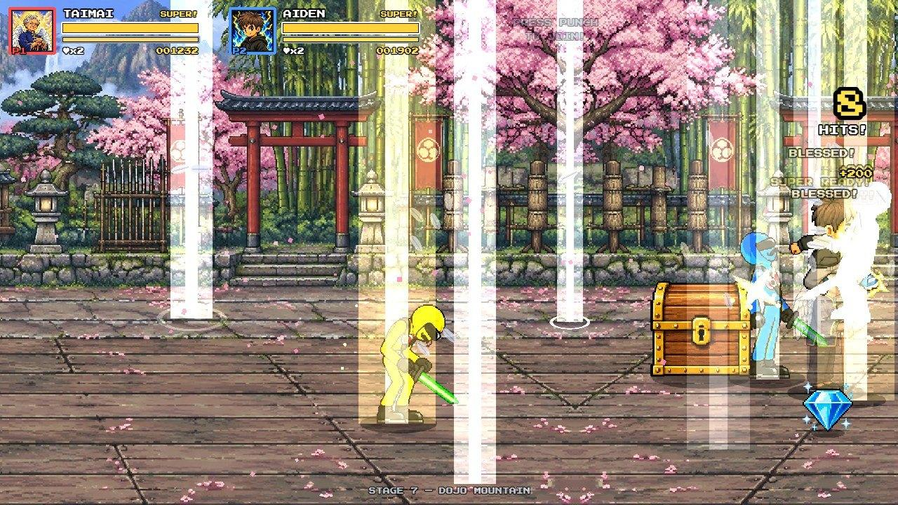

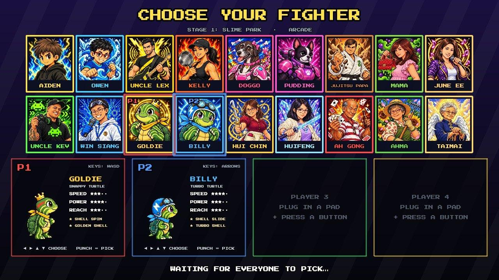

*Five heroes became eighteen.*

## The drawings and the game

Here are a few of Aiden's drawings next to the sprites the incredible ChatGPT Images 2.5 made from them.

**Uncle Lex**: "electric guitar".

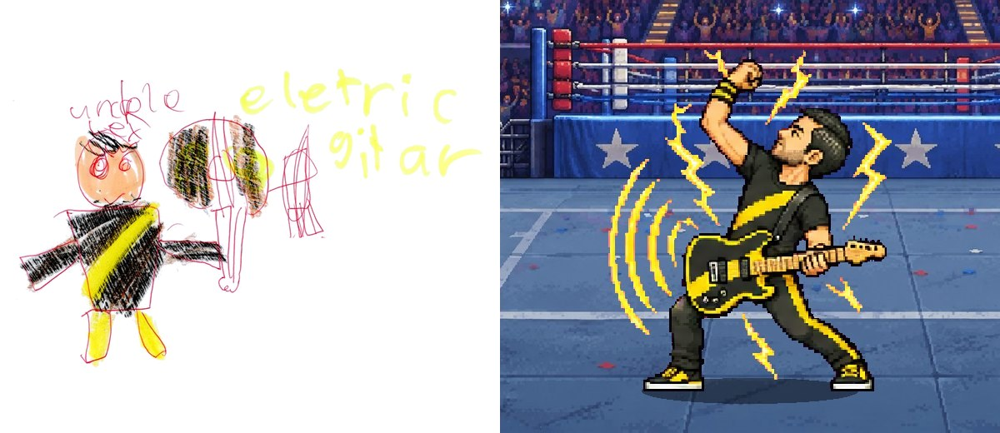

**Doggo** (my dog): she bites, and the spiky tail is her kick.

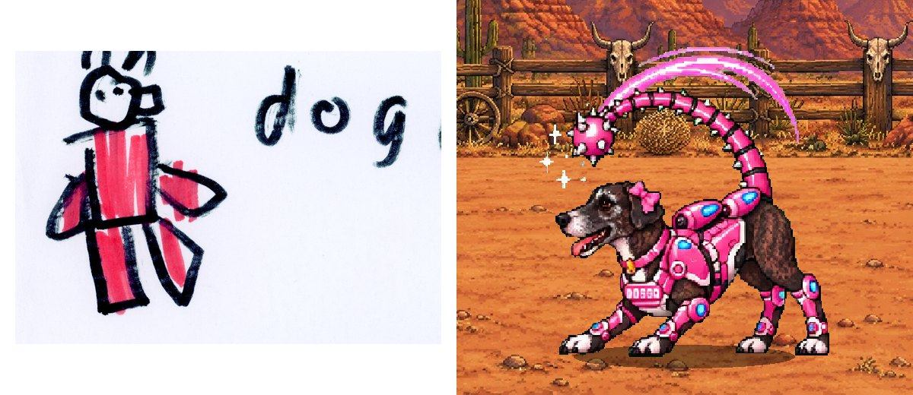

**The Battle Wagon**: the villains steal it, which kicks off the whole game. Claude also decided that it should be an occasional power-up, where you grab the horn and it drives across the screen. That works.

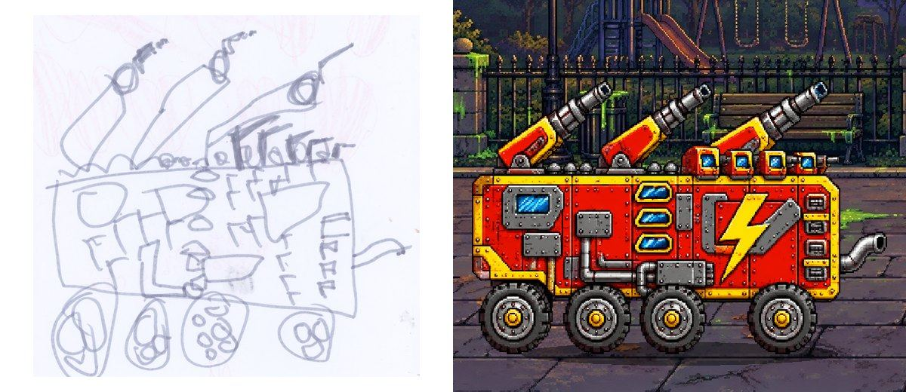

**8th: Shellshock**. Aiden numbered his villains 1st to 12th, and the game uses that as the boss order.

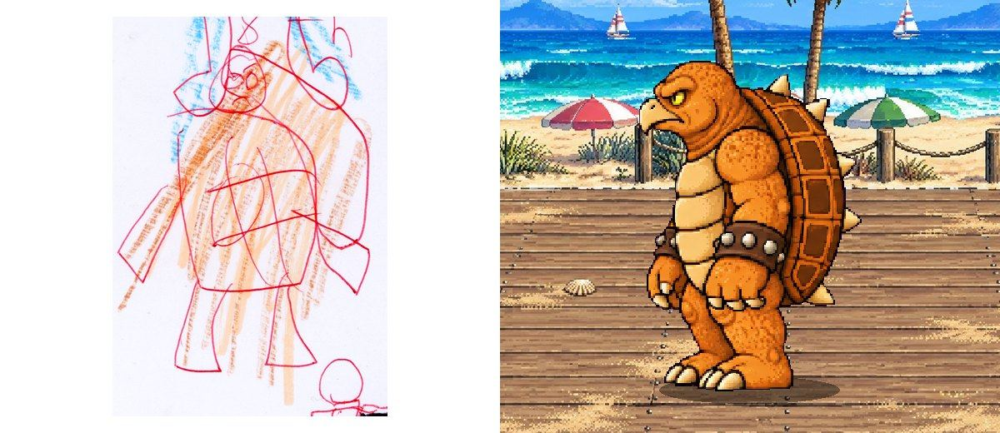

## The final token tally

The final token tally looked something like this:

|               | What was used                                                                                          |
| ------------- | ------------------------------------------------------------------------------------------------------ |
| Claude        | roughly 600 requests over two days: about 320M tokens read from cache, 19M written to cache, 1M output |
| OpenAI images | about 500 images: sprite sheets, character designs, portraits, backgrounds and key art                 |
| ElevenLabs    | 11 music tracks, about 100 sound effects and 90 announcer lines                                        |

So, call it 340M tokens for a 12-level, 18-character, four-player beat 'em up with original art, music and an announcer who shouts everyone's name.

## Conclusion

I must admit I never tested this with Opus 5.5, so I'm not sure whether this was possible before Fable 5.2 rolled around. Still, whether it's thanks to this generation or the last, this is a pretty wild milestone. Claude Code with Fable 5.2 is capable of making entire 12-level *fun* games - in one shot.