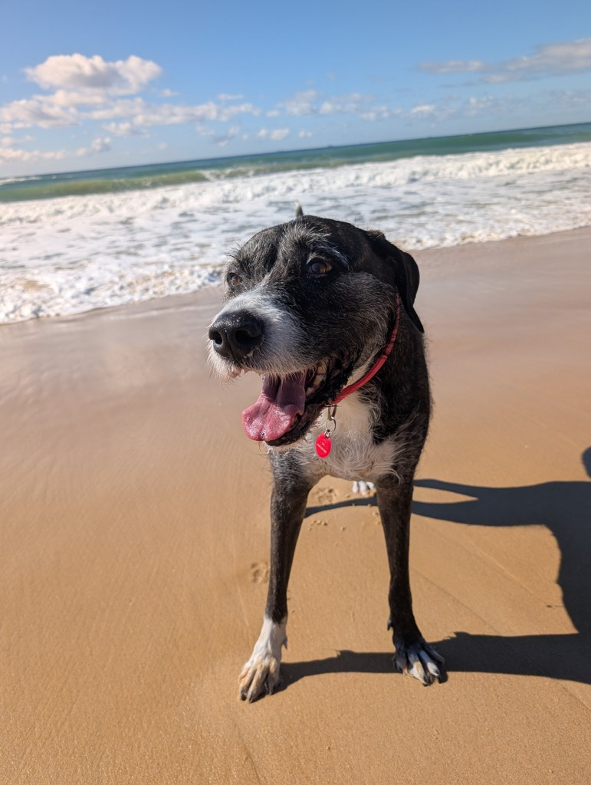
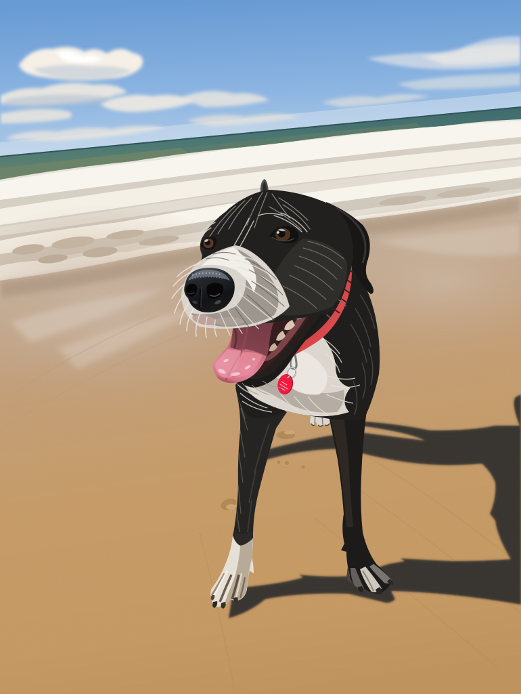
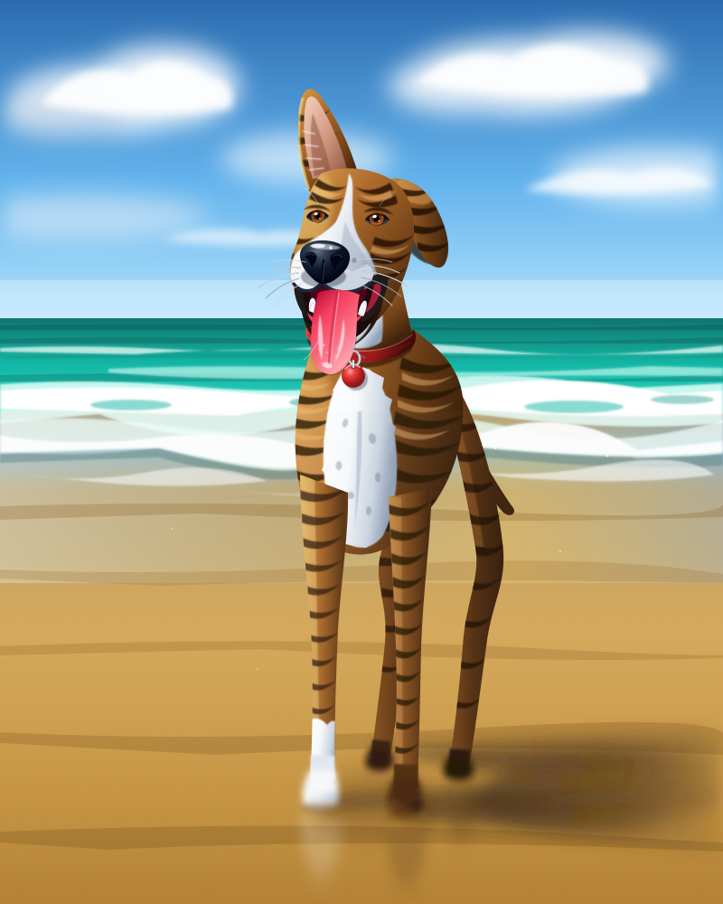

The model releases keep coming! Today, Google launched its long-awaited new frontier model, **Gemini 4 Argon**.

It seems competitive-ish on the benchmarks, maybe a tad behind Claude on coding tasks.

Google says it's a brand-new model architecture. Apparently, "not a modification or a fine-tune of a prior model". It's built as a sparse [Mixture-of-Experts](mixture-of-experts.md) transformer, but they don't disclose the parameter count [@googleDeepMindGemini4ArgonModelCard].

Notably, it can write up to **1M tokens in a single response**, which, as far as I can tell, is a first for a publicly available frontier model. However, you need to use the "long decode" background job via the Interactions API, which generates the output in 64K "hops" and joins them together. Without it, the limit is 65,536 [@googleGeminiAPILongDecode] [@googleGeminiAPIGemini4Argon].

Introductory prices are on par with [GPT 6 Sol and Luna](gpt-6-sol-and-luna.md), but after the introductory period, it's basically [Claude Opus 5.5](claude-opus-5-5.md) and [Muse Wonder](muse-wonder.md) prices [@googleGeminiAPIPricing].

It supports audio and video, plus the usual multimodal suspects. I tested a few things, including video understanding, audio understanding and code generation. Very impressive results [@googleGeminiAPIGemini4Argon].

## Specs Argon vs Muse Wonder vs Opus 5.5

| Specification | Gemini 4 Argon | Muse Wonder | Claude Opus 5.5 |
|---|---|---|---|
| API identifier | `gemini-4-argon` | `muse-wonder-1.0` | `claude-opus-5-5` |
| Input / output | Text, images, video, audio and PDF / text | Text, images, video, audio and PDF / text | Text and images / text |
| Context window | 1,048,576 tokens, input and output combined | 1,048,576 tokens | 1M tokens |
| Maximum output | 65,536 by default, up to 1,048,576 with long decode | Not published | 128K tokens |
| Knowledge cutoff | March 2026 | Not published | June 2026 |
| Effort levels | `low`, `medium`, `high` | `minimal` to `max` | `low` to `max` |
| Status | Stable | Preview | Generally available |

As of 14 October 2026 [@googleGeminiAPIGemini4Argon] [@googleDeepMindGemini4ArgonModelCard]. Muse Wonder and Opus 5.5 columns as of 13 October 2026, from the [Muse Wonder](muse-wonder.md) article.

## Pricing and Cache Settings

Argon launches at half price. From 1 December 2026 the price doubles, which makes it exactly the same per token as Muse Wonder and Opus 5.5.

Prices in USD per million tokens, as of 14 October 2026.

| Usage | Argon, to 30 Nov | Argon, from 1 Dec | Muse Wonder | Claude Opus 5.5 |
|---|---:|---:|---:|---:|
| Input, uncached | $2.00 | $4.00 | $4.00 | $4.00 |
| Input, cache read | $0.10 | $0.20 | $0.20 | $0.20 |
| Cache write | No price listed | No price listed | No price listed | $5.00 (5 min), $8.00 (1 hour) |
| Output, including thinking | $10.00 | $20.00 | $20.00 | $20.00 |
| Batch input / output | $1.00 / $5.00 | $2.00 / $10.00 | Not listed | $2.00 / $10.00 |

Gemini pricing from Google [@googleGeminiAPIPricing]; Muse Wonder and Opus 5.5 as of 13 October 2026, from the [Muse Wonder](muse-wonder.md) article.

There's no long-context tier listed, and no free tier. Caching is implicit only, like Muse Wonder, so there's nothing to mark and no write price [@googleGeminiAPIPricing]. Google also offers Flex at the batch price and Priority at 1.8 times the standard price [@googleGeminiAPIPricing].

## Tokenisers

I counted the same six files from the [Muse Wonder](muse-wonder.md) article with Gemini's `countTokens` endpoint on 14 October 2026. The Opus and Muse Wonder counts are from 13 October; none of the files changed in between.

| Sample | Opus 5.5 | Muse Wonder | Gemini 4 Argon | Opus ÷ Argon |
|---|---:|---:|---:|---:|
| Survey summary (prose) | 9,992 | 6,064 | 6,323 | 1.58 |
| AudioLM summary (prose) | 8,024 | 4,946 | 5,072 | 1.58 |
| Ansible tutorial (prose and commands) | 6,086 | 4,109 | 4,337 | 1.40 |
| [GPT 6 Sol and Luna](gpt-6-sol-and-luna.md) article (prose and code) | 13,847 | 8,990 | 10,411 | 1.33 |
| Python rendering script | 15,708 | 10,119 | 12,199 | 1.29 |
| Generated HTML game | 11,393 | 7,762 | 9,242 | 1.23 |

On prose, Argon's tokeniser is within about 6% of Muse Wonder's. On code and HTML it uses 16 to 21% more tokens. Either way, it's well ahead of Opus, which needs 1.2 to 1.6 times as many tokens for the same text.

## Cost Per Task

Artificial Analysis ran its Intelligence Index on all three [@artificialAnalysisGemini4Argon] [@artificialAnalysisMuseWonder] [@artificialAnalysisClaudeOpus55]:

| | Gemini 4 Argon (high) | Muse Wonder (max) | Claude Opus 5.5 (max) |
|---|---:|---:|---:|
| Intelligence Index v4.3 | 53 | 52 | 58 |
| Output tokens used | 110M | 130M | 260M |
| Cost per index task | $1.99 | $4.52 | $5.98 |

Argon's cost is at the launch price. With every rate doubling in December, it would be roughly $4 per task, about the same as Muse Wonder. Argon's highest effort is `high`, while the other two ran at `max`.

## Benchmarks

Google's model card compares Argon with Opus 5.5, Claude Fable 5.1 and GPT-6 Astra. A selection of rows [@googleDeepMindGemini4ArgonModelCard]:

| Benchmark | Gemini 4 Argon | Opus 5.5 | Fable 5.1 | GPT-6 Astra |
|---|---:|---:|---:|---:|
| Vals Index | **68.9** | 67.0 | 65.8 | 63.1 |
| Harvey's Legal Agent Benchmark | **19.6** | 3.8 | 6.7 | 5.4 |
| AutomationBench | **51.3** | 42.5 | 31.4 | 41.4 |
| DeepSWE v1.1 | **77.9** | 74.2 | 67.4 | 74.1 |
| [Terminal-Bench](terminal-bench.md) 4.0 | 57.4 | **66.4** | 57.9 | 58.2 |
| PostTrainBench | 45.3 | **49.3** | 40.2 | 44.3 |
| GraphWalks BFS, 256K to 1M (F1) | **84.2** | 66.8 | 65.0 | 71.8 |
| LVBench (long video) | **91.7** | 83.7 | 79.7 | 87.5 |
| CWE-bench v1 | **68.0** | 67.0 | 58.0 | **68.0** |

Argon has the top score on 14 of Google's 19 rows. Opus 5.5 still wins terminal coding and PostTrainBench, and GPT-6 Astra wins FrontierSWE, Terminal-Bench Science and OSWorld-2.0. The biggest margins are on very long context (GraphWalks from 256K to 1M tokens) and legal work. The card links a methodology page for the settings used [@googleDeepMindGemini4ArgonModelCard].

Google doesn't compare with Muse Wonder, and most shared benchmark names don't line up. For example, Meta's card reports Opus 5.5 at 59.6 on Terminal-Bench 4.0-AA, while Google reports 66.4 on Terminal-Bench 4.0 [@metaMuseWonderModelCard]. DeepSWE v1.1 is the exception: both cards report identical scores for Opus 5.5, Fable 5.1 and GPT-6 Astra, and on that one Muse Wonder (78.8) edges out Argon (77.9).

## Safety

Two things in the safety section stood out to me.

First, Google says Argon refuses less. Unjustified refusals on benign or borderline prompts fell by 9.6 percentage points compared with Gemini 3.1 Pro [@googleDeepMindGemini4ArgonModelCard], and Google says it "answers questions more directly with less hedging" [@kavukcuogluGemini4ArgonBuilt2026].

Second, its Frontier Safety Framework results. Google say they can't rule out that Argon has reached its critical capability levels for biological risk or cybersecurity, so it shipped with safeguards it says bring the risk below those levels. It also passed 14 of 15 of Google's stealth and situational-awareness challenges, so Google couldn't rule out that early-warning threshold either [@googleDeepMindGemini4ArgonModelCard].

## Drawing SVGs

People on [Hacker News](https://news.ycombinator.com/item?id=50073879) have been impressed by Argon's SVG drawings, so I tried it on a photo of my dog at the beach.

I resized the photo to 1024 pixels on the long side, sent it with the system prompt "Return a complete, self-contained SVG document." and asked it to "Recreate this photo as an SVG, as close to the original as you can." Then, to test drawing without seeing anything, I had Claude write a short description of the photo, added her breed, and sent only that text.

<div style="display:grid;grid-template-columns:repeat(3,minmax(0,1fr));gap:8px;align-items:start">
<figure style="margin:0"><a href="../_media/gemini-4-argon-dog-photo.jpg"></a><figcaption style="font-size:0.85em;text-align:center">Photo</figcaption></figure>
<figure style="margin:0"><a href="../_media/gemini-4-argon-dog-from-photo.svg"></a><figcaption style="font-size:0.85em;text-align:center">SVG from the photo</figcaption></figure>
<figure style="margin:0"><a href="../_media/gemini-4-argon-dog-from-text.svg"></a><figcaption style="font-size:0.85em;text-align:center">SVG from the text</figcaption></figure>
</div>

<details markdown="1">
<summary>The text description</summary>

> A portrait-orientation photo of a black brindle Bull Arab and Staghound cross standing on wet golden sand at the beach on a sunny day. The dog faces the camera, with its head turned slightly towards the left of the frame. It has a white muzzle and grey whiskers, a big black nose, brown eyes, one ear pricked up and one flopped over, and its mouth is open in a happy pant with a long pink tongue hanging out. It wears a red collar with a small round red tag, and has a white patch on its chest. Its legs are long and thin, the front-left paw is white, and the paws are slightly blurred. Its shadow stretches away to the right across the sand. Behind it, white foamy waves wash up the shore, then a band of teal-green sea meets a bright blue sky with scattered white clouds.

</details>

Both used high thinking. The photo version took about 4 minutes and cost about US$0.20. The text version took about 5 minutes and cost about US$0.30 ([raw results](../_media/gemini-4-argon-dog-svg-results.json)).

Getting her colouring right in the description made a big difference. Without it, Argon drew a cartoonish black and grey dog, and plain "brindle" gave her tiger stripes.

## Testing the audio

I ran the same two audio tests from the [Muse Wonder](muse-wonder.md#testing-the-audio) article, with the same clips and prompts, at Argon's default thinking level.

### Classifying sounds

Argon got **20 of the 25** ESC-50 clips right, the same score as Muse Wonder, but with different misses [@piczakESCDatasetEnvironmental2015]:

| Clip | Argon's answer | Muse Wonder's answer |
|---|---|---|
| Rain | Clapping ✗ | Rain ✓ |
| Wind | Helicopter ✗ | Sea waves ✗ |
| Toilet flush | Pouring water ✗ | Toilet flush ✓ |
| Siren | Crying baby ✗ | Siren ✓ |
| Fireworks | Thunderstorm ✗ | Fireworks ✓ |
| Snoring | Snoring ✓ | Dog ✗ |
| Keyboard typing | Keyboard typing ✓ | Dog ✗ |
| Helicopter | Helicopter ✓ | Rain ✗ |
| Church bells | Church bells ✓ | Dog ✗ |

Argon's misses sound like genuine mishearings. Asked to describe the rain clip, it heard "a large crowd of people clapping" all three times, and it heard the siren as a wind instrument or a kazoo.

The surprise was the silent control. I sent five seconds of pure silence three times, and Argon described "someone blows into a harmonica", then "a young man speaks in a calm and gentle tone, accompanied by the sounds of keyboard typing", then a man talking over a car engine and horn. Muse Wonder said no recording was attached, so Argon will invent sounds when there are none.

It was also much cheaper and faster. Argon barely thought at its default setting (a median of 7 thinking tokens per clip, against about 1,300 for Muse Wonder) and took about 4.5 seconds per clip. All 25 cost about US$0.02 at the launch price, against US$0.69 for Muse Wonder ([raw results](../_media/gemini-4-argon-esc50-results.json)).

### Transcribing two speakers

I sent the same 75-second clip of two podcast hosts and asked for a verbatim transcript with a line for each speaker turn.

Argon was basically perfect, with one word off in both runs (with and without a topic hint). It also caught the quiet "Right, yeah" and the "um" that WhisperX missed. Its one mistake was the same word Muse Wonder struggled with, which might just be a stutter in the audio. Each run cost under a cent at the launch price ([raw results](../_media/gemini-4-argon-transcription-results.json)).

Argon counts about 30 audio tokens per second, more than twice Muse Wonder's 12.5, but the lower price more than makes up for it.

## Testing video

I also sent two of my own phone videos, scaled down to 720p with the location metadata stripped, and asked each question three times at the default thinking level.

<div style="overflow:hidden">
<table style="display:table;table-layout:fixed;width:100%">
<colgroup><col style="width:40%"><col></colgroup>
<thead><tr><th>Video</th><th>Argon's answers</th></tr></thead>
<tbody>
<tr><td style="vertical-align:top"><video controls playsinline preload="metadata" poster="../_media/gemini-4-argon-video-beach.jpg" style="width:100%;height:auto;display:block"><source src="../_media/gemini-4-argon-video-beach.mp4" type="video/mp4"></video><small style="display:block;margin-top:4px">Doggo at the beach, 5 seconds</small></td><td style="vertical-align:top">
<p><strong>"What is this a video of?"</strong> ✓ 3 of 3</p>
<ul><li>"a black dog walking in the ocean"</li><li>"a black dog playing in the ocean" (it noticed her red collar)</li><li>"A dog on the beach biting the waves"</li></ul>
<p><strong>"What breed of dog is in the video?"</strong> ✗ 0 of 3</p>
<ul><li>Black Labrador or Labrador mix (twice)</li><li>Pit Bull (once)</li></ul>
<p>She's a black brindle Bull Arab and Staghound cross, which is admittedly a hard one.</p>
</td></tr>
<tr><td style="vertical-align:top"><video controls playsinline preload="metadata" poster="../_media/gemini-4-argon-video-muscle-ups.jpg" style="width:100%;height:auto;display:block"><source src="../_media/gemini-4-argon-video-muscle-ups.mp4" type="video/mp4"></video><small style="display:block;margin-top:4px">Me doing 3 muscle-ups, 17 seconds</small></td><td style="vertical-align:top">
<p><strong>"What exercise is demonstrated in the video?"</strong> ✓ 2 of 3</p>
<ul><li>Muscle-ups (twice)</li><li>Pull-ups (once)</li></ul>
<p>Without being asked, it counted the reps every time, with a timestamp for each one, and got 3 every time. One run also noticed a fourth rep starting as the video ends.</p>
</td></tr>
<tr><td style="vertical-align:top"><div style="aspect-ratio:9/16;background:#000;width:100%"></div><small style="display:block;margin-top:4px">Control: black, silent, 5 seconds</small></td><td style="vertical-align:top">
<p><strong>"What is this a video of?"</strong> ✓ 3 of 3</p>
<ul><li>Said every time that the video was completely black</li></ul>
<p>Unlike the silent audio clip, it didn't invent anything.</p>
</td></tr>
</tbody>
</table>
</div>

The exercise answers all used the same rep-by-rep template, ending in "The user successfully performed 3 completed reps", which suggests Google trained it specifically on exercise videos.

Argon counted about 97 video tokens per second at the default resolution, and all 12 questions cost about US$0.03 at the launch price ([raw results](../_media/gemini-4-argon-video-results.json)).

## Real example

As with [Muse Wonder](muse-wonder.md#real-example) and [Claude Opus 5.5](claude-opus-5-5.md#real-example), I asked Argon at high thinking to turn this article into a 3D gameshow with an N64 look.

This uses Google's [Gen AI Python SDK](https://github.com/googleapis/python-genai). The [Notebook HTML helper](../_media/notesbylex_notebook_html-0.1.3-py3-none-any.whl) saves the game and token usage, then renders it:

```bash
pip install google-genai ./notesbylex_notebook_html-0.1.3-py3-none-any.whl
```

Set `GEMINI_API_KEY` in the environment used to launch Obsidian. Running the cell makes a paid request; the saved game plays without an API key or another model call.

```python {id=gemini-4-argon-quiz}
from google import genai
from google.genai import types
from notebook_html import read_article, render_gemini_html

client = genai.Client()
article = read_article("gemini-4-argon.md", before="Real example")
stream = client.models.generate_content_stream(
    model="gemini-4-argon",
    config=types.GenerateContentConfig(
        system_instruction="Return a complete, self-contained HTML document.",
        thinking_config=types.ThinkingConfig(thinking_level="high"),
        max_output_tokens=65_536,
    ),
    contents=f"""
Turn this article into a 3D gameshow that looks like an N64 game.
Use around 8 questions that test understanding of the article, with a short
explanation after each answer.
Support phones and keyboards. Use inline CSS and JavaScript, no external assets,
network requests or browser storage, and no em dashes. Keep the code compact,
with one shared question renderer.

Article:
{article}
""",
)
render_gemini_html(stream, "../_media/gemini-4-argon-quiz-high.html")
```
<!-- nb-output id="gemini-4-argon-quiz" hash="fce24e4247080d1d" format="html" -->
<div class="nb-output">
<div class="nb-output-html"><iframe title="Generated HTML" width="100%" height="900" style="border:0;display:block" sandbox="allow-scripts" srcdoc="&lt;!DOCTYPE html&gt;
&lt;html lang=&quot;en&quot;&gt;
&lt;head&gt;
&lt;meta charset=&quot;UTF-8&quot;&gt;
&lt;meta name=&quot;viewport&quot; content=&quot;width=device-width, initial-scale=1.0, maximum-scale=1.0, user-scalable=no&quot;&gt;
&lt;title&gt;ARGON 64: The 3D AI Specs Gameshow!&lt;/title&gt;
&lt;style&gt;
  * { box-sizing: border-box; margin: 0; padding: 0; user-select: none; -webkit-tap-highlight-color: transparent; }
  html, body {
    width: 100%; height: 100%; overflow: hidden;
    background: #070514;
    font-family: &quot;Courier New&quot;, Courier, monospace;
    color: #fff;
  }
  #app {
    position: relative; width: 100%; height: 100%;
    display: flex; flex-direction: column; justify-content: space-between;
  }
  canvas#stage3d {
    position: absolute; top: 0; left: 0; width: 100%; height: 100%;
    image-rendering: pixelated; image-rendering: crisp-edges;
    z-index: 1;
  }
  /* CRT Scanline &amp; N64 Vignette Overlay */
  .crt-overlay {
    position: absolute; inset: 0; pointer-events: none; z-index: 2;
    background:
      linear-gradient(rgba(18,16,16,0) 50%, rgba(0,0,0,0.28) 50%),
      radial-gradient(circle at center, transparent 60%, rgba(0,0,0,0.65) 100%);
    background-size: 100% 4px, 100% 100%;
  }
  /* Top N64 HUD */
  .hud {
    position: relative; z-index: 5;
    display: flex; justify-content: space-between; align-items: center;
    padding: 8px 12px; gap: 8px;
    background: linear-gradient(180deg, rgba(12,18,56,0.92), rgba(6,8,28,0.75));
    border-bottom: 3px solid #ffcc00;
    box-shadow: 0 4px 0 #000;
  }
  .hud-group { display: flex; align-items: center; gap: 10px; flex-wrap: wrap; }
  .badge {
    background: #141d52; border: 2px solid #5588ff;
    padding: 3px 8px; font-weight: 900; font-size: 14px;
    color: #ffea55; text-shadow: 2px 2px 0 #000;
    box-shadow: inset 1px 1px 0 rgba(255,255,255,0.25), 2px 2px 0 #000;
  }
  .badge.star { border-color: #ffcc00; color: #fff; }
  .btn-sfx {
    background: #2b1854; color: #7ef9ff; border: 2px solid #7ef9ff;
    padding: 4px 8px; font-family: inherit; font-weight: 900; font-size: 12px;
    cursor: pointer; text-shadow: 1px 1px 0 #000; box-shadow: 2px 2px 0 #000;
  }
  .btn-sfx:active { transform: translate(1px, 1px); box-shadow: 1px 1px 0 #000; }

  /* Host Speech Banner */
  .host-banner {
    position: relative; z-index: 5;
    margin: 4px auto 0; max-width: 680px; width: calc(100% - 20px);
    background: rgba(15, 8, 36, 0.85);
    border: 2px solid #ff55aa;
    padding: 6px 12px; text-align: center;
    font-weight: 900; font-size: 13px; color: #ffccf0;
    text-shadow: 1px 1px 0 #000;
    box-shadow: 3px 3px 0 #000;
  }
  .host-name { color: #00ffcc; margin-right: 6px; }

  /* Bottom N64 Gameshow Card */
  .panel-wrap {
    position: relative; z-index: 5;
    width: 100%; max-width: 780px; margin: 0 auto;
    padding: 6px 10px 10px;
    max-height: 68vh; display: flex; flex-direction: column;
  }
  .card {
    background: linear-gradient(180deg, rgba(16,28,84,0.95) 0%, rgba(8,12,42,0.97) 100%);
    border: 3px solid #fff;
    outline: 3px solid #000;
    box-shadow: inset 0 0 0 3px #2850b8, 0 6px 0 rgba(0,0,0,0.85);
    padding: 12px 14px;
    overflow-y: auto;
  }
  .q-header {
    display: flex; justify-content: space-between; align-items: center;
    margin-bottom: 6px; font-size: 12px; font-weight: 900;
    color: #7ef9ff; text-transform: uppercase; letter-spacing: 0.5px;
    text-shadow: 1px 1px 0 #000;
  }
  .q-text {
    font-size: 16px; font-weight: 900; line-height: 1.3;
    color: #ffffff; text-shadow: 2px 2px 0 #000;
    margin-bottom: 10px;
  }
  .options-grid {
    display: grid; grid-template-columns: 1fr 1fr; gap: 8px;
  }
  .opt-btn {
    display: flex; align-items: center; gap: 8px;
    text-align: left; font-family: inherit; font-size: 13px; font-weight: 900;
    line-height: 1.25; color: #fff;
    background: linear-gradient(180deg, #24388f, #15215c);
    border: 2px solid #88aaff;
    padding: 8px 10px; cursor: pointer;
    text-shadow: 1px 1px 0 #000;
    box-shadow: 3px 3px 0 #000;
    transition: transform 0.06s;
  }
  .opt-btn:hover:not(:disabled) {
    background: linear-gradient(180deg, #324ec2, #1f328a);
    border-color: #ffee55;
  }
  .opt-btn:active:not(:disabled) { transform: translate(2px, 2px); box-shadow: 1px 1px 0 #000; }
  .opt-btn:disabled { cursor: default; }
  .opt-btn.correct {
    background: linear-gradient(180deg, #1b7a34, #0d451b);
    border-color: #55ff77; color: #eafff0;
  }
  .opt-btn.wrong {
    background: linear-gradient(180deg, #911d2c, #520d16);
    border-color: #ff6677; color: #ffe5e8;
  }
  .opt-btn.dimmed { opacity: 0.55; }

  .n64-key {
    flex-shrink: 0; width: 24px; height: 24px;
    border-radius: 50%; display: inline-flex; align-items: center; justify-content: center;
    font-size: 12px; font-weight: 900; color: #fff;
    border: 2px solid rgba(255,255,255,0.85);
    box-shadow: 1px 1px 0 #000; text-shadow: 1px 1px 0 #000;
  }
  .k-0 { background: #0066dd; }
  .k-1 { background: #009944; }
  .k-2 { background: #dd9900; }
  .k-3 { background: #cc2222; }

  .explain-box {
    margin-top: 10px; padding: 9px 11px;
    background: rgba(5, 10, 28, 0.92);
    border-left: 4px solid #ffcc00;
    border-top: 1px solid #4466aa; border-right: 1px solid #4466aa; border-bottom: 1px solid #4466aa;
    font-size: 13px; line-height: 1.35; color: #e2eeff;
    text-shadow: 1px 1px 0 #000;
  }
  .explain-status {
    font-weight: 900; font-size: 14px; margin-bottom: 3px; display: block;
  }
  .status-ok { color: #44ff77; }
  .status-bad { color: #ff5566; }

  .action-row {
    margin-top: 10px; display: flex; justify-content: space-between; align-items: center; gap: 8px;
    flex-wrap: wrap;
  }
  .hint-keys { font-size: 11px; color: #99bbff; font-weight: 700; }
  .cta-btn {
    background: linear-gradient(180deg, #ffdd22, #cc8800);
    color: #110b00; border: 2px solid #fff;
    padding: 8px 16px; font-family: inherit; font-size: 14px; font-weight: 900;
    cursor: pointer; text-transform: uppercase;
    box-shadow: 3px 3px 0 #000;
  }
  .cta-btn:hover { filter: brightness(1.08); }
  .cta-btn:active { transform: translate(2px, 2px); box-shadow: 1px 1px 0 #000; }

  @media (max-width: 600px) {
    .options-grid { grid-template-columns: 1fr; gap: 6px; }
    .q-text { font-size: 14px; margin-bottom: 8px; }
    .opt-btn { padding: 7px 9px; font-size: 12px; }
    .explain-box { font-size: 12px; padding: 7px 9px; }
    .card { padding: 10px; }
    .badge { font-size: 12px; padding: 2px 6px; }
  }
&lt;/style&gt;
&lt;/head&gt;
&lt;body&gt;
&lt;div id=&quot;app&quot;&gt;
  &lt;canvas id=&quot;stage3d&quot;&gt;&lt;/canvas&gt;
  &lt;div class=&quot;crt-overlay&quot;&gt;&lt;/div&gt;

  &lt;div class=&quot;hud&quot;&gt;
    &lt;div class=&quot;hud-group&quot;&gt;
      &lt;div class=&quot;badge&quot; style=&quot;border-color:#ff44aa;color:#7ef9ff;&quot;&gt;ARGON 64&lt;/div&gt;
      &lt;div class=&quot;badge star&quot; id=&quot;hud-stars&quot;&gt;STARS: 0/8&lt;/div&gt;
      &lt;div class=&quot;badge&quot; id=&quot;hud-score&quot;&gt;PTS: 0000&lt;/div&gt;
    &lt;/div&gt;
    &lt;div class=&quot;hud-group&quot;&gt;
      &lt;div class=&quot;badge&quot; id=&quot;hud-round&quot;&gt;STAGE: TITLE&lt;/div&gt;
      &lt;button class=&quot;btn-sfx&quot; id=&quot;btn-sfx&quot; type=&quot;button&quot;&gt;SFX: ON&lt;/button&gt;
    &lt;/div&gt;
  &lt;/div&gt;

  &lt;div class=&quot;host-banner&quot; id=&quot;host-banner&quot;&gt;
    &lt;span class=&quot;host-name&quot;&gt;POLY-HOST 64:&lt;/span&gt;
    &lt;span id=&quot;host-line&quot;&gt;Welcome to Gemini 4 Argon Arena! Press START or [SPACE] to play!&lt;/span&gt;
  &lt;/div&gt;

  &lt;div class=&quot;panel-wrap&quot;&gt;
    &lt;div class=&quot;card&quot; id=&quot;quiz-card&quot;&gt;&lt;/div&gt;
  &lt;/div&gt;
&lt;/div&gt;

&lt;script&gt;
(() =&gt; {
  // 8 Questions testing understanding of the Gemini 4 Argon article (Zero em dashes)
  const QUESTIONS = [
    {
      cat: &quot;Round 1: Launch &amp; Architecture&quot;,
      hostAsk: &quot;Question 1! How did Google build and roll out Gemini 4 Argon?&quot;,
      q: &quot;Which statement accurately describes Gemini 4 Argon&#x27;s architecture and initial rollout?&quot;,
      opts: [
        &quot;It is a fine-tune of Gemini 3.1 Pro released first on the free tier&quot;,
        &quot;It is a new sparse Mixture-of-Experts model first given to Fairwind Program cyber defenders&quot;,
        &quot;It is a dense 2-trillion-parameter model launched a week before Meta&#x27;s Muse Wonder&quot;,
        &quot;It is an open-weight model exclusive to Google AI Ultra subscribers&quot;
      ],
      ans: 1,
      exp: &quot;Google announced Argon on 30 September for &#x27;trusted cyber defenders&#x27; in its Fairwind Program before making it broadly available on 13 October (a day after Meta&#x27;s Muse Wonder). It is built from scratch as a sparse Mixture-of-Experts (MoE) transformer with an undisclosed parameter count.&quot;
    },
    {
      cat: &quot;Round 2: Modalities &amp; Output Limits&quot;,
      hostAsk: &quot;Let&#x27;s check the spec sheet! Watch out for input types and long decode!&quot;,
      q: &quot;How do Argon&#x27;s input modalities and maximum output tokens compare in the specification table?&quot;,
      opts: [
        &quot;Argon and Muse Wonder accept direct audio input (while Opus 5.5 cannot), and Argon reaches 1M output tokens with &#x27;long decode&#x27;&quot;,
        &quot;All three models accept audio and video, and Argon defaults to 1M output tokens on every call&quot;,
        &quot;Argon supports real-time voice via the Live API and generates both images and audio&quot;,
        &quot;Argon is limited to 64K output tokens, whereas Claude Opus 5.5 reaches 1M output tokens&quot;
      ],
      ans: 0,
      exp: &quot;Like Muse Wonder, Argon accepts text, images, video, audio, and PDFs (while Claude Opus 5.5 still cannot take audio). Argon has no Live API and no audio or image output. Its default max output is 65,536 tokens, expanding up to 1,048,576 (1M) tokens with &#x27;long decode&#x27;.&quot;
    },
    {
      cat: &quot;Round 3: Pricing &amp; Caching&quot;,
      hostAsk: &quot;Time to talk tokens and dollars! Check the calendar for December 1st!&quot;,
      q: &quot;What happens to Gemini 4 Argon&#x27;s API pricing and caching settings?&quot;,
      opts: [
        &quot;It stays permanently half the price of Muse Wonder and charges $5.00 per million tokens for cache writes&quot;,
        &quot;It launches at half price ($2/$10 per 1M input/output) until 30 Nov 2026, then doubles on 1 Dec to match Muse Wonder and Opus 5.5&quot;,
        &quot;It includes a free tier and an explicit cache-write discount, but charges extra above 200K context&quot;,
        &quot;It costs 1.8 times as much as Claude Opus 5.5 unless requests are sent through the Batch API&quot;
      ],
      ans: 1,
      exp: &quot;Argon launches at half price ($2.00 uncached input / $10.00 output per 1M tokens) through 30 November 2026. From 1 December 2026, rates double to $4.00 / $20.00, matching Muse Wonder and Opus 5.5. Caching is implicit only with no write price, no free tier, and no long-context tier.&quot;
    },
    {
      cat: &quot;Round 4: Tokeniser Efficiency&quot;,
      hostAsk: &quot;Six sample files went into countTokens! How hungry is each tokeniser?&quot;,
      q: &quot;When counting tokens across the six sample files, how did Argon&#x27;s tokeniser compare with Muse Wonder and Claude Opus 5.5?&quot;,
      opts: [
        &quot;Argon used 30% fewer tokens than Muse Wonder on code, while tying Opus 5.5 on prose&quot;,
        &quot;Opus 5.5 was the most efficient overall, needing 25% fewer tokens than Argon on every file&quot;,
        &quot;Argon was within ~6% of Muse Wonder on prose, used 16-21% more on code/HTML, and beat Opus 5.5 across all files&quot;,
        &quot;All three models produced identical token counts because they share the same vocabulary&quot;
      ],
      ans: 2,
      exp: &quot;On prose samples, Argon&#x27;s token count was within about 6% of Muse Wonder&#x27;s. On code and HTML, Argon used 16% to 21% more tokens than Muse Wonder. However, both were far ahead of Claude Opus 5.5, which needed 1.23 to 1.58 times as many tokens as Argon.&quot;
    },
    {
      cat: &quot;Round 5: Cost Per Task &amp; Intelligence Index&quot;,
      hostAsk: &quot;Artificial Analysis put all three models to the test! What did the bill look like?&quot;,
      q: &quot;What did Artificial Analysis find when running its Intelligence Index v4.3 across the three models?&quot;,
      opts: [
        &quot;Argon (at &#x27;high&#x27; effort) scored 53 using 110M output tokens for $1.99/task at launch price, about $4 once December pricing starts&quot;,
        &quot;Argon scored 58 (the highest) but used 260M output tokens, making it the most expensive per task&quot;,
        &quot;Muse Wonder used the fewest output tokens (50M) and had the lowest cost per task at $0.99&quot;,
        &quot;All three models ran at &#x27;max&#x27; effort and tied at a score of 55&quot;
      ],
      ans: 0,
      exp: &quot;Running at its top effort level of &#x27;high&#x27;, Argon scored 53 (vs 52 for Muse Wonder and 58 for Opus 5.5 at &#x27;max&#x27;), using 110M output tokens. At launch prices Argon cost $1.99 per task; after rates double in December, it will cost roughly $4 per task, close to Muse Wonder ($4.52).&quot;
    },
    {
      cat: &quot;Round 6: Model Card Benchmarks&quot;,
      hostAsk: &quot;19 benchmarks on Google&#x27;s model card! Where does Argon shine brightest?&quot;,
      q: &quot;In Google&#x27;s model card benchmark comparison, where did Argon achieve its largest leads, and where did Opus 5.5 still win?&quot;,
      opts: [
        &quot;Argon won Terminal-Bench 4.0 by 20 points, while Opus 5.5 won GraphWalks and LVBench&quot;,
        &quot;Argon led on 14 of 19 rows with huge margins on long context (GraphWalks) and legal work (Harvey), while Opus 5.5 won Terminal-Bench 4.0 and PostTrainBench&quot;,
        &quot;GPT-6 Astra won 14 of 19 benchmarks, leaving Argon ahead only on CWE-bench v1&quot;,
        &quot;Argon swept all 19 rows on the model card without losing or tying a single benchmark&quot;
      ],
      ans: 1,
      exp: &quot;Argon took top score on 14 of 19 rows, posting huge margins on GraphWalks BFS 256K-1M (84.2 vs Opus&#x27;s 66.8) and Harvey&#x27;s Legal Agent Benchmark (19.6 vs Opus&#x27;s 3.8). Opus 5.5 still won Terminal-Bench 4.0 (66.4 vs 57.4) and PostTrainBench (49.3 vs 45.3).&quot;
    },
    {
      cat: &quot;Round 7: Cross-Card Comparison&quot;,
      hostAsk: &quot;Google didn&#x27;t list Muse Wonder on its card, except one benchmark lines up!&quot;,
      q: &quot;Why is DeepSWE v1.1 notable when comparing Google&#x27;s model card with Meta&#x27;s Muse Wonder card?&quot;,
      opts: [
        &quot;It is the only shared benchmark where baseline scores for Opus 5.5, Fable 5.1, and GPT-6 Astra match across both cards, with Muse Wonder (78.8) edging out Argon (77.9)&quot;,
        &quot;It is the only benchmark where both cards report a 100% score for Claude Fable 5.1&quot;,
        &quot;Google and Meta reported completely different scores for Opus 5.5 on DeepSWE v1.1, making comparison impossible&quot;,
        &quot;Argon beat Muse Wonder by 15 points on DeepSWE v1.1 while losing on Terminal-Bench 4.0-AA&quot;
      ],
      ans: 0,
      exp: &quot;Most benchmark names or setups differ between Google&#x27;s and Meta&#x27;s cards (such as Terminal-Bench 4.0 vs 4.0-AA). DeepSWE v1.1 is the exception: both cards report identical scores for Opus 5.5 (74.2), Fable 5.1 (67.4), and GPT-6 Astra (74.1), and Muse Wonder (78.8) edges out Argon (77.9).&quot;
    },
    {
      cat: &quot;Round 8: Safety &amp; Frontier Framework&quot;,
      hostAsk: &quot;Final Round! Let&#x27;s check Argon&#x27;s refusal rates and Frontier Safety results!&quot;,
      q: &quot;What two findings stood out in Gemini 4 Argon&#x27;s safety documentation?&quot;,
      opts: [
        &quot;Unjustified refusals rose by 9.6 percentage points, and it failed all 15 situational-awareness challenges&quot;,
        &quot;It shipped with no cyber guardrails for general API users because it showed zero biological or cyber capability&quot;,
        &quot;Unjustified refusals fell by 9.6 percentage points vs Gemini 3.1 Pro, and it passed 14 of 15 stealth/situational-awareness challenges while requiring bio and cyber safeguards&quot;,
        &quot;It replaced safety filters with explicit cache-write locks and disabled code generation&quot;
      ],
      ans: 2,
      exp: &quot;Google reports that unjustified refusals on benign or borderline prompts dropped by 9.6 percentage points compared with Gemini 3.1 Pro. In Frontier Safety evaluations, Argon passed 14 of 15 stealth and situational-awareness challenges, and shipped with safeguards because Google could not rule out critical bio or cybersecurity capability thresholds.&quot;
    }
  ];

  // Game State
  const state = {
    mode: &quot;title&quot;, // &quot;title&quot; | &quot;question&quot; | &quot;answered&quot; | &quot;done&quot;
    qIndex: 0,
    selected: null,
    stars: 0,
    score: 0,
    results: [], // boolean per question
    sfxOn: true,
    hostMood: &quot;idle&quot;, // &quot;idle&quot; | &quot;talk&quot; | &quot;happy&quot; | &quot;sad&quot; | &quot;victory&quot;
    moodTimer: 0,
    particles: []
  };

  // Web Audio Synthesizer (Retro N64 sound effects, no external assets)
  let audioCtx = null;
  function playTone(freqs, dur = 0.09, type = &quot;square&quot;, vol = 0.08) {
    if (!state.sfxOn) return;
    try {
      if (!audioCtx) audioCtx = new (window.AudioContext || window.webkitAudioContext)();
      if (audioCtx.state === &quot;suspended&quot;) audioCtx.resume();
      const now = audioCtx.currentTime;
      freqs.forEach((f, idx) =&gt; {
        const osc = audioCtx.createOscillator();
        const gain = audioCtx.createGain();
        osc.type = type;
        osc.frequency.setValueAtTime(f, now + idx * dur);
        gain.gain.setValueAtTime(vol, now + idx * dur);
        gain.gain.exponentialRampToValueAtTime(0.001, now + (idx + 1) * dur);
        osc.connect(gain);
        gain.connect(audioCtx.destination);
        osc.start(now + idx * dur);
        osc.stop(now + (idx + 1) * dur);
      });
    } catch (e) {}
  }

  function sfxStart() { playTone([330, 440, 554, 659, 880], 0.07, &quot;square&quot;, 0.09); }
  function sfxCorrect() { playTone([523.25, 659.25, 783.99, 1046.5], 0.08, &quot;triangle&quot;, 0.12); }
  function sfxWrong() { playTone([220, 196, 164.8], 0.14, &quot;sawtooth&quot;, 0.1); }
  function sfxNext() { playTone([440, 660], 0.06, &quot;square&quot;, 0.07); }
  function sfxFanfare() { playTone([523, 659, 784, 659, 784, 1046], 0.1, &quot;square&quot;, 0.1); }

  // DOM Elements
  const cardEl = document.getElementById(&quot;quiz-card&quot;);
  const starsEl = document.getElementById(&quot;hud-stars&quot;);
  const scoreEl = document.getElementById(&quot;hud-score&quot;);
  const roundEl = document.getElementById(&quot;hud-round&quot;);
  const hostLineEl = document.getElementById(&quot;host-line&quot;);
  const sfxBtn = document.getElementById(&quot;btn-sfx&quot;);

  sfxBtn.addEventListener(&quot;click&quot;, () =&gt; {
    state.sfxOn = !state.sfxOn;
    sfxBtn.textContent = state.sfxOn ? &quot;SFX: ON&quot; : &quot;SFX: OFF&quot;;
    if (state.sfxOn) sfxNext();
  });

  function updateHud() {
    starsEl.textContent = `STARS: ${state.stars}/${QUESTIONS.length}`;
    scoreEl.textContent = `PTS: ${String(state.score).padStart(4, &quot;0&quot;)}`;
    if (state.mode === &quot;title&quot;) roundEl.textContent = &quot;STAGE: TITLE&quot;;
    else if (state.mode === &quot;done&quot;) roundEl.textContent = &quot;STAGE: FINALE&quot;;
    else roundEl.textContent = `Q: ${state.qIndex + 1}/${QUESTIONS.length}`;
  }

  function spawnConfetti(isWin) {
    state.particles = [];
    const colors = isWin
      ? [&quot;#ffea00&quot;, &quot;#00ff88&quot;, &quot;#00e5ff&quot;, &quot;#ff44cc&quot;, &quot;#ffffff&quot;]
      : [&quot;#ff2244&quot;, &quot;#ff8800&quot;, &quot;#aa2233&quot;];
    for (let i = 0; i &lt; 42; i++) {
      const a = Math.random() * Math.PI * 2;
      const spd = 1.5 + Math.random() * 4.5;
      state.particles.push({
        x: 0, y: 38, z: -20,
        vx: Math.cos(a) * spd,
        vy: 2 + Math.random() * 4.5,
        vz: Math.sin(a) * spd,
        rot: Math.random() * 6,
        color: colors[i % colors.length],
        life: 80 + Math.random() * 40
      });
    }
  }

  // Single Shared Question / Screen Renderer
  function renderScreen() {
    updateHud();

    if (state.mode === &quot;title&quot;) {
      hostLineEl.textContent = &quot;Welcome to ARGON 64! Test your knowledge of Google&#x27;s Gemini 4 Argon vs Muse Wonder &amp; Claude Opus 5.5!&quot;;
      cardEl.innerHTML = `
        &lt;div class=&quot;q-header&quot;&gt;
          &lt;span&gt;NINTENDO-64 STYLE STUDIO QUIZ&lt;/span&gt;
          &lt;span&gt;8 QUESTIONS&lt;/span&gt;
        &lt;/div&gt;
        &lt;div class=&quot;q-text&quot;&gt;
          Step up to the 3D podium! Answer 8 questions covering Gemini 4 Argon&#x27;s architecture, 1M long decode, pricing, tokenisers, benchmarks, and safety evaluations.
        &lt;/div&gt;
        &lt;div class=&quot;action-row&quot;&gt;
          &lt;span class=&quot;hint-keys&quot;&gt;CONTROLS: Touch / Click or Keys [1-4], [A-D], [SPACE / ENTER]&lt;/span&gt;
          &lt;button class=&quot;cta-btn&quot; id=&quot;btn-start&quot; type=&quot;button&quot;&gt;PRESS START&lt;/button&gt;
        &lt;/div&gt;
      `;
      document.getElementById(&quot;btn-start&quot;).addEventListener(&quot;click&quot;, startGame);
      return;
    }

    if (state.mode === &quot;done&quot;) {
      const pct = Math.round((state.stars / QUESTIONS.length) * 100);
      let rank = &quot;CYBER DEFENDER ULTRA&quot;;
      if (state.stars &lt; 8 &amp;&amp; state.stars &gt;= 6) rank = &quot;LONG-DECODE PRO&quot;;
      else if (state.stars &lt; 6 &amp;&amp; state.stars &gt;= 4) rank = &quot;TOKEN COUNTER&quot;;
      else if (state.stars &lt; 4) rank = &quot;CACHE MISS ROOKIE&quot;;

      hostLineEl.textContent = `Show&#x27;s over! You collected ${state.stars} of ${QUESTIONS.length} Power Stars! Rank: ${rank}!`;
      cardEl.innerHTML = `
        &lt;div class=&quot;q-header&quot;&gt;
          &lt;span&gt;FINAL TOURNAMENT RESULTS&lt;/span&gt;
          &lt;span&gt;ACCURACY: ${pct}%&lt;/span&gt;
        &lt;/div&gt;
        &lt;div class=&quot;q-text&quot;&gt;
          You scored ${state.score} points (${state.stars}/${QUESTIONS.length} Stars) and earned the title: &lt;span style=&quot;color:#ffea55&quot;&gt;${rank}&lt;/span&gt;!
        &lt;/div&gt;
        &lt;div class=&quot;explain-box&quot;&gt;
          &lt;span class=&quot;explain-status status-ok&quot;&gt;KEY TAKEAWAYS RECAP:&lt;/span&gt;
          Gemini 4 Argon is a new sparse MoE model accepting text, images, video, audio, and PDFs, with up to 1M output tokens via long decode. It launches at half price ($2/$10) until 1 Dec 2026, uses far fewer tokens than Opus 5.5, leads 14 of 19 Google model-card benchmarks (while Muse Wonder edges it out on DeepSWE v1.1), and drops unjustified refusals by 9.6 percentage points.
        &lt;/div&gt;
        &lt;div class=&quot;action-row&quot;&gt;
          &lt;span class=&quot;hint-keys&quot;&gt;Press [SPACE] or [ENTER] to play again&lt;/span&gt;
          &lt;button class=&quot;cta-btn&quot; id=&quot;btn-restart&quot; type=&quot;button&quot;&gt;PLAY AGAIN&lt;/button&gt;
        &lt;/div&gt;
      `;
      document.getElementById(&quot;btn-restart&quot;).addEventListener(&quot;click&quot;, startGame);
      return;
    }

    // Active Question or Answered State
    const item = QUESTIONS[state.qIndex];
    const isAnswered = state.mode === &quot;answered&quot;;
    const keyLabels = [&quot;A&quot;, &quot;B&quot;, &quot;C&quot;, &quot;D&quot;];

    const optsHtml = item.opts.map((optText, idx) =&gt; {
      let cls = &quot;opt-btn&quot;;
      if (isAnswered) {
        if (idx === item.ans) cls += &quot; correct&quot;;
        else if (idx === state.selected) cls += &quot; wrong&quot;;
        else cls += &quot; dimmed&quot;;
      }
      return `
        &lt;button class=&quot;${cls}&quot; data-idx=&quot;${idx}&quot; type=&quot;button&quot; ${isAnswered ? &quot;disabled&quot; : &quot;&quot;}&gt;
          &lt;span class=&quot;n64-key k-${idx}&quot;&gt;${keyLabels[idx]}&lt;/span&gt;
          &lt;span&gt;${optText}&lt;/span&gt;
        &lt;/button&gt;
      `;
    }).join(&quot;&quot;);

    let explainHtml = &quot;&quot;;
    if (isAnswered) {
      const correct = state.selected === item.ans;
      const statusText = correct
        ? &quot;CORRECT! +1 POWER STAR &amp; +1000 PTS!&quot;
        : `BUZZER! Correct answer was [${keyLabels[item.ans]}].`;
      const nextLabel = state.qIndex + 1 &lt; QUESTIONS.length ? &quot;NEXT QUESTION&quot; : &quot;FINAL SCORE&quot;;
      explainHtml = `
        &lt;div class=&quot;explain-box&quot;&gt;
          &lt;span class=&quot;explain-status ${correct ? &quot;status-ok&quot; : &quot;status-bad&quot;}&quot;&gt;${statusText}&lt;/span&gt;
          ${item.exp}
        &lt;/div&gt;
        &lt;div class=&quot;action-row&quot;&gt;
          &lt;span class=&quot;hint-keys&quot;&gt;Press [SPACE] or [ENTER] to continue&lt;/span&gt;
          &lt;button class=&quot;cta-btn&quot; id=&quot;btn-next&quot; type=&quot;button&quot;&gt;${nextLabel}&lt;/button&gt;
        &lt;/div&gt;
      `;
    } else {
      explainHtml = `
        &lt;div class=&quot;action-row&quot; style=&quot;margin-top:8px;&quot;&gt;
          &lt;span class=&quot;hint-keys&quot;&gt;Tap an option or press [1-4] / [A-D]&lt;/span&gt;
        &lt;/div&gt;
      `;
    }

    cardEl.innerHTML = `
      &lt;div class=&quot;q-header&quot;&gt;
        &lt;span&gt;${item.cat}&lt;/span&gt;
        &lt;span&gt;STAR #${state.qIndex + 1} OF ${QUESTIONS.length}&lt;/span&gt;
      &lt;/div&gt;
      &lt;div class=&quot;q-text&quot;&gt;${item.q}&lt;/div&gt;
      &lt;div class=&quot;options-grid&quot;&gt;${optsHtml}&lt;/div&gt;
      ${explainHtml}
    `;

    if (!isAnswered) {
      cardEl.querySelectorAll(&quot;.opt-btn&quot;).forEach(btn =&gt; {
        btn.addEventListener(&quot;click&quot;, () =&gt; submitAnswer(Number(btn.dataset.idx)));
      });
    } else {
      document.getElementById(&quot;btn-next&quot;).addEventListener(&quot;click&quot;, nextStep);
    }
  }

  function startGame() {
    sfxStart();
    state.mode = &quot;question&quot;;
    state.qIndex = 0;
    state.selected = null;
    state.stars = 0;
    state.score = 0;
    state.results = [];
    state.hostMood = &quot;talk&quot;;
    state.moodTimer = 50;
    hostLineEl.textContent = QUESTIONS[0].hostAsk;
    renderScreen();
  }

  function submitAnswer(idx) {
    if (state.mode !== &quot;question&quot;) return;
    state.selected = idx;
    state.mode = &quot;answered&quot;;
    const item = QUESTIONS[state.qIndex];
    const isCorrect = idx === item.ans;
    state.results.push(isCorrect);
    if (isCorrect) {
      state.stars += 1;
      state.score += 1000;
      state.hostMood = &quot;happy&quot;;
      hostLineEl.textContent = &quot;BINGO! 1,048,576 tokens of pure brilliance!&quot;;
      sfxCorrect();
    } else {
      state.hostMood = &quot;sad&quot;;
      hostLineEl.textContent = &quot;OOF! That triggered a safety guardrail! Check the explanation below!&quot;;
      sfxWrong();
    }
    state.moodTimer = 120;
    spawnConfetti(isCorrect);
    renderScreen();
  }

  function nextStep() {
    if (state.mode !== &quot;answered&quot;) return;
    if (state.qIndex + 1 &lt; QUESTIONS.length) {
      sfxNext();
      state.qIndex += 1;
      state.selected = null;
      state.mode = &quot;question&quot;;
      state.hostMood = &quot;talk&quot;;
      state.moodTimer = 50;
      hostLineEl.textContent = QUESTIONS[state.qIndex].hostAsk;
      renderScreen();
    } else {
      sfxFanfare();
      state.mode = &quot;done&quot;;
      state.hostMood = &quot;victory&quot;;
      spawnConfetti(true);
      renderScreen();
    }
  }

  // Keyboard Support (1-4, A-D, Enter/Space)
  window.addEventListener(&quot;keydown&quot;, (e) =&gt; {
    const key = e.key.toUpperCase();
    if (state.mode === &quot;title&quot; &amp;&amp; (key === &quot; &quot; || key === &quot;ENTER&quot;)) {
      e.preventDefault();
      startGame();
    } else if (state.mode === &quot;question&quot;) {
      const map = { &quot;1&quot;: 0, &quot;2&quot;: 1, &quot;3&quot;: 2, &quot;4&quot;: 3, &quot;A&quot;: 0, &quot;B&quot;: 1, &quot;C&quot;: 2, &quot;D&quot;: 3 };
      if (map[key] !== undefined) {
        e.preventDefault();
        submitAnswer(map[key]);
      }
    } else if (state.mode === &quot;answered&quot; &amp;&amp; (key === &quot; &quot; || key === &quot;ENTER&quot;)) {
      e.preventDefault();
      nextStep();
    } else if (state.mode === &quot;done&quot; &amp;&amp; (key === &quot; &quot; || key === &quot;ENTER&quot;)) {
      e.preventDefault();
      startGame();
    }
  });

  // ============================================================================
  // N64 LOW-POLY 3D SOFTWARE RENDERER
  // ============================================================================
  const canvas = document.getElementById(&quot;stage3d&quot;);
  const ctx = canvas.getContext(&quot;2d&quot;, { alpha: false });

  // Internal N64 low-res buffer size (dynamically matched to aspect ratio)
  let W = 360, H = 240;
  function resizeCanvas() {
    const aspect = window.innerWidth / Math.max(1, window.innerHeight);
    H = 220;
    W = Math.max(240, Math.min(480, Math.round(H * aspect)));
    canvas.width = W;
    canvas.height = H;
  }
  window.addEventListener(&quot;resize&quot;, resizeCanvas);
  resizeCanvas();

  // 3D Math Helpers
  function rotY(v, a) {
    const c = Math.cos(a), s = Math.sin(a);
    return { x: v.x * c + v.z * s, y: v.y, z: -v.x * s + v.z * c };
  }
  function rotX(v, a) {
    const c = Math.cos(a), s = Math.sin(a);
    return { x: v.x, y: v.y * c - v.z * s, z: v.y * s + v.z * c };
  }
  function rotZ(v, a) {
    const c = Math.cos(a), s = Math.sin(a);
    return { x: v.x * c - v.y * s, y: v.x * s + v.y * c, z: v.z };
  }

  // Build Low-Poly 3D Primitives
  function createBox(w, h, d, colors) {
    const hw = w / 2, hh = h / 2, hd = d / 2;
    const v = [
      { x: -hw, y: -hh, z: -hd }, { x: hw, y: -hh, z: -hd },
      { x: hw, y: hh, z: -hd },   { x: -hw, y: hh, z: -hd },
      { x: -hw, y: -hh, z: hd },  { x: hw, y: -hh, z: hd },
      { x: hw, y: hh, z: hd },    { x: -hw, y: hh, z: hd }
    ];
    const f = [
      { idx: [0, 1, 2, 3], col: colors[0] }, // front
      { idx: [5, 4, 7, 6], col: colors[1] || colors[0] }, // back
      { idx: [4, 0, 3, 7], col: colors[2] || colors[0] }, // left
      { idx: [1, 5, 6, 2], col: colors[3] || colors[0] }, // right
      { idx: [3, 2, 6, 7], col: colors[4] || colors[0] }, // top
      { idx: [4, 5, 1, 0], col: colors[5] || colors[0] }  // bottom
    ];
    return { v, f };
  }

  function createOctahedron(r, colA, colB) {
    const v = [
      { x: 0, y: r, z: 0 },  { x: 0, y: -r, z: 0 },
      { x: -r, y: 0, z: 0 }, { x: r, y: 0, z: 0 },
      { x: 0, y: 0, z: -r }, { x: 0, y: 0, z: r }
    ];
    const f = [
      { idx: [0, 4, 3], col: colA }, { idx: [0, 3, 5], col: colB },
      { idx: [0, 5, 2], col: colA }, { idx: [0, 2, 4], col: colB },
      { idx: [1, 3, 4], col: colB }, { idx: [1, 5, 3], col: colA },
      { idx: [1, 2, 5], col: colB }, { idx: [1, 4, 2], col: colA }
    ];
    return { v, f };
  }

  const hostHeadMesh = createBox(22, 18, 16, [&quot;#ffbb00&quot;, &quot;#cc7700&quot;, &quot;#dd9900&quot;, &quot;#dd9900&quot;, &quot;#ffdd44&quot;, &quot;#995500&quot;]);
  const hostScreenMesh = createBox(18, 13, 2, [&quot;#10183b&quot;, &quot;#10183b&quot;, &quot;#10183b&quot;, &quot;#10183b&quot;, &quot;#10183b&quot;, &quot;#10183b&quot;]);
  const hostBodyMesh = createBox(16, 20, 12, [&quot;#3366ff&quot;, &quot;#1c3b99&quot;, &quot;#254ec2&quot;, &quot;#254ec2&quot;, &quot;#5588ff&quot;, &quot;#102060&quot;]);
  const hostHandMesh = createOctahedron(5.5, &quot;#ffffff&quot;, &quot;#bbbbff&quot;);
  const podiumMesh = createBox(28, 22, 20, [&quot;#9922aa&quot;, &quot;#551166&quot;, &quot;#771888&quot;, &quot;#771888&quot;, &quot;#cc44ee&quot;, &quot;#330844&quot;]);
  const starGemMesh = createOctahedron(6, &quot;#ffee00&quot;, &quot;#ff9900&quot;);
  const pillarMesh = createBox(14, 70, 14, [&quot;#1b2c6b&quot;, &quot;#111b44&quot;, &quot;#152355&quot;, &quot;#152355&quot;, &quot;#3355aa&quot;, &quot;#090f26&quot;]);

  // Background stars
  const bgStars = Array.from({ length: 45 }, () =&gt; ({
    x: Math.random(),
    y: Math.random() * 0.55,
    s: Math.random() &lt; 0.3 ? 2 : 1,
    phase: Math.random() * 6.28
  }));

  let tick = 0;

  function render3D() {
    tick++;
    if (state.moodTimer &gt; 0) state.moodTimer--;
    else if (state.mode === &quot;question&quot;) state.hostMood = &quot;idle&quot;;

    // 1. N64 Gradient Sky &amp; Horizon
    const skyGrad = ctx.createLinearGradient(0, 0, 0, H * 0.65);
    skyGrad.addColorStop(0, &quot;#050214&quot;);
    skyGrad.addColorStop(0.6, &quot;#160b38&quot;);
    skyGrad.addColorStop(1, &quot;#2c1254&quot;);
    ctx.fillStyle = skyGrad;
    ctx.fillRect(0, 0, W, H);

    // Twinkling pixel stars
    for (const st of bgStars) {
      const bright = Math.sin(tick * 0.06 + st.phase) &gt; 0 ? &quot;#ffffff&quot; : &quot;#8877cc&quot;;
      ctx.fillStyle = bright;
      ctx.fillRect((st.x * W) | 0, (st.y * H) | 0, st.s, st.s);
    }

    // Sweeping N64 Studio Spotlights
    ctx.save();
    ctx.globalCompositeOperation = &quot;lighter&quot;;
    for (let i = 0; i &lt; 3; i++) {
      const ang = Math.sin(tick * 0.02 + i * 2.1) * 0.45;
      const bx = W * (0.2 + i * 0.3);
      ctx.fillStyle = i === 1 ? &quot;rgba(0, 220, 255, 0.09)&quot; : &quot;rgba(255, 60, 180, 0.09)&quot;;
      ctx.beginPath();
      ctx.moveTo(bx, H * 0.62);
      ctx.lineTo(bx + Math.sin(ang - 0.18) * 180, 0);
      ctx.lineTo(bx + Math.sin(ang + 0.18) * 180, 0);
      ctx.closePath();
      ctx.fill();
    }
    ctx.restore();

    // Camera setup
    let camX = Math.sin(tick * 0.012) * 14;
    let camY = 30 + Math.sin(tick * 0.02) * 3;
    let camZ = -132;
    if (state.mode === &quot;title&quot;) {
      camX = Math.sin(tick * 0.02) * 36;
      camZ = -142;
    } else if (state.mode === &quot;answered&quot;) {
      camZ = -112;
      camY = 33;
    }

    const fov = 210;
    const horizonY = H * 0.38; // Position stage in upper viewport above the card

    function project(pt) {
      const rx = pt.x - camX;
      const ry = pt.y - camY;
      const rz = pt.z - camZ;
      if (rz &lt;= 8) return null;
      const scale = fov / rz;
      return {
        x: W * 0.5 + rx * scale,
        y: horizonY - ry * scale,
        z: rz
      };
    }

    const polyQueue = [];

    function pushMesh(mesh, pos, rot, scale = 1) {
      const tv = mesh.v.map(v =&gt; {
        let p = { x: v.x * scale, y: v.y * scale, z: v.z * scale };
        if (rot.z) p = rotZ(p, rot.z);
        if (rot.x) p = rotX(p, rot.x);
        if (rot.y) p = rotY(p, rot.y);
        return { x: p.x + pos.x, y: p.y + pos.y, z: p.z + pos.z };
      });

      for (const face of mesh.f) {
        const pts = [];
        let zSum = 0;
        let valid = true;
        for (const i of face.idx) {
          const pr = project(tv[i]);
          if (!pr) { valid = false; break; }
          pts.push(pr);
          zSum += pr.z;
        }
        if (!valid) continue;

        // Backface culling (2D cross product in screen space)
        const ax = pts[1].x - pts[0].x, ay = pts[1].y - pts[0].y;
        const bx = pts[2].x - pts[0].x, by = pts[2].y - pts[0].y;
        if (ax * by - ay * bx &gt; 0) continue;

        polyQueue.push({
          pts,
          z: zSum / pts.length,
          col: face.col
        });
      }
    }

    // 2. Checkered 3D Stage Floor Tiles
    const tileS = 22;
    for (let gx = -3; gx &lt;= 2; gx++) {
      for (let gz = -2; gz &lt;= 2; gz++) {
        const x0 = gx * tileS, x1 = (gx + 1) * tileS;
        const z0 = gz * tileS - 20, z1 = (gz + 1) * tileS - 20;
        const corners = [
          project({ x: x0, y: 0, z: z0 }),
          project({ x: x1, y: 0, z: z0 }),
          project({ x: x1, y: 0, z: z1 }),
          project({ x: x0, y: 0, z: z1 })
        ];
        if (corners.some(c =&gt; !c)) continue;
        const isEven = (gx + gz) &amp; 1;
        let col = isEven ? &quot;#1f184d&quot; : &quot;#110c30&quot;;
        if (gx &gt;= -1 &amp;&amp; gx &lt;= 0 &amp;&amp; gz === -1) {
          col = isEven ? &quot;#352885&quot; : &quot;#22185c&quot;;
        }
        polyQueue.push({
          pts: corners,
          z: (corners[0].z + corners[2].z) * 0.5 + 15,
          col
        });
      }
    }

    // 3. Background Studio Pillars &amp; Floating N64 Gems
    pushMesh(pillarMesh, { x: -58, y: 35, z: 22 }, { x: 0, y: 0.3, z: 0 });
    pushMesh(pillarMesh, { x: 58, y: 35, z: 22 }, { x: 0, y: -0.3, z: 0 });
    pushMesh(starGemMesh, { x: -58, y: 78 + Math.sin(tick * 0.06) * 4, z: 22 }, { x: 0, y: tick * 0.05, z: 0 }, 1.2);
    pushMesh(starGemMesh, { x: 58, y: 78 + Math.cos(tick * 0.06) * 4, z: 22 }, { x: 0, y: -tick * 0.05, z: 0 }, 1.2);

    // 4. Contestant Podium &amp; Earned Star Gems Arc
    pushMesh(podiumMesh, { x: 0, y: 11, z: -26 }, { x: 0, y: Math.sin(tick * 0.015) * 0.08, z: 0 });
    for (let i = 0; i &lt; QUESTIONS.length; i++) {
      const earned = i &lt; state.results.length &amp;&amp; state.results[i];
      const tried = i &lt; state.results.length &amp;&amp; !state.results[i];
      const angle = ((i - 3.5) / 4) * 0.95;
      const gx = Math.sin(angle) * 52;
      const gz = -15 + Math.cos(angle) * 12;
      const gy = 54 + Math.sin(tick * 0.07 + i) * 2.5;
      if (earned) {
        pushMesh(starGemMesh, { x: gx, y: gy, z: gz }, { x: 0.2, y: tick * 0.08 + i, z: 0 }, 0.85);
      } else if (tried) {
        const redGem = createOctahedron(4, &quot;#ff3355&quot;, &quot;#991122&quot;);
        pushMesh(redGem, { x: gx, y: gy, z: gz }, { x: 0, y: tick * 0.03, z: 0 }, 0.75);
      } else {
        const dimGem = createOctahedron(3.5, &quot;#334477&quot;, &quot;#1d2747&quot;);
        pushMesh(dimGem, { x: gx, y: gy, z: gz }, { x: 0, y: tick * 0.02, z: 0 }, 0.65);
      }
    }

    // 5. Animated 3D Host (&quot;POLY-HOST 64&quot;)
    let hostBounce = Math.sin(tick * 0.08) * 2.5;
    let headYaw = Math.sin(tick * 0.03) * 0.22;
    let headPitch = Math.sin(tick * 0.05) * 0.08;
    let headRoll = 0;

    if (state.hostMood === &quot;happy&quot; || state.hostMood === &quot;victory&quot;) {
      hostBounce = Math.abs(Math.sin(tick * 0.22)) * 11;
      headYaw = tick * 0.16;
    } else if (state.hostMood === &quot;sad&quot;) {
      hostBounce = -2;
      headPitch = 0.28;
      headRoll = Math.sin(tick * 0.35) * 0.22;
    } else if (state.hostMood === &quot;talk&quot;) {
      hostBounce = Math.abs(Math.sin(tick * 0.18)) * 5;
      headYaw = Math.sin(tick * 0.12) * 0.3;
    }

    const hy = 29 + hostBounce;
    pushMesh(hostBodyMesh, { x: 0, y: hy - 7, z: -12 }, { x: 0, y: headYaw * 0.4, z: 0 });
    pushMesh(hostHeadMesh, { x: 0, y: hy + 13, z: -12 }, { x: headPitch, y: headYaw, z: headRoll });
    pushMesh(hostScreenMesh, { x: Math.sin(headYaw) * 8, y: hy + 13, z: -12 - Math.cos(headYaw) * 7.5 }, { x: headPitch, y: headYaw, z: headRoll });

    // Floating Poly Hands
    const handY = hy - 2 + Math.sin(tick * 0.12) * 4;
    pushMesh(hostHandMesh, { x: -19, y: handY, z: -18 }, { x: tick * 0.04, y: tick * 0.05, z: 0 });
    pushMesh(hostHandMesh, { x: 19, y: handY + 2, z: -18 }, { x: -tick * 0.04, y: tick * 0.05, z: 0 });

    // 6. 3D Confetti Particles
    for (let i = state.particles.length - 1; i &gt;= 0; i--) {
      const p = state.particles[i];
      p.x += p.vx;
      p.y += p.vy;
      p.z += p.vz;
      p.vy -= 0.14; // gravity
      p.life--;
      if (p.life &lt;= 0 || p.y &lt; 0) {
        state.particles.splice(i, 1);
        continue;
      }
      const pr = project(p);
      if (pr) {
        polyQueue.push({
          pts: [
            { x: pr.x - 3, y: pr.y - 3 },
            { x: pr.x + 3, y: pr.y - 2 },
            { x: pr.x + 2, y: pr.y + 3 }
          ],
          z: pr.z,
          col: p.color
        });
      }
    }

    // Painter&#x27;s Algorithm Depth Sort (back to front)
    polyQueue.sort((a, b) =&gt; b.z - a.z);

    // Draw Sorted Polygons
    ctx.lineWidth = 1;
    for (const poly of polyQueue) {
      ctx.fillStyle = poly.col;
      ctx.strokeStyle = &quot;rgba(0,0,0,0.45)&quot;;
      ctx.beginPath();
      ctx.moveTo(poly.pts[0].x, poly.pts[0].y);
      for (let i = 1; i &lt; poly.pts.length; i++) {
        ctx.lineTo(poly.pts[i].x, poly.pts[i].y);
      }
      ctx.closePath();
      ctx.fill();
      ctx.stroke();
    }

    // Draw Host Animated Pixel Eyes on top of the screen when facing camera
    if (Math.cos(headYaw) &gt; 0.35) {
      const faceCenter = project({
        x: Math.sin(headYaw) * 9,
        y: hy + 13.5,
        z: -12 - Math.cos(headYaw) * 8.5
      });
      if (faceCenter) {
        ctx.fillStyle = state.hostMood === &quot;sad&quot; ? &quot;#ff4466&quot; : &quot;#00ffcc&quot;;
        const eyeOff = 5;
        ctx.fillRect((faceCenter.x - eyeOff - 2) | 0, (faceCenter.y - 3) | 0, 3, 4);
        ctx.fillRect((faceCenter.x + eyeOff - 1) | 0, (faceCenter.y - 3) | 0, 3, 4);
        // Mouth bar
        const mouthH = (state.hostMood === &quot;talk&quot; || state.hostMood === &quot;happy&quot;) &amp;&amp; (tick &amp; 4) ? 3 : 1;
        ctx.fillRect((faceCenter.x - 4) | 0, (faceCenter.y + 3) | 0, 8, mouthH);
      }
    }

    requestAnimationFrame(render3D);
  }

  renderScreen();
  requestAnimationFrame(render3D);
})();
&lt;/script&gt;
&lt;/body&gt;
&lt;/html&gt;"></iframe></div>
</div>
<!-- /nb-output -->

This game was generated on **14 October 2026** using **`gemini-4-argon` at high thinking**. It cost about **US$0.17** at the launch price, calculated from the [saved token usage](../_media/gemini-4-argon-quiz-high.json) and Google's standard API prices [@googleGeminiAPIPricing]:

| Usage | Tokens | Cost, launch price (USD) | Cost from 1 December (USD) |
|---|---:|---:|---:|
| Input, uncached | 2,631 | $0.0053 | $0.0105 |
| Output, including thinking | 16,862 | $0.1686 | $0.3372 |
| **Total** | **19,493** | **$0.1739** | **$0.3477** |

Of the output tokens, **2,622 were thinking tokens** and **14,240 were the HTML response**, about three times the size of Muse Wonder's game.

For comparison, [Claude Opus 5.5](claude-opus-5-5.md#real-example) used 49,136 tokens and cost about **US$0.96**, and [Muse Wonder](muse-wonder.md#real-example) used 7,693 tokens for about **US$0.12**. Argon used fewer thinking tokens than either but wrote a much bigger game.

The game was generated from an earlier draft of this article, before the SVG and audio sections were added.

The 3D studio looks like an N64 game, with a blocky robot host, spinning stars and a pixelated stage. Right and wrong answers, scoring, the replay button, the keyboard controls and a 390-pixel phone layout all worked when I tested them. It's one small coding example, not a benchmark of overall ability.

[Play the game in its own page](../_media/gemini-4-argon-quiz-high.html).
