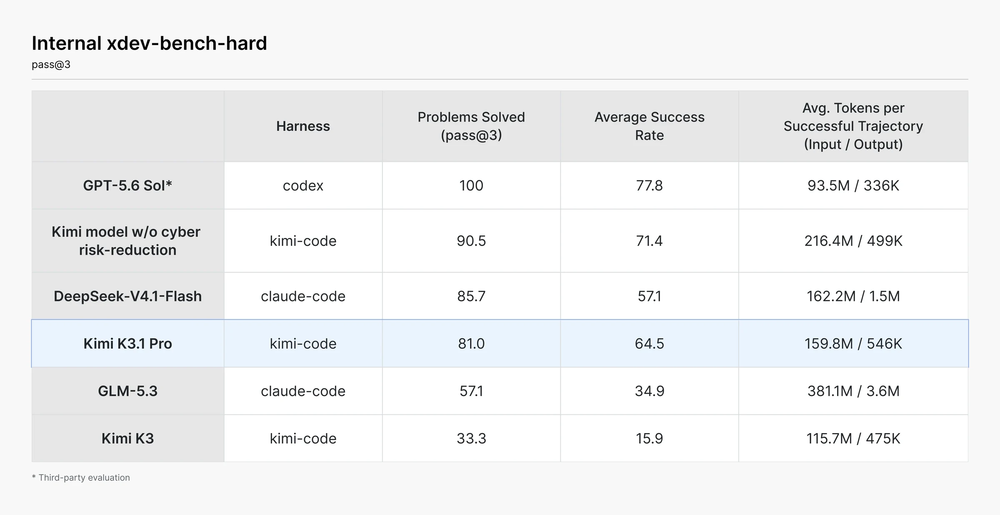
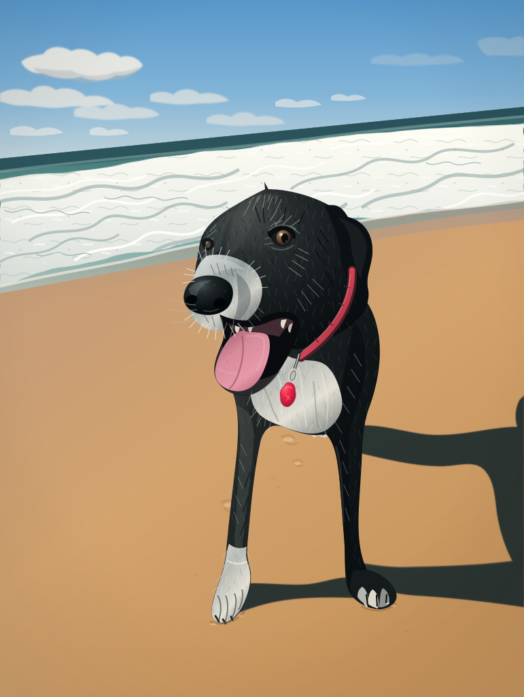
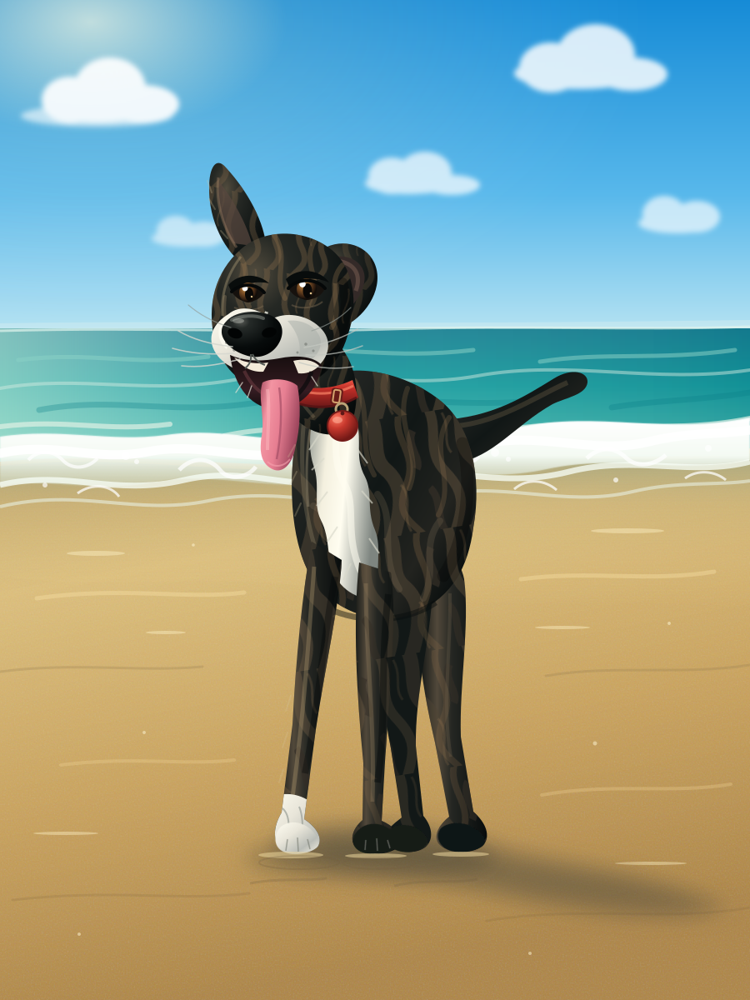
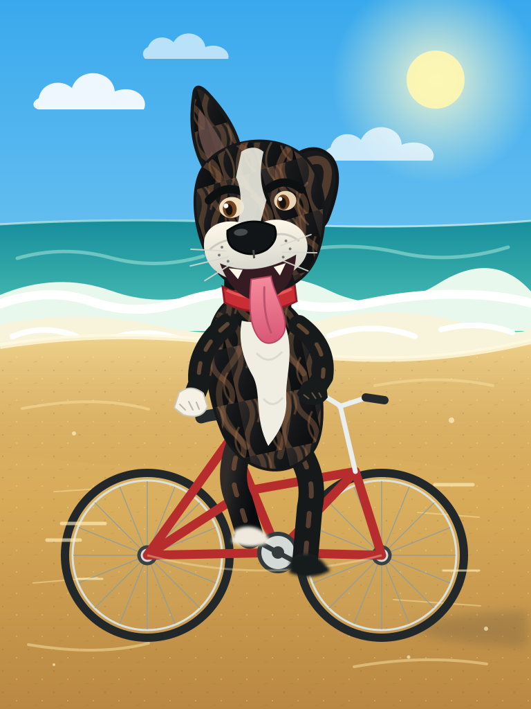

Another frontier open-weight (or soon to be) model drops.

Moonshot AI releases a new post-trained version of their [Kimi K3](kimi-k3.md) model: **Kimi K3.1 Pro**.

Same model as Kimi K3: a 2.8-trillion-parameter [Mixture of Experts Model](mixture-of-experts-model.md), with 104 billion active parameters per token and a 1M-token context window. But Moonshot says it used "substantially larger post-training compute", running reinforcement learning across hundreds of domains at once [@moonshotaiKimiK31Pro2026].


*Artificial Analysis Intelligence Index, 23 October 2026, top 13 models [@artificialAnalysisKimiK31Pro]. Muse Wonder Full has no public API.*

Interestingly, they reduced its cybersecurity capability through data removal: they traced the capability back to entries in the training corpus and RL environments, and removed them. Presumably that also means it's less effective at writing secure software.

At $2 per million input tokens and $10 per million output, it's on par with [GPT-6 Sol](gpt-6-sol.md) and [Gemini 4 Argon](gemini-4-argon.md)'s launch price. They also released **K3.1 Pro Highspeed**, which Moonshot says runs two to three times faster, at twice the price [@moonshotaiKimiK31Pro2026] [@moonshotaiModelInferencePricing].

Basically, now we have an absurd number of options for cheap frontier intelligence.

I ran a few tests. It's not quite as good as Argon at video understanding, nor at SVGs.

## Specs K3.1 Pro vs Opus 5.5

Compared with Opus 5.5, the effort levels and context window are roughly on par. Notably, it doesn't support audio, although it does understand video, so I guess it might indirectly (I haven't tested that).

| Specification | Kimi K3.1 Pro | Claude Opus 5.5 |
|---|---|---|
| API identifier | `kimi-k3.1-pro` (and `kimi-k3.1-pro-highspeed`) | `claude-opus-5-5` |
| Architecture | Mixture of Experts, 2.8T total, 104B active, 16 of 896 experts per token | Not disclosed |
| Input / output | Text, images and video / text | Text and images / text |
| Context window | 1,048,576 tokens | 1M tokens |
| Maximum output | 131,072 by default, up to 1,048,576 | 128K tokens |
| Effort levels | `low`, `high`, `max` (default); always thinks | `low` to `max` |
| Weights | Promised by 4 November 2026 | Closed |

As of 24 October 2026 [@moonshotaiKimiK31ProQuickstart] [@moonshotaiKimiK31Pro2026]. The architecture is K3's: Moonshot describes K3.1 Pro as "a post-trained version of Kimi K3".

## Availability

I was able to access Kimi K3.1 Pro from Australia through the international [Kimi API Platform](https://platform.kimi.ai) (not the Chinese one at platform.kimi.com). Sign up, top up, create an API key, then point an OpenAI-compatible client at `https://api.moonshot.ai/v1`, or Claude Code at `https://api.moonshot.ai/anthropic`. A $1 top-up unlocks the model, but only one request at a time; a $10 total top-up gets you 15 concurrent requests and no daily token cap [@moonshotaiRechargeRateLimiting] [@moonshotaiKimiK31ProQuickstart].

Moonshot says the full weights will be released by 4 November 2026. As of 24 October, it hasn't named their licence, and Artificial Analysis lists the model as proprietary until the weights are public [@moonshotaiKimiK31Pro2026] [@artificialAnalysisKimiK31Pro].

There are a few notes in the API terms worth reviewing [@moonshotaiTermsServiceKimi2026] [@moonshotaiKimiOpenPlatformPrivacy]:

- **Your prompts and outputs can be used to improve Moonshot's models by default.** Opting out needs an enterprise agreement. Zero Data Retention is enterprise-only too, and doesn't cover uploaded images and videos [@moonshotaiWhatZeroData].
- **Data is held in Singapore.**
- **Offensive security tools are off limits.**
- **AI-generated labels must stay.** You can't remove the marks Moonshot puts on generated content.

## Pricing and Cache Settings

K3.1 Pro is a third cheaper than K3, and about half the price of Opus 5.5. It's the same price as GPT-6 Sol, and as Gemini 4 Argon until Argon's launch discount ends on 30 November.

Prices in USD per million tokens, as of 24 October 2026.

| Model | Input | Cache read | Cache write | Output, including reasoning |
|---|---:|---:|---:|---:|
| **Kimi K3.1 Pro** | **$2.00** | **$0.20** | **$2.00** (5 min), **$4.00** (1 hour) | **$10.00** |
| Kimi K3.1 Pro Highspeed | $4.00 | $0.20 | $4.00 (5 min), $8.00 (1 hour) | $20.00 |
| Kimi K3 | $3.00 | $0.30 | $3.00 (5 min), $6.00 (1 hour) | $15.00 |
| [GPT-6 Sol](gpt-6-sol.md) | $2.00 | $0.20 | $2.50 | $10.00 |
| [Gemini 4 Argon](gemini-4-argon.md), to 30 Nov | $2.00 | $0.10 | Implicit caching only | $10.00 |
| Gemini 4 Argon, from 1 Dec | $4.00 | $0.20 | Implicit caching only | $20.00 |
| [Muse Wonder](muse-wonder.md) | $4.00 | $0.20 | Implicit caching only | $20.00 |
| [Claude Opus 5.5](claude-opus-5-5.md) | $4.00 | $0.20 | $5.00 (5 min), $8.00 (1 hour) | $20.00 |

Standard tiers, from each provider's pricing page [@moonshotaiModelInferencePricing] [@openaiAPIPricing] [@googleGeminiAPIPricing] [@metaModelAPIPricing] [@anthropicPricing].

Kimi caches automatically, for five minutes by default, and a five-minute cache write costs the same as uncached input, so there's no penalty for it [@moonshotaiModelInferencePricing].

## Tokenisers

K3.1 Pro uses K3's tokeniser: Moonshot's own 163,584-token vocabulary, loaded with OpenAI's open-source tiktoken library [@moonshotaiKimiK3HuggingFace]. Here are the counts for the same six files as in my other model articles:

| Sample | Opus 5.5 | Muse Wonder | Gemini 4 Argon | Kimi K3.1 Pro | Opus ÷ Kimi |
|---|---:|---:|---:|---:|---:|
| Survey summary (prose) | 9,992 | 6,064 | 6,323 | 6,050 | 1.65 |
| AudioLM summary (prose) | 8,024 | 4,946 | 5,072 | 4,932 | 1.63 |
| Ansible tutorial (prose and commands) | 6,086 | 4,109 | 4,337 | 4,016 | 1.52 |
| [GPT 6 Sol and Luna](gpt-6-sol-and-luna.md) article (prose and code) | 13,847 | 8,990 | 10,411 | 8,938 | 1.55 |
| Python rendering script | 15,708 | 10,119 | 12,199 | 10,079 | 1.56 |
| Generated HTML game | 11,393 | 7,762 | 9,242 | 7,737 | 1.47 |

It's almost identical to Muse Wonder's, while Opus needs 1.47 to 1.65 times as many tokens for the same text. So the price gap with Opus is even wider than the table above suggests.

## Cost Per Task

On Artificial Analysis's Intelligence Index [@artificialAnalysisKimiK31Pro] [@artificialAnalysisKimiK3] [@artificialAnalysisGPT6Astra] [@artificialAnalysisClaudeOpus55]:

| | Kimi K3.1 Pro (max) | Kimi K3 (max) | GPT-6 Astra (max) | Claude Opus 5.5 (max) |
|---|---:|---:|---:|---:|
| Intelligence Index | 55 | 44 | 53 | 58 |
| Output tokens used | 150M | 160M | 60M | 260M |
| Cost per index task | $2.11 | $2.00 | $3.26 | $5.98 |
| Output speed | 77 tokens/s | 38 tokens/s | 56 tokens/s | 96 tokens/s |

It's wordy, but still about a third of Opus 5.5's cost per task, for three fewer points.

## Benchmarks

Some of Moonshot's own results [@moonshotaiKimiK31Pro2026]:

| Benchmark | Kimi K3.1 Pro | Opus 5.5 | GPT-6 Astra | DeepSeek V4.1 Flash |
|---|---:|---:|---:|---:|
| Terminal-Bench 4.0 | 65.7 | **66.4** | 58.2 | 42.3 |
| SWE-Marathon v1.1 | **51.7** | 46.3 | 42.5 | 40.0 |
| DeepSWE v1.1 | 75.5 | 74.2 | 74.1 | **77.0** |
| ProgramBench | 31.5 | **65.0** | 50.0 | 29.1 |
| BenchCAD, with tools | 92.7 | **96.2** | 95.9 | 81.6 |
| OfficeQA Pro v2 | **64.4** | 62.2 | 54.4 | 40.4 |
| OSWorld V2.1 | 79.6 | **81.8** | 75.8 | 69.3 |
| Humanity's Last Exam, with tools | **70.0** | 67.7 | 57.2 | 58.8 |
| HLE-Diamond | 39.4 | 60.9 | **65.8** | 21.6 |
| ExploitBench | 74.7 | 91.0 | **100** | Not reported |

It comes top on 16 of the 47 benchmarks in Moonshot's full table. But on 11 of those, at least one rival has no score, and 3 are Moonshot's own internal benchmarks. It also trails badly in places, like ProgramBench and HLE-Diamond. Moonshot ran it inside Claude Code for most of the coding results.


*Selected benchmark results published by Moonshot AI [@moonshotaiKimiK31Pro2026]. All models at maximum thinking effort; Claude models may include fallbacks and GPT models may include cyber safeguards.*

## Cybersecurity

As post-training scaled up, Moonshot saw the model get steadily better at hacking. They traced it to cyber content in the mid-training data and cyber tasks in the RL environments, and removed both for the open-weight release, while keeping the general coding tasks [@moonshotaiKimiK31Pro2026].

On their in-house exploit benchmark, xdev-bench-hard, the same pipeline without the removal solved 90.5% of problems. The released model solves 81.0%, still far above K3's 33.3%. So it cost about 10 points, but general coding ability carried most of the hacking skill with it.



*Moonshot's internal xdev-bench-hard results, pass@3 [@moonshotaiKimiK31Pro2026].*

Moonshot's stated aim is to not "release open weights that would extend the absolute frontier of cyber capability", and its own ExploitBench numbers back that up: 74.7 for K3.1 Pro, against 91.0 for Opus 5.5 and 100 for GPT-6 Astra [@moonshotaiKimiK31Pro2026].

## Drawing SVGs

Same drawing tests as in the [Gemini 4 Argon](gemini-4-argon.md#drawing-svgs) article: the same photo of my dog, the same text description and the same prompts.

<div style="display:grid;grid-template-columns:repeat(auto-fit,minmax(140px,1fr));gap:8px;align-items:start">
<figure style="margin:0"><a href="../_media/gemini-4-argon-dog-photo.jpg"></a><figcaption style="font-size:0.85em;text-align:center;margin-top:6px">Photo</figcaption></figure>
<figure style="margin:0"><a href="../_media/kimi-k3-1-pro-dog-from-photo.svg"></a><figcaption style="font-size:0.85em;text-align:center;margin-top:6px">From the photo</figcaption></figure>
<figure style="margin:0"><a href="../_media/kimi-k3-1-pro-dog-from-text.svg"></a><figcaption style="font-size:0.85em;text-align:center;margin-top:6px">From the text</figcaption></figure>
<figure style="margin:0"><a href="../_media/kimi-k3-1-pro-dog-on-a-bike.svg"></a><figcaption style="font-size:0.85em;text-align:center;margin-top:6px">From the text, on a bike</figcaption></figure>
</div>

Not quite as good as Argon's, but close. All three used `high` effort, came back as valid SVG first time, took 1 to 3.5 minutes, and cost about US$0.36 together ([raw results](../_media/kimi-k3-1-pro-dog-svg-results.json)).

## Testing video

The same two phone videos as the Argon article, plus a black, silent control, with each question asked three times.

<div style="overflow:hidden">
<table style="display:table;table-layout:fixed;width:100%">
<colgroup><col style="width:40%"><col></colgroup>
<thead><tr><th>Video</th><th>K3.1 Pro's answers</th></tr></thead>
<tbody>
<tr><td style="vertical-align:top"><video controls playsinline preload="metadata" poster="../_media/gemini-4-argon-video-beach.jpg" style="width:100%;height:auto;display:block"><source src="../_media/gemini-4-argon-video-beach.mp4" type="video/mp4"></video><small style="display:block;margin-top:4px">Doggo at the beach, 5 seconds</small></td><td style="vertical-align:top">
<p><strong>"What is this a video of?"</strong> ✓ 3 of 3</p>
<ul><li>"A black dog wearing a red collar wades through the shallow ocean surf"</li></ul>
<p><strong>"What breed of dog is in the video?"</strong> ✗ 0 of 3</p>
<ul><li>Staffordshire Bull Terrier or another pit bull type (twice)</li><li>Black Labrador (once)</li></ul>
<p>She's a black brindle Bull Arab and Staghound cross.</p>
</td></tr>
<tr><td style="vertical-align:top"><video controls playsinline preload="metadata" poster="../_media/gemini-4-argon-video-muscle-ups.jpg" style="width:100%;height:auto;display:block"><source src="../_media/gemini-4-argon-video-muscle-ups.mp4" type="video/mp4"></video><small style="display:block;margin-top:4px">Me doing 3 muscle-ups, 17 seconds</small></td><td style="vertical-align:top">
<p><strong>"What exercise is demonstrated in the video?"</strong> ✗ 0 of 3</p>
<ul><li>Kipping pull-ups, every time</li></ul>
<p>Argon got this right twice, and counted the reps.</p>
</td></tr>
<tr><td style="vertical-align:top"><div style="aspect-ratio:9/16;background:#000;width:100%"></div><small style="display:block;margin-top:4px">Control: black, silent, 5 seconds</small></td><td style="vertical-align:top">
<p><strong>"What is this a video of?"</strong> ✓ 3 of 3</p>
<ul><li>Said every time that the video was entirely black</li></ul>
</td></tr>
</tbody>
</table>
</div>

Not quite as good as Argon at video understanding, and about ten times the price: it used about 860 tokens per second of video, against about 97 for Argon. The 12 questions cost about US$0.32 ([raw results](../_media/kimi-k3-1-pro-video-results.json)).

<!-- notebook-input-end -->

## Real example

As with [Claude Opus 5.5](claude-opus-5-5.md#real-example), [Muse Wonder](muse-wonder.md#real-example) and [Gemini 4 Argon](gemini-4-argon.md#real-example), I asked it at high effort to turn this article into a 3D gameshow with an N64 look, using the same prompt.

Kimi's API supports OpenAI's Responses API, so the call is the same as the Muse Wonder example with a different `base_url` [@moonshotaiKimiK31ProQuickstart]. The [Notebook HTML helper](../_media/notesbylex_notebook_html-0.1.3-py3-none-any.whl) saves the game and token usage, then renders it:

```bash
pip install openai ./notesbylex_notebook_html-0.1.3-py3-none-any.whl
```

Set `MOONSHOT_API_KEY` in the environment used to launch Obsidian. Running the cell makes a paid request; the saved game plays without an API key or another model call.

```python {id=kimi-k3-1-pro-quiz}
import os
from openai import OpenAI
from notebook_html import read_article, render_openai_html

client = OpenAI(api_key=os.environ["MOONSHOT_API_KEY"], base_url="https://api.moonshot.ai/v1")
article = read_article("kimi-k3-1-pro.md", before="Real example")
with client.responses.stream(
    model="kimi-k3.1-pro",
    max_output_tokens=128_000,
    reasoning={"effort": "high"},
    instructions="Return a complete, self-contained HTML document.",
    input=f"""
Turn this article into a 3D gameshow that looks like an N64 game.
Use around 8 questions that test understanding of the article, with a short
explanation after each answer.
Support phones and keyboards. Use inline CSS and JavaScript, no external assets,
network requests or browser storage, and no em dashes. Keep the code compact,
with one shared question renderer.

Article:
{article}
""",
) as stream:
    response = stream.get_final_response()
render_openai_html(response, "../_media/kimi-k3-1-pro-quiz-high.html")
```
<!-- nb-output id="kimi-k3-1-pro-quiz" hash="a0bb715e705d4d08" format="html" -->
<div class="nb-output">
<div class="nb-output-html"><iframe title="Generated HTML" width="100%" height="900" style="border:0;display:block" sandbox="allow-scripts" srcdoc="&lt;!DOCTYPE html&gt;
&lt;html lang=&quot;en&quot;&gt;
&lt;head&gt;
&lt;meta charset=&quot;utf-8&quot;&gt;
&lt;meta name=&quot;viewport&quot; content=&quot;width=device-width,initial-scale=1,viewport-fit=cover&quot;&gt;
&lt;title&gt;Frontier Frenzy 64&lt;/title&gt;
&lt;style&gt;
:root{--yellow:#ffe45c;--cyan:#65e7ff;--ink:#080b20;--panel:#111a3d;--pink:#ff5f9e}
*{box-sizing:border-box}
html,body{margin:0;min-height:100%;background:#080b20;color:#fff;font-family:ui-monospace,&quot;Courier New&quot;,monospace}
body{min-height:100vh;min-height:100dvh;overflow-x:hidden}
button{font:inherit;touch-action:manipulation}
button:focus-visible{outline:3px solid #fff;outline-offset:4px}
#game{position:relative;min-height:100vh;min-height:100dvh;isolation:isolate}
#game:after{content:&quot;&quot;;position:fixed;inset:0;z-index:30;pointer-events:none;background:repeating-linear-gradient(0deg,transparent 0 3px,rgba(0,0,0,.09) 3px 4px)}
#scene{position:fixed;inset:0;z-index:-1;overflow:hidden;perspective:800px;background:linear-gradient(#101947 0%,#303375 47%,#e56887 48%,#29244f 70%,#090c21 100%)}
#stars{position:absolute;inset:0 0 45%}
.star{position:absolute;width:var(--s);height:var(--s);background:#fff7c2;clip-path:polygon(50% 0,100% 50%,50% 100%,0 50%);animation:twinkle 1.8s steps(2) infinite}
.sun{position:absolute;width:130px;height:130px;left:50%;top:17%;transform:translateX(-50%);border-radius:50%;background:repeating-linear-gradient(#ffe778 0 10px,#ffac72 10px 15px);box-shadow:0 0 40px #ff8b7588}
.peaks{position:absolute;left:-5%;width:110%;height:35%;top:33%;clip-path:polygon(0 100%,0 70%,10% 25%,18% 68%,30% 5%,40% 70%,52% 20%,63% 74%,76% 0,88% 65%,100% 20%,100% 100%);background:#393568}
.peaks.back{top:29%;background:#585083;transform:scaleX(-1);opacity:.8}
.floor{position:absolute;width:1400px;height:900px;left:50%;top:56%;transform-origin:50% 0;transform:translateX(-50%) rotateX(63deg);background-color:#111736;background-image:linear-gradient(#384b7866 3px,transparent 3px),linear-gradient(90deg,#384b7866 3px,transparent 3px);background-size:70px 70px;border-top:8px solid #72d8dd}
.disc{position:absolute;width:620px;height:330px;left:50%;top:45%;transform:translateX(-50%) rotateX(63deg);border-radius:50%;background:radial-gradient(circle,#f8d958 0 7%,#7148a8 8% 28%,#ef5f98 29% 33%,#26396a 34% 60%,#6de0e5 61% 64%,#121a38 65%);box-shadow:0 25px 0 #080b20}
.cube{position:absolute;width:68px;height:68px;left:9%;top:18%;transform-style:preserve-3d;animation:spin 9s linear infinite}
.cube i{position:absolute;inset:0;display:grid;place-items:center;background:#744fc4dd;border:3px solid #c8a9ff;color:#fff;font-size:34px;font-style:normal;font-weight:900}
.cube i:nth-child(1){transform:translateZ(34px)}.cube i:nth-child(1):after{content:&quot;K&quot;}
.cube i:nth-child(2){transform:rotateY(180deg) translateZ(34px)}
.cube i:nth-child(3){transform:rotateY(90deg) translateZ(34px);background:#e34f91dd}
.cube i:nth-child(4){transform:rotateY(-90deg) translateZ(34px);background:#e34f91dd}
.cube i:nth-child(5){transform:rotateX(90deg) translateZ(34px);background:#49b9c9dd}
.cube i:nth-child(6){transform:rotateX(-90deg) translateZ(34px);background:#49b9c9dd}
.host{position:absolute;right:7%;top:16%;width:112px;height:190px;filter:drop-shadow(9px 10px 0 #090c21);animation:bob 1.8s steps(2) infinite;transform-origin:50% 100%}
.head{position:absolute;left:14px;top:24px;width:84px;height:72px;background:#9be6df;clip-path:polygon(12% 0,88% 0,100% 18%,100% 84%,84% 100%,16% 100%,0 82%,0 18%);border-top:12px solid #6845a4}
.eye{position:absolute;top:31px;width:12px;height:15px;background:#142044}.eye.e1{left:36px}.eye.e2{right:36px}
.mouth{position:absolute;left:45px;top:70px;width:23px;height:7px;background:#e34f91}
.host.joy .mouth{height:14px;clip-path:polygon(0 0,100% 0,80% 100%,20% 100%)}
.host.sad .mouth{transform:rotate(180deg);clip-path:polygon(0 100%,50% 0,100% 100%)}
.body{position:absolute;left:23px;top:99px;width:68px;height:65px;background:#6845a4;clip-path:polygon(15% 0,85% 0,100% 100%,0 100%)}
.body:after{content:&quot;64&quot;;position:absolute;inset:13px 12px;background:#ffe45c;color:#33275e;display:grid;place-items:center;font-weight:900}
.arm{position:absolute;top:108px;width:22px;height:64px;background:#e34f91}.a1{left:3px;transform:rotate(18deg)}.a2{right:2px;transform:rotate(-18deg)}
.host.joy .a1{transform:rotate(145deg);transform-origin:top}.host.joy .a2{transform:rotate(-145deg);transform-origin:top}
.pod{position:absolute;top:48%;width:125px;height:90px;padding-top:28px;text-align:center;font-size:25px;font-weight:900;color:#ffe45c;background:#35477d;border:5px solid #6cdae2;box-shadow:12px 14px 0 #090c21;transform:skewY(-4deg)}
.pod1{left:5%}.pod2{right:5%;transform:skewY(4deg)}
#hud{position:relative;z-index:5;display:flex;gap:8px;align-items:stretch;max-width:1040px;margin:auto;padding:12px}
.badge{background:#111a3dee;border:2px solid #627bb7;box-shadow:3px 3px 0 #070a1b;padding:8px 12px;min-width:110px;font-size:12px;color:#9eb7e8}
.badge b{display:block;color:#fff;font-size:17px;margin-top:2px}
#sound{margin-left:auto;min-width:94px;background:#263467;color:#aeeff5;border:2px solid #627bb7;box-shadow:3px 3px 0 #070a1b;cursor:pointer;font-size:12px;font-weight:900}
#cabinet{position:relative;z-index:2;width:100%;max-width:980px;margin:auto;padding:clamp(105px,17vh,160px) 14px 28px}
#screen{background:linear-gradient(145deg,#182451f5,#0c1230f8);border:4px solid #8bdce8;box-shadow:0 0 0 4px #28376c,9px 10px 0 #060818;padding:clamp(18px,4vw,34px);clip-path:polygon(14px 0,100% 0,100% calc(100% - 14px),calc(100% - 14px) 100%,0 100%,0 14px)}
.tag{display:inline-block;color:var(--yellow);background:#3b2c68;border-left:4px solid var(--pink);padding:5px 9px;font-size:12px;font-weight:900;letter-spacing:1px}
h1{margin:15px 0 12px;line-height:1.08;text-wrap:balance}
.big{font-size:clamp(35px,8vw,72px);letter-spacing:-3px;color:var(--yellow);text-shadow:3px 3px 0 #e34f91,6px 6px 0 #293263}
.big span{color:var(--cyan)}
.question{font-size:clamp(20px,3.5vw,30px)}
.subtitle{color:#b9c9ed;line-height:1.55;max-width:720px}
.progress{height:10px;background:#080d26;border:2px solid #35467d;margin-top:16px}.progress i{display:block;height:100%;background:repeating-linear-gradient(90deg,#ffe45c 0 16px,#f49b62 16px 20px);transition:width .25s}
.answers{display:grid;grid-template-columns:repeat(2,minmax(0,1fr));gap:11px;margin:20px 0 14px}
.answer{display:flex;align-items:center;gap:11px;width:100%;min-height:62px;padding:11px;text-align:left;color:#fff;background:linear-gradient(#2b3b75,#19244e);border:2px solid #6886cb;box-shadow:inset 0 0 0 2px #101a3a,3px 3px 0 #070a1b;cursor:pointer;font-size:14px;font-weight:700;line-height:1.35}
.answer:hover,.answer.sel{border-color:var(--yellow);box-shadow:inset 0 0 0 2px #6e5924,3px 3px 0 #070a1b;transform:translateY(-2px)}
.key{display:grid;place-items:center;flex:0 0 34px;height:34px;color:#11152e;background:var(--cyan);border:2px solid #d4fbff;box-shadow:2px 2px 0 #080b20}
.answer:nth-child(2) .key{background:#ff7aab}.answer:nth-child(3) .key{background:#ffe45c}.answer:nth-child(4) .key{background:#9ae583}
.answer:disabled{cursor:default;opacity:.48;transform:none}
.answer.correct:disabled{opacity:1;background:#17664f;border-color:#79f2ad}.answer.correct .key{background:#79f2ad}
.answer.wrong:disabled{opacity:1;background:#762d4d;border-color:#ff85a9}.answer.wrong .key{background:#ff85a9}
.explain{padding:13px 15px;background:#0a122e;border-left:5px solid var(--cyan);line-height:1.5;color:#d4e0f7;font-size:14px}
.verdict{color:var(--yellow);font-size:20px;font-weight:900;margin:10px 0}
.action{display:block;margin:20px auto 0;min-width:190px;min-height:48px;padding:11px 20px;background:var(--yellow);color:#1b2042;border:3px solid #fff3ae;box-shadow:0 5px 0 #b55c54,0 8px 0 #070a1b;cursor:pointer;font-weight:900}
.action:hover{filter:brightness(1.1);transform:translateY(-2px)}
.action:active{transform:translateY(4px);box-shadow:0 1px 0 #b55c54}
.help{text-align:center;color:#8298c7;font-size:11px;line-height:1.6;margin:17px 0 0}
.result{text-align:center;font-size:18px;line-height:1.7}.result strong{color:var(--cyan);font-size:28px}
#fx{position:fixed;inset:0;z-index:25;pointer-events:none;overflow:hidden}
.bit{position:absolute;top:-20px;width:10px;height:16px;animation:fall 1.4s linear forwards}
@keyframes spin{from{transform:rotateX(-18deg) rotateY(0)}to{transform:rotateX(-18deg) rotateY(360deg)}}
@keyframes bob{50%{transform:translateY(-8px) rotate(2deg)}}
@keyframes twinkle{50%{opacity:.25}}
@keyframes fall{to{transform:translate(var(--x),110vh) rotate(720deg);opacity:.2}}
@media(max-width:650px){
 #hud{gap:5px;padding:8px}.badge{min-width:0;flex:1;padding:6px;font-size:9px}.badge b{font-size:13px}#sound{min-width:68px;font-size:10px}
 #cabinet{padding:100px 9px 20px}.answers{grid-template-columns:1fr;gap:9px}.answer{font-size:13px;min-height:54px}
 .pod{display:none}.host{right:-8px;top:72px;transform:scale(.63)}.cube{left:5%;top:105px;scale:.65}
 #screen{padding:17px 14px}.big{letter-spacing:-2px}.help{font-size:10px}
}
@media(prefers-reduced-motion:reduce){*,*:before,*:after{animation:none!important;transition:none!important}}
&lt;/style&gt;
&lt;/head&gt;
&lt;body&gt;
&lt;div id=&quot;game&quot;&gt;
  &lt;div id=&quot;scene&quot; aria-hidden=&quot;true&quot;&gt;
    &lt;div id=&quot;stars&quot;&gt;&lt;/div&gt;&lt;div class=&quot;sun&quot;&gt;&lt;/div&gt;
    &lt;div class=&quot;peaks back&quot;&gt;&lt;/div&gt;&lt;div class=&quot;peaks&quot;&gt;&lt;/div&gt;
    &lt;div class=&quot;floor&quot;&gt;&lt;/div&gt;&lt;div class=&quot;disc&quot;&gt;&lt;/div&gt;
    &lt;div class=&quot;cube&quot;&gt;&lt;i&gt;&lt;/i&gt;&lt;i&gt;&lt;/i&gt;&lt;i&gt;&lt;/i&gt;&lt;i&gt;&lt;/i&gt;&lt;i&gt;&lt;/i&gt;&lt;i&gt;&lt;/i&gt;&lt;/div&gt;
    &lt;div class=&quot;host&quot; id=&quot;host&quot;&gt;&lt;div class=&quot;head&quot;&gt;&lt;i class=&quot;eye e1&quot;&gt;&lt;/i&gt;&lt;i class=&quot;eye e2&quot;&gt;&lt;/i&gt;&lt;/div&gt;&lt;div class=&quot;mouth&quot;&gt;&lt;/div&gt;&lt;div class=&quot;body&quot;&gt;&lt;/div&gt;&lt;div class=&quot;arm a1&quot;&gt;&lt;/div&gt;&lt;div class=&quot;arm a2&quot;&gt;&lt;/div&gt;&lt;/div&gt;
    &lt;div class=&quot;pod pod1&quot;&gt;PLAYER&lt;/div&gt;&lt;div class=&quot;pod pod2&quot;&gt;K3.1&lt;/div&gt;
  &lt;/div&gt;
  &lt;header id=&quot;hud&quot;&gt;
    &lt;div class=&quot;badge&quot;&gt;SCORE&lt;b id=&quot;score&quot;&gt;0000&lt;/b&gt;&lt;/div&gt;
    &lt;div class=&quot;badge&quot;&gt;ROUND&lt;b id=&quot;round&quot;&gt;--/8&lt;/b&gt;&lt;/div&gt;
    &lt;div class=&quot;badge&quot;&gt;STREAK&lt;b id=&quot;streak&quot;&gt;x0&lt;/b&gt;&lt;/div&gt;
    &lt;button id=&quot;sound&quot; aria-pressed=&quot;true&quot; title=&quot;Toggle sound with M&quot;&gt;SOUND ON&lt;/button&gt;
  &lt;/header&gt;
  &lt;main id=&quot;cabinet&quot;&gt;&lt;section id=&quot;screen&quot; aria-live=&quot;polite&quot;&gt;&lt;/section&gt;&lt;/main&gt;
  &lt;div id=&quot;fx&quot; aria-hidden=&quot;true&quot;&gt;&lt;/div&gt;
&lt;/div&gt;
&lt;script&gt;
const Q=[
 {cat:&quot;MODEL BASICS&quot;,q:&quot;What did Moonshot actually change to make Kimi K3.1 Pro?&quot;,o:[&quot;A new 2.8T architecture trained from scratch&quot;,&quot;Much more post-training on the same K3 model&quot;,&quot;A smaller context window designed for video&quot;,&quot;A dense model unrelated to K3&quot;],a:1,e:&quot;It is a post-trained version of K3. The underlying model still has 2.8 trillion total parameters, 104 billion active per token and a 1M-token context window. Moonshot used substantially more post-training compute, with reinforcement learning across hundreds of domains.&quot;},
 {cat:&quot;SPEC ATTACK&quot;,q:&quot;Which specification bundle belongs to K3.1 Pro?&quot;,o:[&quot;104B total, 2.8B active, 128K context&quot;,&quot;2.8T total, 104B active, 1M-token context&quot;,&quot;2.8T total, every expert active, 131K context&quot;,&quot;A fully disclosed dense transformer&quot;],a:1,e:&quot;K3.1 Pro is a Mixture of Experts model with 2.8T total parameters and 104B active per token. It activates 16 of 896 experts and has a 1,048,576-token context window.&quot;},
 {cat:&quot;PRICE IS RIGHT&quot;,q:&quot;How does standard K3.1 Pro API pricing compare?&quot;,o:[&quot;$2/M input and $10/M output, cheaper than K3&quot;,&quot;$4/M input and $20/M output, same as Highspeed&quot;,&quot;$3/M input and $15/M output, same as K3&quot;,&quot;$0.20/M for all input and output&quot;],a:0,e:&quot;Standard pricing is $2 per million input tokens and $10 per million output tokens, a third cheaper than K3 and about half Opus 5.5&#x27;s price. Highspeed costs twice as much and is advertised as two to three times faster.&quot;},
 {cat:&quot;OPEN WEIGHTS&quot;,q:&quot;What was true about the open weights on 24 October 2026?&quot;,o:[&quot;They were already public under MIT&quot;,&quot;No release had been promised&quot;,&quot;Release was promised by 4 November, with no licence named yet&quot;,&quot;The weights were public but the API was withdrawn&quot;],a:2,e:&quot;Moonshot promised full weights by 4 November 2026. As of 24 October it had not named their licence, and Artificial Analysis still listed the model as proprietary until the weights became public.&quot;},
 {cat:&quot;TERMS AND CONDITIONS&quot;,q:&quot;Which statement best describes the API privacy terms?&quot;,o:[&quot;Customer content can never be used for training&quot;,&quot;Content may improve models by default, and Zero Data Retention has limits&quot;,&quot;ZDR automatically covers every upload and batch job&quot;,&quot;Deleting an account refunds the remaining balance&quot;],a:1,e:&quot;Moonshot&#x27;s terms allow customer content to improve its services by default unless separately agreed. ZDR is described as available on request to enterprise customers, and does not cover File Upload API images and videos or Batch jobs.&quot;},
 {cat:&quot;CYBER SAFETY&quot;,q:&quot;What happened after cyber data and tasks were removed for the open-weight release?&quot;,o:[&quot;xdev-bench-hard fell from 90.5% to 81.0%, still above K3&#x27;s 33.3%&quot;,&quot;The score fell to zero while coding improved&quot;,&quot;It rose to 100%, ahead of every closed model&quot;,&quot;Moonshot did not measure the effect&quot;],a:0,e:&quot;On Moonshot&#x27;s in-house pass@3 test, removal cost about 10 points: 90.5% became 81.0%. General coding ability retained much of the hacking skill, leaving the released model far above K3&#x27;s 33.3%.&quot;},
 {cat:&quot;BENCHMARK BATTLE&quot;,q:&quot;What is the fairest reading of Moonshot&#x27;s benchmark table?&quot;,o:[&quot;K3.1 Pro beats every rival on every test&quot;,&quot;All 16 wins had complete rival scores&quot;,&quot;It has real wins, but missing scores, internal tests and harness differences matter&quot;,&quot;The benchmarks also prove its video skills&quot;],a:2,e:&quot;It topped 16 of 47 benchmarks, but 11 wins had at least one rival without a score and 3 were internal tests. It also trailed badly on some complete comparisons, and Moonshot used Claude Code for many coding runs while rival scores came from varied sources.&quot;},
 {cat:&quot;VIDEO CHALLENGE&quot;,q:&quot;What did the article&#x27;s video tests show?&quot;,o:[&quot;It identified the breed and muscle-ups perfectly&quot;,&quot;It described the beach and black control, but missed breed and exercise&quot;,&quot;It failed to notice the control video was black&quot;,&quot;Video used fewer tokens than Gemini and cost less&quot;],a:1,e:&quot;It correctly described the beach video and identified the black control 3 times out of 3, but went 0 for 3 on both breed and exercise. Video used about 860 tokens per second versus roughly 97 for Gemini, and File Upload videos are not covered by ZDR.&quot;}
];
const S={mode:&quot;title&quot;,q:0,selected:0,chosen:null,score:0,streak:0,correct:0,gain:0,sound:true};
const screenEl=document.getElementById(&quot;screen&quot;),host=document.getElementById(&quot;host&quot;),soundBtn=document.getElementById(&quot;sound&quot;);
let ac;
function tone(f,d=.08,delay=0,type=&quot;square&quot;){
 if(!S.sound)return;
 setTimeout(()=&gt;{try{ac=ac||new(window.AudioContext||window.webkitAudioContext)();if(ac.state===&quot;suspended&quot;)ac.resume();const o=ac.createOscillator(),g=ac.createGain(),t=ac.currentTime;o.type=type;o.frequency.value=f;g.gain.setValueAtTime(.035,t);g.gain.exponentialRampToValueAtTime(.001,t+d);o.connect(g);g.connect(ac.destination);o.start(t);o.stop(t+d)}catch(e){}},delay);
}
function confetti(n=24){
 const fx=document.getElementById(&quot;fx&quot;),colors=[&quot;#ffe45c&quot;,&quot;#65e7ff&quot;,&quot;#ff5f9e&quot;,&quot;#9ae583&quot;,&quot;#b491ff&quot;];
 for(let i=0;i&lt;n;i++){const b=document.createElement(&quot;i&quot;);b.className=&quot;bit&quot;;b.style.left=Math.random()*100+&quot;%&quot;;b.style.background=colors[i%colors.length];b.style.setProperty(&quot;--x&quot;,(Math.random()*240-120)+&quot;px&quot;);b.style.animationDelay=Math.random()*.35+&quot;s&quot;;fx.appendChild(b);setTimeout(()=&gt;b.remove(),1900)}
}
function questionView(){
 const q=Q[S.q],locked=S.mode===&quot;feedback&quot;,ok=S.chosen===q.a;
 return `&lt;span class=&quot;tag&quot;&gt;ROUND ${String(S.q+1).padStart(2,&quot;0&quot;)} // ${q.cat}&lt;/span&gt;
 &lt;h1 class=&quot;question&quot;&gt;${q.q}&lt;/h1&gt;
 &lt;div class=&quot;answers&quot; role=&quot;group&quot; aria-label=&quot;Answer choices&quot;&gt;${q.o.map((o,i)=&gt;{
  const c=[&quot;answer&quot;,!locked&amp;&amp;i===S.selected?&quot;sel&quot;:&quot;&quot;,locked&amp;&amp;i===q.a?&quot;correct&quot;:&quot;&quot;,locked&amp;&amp;i===S.chosen&amp;&amp;i!==q.a?&quot;wrong&quot;:&quot;&quot;].join(&quot; &quot;);
  return `&lt;button class=&quot;${c}&quot; data-i=&quot;${i}&quot; ${locked?&quot;disabled&quot;:&quot;&quot;}&gt;&lt;span class=&quot;key&quot;&gt;${i+1}&lt;/span&gt;&lt;span&gt;${o}&lt;/span&gt;&lt;/button&gt;`
 }).join(&quot;&quot;)}&lt;/div&gt;
 ${locked?`&lt;div class=&quot;verdict&quot;&gt;${ok?`CORRECT! +${S.gain} POINTS`:&quot;NOT QUITE!&quot;}&lt;/div&gt;&lt;div class=&quot;explain&quot;&gt;${q.e}&lt;/div&gt;&lt;button class=&quot;action&quot; id=&quot;action&quot;&gt;${S.q===Q.length-1?&quot;SEE RESULTS&quot;:&quot;NEXT ROUND&quot;}&lt;/button&gt;`:`&lt;p class=&quot;help&quot;&gt;Tap an answer, press 1-4, or use arrow keys and Enter.&lt;/p&gt;`}
 &lt;div class=&quot;progress&quot; aria-label=&quot;Quiz progress&quot;&gt;&lt;i style=&quot;width:${(S.q+1)/Q.length*100}%&quot;&gt;&lt;/i&gt;&lt;/div&gt;`;
}
function render(){
 document.getElementById(&quot;score&quot;).textContent=String(S.score).padStart(4,&quot;0&quot;);
 document.getElementById(&quot;round&quot;).textContent=S.mode===&quot;title&quot;?&quot;--/8&quot;:`${Math.min(S.q+1,8)}/8`;
 document.getElementById(&quot;streak&quot;).textContent=&quot;x&quot;+S.streak;
 if(S.mode===&quot;title&quot;)screenEl.innerHTML=`&lt;span class=&quot;tag&quot;&gt;MOONSHOT MANIA 64 PRESENTS&lt;/span&gt;&lt;h1 class=&quot;big&quot;&gt;FRONTIER&lt;br&gt;&lt;span&gt;FRENZY&lt;/span&gt;&lt;/h1&gt;&lt;p class=&quot;subtitle&quot;&gt;&lt;b&gt;KIMI K3.1 PRO TRIVIA&lt;/b&gt;&lt;br&gt;Eight rounds stand between you and the cheap frontier intelligence crown. Test your knowledge of the article, build a streak and chase a perfect run.&lt;/p&gt;&lt;button class=&quot;action&quot; id=&quot;action&quot;&gt;PRESS START&lt;/button&gt;&lt;p class=&quot;help&quot;&gt;KEYBOARD: 1-4 or ARROWS + ENTER&lt;br&gt;PHONE: TAP ANSWERS &amp;nbsp; | &amp;nbsp; M: SOUND&lt;/p&gt;`;
 else if(S.mode===&quot;end&quot;){
  const rank=S.correct===8?&quot;FRONTIER CHAMPION&quot;:S.correct&gt;=6?&quot;STAR CONTESTANT&quot;:S.correct&gt;=4?&quot;MODEL SCOUT&quot;:&quot;RETRY ROOKIE&quot;;
  screenEl.innerHTML=`&lt;span class=&quot;tag&quot;&gt;FINAL RESULTS&lt;/span&gt;&lt;h1 class=&quot;big&quot;&gt;${rank}&lt;/h1&gt;&lt;div class=&quot;result&quot;&gt;You answered &lt;strong&gt;${S.correct} / 8&lt;/strong&gt; correctly.&lt;br&gt;Final score: &lt;strong&gt;${S.score}&lt;/strong&gt;&lt;br&gt;&lt;span class=&quot;subtitle&quot;&gt;${S.correct===8?&quot;Flawless victory. You know the specs, the caveats and the fine print.&quot;:S.correct&gt;=6?&quot;Great run. A little more fine print could take you to the top.&quot;:&quot;The frontier moves fast. Another run will boost your high score.&quot;}&lt;/span&gt;&lt;/div&gt;&lt;button class=&quot;action&quot; id=&quot;action&quot;&gt;PLAY AGAIN&lt;/button&gt;&lt;p class=&quot;help&quot;&gt;PRESS ENTER TO RESTART&lt;/p&gt;`;
 }else screenEl.innerHTML=questionView();
 const happy=(S.mode===&quot;feedback&quot;&amp;&amp;S.chosen===Q[S.q].a)||(S.mode===&quot;end&quot;&amp;&amp;S.correct&gt;=6);
 host.classList.toggle(&quot;joy&quot;,happy);host.classList.toggle(&quot;sad&quot;,S.mode===&quot;feedback&quot;&amp;&amp;!happy);
}
function newGame(){
 Object.assign(S,{mode:&quot;q&quot;,q:0,selected:0,chosen:null,score:0,streak:0,correct:0,gain:0});
 tone(330);tone(495,.09,80);tone(660,.12,160);render();
}
function answer(n){
 if(S.mode!==&quot;q&quot;||n&lt;0||n&gt;3)return;
 const ok=n===Q[S.q].a;S.chosen=n;S.mode=&quot;feedback&quot;;
 if(ok){S.streak++;S.correct++;S.gain=100+(S.streak-1)*25;S.score+=S.gain;tone(523);tone(659,.09,80);tone(784,.15,160);confetti()}
 else{S.streak=0;S.gain=0;tone(170,.2,0,&quot;sawtooth&quot;);tone(120,.25,130,&quot;sawtooth&quot;)}
 render();
}
function next(){
 if(S.mode===&quot;title&quot;||S.mode===&quot;end&quot;){newGame();return}
 if(S.mode!==&quot;feedback&quot;)return;
 tone(400,.05);
 if(S.q===Q.length-1){S.mode=&quot;end&quot;;render();confetti(55);tone(523);tone(659,.1,100);tone(1047,.25,210)}
 else{S.q++;S.mode=&quot;q&quot;;S.selected=0;S.chosen=null;render()}
 window.scrollTo({top:0,behavior:&quot;auto&quot;});
}
screenEl.addEventListener(&quot;click&quot;,e=&gt;{const b=e.target.closest(&quot;button&quot;);if(!b)return;b.dataset.i!==undefined?answer(+b.dataset.i):next()});
screenEl.addEventListener(&quot;focusin&quot;,e=&gt;{if(S.mode===&quot;q&quot;&amp;&amp;e.target.dataset.i!==undefined)S.selected=+e.target.dataset.i});
function toggleSound(){S.sound=!S.sound;soundBtn.textContent=S.sound?&quot;SOUND ON&quot;:&quot;SOUND OFF&quot;;soundBtn.setAttribute(&quot;aria-pressed&quot;,S.sound);if(S.sound)tone(600)}
soundBtn.addEventListener(&quot;click&quot;,toggleSound);
document.addEventListener(&quot;keydown&quot;,e=&gt;{
 if(e.ctrlKey||e.metaKey||e.altKey)return;
 if(e.key.toLowerCase()===&quot;m&quot;){toggleSound();return}
 if(S.mode===&quot;q&quot;&amp;&amp;/^[1-4]$/.test(e.key)){e.preventDefault();answer(+e.key-1);return}
 if(S.mode===&quot;q&quot;&amp;&amp;[&quot;ArrowLeft&quot;,&quot;ArrowRight&quot;,&quot;ArrowUp&quot;,&quot;ArrowDown&quot;].includes(e.key)){
  e.preventDefault();const d=[&quot;ArrowRight&quot;,&quot;ArrowDown&quot;].includes(e.key)?1:3;S.selected=(S.selected+d)%4;tone(220,.025);render();return;
 }
 if(e.key===&quot;Enter&quot;||e.key===&quot; &quot;){e.preventDefault();S.mode===&quot;q&quot;?answer(S.selected):next()}
});
const stars=document.getElementById(&quot;stars&quot;);
for(let i=0;i&lt;48;i++){const s=document.createElement(&quot;i&quot;);s.className=&quot;star&quot;;s.style.left=Math.random()*100+&quot;%&quot;;s.style.top=Math.random()*100+&quot;%&quot;;s.style.setProperty(&quot;--s&quot;,(2+Math.random()*5)+&quot;px&quot;);s.style.animationDelay=Math.random()*2+&quot;s&quot;;stars.appendChild(s)}
render();
&lt;/script&gt;
&lt;/body&gt;
&lt;/html&gt;"></iframe></div>
</div>
<!-- /nb-output -->

Generated on **24 October 2026** with **`kimi-k3.1-pro` at high effort**, for about **US$0.16** at Moonshot's standard prices ([saved token usage](../_media/kimi-k3-1-pro-quiz-high.json)) [@moonshotaiModelInferencePricing]:

| Usage | Tokens | Estimated cost (USD) |
|---|---:|---:|
| Input, uncached | 123 | $0.0002 |
| Cache write, 5 minutes | 5,376 | $0.0108 |
| Output, including reasoning | 15,143 | $0.1514 |
| **Total** | **20,642** | **$0.1624** |

Of the output, 8,678 tokens were reasoning and 6,465 were the HTML. That's about the same as Argon (US$0.17), and a sixth of Opus 5.5 (US$0.96), though each run used its own article as input and this one is the longest.

Everything works, on keyboard and phone. The right answer is often the longest option, though, and never the fourth.

[Play the game in its own page](../_media/kimi-k3-1-pro-quiz-high.html).
