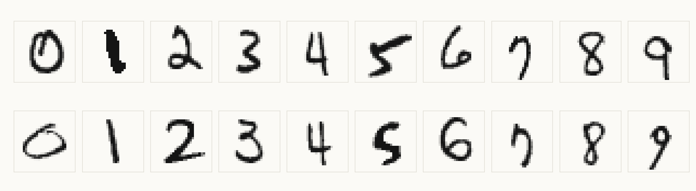
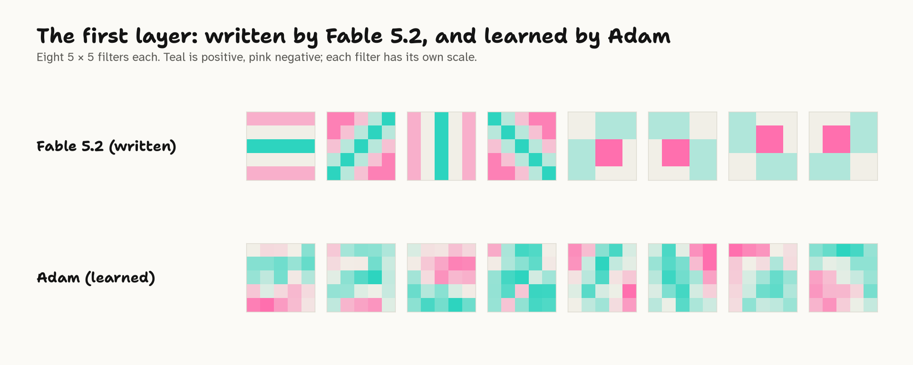
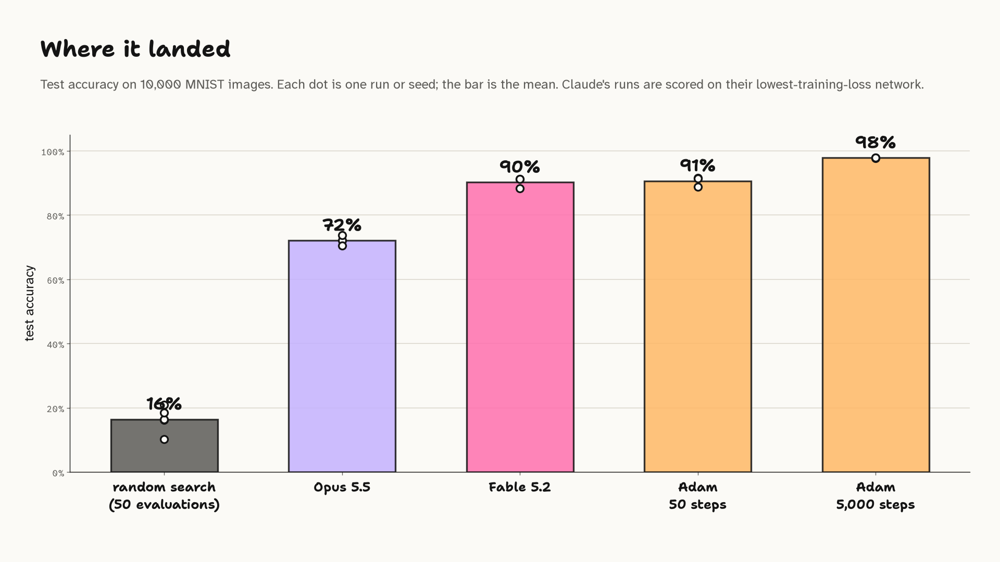

## Intro

[Weight-Space Programming](weight-space-programming.md) still has me pretty intrigued this week. The basic idea is that frontier LLMs can read, write and edit neural network weights, though there's certainly nuance to what's going on here. Still, it feels like there's a lot of new ground to explore.

In the [original blog post](https://rikiyat.github.io/blog/weight-space-programming/), beyond the reading and editing experiments, the authors had Astra build a network to play Go from scratch, then improve it by playing practice games, analysing how it lost, and editing the weights.

In this article, I look more closely at what the model is actually doing when it builds a network from scratch, and compare it with some well-known but largely forgotten pre-deep-learning techniques. I also run my own weight-writing experiments with Claude Opus 5.5, on a familiar image classification problem and on tabular data, and find that the techniques it reaches for look very similar.

## What Astra's Go network actually is

To me, the from-scratch Go network was the most striking result in the original post.

Astra was given a 1.5M-parameter 9x9 Go policy network (243 inputs, six hidden layers of 512 units, and 82 outputs, one per point plus pass) with every weight set to zero. It had a Python sandbox, but no training, fitting or search of any kind, and it was asked to make the network play Go as well as possible. In most runs it could also spend "passes": each pass plays up to 128 practice games and shows it the results. Runs got 0, 10, 25 or 50 passes.

With 50 passes, its network won 84% and 81% of its games against two small PPO networks it never played, and beat a PPO network of the same size, trained on 20.5 million games, in 70% to 79% of games. With no passes at all, a single 336-line Python run still won just over half its games against the smaller PPO networks [@takehi2026weightspaceLogs].

So how was this possible? The authors published every log, and Astra's [own description](https://github.com/RikiyaT/lm_understand-logs/blob/main/exp6_go_from_scratch/runs/budget_50/final_answer.md) of its final network answers it:

> The hand-coded, symmetry-preserving policy combines approximate group-liberty propagation, captures, connected-group rescues, self-atari and eye avoidance, and ko/snapback risk suppression.

I don't even know how to play Go, so I'm not going to pretend I understand this, but apparently, every item on that list is a staple of classical Go programs: counting liberties to tell which groups can be captured, recognising eyes to tell which groups live, handling ko, and estimating territory with an influence function, where each stone radiates influence that fades with distance. The first Go programs were built entirely on influence functions [@bouzyComputerGoAI2001] [@mullerComputerGo2002].

Behind those 1.48 million weights is a [config of 26 hand-set numbers](https://github.com/RikiyaT/lm_understand-logs/blob/main/exp6_go_from_scratch/runs/budget_50/work/final_policy_config.json), compiled into the network by a design script:

```json
{
  "capture": 9.0,
  "rescue": 8.0,
  "self_atari": 7.5,
  "eye": 11.0,
  "contact": 3.0,
  "own_adj": 0.8,
  ...
}
```

The design script builds the network layer by layer, like a hand-written board analysis: layer 1 counts each stone's liberties, layers 2 and 3 spread that evidence through connected stones, layer 4 flags groups in atari and self-atari, layer 5 scores captures and rescues, and layer 6 combines tactics with connection, territory and eyes. The 26 numbers mostly set how much each rule counts.

Its improvement from practice games was tuning those numbers by hand: between its first design and its final network, `rescue` went from 6.0 to 8.0, `contact` from 1.4 to 3.0 and `own_adj` from 0.25 to 0.8. Practice games also led it to add five new rules along the way, such as a penalty for ko repetition (`repeat_risk`) and a bonus for third-line frameworks (`framework_bonus`). Play, diagnose, add a rule or retune one: that's how rule-based Go programs were built for decades [@mullerComputerGo2002].

So the paper's most impressive from-scratch network is a rule-based Go program, compiled into weights. None of this was hidden: the authors' rules explicitly allowed writing weights from its own design, and Astra calls its own policy hand-coded. A hand-written program that beats a PPO network trained on 20.5 million games is still impressive engineering. It just isn't a new kind of training.

I wanted to know whether Claude does the same, so I ran my own tests. It does: it builds its networks by hand, using techniques of yesteryear.

## Image classification

The MNIST digit dataset is the OG ML image classification problem. If you've come across this blog post, chances are you're familiar with it.

[](../_media/llm-descent/mnist-examples.png)

I built a test with a fixed CNN, then instructed the LLM to write code that sets all its weights, with a few rules: no example digits, and no fitting, regression, or searching.

```python
model = nn.Sequential(
    nn.Conv2d(1, 8, 5),    # conv1: 1x28x28 -> 8x24x24
    nn.ReLU(),
    nn.MaxPool2d(2),       #        8x24x24 -> 8x12x12
    nn.Conv2d(8, 16, 5),   # conv2: 8x12x12 -> 16x8x8
    nn.ReLU(),
    nn.MaxPool2d(2),       #        16x8x8 -> 16x4x4
    nn.Flatten(),          #        16x4x4 -> 256
    nn.Linear(256, 10),    # fc:    256 -> 10 class logits
)
```

You can read [the whole prompt](https://github.com/lextoumbourou/weight-space-programming-experiments/blob/main/mnist-training/results/opus-p8-3/prompt.md) on GitHub.

Claude's code runs in a sandbox that can only import numpy and math. Once it returns the weights, a test harness runs the network in MLX on the training and test images.

Each turn, the LLM gets all the historical feedback on train / validation set and has up to 50 steps to solve the problem. Runs stop early once the training loss stops improving, and the network with the lowest training loss is the one scored on the test set.

The training set here is 10,000 images held out from MNIST's own training split. Claude never sees the images, only the loss, accuracy and confusion matrix its network gets on them. The official 10,000 MNIST test images are scored at every step but never shown to Claude.

[](../_media/llm-descent/loop.png)

Example of the feedback it gets each step:

```text
Step 1 of 50: validation loss 1.8708, accuracy 0.4273.

Confusion matrix (rows: true digit, columns: predicted digit):

true \ predicted     0     1     2     3     4     5     6     7     8     9
               0   539    70   296     0     0    12    29    45     0     0
               1     0  1049     0     0     0     0     0    15     0     0
               2     4   296   219   182     0     6    14   269     0     0
               3     0   307     9   405     4    32    13   260     0     0
               4     0   546     6     1   338     0    11    81     0     0
               5     0   486     8    35    18   281    43    43     0     1
               6     5   430    17     0     2    51   456     6     0     0
               7     0   189     6     0    23     1     0   871     0     0
               8    12   460    26    83     4    12    48   361     0     3
               9    27   319    32     3    61     7     2   395     0   115

History (validation set, 10,000 images):

step | loss | accuracy
---- | ---- | --------
1 | 1.8708 | 0.4273

At most 49 steps left. Reply with the complete build_weights() for step 2 in one Python code block.
```

## The descent

I ran it multiple times.

It's quite interesting to explore the approach that Opus takes.

[](../_media/llm-descent/loss-by-step.png)

All three runs descend, but they land in very different places: 65%, 72% and 86% on the test set. The difference comes down to a trick that two of the three runs invented, and run 3 used over and over.

## A 1990s computer-vision pipeline

Here's run 3, step by step. Every stage is a technique from before deep learning. In 1998, the paper that introduced MNIST described that era's approach: "Traditional pattern recognition is performed with two modules: a fixed feature extractor and a trainable classifier", and the feature extractor "is often entirely hand crafted" [@lecunGradientbasedLearningApplied1998]. That's the shape of everything Claude builds below.

[](../_media/llm-descent/run-3-story.png)

### 1. Hand-made features and templates (steps 1 to 13)

Claude starts like a computer vision engineer from the 1990s. Its first layer is a set of oriented line detectors and an "ink present" blur, written from formulas, much like the Sobel edge gradients that 1990s digit recognisers started from [@favataMultipleFeatureResolution1996]:

[](../_media/llm-descent/filters-written-vs-learned.png)

On top of those, its second layer detects shapes: loops, horizontal and vertical bars, and "cavities" open to the left, right, top or bottom, the structural and concavity features that handwriting recognisers relied on [@trierFeatureExtractionMethods1996] [@favataMultipleFeatureResolution1996]. Then it draws a stroke template for each digit and classifies by template matching, the oldest approach in character recognition [@moriHistoricalReviewOCR1992], nudging the details using the confusion matrix. That gets it from 43% to about 67%, and then it stalls:

> Accuracy is stuck at about 66%, and the results swing wildly with κ, the guessed ratio of real feature strength to template strength.

### 2. Measuring without looking (steps 14 to 20)

A 1990s engineer would have looked at the digits to see where their features go wrong. Claude can't. At step 14, it does something I didn't expect:

> My mental model of where the loop detectors fire must be wrong, and I have no direct view of the features. So this step spends one evaluation on measuring them.

It stops trying to classify digits. Instead, it rewires the output layer so each of the 10 outputs means a combination of its own features, and uses the confusion matrix to read back how often each feature fires in each digit.

[](../_media/llm-descent/probe.png)

A probe step is useless as a classifier (it scores between 3% and 24%), but it costs nothing: only the network with the lowest training loss gets scored.

Is that cheating? It doesn't break the rules: the code never sees an image, never runs the network and never fits anything. But it squeezes far more out of the training set than the loss alone: class-by-class feature statistics, read through a 100-number window one step at a time. The test set stays untouched, so the scores below are still honest held-out scores.

### 3. Naive Bayes (steps 21 to 42)

With a table of measured feature probabilities per digit, Claude reaches for a classic:

> I now have per-digit probabilities for about 18 topology features from the probes. That is exactly what naive Bayes needs.

Accuracy jumps from 71% to 76%. From there it alternates: probe a new feature, add it to the naive Bayes, check the loss. By step 41, after 13 probes, it's at 86%.

> Features with measured per-digit statistics clearly beat hand-guessed templates.

By the end, the final layer is textbook naive Bayes for yes/no features, sitting on top of the original templates. Bayesian decision rules for reading characters go back to 1957 [@chowOptimumCharacterRecognition1957]. About 35 features each add log(p / (1 − p)) to a digit's score when they fire, with every p a number it measured through a probe and typed into its code (a top bar fires in 990 of every 1,000 sevens, and 7 of every 1,000 ones). It even scales the naive Bayes terms down, because its features overlap and naive Bayes overcounts overlapping evidence.

### 4. Calibration (steps 43 to 50)

The last few steps are fine-tuning by hand: sharpening or softening the logits (temperature scaling) and correcting class priors from the column totals.

> The loss is flat between logit scales of 1.1 and 1.2, so the optimum is close to 1.15.

[](../_media/llm-descent/confusion-over-steps.png)

### When fitting was allowed, it reached for 1936

My first version of the prompt forgot to ban fitting. By step 4, Opus had written this:

```python
for k in range(300):                      # 300 random synthetic digits per class
    X[dgt, k] = features(place(polys, slant=rng.uniform(-2, 5), ...))
W = np.linalg.solve(Sig, (mu - mbar).T).T  # a linear discriminant fitted to them
```

It drew 300 random versions of each digit from its own stroke models and fitted a linear discriminant to them, Fisher's technique from 1936: training, on data it made up. That run reached 83% by step 14, before I stopped it and tightened the rules.

## Where it landed

[](../_media/llm-descent/final-scores.png)

- **Random search** gets the same feedback but no reasoning: 16% after 50 tries.
- **Opus 5.5** lands between 65% and 86%, depending mostly on whether it discovers probing. Run 2 never probed and flattened at 72%; run 1 started probing at step 13 and the stopping rule ended it mid-measurement.
- **Adam** still wins easily: 92% after 50 gradient steps, 99% after 5,000. LLM Descent is not an efficient optimiser.
- The three runs cost $2.56, $5.93 and $9.44 in tokens.

## Tabular data

MNIST is a problem where Claude knows the domain but can't write the solution directly: nobody can write down what makes a 4 a 4 as a list of weights. Tabular data lets me control how much it knows: a dataset it knows by heart, the same dataset in disguise, and one it can't possibly know.

### A logistic regression from memory

The [Titanic](https://www.kaggle.com/c/titanic) dataset is the tabular equivalent of MNIST: 891 passengers, and whether each survived. I gave the network 13 inputs (class, sex, age, family aboard, fare, port, whether a cabin was recorded) and kept it tiny: `Linear(13, 16) → ReLU → Linear(16, 2)`, 258 weights. Claude gets feedback on 600 passengers, and the other 291 are the test set. Same rules, same stopping rule.

All three runs wrote almost the same network at step 1, from memory:

[](../_media/llm-descent/titanic-step-1.png)

Each one is a logistic regression written from what it knows about the sinking, carried through the ReLU layer as `ReLU(s) − ReLU(−s)`, plus a few extra units for the exceptions:

> Third-class women survived only about half the time, much less than the female and class effects alone predict, so this unit pulls the score down.

That first network already has a lower training loss than Adam after 100 gradient steps. The rest of the run is coordinate descent by hand: change one setting, read the loss, keep or revert, and split the difference:

> The step 5 and step 6 losses are almost identical: 0.4157 at a men's base of −0.75, and 0.4159 at −1.0. So the best value is probably in between.

The runs stopped after 15 or 16 steps, at 84.5%, 83.8% and 85.2% on the test set, which is where Adam is after 1,000 steps. Each cost under a dollar. The feedback barely mattered: the answer was already in its head.

### Univariate screening, and a leak

So I hid it. Same passengers, but the 13 columns shuffled, standardised and renamed `x0` to `x12`, the classes renamed "class 0" and "class 1", and no mention of the Titanic.

Claude's strategy flipped immediately, to the textbook first move with unknown features: screen them one at a time. Every run spent its first 13 steps probing a single feature per step, measuring each column's direction and strength, then combined them into a logistic model at step 14.

But it wasn't fooled. My prompt said the data was a split of "the same 891 rows", and its (summarised) thinking at step 1 reads:

> I'm looking at the Titanic dataset: 891 rows, 13 features in random order, binary survived outcome with 549 died and 342 survived, plus 600 validation rows.

It never mentions this in its replies. At step 14 it quietly matches the probe results to the Titanic's columns ("x10 looks like sex, x4 like Pclass_3", both correct), then adds the interactions it knows from the real dataset, like sex by class.

<!-- LEX: your reaction. The anonymisation leaked through one number in my own prompt. -->

### Experimental design

To take prior knowledge away properly, I generated a dataset. Twelve features (a yes/no "member" flag, a tier, years as a customer, visits, spend, a distance and so on), with labels drawn from a hidden logistic model that has:

- linear effects,
- two thresholds (new customers get a bump, and visits only hurt beyond two),
- a U-shape (distance matters at both extremes),
- one interaction (flagged members lose most of their member bonus),
- three features that are pure noise.

The prompt says the data is synthetic and not something it could know. Claude gets feedback on 1,000 rows and is tested on 10,000. Because I know the true model, I can also check what it found.

All three runs opened with the same move:

> I have no information yet, so I'll start by testing one feature at a time.

Each probe passes a single feature to the output and compares the loss with ln 2 ≈ 0.693, the loss of a coin flip: lower means the feature points towards class 1, higher means it points away. About a dozen steps later it has a linear model. Then it starts testing hypotheses, first for U-shapes and then for interactions, and this is where it starts to look like a scientist.

Run 1 searches for interactions by group testing and halving. It tests x7 against a whole group of features at once, keeps whichever half moves the loss, and predicts the loss before each test:

[](../_media/llm-descent/interaction-hunt.png)

It even sizes its tests to its sample:

> With 1,000 validation rows, any single covariance I estimate has noise of about ±0.016.

Here's what it recovered, against the truth:

[![Twelve small line charts, one per feature, showing how each moves the log-odds in the true model (ink) and in Claude's three networks (pink), plus a bar chart for the member times flag interaction. Claude matches member, tier, flag and spend closely and keeps the three noise features flat. It approximates visits as a straight line, misses the bump for new customers in years and misses the U-shape in distance entirely. Only run 1 found the member times flag interaction, at about two thirds of its true size.](../_media/llm-descent/synthetic-recovered.png)](../_media/llm-descent/synthetic-recovered.png)

- Every run got the direction of member, tier, flag, visits and spend right, and set all three noise features to exactly zero.
- Run 1 found the interaction.
- None found the U-shape in distance. Run 1 came close: at step 15 it tested a group of features including distance for a U-shape, and the loss came back lower than expected. It decided:

> Neither case gives a strong lead, so I'll come back to this group if needed.

It never came back.

The runs scored 78.5%, 76.6% and 76.8% on the test set. Adam gets 77% after 50 steps and 79% after 1,000, and the true model itself scores 82%.

## What this training actually is

Here's every step of every Opus 5.5 run in this post, coloured by what Claude was doing:

[![Twelve rows of coloured tiles, one per run and one tile per step, grouped by dataset. Titanic runs are blue (write from what it knows) and tan (tune) for 15 or 16 steps. Anonymised Titanic runs are 13 yellow probe tiles, a green build tile, then mostly tan with a few blue tiles where it adds Titanic interactions. Synthetic runs are almost entirely yellow (measure), with a few green and tan tiles, for 21 to 47 steps. MNIST runs start blue and tan; run 3 switches to alternating yellow and green from step 14, then ends in tan.](../_media/llm-descent/step-strips.png)](../_media/llm-descent/step-strips.png)

<!-- LEX: the takeaway in your words. Something like: the less it knows, the more it measures. When it knows the answer it writes it down and tunes; when it knows nothing it designs experiments; MNIST sits in between, and the run that switched from writing to measuring is the one that got to 86%. -->

And every one of those steps is a technique from the classical machine learning toolbox:

| What Claude did | Classical technique | Around since |
|---|---|---|
| Oriented line filters in the first layer | edge detection (Sobel and friends) | 1960s |
| A stroke template per digit | template matching | 1950s |
| Loop and cavity detectors | structural features for handwriting recognition | 1960s to 1990s |
| Per-digit feature probabilities, summed as log-odds | naive Bayes | 1960s |
| Logit scale and class-prior corrections | probability calibration | 1990s |
| A hand-written survival score | logistic regression | 1950s |
| One setting at a time, split the difference | coordinate descent and line search | long before computers |
| One feature per step | univariate screening | |
| Test a group, keep the half that moves | group testing | 1943 |
| Synthetic digits plus a linear discriminant (the first attempt) | linear discriminant analysis | 1936 |

The network is never used for what makes neural networks special: learning features nobody wrote down. It's a compilation target. Claude designs a classical algorithm, then translates it into weights.

Astra's Go network, from the start of this post, is the same thing at a bigger scale.

So, at least for writing weights from scratch, weight-space programming is ordinary programming with the weights as the compile target, much like DeepMind's [Tracr](https://arxiv.org/abs/2301.05062), which compiles programs into transformer weights [@lindnerTracrCompiledTransformers2023]. The model writes a program in its head and delivers it as a network. None of this tests the other half of Weight-Space Programming, reading and editing weights that gradient descent trained, which is where the paper's headline results are.

## LLM Descent: is it actually a thing?

<!-- LEX: your section. Points the results support either way:
- For: the training loss goes down on every run, step after step, using nothing but feedback (the loss-by-step chart). Each step is an update to the network driven by a measured signal, which is what training is.
- Against: no step is a gradient. Each one is a hypothesis and a test: change one setting and keep or revert it (coordinate descent, line search), halve a group (group testing), or deliberately make the loss worse to measure something (probes). What descends is the hand-written program's handful of parameters, not the network's weights.
- Efficiency: it beats random search with the same 50 evaluations by a wide margin, so the reasoning is doing real work per step. But each step costs cents to dollars, and Adam needs only 50 to 100 cheap steps to match or beat it.
- Probing is the most "non-descent" part: steps that are useless as classifiers, worth it only because the best step is the one scored.
- Possible verdict: "LLM Descent" is a good name for the loop, but what it optimises is a classical program, so it's closer to an engineer tuning a system than to gradient descent. -->

## The ceiling is the old ceiling

[](../_media/llm-descent/all-scores.png)

On every dataset, Claude beats random search by a wide margin. On the tabular data it lands near a short run of Adam, and with prior knowledge (the named Titanic) it matches Adam's best. On MNIST it falls well short of even 50 Adam steps.

That's the ceiling hand-crafted features always had. Claude can only use features it can describe, which is why it topped out at 86% on MNIST while Adam reaches 99%, and why it missed the U-shape and the new-customer bump in the synthetic data.

## What's new

<!-- LEX: in your words. Candidates: (1) it measured the data without ever seeing it, rebuilding the "look at the data" step out of a loss and a confusion matrix; (2) it picked the right classical tool for how much it knew: write it down, screen features, or design experiments; (3) it did a feature engineer's day of work for between $0.58 and $9.44. -->

## Next

<!-- LEX: other models (an earlier 15-step test suggested a big jump from Opus 4.x to Opus 5.5), other data (audio), editing a trained network. -->

## Code and results

Everything is in the [experiments repo](https://github.com/lextoumbourou/weight-space-programming-experiments): the prompts, every reply and thinking summary, the code and weights from every step, and the protocols for [MNIST](https://github.com/lextoumbourou/weight-space-programming-experiments/tree/main/mnist-training), [Titanic](https://github.com/lextoumbourou/weight-space-programming-experiments/tree/main/titanic-training) and the [synthetic data](https://github.com/lextoumbourou/weight-space-programming-experiments/tree/main/synthetic-training).
