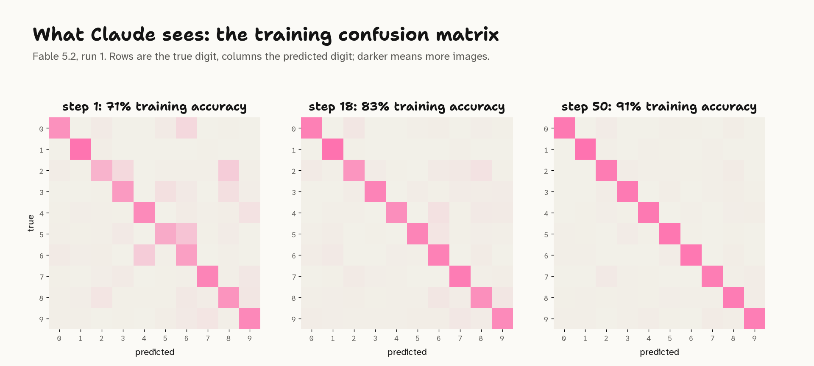

## Intro

[Weight-Space Programming](weight-space-programming.md) still has me pretty intrigued. The basic idea is that frontier LLMs can read, write and edit the weights of neural networks. There's nuance to what's going on, but it feels like there's a lot of new ground to explore.

In the [original blog post](https://rikiyat.github.io/blog/weight-space-programming/) beyond the reading and editing experiments, the authors had GPT-6 Astra build a network to play Go from scratch, then improve it by playing practice games, and editing the weights based on analysis of its losses. That loop of writing, testing and editing feels like a new way to train a network, something like *LLM Descent*. But is it?

In this article, I run my own weight-writing experiment with Claude Fable 5.2 on a familiar image classification problem. Look closely at what it builds, and learn that it's using largely forgotten image classification techniques from before deep learning.

Finally, I look at what Astra actually did to build its Go network, and find the same thing.

## Building an image classifier with LLM Descent

MNIST is the OG image classification problem. The goal is to label each handwritten digit, 0 to 9.

[](../_media/llm-descent/mnist-examples.png)

I built a test with a fixed CNN, then prompted Claude to write code that sets all its weights, with a few rules that include no fitting, regression, or searching. It's a considerably stricter setup than Astra had for Go, with no PyTorch and no practice games, only a score on the training set after each attempt. I also ran a few tests that gave the model more feedback, including example digits, but they didn't make much difference, so I've left them out of this post.

I ran it with Claude Fable 5.2, which came out while I was writing this, and with Opus 5.5 for comparison.

Claude starts with no weights at all, and has to set every one of this network's 5,994 weights "by hand":

```python
model = nn.Sequential(
    nn.Conv2d(1, 8, 5),    # conv1: 1x28x28 -> 8x24x24
    nn.ReLU(),
    nn.MaxPool2d(2),       #        8x24x24 -> 8x12x12
    nn.Conv2d(8, 16, 5),   # conv2: 8x12x12 -> 16x8x8
    nn.ReLU(),
    nn.MaxPool2d(2),       #        16x8x8 -> 16x4x4
    nn.Flatten(),          #        16x4x4 -> 256
    nn.Linear(256, 10),    # fc:    256 -> 10 class logits
)
```

You can read [the whole prompt](https://github.com/lextoumbourou/weight-space-programming-experiments/blob/main/mnist-training/results/fable-a-1/prompt.md) on GitHub.

Claude's code runs in a sandbox that can only import NumPy, SciPy and math. Once it returns the weights, a test harness runs the network on the training and test images.

Claude has up to 50 steps, and at each one it sees all the feedback so far. A run stops early once the training loss stops improving, and the network with the lowest training loss is the one scored on the test set.

The training set is 10,000 images from MNIST's official training split. The 10,000 official test images are scored at every step, but Claude never sees those scores.

[](../_media/llm-descent/loop.png)

Here's the feedback it got after its first attempt:

```output
Step 1 of 50: training loss 1.0324, accuracy 0.7147.

Confusion matrix (rows: true digit, columns: predicted digit):

true \ predicted     0     1     2     3     4     5     6     7     8     9
               0   723     0    39     0     0    42   181     0     5     1
               1     4  1022    23     0     3     4     0     8     0     0
               2    30     5   461   176     3    12     9    13   271    10
               3     2     0     8   687     0   125    51     4   133    20
               4     7    19    14     6   768     0    35    10    22   102
               5    10     5    13    45     2   492   312     6    29     1
               6    41    17    19     1   266     8   603     0    10     2
               7     8     2    21    45     2     7    13   906    11    75
               8    15    19    86     5     5     4    60    27   714    74
               9    15     9     1     4     1    19    46    82    13   771

History (training set, 10,000 images):

step | loss | accuracy
---- | ---- | --------
1 | 1.0324 | 0.7147

At most 49 steps left. Reply with the complete build_weights() for step 2
in one Python code block.
```

### The descent

I ran it three times.

[](../_media/llm-descent/loss-by-step.png)

All three runs descend for the full 50 steps, still improving when they run out, and land at 91.3%, 88.3% and 91.2% on the test set. That's about where Adam gets to after 50 gradient steps.

Let's look at what the runs actually built, step by step. As we'll see, Claude's approach looks a lot like the hand-crafted methods early computer vision researchers used.

### A 1990s computer-vision pipeline

In 1998, LeCun's paper that introduced MNIST described that era's approach as "a fixed feature extractor and a trainable classifier", where the feature extractor "is often entirely hand crafted" [@lecunGradientbasedLearningApplied1998]. Accuracy, he wrote, "is largely determined by the ability of the designer to come up with an appropriate set of features", which is "a daunting task which, unfortunately, must be redone for each new problem."

That daunting task is exactly what Claude takes on, for about $30 a run.

All three runs built the same kind of pipeline, in roughly the same order:

| Technique | Run 1 | Run 2 | Run 3 |
|---|---:|---:|---:|
| Hand-drawn digit templates | step 1 | step 1 | step 1 |
| Log-odds (naive Bayes) scoring | step 1 | step 11 | step 2 |
| Loop detectors | step 2 | step 5 | step 5 |
| Corner or concavity detectors | step 3 | step 3 | step 14 |
| First measurement step | step 4 | step 4 | step 5 |
| Classifier built from its measurements | step 5 | step 11 | step 13 |
| Measurement steps in total | 20 | 24 | 27 |

*The first step at which each run's reply uses the technique.*

We'll study all the steps taken in run 1, which turns out to be an interesting history lesson on how we created image classification models before the deep learning era. It's the best of the three, at 91.3%, but the other two follow the same path.

[](../_media/llm-descent/fable-run-1-story.png)

#### 1. Hand-drawn templates (steps 1 to 3)

Claude starts like a 1990s computer vision engineer. Its first layer is a set of line detectors at four angles, written from formulas. They're much like the [Sobel filter](https://en.wikipedia.org/wiki/Sobel_operator), a classic way to find edges in an image, which 1990s digit recognisers started with [@favataMultipleFeatureResolution1996].

[](../_media/llm-descent/filters-written-vs-learned.png)

Then it draws each digit by hand, as a few strokes, and turns the drawings into a table of how likely each stroke is in each part of the image. It scores every image against those tables:

> The weights are the log-odds of that table, scaled down by a temperature.

That's template matching, the oldest approach in character recognition [@moriHistoricalReviewOCR1992], scored like naive Bayes, which treats each feature as independent evidence for each digit. Bayesian decision rules for reading characters go back to 1957 [@chowOptimumCharacterRecognition1957]. Its first network gets 71% on the test set, and redrawing the digits the confusion matrix says are wrong gets it to 77%.

#### 2. Testing each detector (steps 4 to 9)

A 1990s engineer would have looked at the digits to see where their features go wrong. Claude can't. At step 4, it does something I didn't expect. It stops classifying for a step, to test its loop detector on its own:

> I cannot tell that from a confusion matrix where everything is mixed together, so this step tests the detector on its own, like a unit test.

It rewires the output layer so each "predicted digit" stands for how strongly, and where, the loop detector fires. That turns each row of the confusion matrix into a histogram for one true digit. The answer comes back in one step: the detector fires on 83% of 8s, in both halves of the image. At steps 6 and 7 it tests its own drawings the same way, putting variants of each digit head to head, which is why the chart dips to almost zero there.

Is that cheating? It doesn't break the rules: the code never sees an image, never runs the network and never fits anything. But it squeezes far more out of the training set than the loss alone: class-by-class feature statistics, read through a 100-number window one step at a time. The test set stays untouched, so the scores below are still honest held-out scores.

#### 3. Corners (steps 10 to 18)

Next, it adds detectors for the four kinds of inner corner, the structural and concavity features that handwriting recognisers relied on [@trierFeatureExtractionMethods1996] [@favataMultipleFeatureResolution1996]. It guesses how they behave at first, and when tuning stalls at about 81% it measures them instead, three steps in a row, then sets their weights from what it measured. By step 18 it's at 83%.

> Three measurement steps on the corners gave more than many steps of guessing, and they showed that some of my hand-drawn expectations were far off.

#### 4. Measuring every stroke (steps 19 to 30)

So it measures everything else too. Over the next twelve steps it reads out how often each of its 32 stroke features fires for each digit, a few features per step. At step 24 it plugs the first fifteen measurements in to check they help, and accuracy jumps from 83% to 88%.

#### 5. Rebuilt from measurements (steps 31 to 40)

At step 31 it throws its drawings away:

> rebuild the whole classifier from measured rates: 32 orientation cells, 8 corner zones and the loop detector. No hand-drawn stroke templates remain in the final layer.

What's left is naive Bayes with every probability measured from the training set, counted one feature at a time through the confusion matrix. It reaches 89%, and 90% after tuning a few global settings. Then it spends steps 36 to 40 measuring the half of the stroke grid it hadn't measured yet.

#### 6. Calibration (steps 41 to 50)

The last ten steps are fine-tuning by hand: how much to trust each kind of evidence, and how sharp to make the probabilities. It knows exactly how it will be scored:

> if this step does not beat 0.3111, step 48 is the one that gets scored.

It finishes at 91.3% on the test set.

[](../_media/llm-descent/confusion-over-steps.png)

### What about Opus 5.5?

Opus 5.5 reaches for the same toolbox: oriented strokes, hand-drawn templates, nearest centroid, naive Bayes, and loop and endpoint detectors. The difference is how much it measures. Fable's runs spent 20 to 27 steps measuring, while Opus's spent none, three and one, and kept guessing instead. Its runs stopped at steps 19 to 23, scoring 70% to 74% on the test set.

### When fitting was allowed, it reached for 1936

My first version of the prompt forgot to ban fitting. By step 4, Opus had written this:

```python
for k in range(300):                      # 300 random synthetic digits per class
    X[dgt, k] = features(place(polys, slant=rng.uniform(-2, 5), ...))
W = np.linalg.solve(Sig, (mu - mbar).T).T  # a linear discriminant fitted to them
```

It drew 300 random versions of each digit from its own stroke models and fitted a linear discriminant to them, Fisher's technique from 1936: training, on data it made up. [That run](https://github.com/lextoumbourou/weight-space-programming-experiments/tree/e26658b/mnist-training/results/opus-high-loose-rules-stopped) reached 83% by step 14, before I stopped it and tightened the rules.

### Where it landed

[](../_media/llm-descent/final-scores.png)

- **Random search** gets the same feedback but no reasoning: 16% on average after 50 tries.
- **Opus 5.5** lands between 70% and 74%.
- **Fable 5.2** lands between 88% and 91%, level with Adam after 50 gradient steps, without a single gradient.
- **Adam**, trained on the same 10,000 images, keeps going: 98% after 5,000 steps, at a tiny fraction of the cost. LLM Descent is not an efficient optimiser.
- The Fable 5.2 runs cost $26.64 to $31.18 each in tokens, and the Opus 5.5 runs $2.74 to $4.23.

## Exploring the Go network

Claude's MNIST network turned out to be a 1990s computer-vision pipeline. Does the paper's own Go network work the same way?

To me, the from-scratch Go network was the most striking result in the original post.

Astra was given a 1.5M-parameter 9x9 Go policy network (243 inputs, six hidden layers of 512 units, and 82 outputs, one per point plus pass) with every weight set to zero. It had a Python sandbox, but no training, fitting or search of any kind, and it was asked to make the network play Go as well as possible. In most runs it could also spend "passes": each pass plays up to 128 practice games and shows it the results. Runs got 0, 10, 25 or 50 passes.

With 50 passes, its network won 84% of games against one small PPO network and 81% against another, neither of which it had played during development. It also beat a PPO network of the same size, trained on 20.5 million games, in 70% to 79% of games. With no passes at all, a single 336-line Python run still won just over half its games against the smaller PPO networks [@takehi2026weightspaceLogs].

So, how is this even possible? Well, Astra spells it out in its [final answer](https://github.com/RikiyaT/lm_understand-logs/blob/main/exp6_go_from_scratch/runs/budget_50/final_answer.md):

> The hand-coded, symmetry-preserving policy combines approximate group-liberty propagation, captures, connected-group rescues, self-atari and eye avoidance, and ko/snapback risk suppression.

I don't even know how to play Go, so I'm not going to pretend I understand this, but my LLM tells me that every item on that list is a staple of classical Go programs: counting liberties to tell which groups can be captured, recognising eyes to tell which groups live, handling ko, and estimating territory with an influence function, where each stone radiates influence that fades with distance. The first Go programs were built entirely on influence functions [@bouzyComputerGoAI2001] [@mullerComputerGo2002].

Behind those 1.48 million weights is a [config of 26 hand-set numbers](https://github.com/RikiyaT/lm_understand-logs/blob/main/exp6_go_from_scratch/runs/budget_50/work/final_policy_config.json), compiled into the network by a design script:

```json
{
  "capture": 9.0,
  "rescue": 8.0,
  "self_atari": 7.5,
  "eye": 11.0,
  "contact": 3.0,
  "own_adj": 0.8,
  ...
}
```

The design script builds the network layer by layer, like a hand-written board analysis: layer 1 counts each stone's liberties, layers 2 and 3 spread that evidence through connected stones, layer 4 flags groups in atari and self-atari, layer 5 scores captures and rescues, and layer 6 combines tactics with connection, territory and eyes. The 26 numbers mostly set how much each rule counts.

Its improvement from practice games was tuning those numbers by hand: between its first design and its final network, `rescue` went from 6.0 to 8.0, `contact` from 1.4 to 3.0 and `own_adj` from 0.25 to 0.8. Practice games also led it to add five new rules along the way, such as a penalty for ko repetition (`repeat_risk`) and a bonus for third-line frameworks (`framework_bonus`). Play, diagnose, add a rule or retune one: that's how rule-based Go programs were built for decades [@mullerComputerGo2002].

So the paper's most impressive from-scratch network is a rule-based Go program, compiled into weights. None of this was hidden - the authors' rules explicitly allowed writing weights from its own design, and Astra calls its own policy hand-coded. A hand-written program that beats a PPO network trained on 20.5 million games is still impressive engineering. It doesn't look like a new kind of training so much as a clever combination of training-free tricks of yesteryear.

## What this training actually is

Every step Claude took on MNIST, and every part of Astra's Go program, is a technique from the classical toolbox:

| What the model did | Classical technique | Around since |
|---|---|---|
| Oriented line filters in the first layer | edge detection (Sobel and friends) | 1960s |
| A stroke template per digit | template matching | 1950s |
| Loop and cavity detectors | structural features for handwriting recognition | 1960s to 1990s |
| Per-digit feature probabilities, summed as log-odds | naive Bayes | 1960s |
| Logit scale and class-prior corrections | probability calibration | 1990s |
| One setting at a time, split the difference (Claude's calibration, Astra's Go coefficients) | coordinate descent and line search | long before computers |
| Liberties, eyes and influence (Astra) | rule-based Go evaluation | 1970s |
| Choosing a weight edit for Qwen (Astra, per Barry) | linear programming | 1940s |
| Synthetic digits plus a linear discriminant (the first attempt) | linear discriminant analysis | 1936 |

The network is never used for what makes neural networks special: learning features nobody wrote down. It's a compilation target. Claude designs a classical algorithm, then translates it into weights.

Astra's Go network, as we saw, is the same thing at a bigger scale.

So, at least for writing weights from scratch, weight-space programming is ordinary programming with the weights as the compile target, much like DeepMind's [Tracr](https://arxiv.org/abs/2301.05062), which compiles programs into transformer weights [@lindnerTracrCompiledTransformers2023]. The model writes a program in its head and delivers it as a network. None of this tests the other half of Weight-Space Programming, reading and editing weights that gradient descent trained, which is where the paper's headline results are.

But Nathan Barry has looked at one of the editing results, Astra's fix for Qwen3.5-0.8B's thinking loops, and found the same pattern there. Most of Astra's search, he writes, was "solving a linear program by trial and error": a couple of linear-program solves reproduce the edit with 8x fewer changed weights. And the fix is almost a constant push in one direction, which a steering vector can deliver without editing any weights at all: "The only difference is delivery" [@barryCanLinearProgram2026].

## LLM Descent: is it actually a thing?

<!-- LEX: your section. Points the results support either way:
- For: the training loss goes down on every run, step after step, using nothing but feedback (the loss-by-step chart). Each step is an update to the network driven by a measured signal, which is what training is.
- Against: no step is a gradient. Each one is a hypothesis and a test: change one setting and keep or revert it (coordinate descent, line search), or deliberately make the loss worse to measure something (probes). What descends is the hand-written program's handful of parameters, not the network's weights.
- Efficiency: it beats random search with the same 50 evaluations by a wide margin, so the reasoning is doing real work per step. But each step costs cents to dollars, and Adam needs only 50 to 100 cheap steps to match or beat it.
- Probing is the most "non-descent" part: steps that are useless as classifiers, worth it only because the best step is the one scored.
- Fable 5.2 comes closest to real training: it effectively fits naive Bayes by hand, counting each feature's rate per digit through the confusion matrix, and matches 50 steps of Adam.
- Possible verdict: "LLM Descent" is a good name for the loop, but what it optimises is a classical program, so it's closer to an engineer tuning a system than to gradient descent. -->

## The ceiling is the old ceiling

<!-- LEX: this heading may need changing. 1990s hand-crafted systems got well above 91% on MNIST, so Fable didn't hit the old ceiling, it ran out of steps. -->

Fable 5.2 finished at 88% to 91%, still improving when it ran out of steps, while Adam reaches 98% after 5,000. Claude can only use features it can describe, and every feature costs it a step or two to measure.

## What's new

<!-- LEX: in your words. Candidates: (1) it measured the data without ever seeing it, rebuilding the "look at the data" step out of a loss and a confusion matrix; (2) when its hand-written features stalled, it switched from guessing to measuring; (3) it did a feature engineer's day of work for about $30 a run; (4) the newer model wasn't better at guessing, it was better at measuring: Fable spent 20 to 27 steps measuring, Opus 0 to 3; (5) letting it see digits, and its own mistakes, barely changed what Opus built. -->

## Next

<!-- LEX: other models (an earlier 15-step test suggested a big jump from Opus 4.x to Opus 5.5), other data (audio), editing a trained network, and a follow-up on tabular data (Titanic, an anonymised Titanic that Claude saw through, and synthetic data with a known answer): what Claude does when it already knows the answer. -->

## Code and results

Everything is in the [experiments repo](https://github.com/lextoumbourou/weight-space-programming-experiments): the prompts, every reply and thinking summary, the code and weights from every step, and the [MNIST protocol](https://github.com/lextoumbourou/weight-space-programming-experiments/tree/main/mnist-training). Earlier versions of these experiments, including tabular ones (Titanic and synthetic data) that I'll write up separately, are in [the repo's history](https://github.com/lextoumbourou/weight-space-programming-experiments/tree/e26658b).
