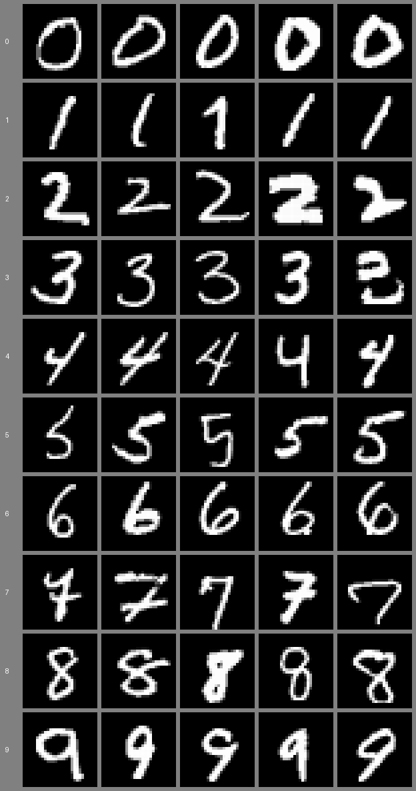
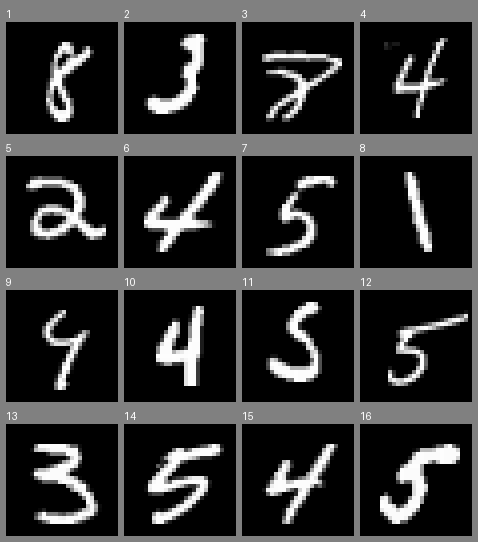

## Intro

[Weight-Space Programming](weight-space-programming.md) still has me pretty intrigued. The basic idea is that frontier LLMs can read, write and edit neural network weights, though there's certainly nuance to what's going on here. Still, it feels like there's a lot of new ground to explore.

In the [original blog post](https://rikiyat.github.io/blog/weight-space-programming/), beyond the reading and editing experiments, the authors had Astra build a network to play Go from scratch, then improve it by playing practice games, analysing how it lost, and editing the weights. It really seems like a new training paradigm, something like *LLM Descent*, but is it?

In this article, I run my own weight-writing experiment with Claude Opus 5.5 on a familiar image classification problem. Looking closely at what the model is doing, we can see that it is actually using some largely forgotten pre-deep-learning techniques.

Then, I look more closely at what Astra was actually doing when it built its Go network from scratch, and the findings are very similar.

## Building an image classifier with LLM Descent

The MNIST digit dataset is the OG ML image classification problem; the goal is to classify each hand-drawn digit.

[](../_media/llm-descent/mnist-examples.png)

I built a test with a fixed CNN, then prompted Claude to write code that sets all its weights, with a few rules: no fitting, regression, or searching, and in the first version, no example digits. It's a considerably stricter setup than Astra had for Go: no PyTorch and no practice games, only a score on the training set after each attempt.

Claude has to set all 5,994 weights of this network:

```python
model = nn.Sequential(
    nn.Conv2d(1, 8, 5),    # conv1: 1x28x28 -> 8x24x24
    nn.ReLU(),
    nn.MaxPool2d(2),       #        8x24x24 -> 8x12x12
    nn.Conv2d(8, 16, 5),   # conv2: 8x12x12 -> 16x8x8
    nn.ReLU(),
    nn.MaxPool2d(2),       #        16x8x8 -> 16x4x4
    nn.Flatten(),          #        16x4x4 -> 256
    nn.Linear(256, 10),    # fc:    256 -> 10 class logits
)
```

You can read [the whole prompt](https://github.com/lextoumbourou/weight-space-programming-experiments/blob/main/mnist-training/results/a-3/prompt.md) on GitHub.

Claude's code runs in a sandbox that can only import numpy, SciPy and math. Once it returns the weights, a test harness runs the network in MLX on the training and test images.

Each step, Claude gets all the feedback so far and has up to 50 steps to solve the problem. Runs stop early once the training loss stops improving, and the network with the lowest training loss is the one scored on the test set.

The training set here is 10,000 images held out from MNIST's own training split. The official 10,000 MNIST test images are scored at every step but never shown to Claude.

[](../_media/llm-descent/loop.png)

Example of the feedback it gets each step:

```text
Step 1 of 50: training loss 1.2152, accuracy 0.6072.

Confusion matrix (rows: true digit, columns: predicted digit):

true \ predicted     0     1     2     3     4     5     6     7     8     9
               0   776    24   152     0     0     0    20     1    17     1
               1     0   969    36     0     1     3     0    54     1     0
               2     8    79   710    19     8     8    48     8   102     0
               3     5    44   109   547     0   153     5    69    95     3
               4     2   261    14     1   370     3    53    12    87   180
               5    13    70    20    25     0   511   234    14    26     2
               6    52    77     5     0    29     2   744     0    58     0
               7     6    60   250     9     3    14     0   627     4   117
               8     1   323   162     7     3    13    71    72   317    40
               9    42   149   116     0    12    12    13    81    35   501

History (training set, 10,000 images):

step | loss | accuracy
---- | ---- | --------
1 | 1.2152 | 0.6072

At most 49 steps left. Reply with the complete build_weights() for step 2 in one Python code block.
```

### The descent

I ran it three times.

[](../_media/llm-descent/loss-by-step.png)

The left panel is the version with numbers only. (The right is a second version where Claude can also see some digits; more on that below.) All three runs descend, and they land close together: 72%, 70% and 74% on the test set, after 19 to 23 steps.

I want to explore what the runs did, step by step. We can see that it looks very similar to the hand-crafted approaches that early computer vision researchers used.

### A 1990s computer-vision pipeline

In 1998, the paper that introduced MNIST described that era's approach: "Traditional pattern recognition is performed with two modules: a fixed feature extractor and a trainable classifier", and the feature extractor "is often entirely hand crafted" [@lecunGradientbasedLearningApplied1998]. That's pretty much the approach that Claude takes. All three runs built the same kind of pipeline, in roughly the same order:

| Technique | Run a-1 | Run a-2 | Run a-3 |
|---|---:|---:|---:|
| Hand-drawn digit templates | step 1 | step 1 | step 1 |
| Nearest-centroid or cosine matching | step 1 | step 4 | step 2 |
| Naive Bayes | | step 7 | step 2 |
| Loop or hole detectors | step 10 | step 6 | step 3 |
| Stroke-endpoint detectors | step 17 | step 19 | |
| Probes (measuring instead of classifying) | | step 10 | step 17 |

*The first step at which each run's reply uses the technique.*

#### 1. Hand-made features and templates

Claude starts like a computer vision engineer from the 1990s. Its first layer is a set of oriented line or edge detectors, written from formulas, much like the Sobel edge gradients that 1990s digit recognisers started from [@favataMultipleFeatureResolution1996]:

[](../_media/llm-descent/filters-written-vs-learned.png)

On top of those, its second layer detects shapes: loops and holes, stroke endpoints, and regions where a digit should have no ink, the structural features that handwriting recognisers relied on [@trierFeatureExtractionMethods1996] [@favataMultipleFeatureResolution1996]. Then it draws a stroke template for each digit and classifies by template matching, the oldest approach in character recognition [@moriHistoricalReviewOCR1992]. Two of the three first networks score about 60%.

#### 2. Nearest centroid, then naive Bayes

Matching against templates swings wildly with how strong the features turn out to be, which Claude can't see. So it reaches for proper classifiers. Run a-2, at step 4:

> So I'm replacing the ad hoc template matching with a proper nearest-centroid rule in feature space

Run a-3, at step 6:

> I use scoring that does not depend on overall feature scale, a multinomial naive Bayes.

Bayesian decision rules for reading characters go back to 1957 [@chowOptimumCharacterRecognition1957].

#### 3. Measuring without looking

A 1990s engineer would have looked at the digits to see where their features go wrong. Claude can't. Two of the three runs did something I didn't expect: they stopped classifying for a step, to measure their own features. Run a-3, at step 17:

> it is a deliberate probe, and its loss will be poor. It costs nothing in the final score, because only the step with the lowest training loss is kept.

It rewires the output layer so each "predicted digit" stands for a range of one of its own features, which turns each row of the confusion matrix into a histogram of that feature for one true digit.

Is that cheating? It doesn't break the rules: the code never sees an image, never runs the network and never fits anything. But it squeezes far more out of the training set than the loss alone: class-by-class feature statistics, read through a 100-number window one step at a time. The test set stays untouched, so the scores below are still honest held-out scores.

In these runs the probes came late, and the stopping rule ended both runs soon after. In [an earlier version of this experiment](https://github.com/lextoumbourou/weight-space-programming-experiments/tree/e26658b/mnist-training/results/opus-p8-3), one run leaned on probing much harder: it probed 13 times, fed the measured probabilities into naive Bayes and reached 86%.

#### 4. Calibration

The last steps are fine-tuning by hand: sharpening or softening the logits (temperature scaling) and correcting class biases from the column totals. Run a-3, at step 12:

> If the loss falls, the model was underconfident and I can push the scale further. If it rises, I'll go the other way.

[](../_media/llm-descent/confusion-over-steps.png)

#### When fitting was allowed, it reached for 1936

My first version of the prompt forgot to ban fitting. By step 4, Opus had written this:

```python
for k in range(300):                      # 300 random synthetic digits per class
    X[dgt, k] = features(place(polys, slant=rng.uniform(-2, 5), ...))
W = np.linalg.solve(Sig, (mu - mbar).T).T  # a linear discriminant fitted to them
```

It drew 300 random versions of each digit from its own stroke models and fitted a linear discriminant to them, Fisher's technique from 1936: training, on data it made up. [That run](https://github.com/lextoumbourou/weight-space-programming-experiments/tree/e26658b/mnist-training/results/opus-high-loose-rules-stopped) reached 83% by step 14, before I stopped it and tightened the rules.

### What if it can see the digits?

Astra's practice games let it watch its own network lose. So I ran a second version that's closer to that. Claude also sees 50 training images at the start, five of each digit, and after every step, 16 training images its network got wrong, each with its true label, prediction and top-3 probabilities. It can look at them, but its code can't contain them.

[](../_media/llm-descent/condition-b-examples.png)

[](../_media/llm-descent/condition-b-mistakes.png)

It helped a little: 77%, 73% and 75% on the test set, and the runs kept improving for longer, 27 to 50 steps. But it didn't change the approach. Every run still built hand-drawn templates and a classical scoring rule, and two of the three used naive Bayes. It also rarely mentions the images. One of the few times it does:

> Looking at the images, the closed-top 4s form a triangle that reads like a 9, which is a genuinely hard case, while the others are open 4s.

One run, b-2, went back to measuring instead: it spent 14 of its 27 steps on probes, reading one feature at a time back through the confusion matrix, until the stopping rule ended it mid-measurement.

<!-- LEX: your take. Seeing the data, it turns out, wasn't the bottleneck. -->

### Where it landed

[](../_media/llm-descent/final-scores.png)

- **Random search** gets the same feedback but no reasoning: 16% on average after 50 tries.
- **Opus 5.5** lands between 70% and 74% with numbers only, and between 73% and 77% when it can also see digits.
- **Adam**, trained on the same 10,000 images, still wins easily: 91% after 50 gradient steps, 98% after 5,000. LLM Descent is not an efficient optimiser.
- The numbers-only runs cost $2.74 to $4.23 in tokens, and the runs with images $4.67 to $8.62.

## Exploring the Go network

Claude's MNIST network turned out to be a 1990s computer-vision pipeline. Does the paper's own Go network work the same way?

To me, the from-scratch Go network was the most striking result in the original post.

Astra was given a 1.5M-parameter 9x9 Go policy network (243 inputs, six hidden layers of 512 units, and 82 outputs, one per point plus pass) with every weight set to zero. It had a Python sandbox, but no training, fitting or search of any kind, and it was asked to make the network play Go as well as possible. In most runs it could also spend "passes": each pass plays up to 128 practice games and shows it the results. Runs got 0, 10, 25 or 50 passes.

With 50 passes, its network won 84% of games against one small PPO network and 81% against another, neither of which it had played during development. It also beat a PPO network of the same size, trained on 20.5 million games, in 70% to 79% of games. With no passes at all, a single 336-line Python run still won just over half its games against the smaller PPO networks [@takehi2026weightspaceLogs].

So, how is this even possible? Well, Astra spells it out in its [final answer](https://github.com/RikiyaT/lm_understand-logs/blob/main/exp6_go_from_scratch/runs/budget_50/final_answer.md):

> The hand-coded, symmetry-preserving policy combines approximate group-liberty propagation, captures, connected-group rescues, self-atari and eye avoidance, and ko/snapback risk suppression.

I don't even know how to play Go, so I'm not going to pretend I understand this, but my LLM tells me that every item on that list is a staple of classical Go programs: counting liberties to tell which groups can be captured, recognising eyes to tell which groups live, handling ko, and estimating territory with an influence function, where each stone radiates influence that fades with distance. The first Go programs were built entirely on influence functions [@bouzyComputerGoAI2001] [@mullerComputerGo2002].

Behind those 1.48 million weights is a [config of 26 hand-set numbers](https://github.com/RikiyaT/lm_understand-logs/blob/main/exp6_go_from_scratch/runs/budget_50/work/final_policy_config.json), compiled into the network by a design script:

```json
{
  "capture": 9.0,
  "rescue": 8.0,
  "self_atari": 7.5,
  "eye": 11.0,
  "contact": 3.0,
  "own_adj": 0.8,
  ...
}
```

The design script builds the network layer by layer, like a hand-written board analysis: layer 1 counts each stone's liberties, layers 2 and 3 spread that evidence through connected stones, layer 4 flags groups in atari and self-atari, layer 5 scores captures and rescues, and layer 6 combines tactics with connection, territory and eyes. The 26 numbers mostly set how much each rule counts.

Its improvement from practice games was tuning those numbers by hand: between its first design and its final network, `rescue` went from 6.0 to 8.0, `contact` from 1.4 to 3.0 and `own_adj` from 0.25 to 0.8. Practice games also led it to add five new rules along the way, such as a penalty for ko repetition (`repeat_risk`) and a bonus for third-line frameworks (`framework_bonus`). Play, diagnose, add a rule or retune one: that's how rule-based Go programs were built for decades [@mullerComputerGo2002].

So the paper's most impressive from-scratch network is a rule-based Go program, compiled into weights. None of this was hidden - the authors' rules explicitly allowed writing weights from its own design, and Astra calls its own policy hand-coded. A hand-written program that beats a PPO network trained on 20.5 million games is still impressive engineering. It doesn't look like a new kind of training so much as a clever combination of training-free tricks of yesteryear.

## What this training actually is

Every step Claude took on MNIST, and every part of Astra's Go program, is a technique from the classical toolbox:

| What the model did | Classical technique | Around since |
|---|---|---|
| Oriented line filters in the first layer | edge detection (Sobel and friends) | 1960s |
| A stroke template per digit | template matching | 1950s |
| Loop and cavity detectors | structural features for handwriting recognition | 1960s to 1990s |
| Per-digit feature probabilities, summed as log-odds | naive Bayes | 1960s |
| Logit scale and class-prior corrections | probability calibration | 1990s |
| One setting at a time, split the difference (Claude's calibration, Astra's Go coefficients) | coordinate descent and line search | long before computers |
| Liberties, eyes and influence (Astra) | rule-based Go evaluation | 1970s |
| Choosing a weight edit for Qwen (Astra, per Barry) | linear programming | 1940s |
| Synthetic digits plus a linear discriminant (the first attempt) | linear discriminant analysis | 1936 |

The network is never used for what makes neural networks special: learning features nobody wrote down. It's a compilation target. Claude designs a classical algorithm, then translates it into weights.

Astra's Go network, as we saw, is the same thing at a bigger scale.

So, at least for writing weights from scratch, weight-space programming is ordinary programming with the weights as the compile target, much like DeepMind's [Tracr](https://arxiv.org/abs/2301.05062), which compiles programs into transformer weights [@lindnerTracrCompiledTransformers2023]. The model writes a program in its head and delivers it as a network. None of this tests the other half of Weight-Space Programming, reading and editing weights that gradient descent trained, which is where the paper's headline results are.

But Nathan Barry has looked at one of the editing results, Astra's fix for Qwen3.5-0.8B's thinking loops, and found the same pattern there. Most of Astra's search, he writes, was "solving a linear program by trial and error": a couple of linear-program solves reproduce the edit with 8x fewer changed weights. And the fix is almost a constant push in one direction, which a steering vector can deliver without editing any weights at all: "The only difference is delivery" [@barryCanLinearProgram2026].

## LLM Descent: is it actually a thing?

<!-- LEX: your section. Points the results support either way:
- For: the training loss goes down on every run, step after step, using nothing but feedback (the loss-by-step chart). Each step is an update to the network driven by a measured signal, which is what training is.
- Against: no step is a gradient. Each one is a hypothesis and a test: change one setting and keep or revert it (coordinate descent, line search), or deliberately make the loss worse to measure something (probes). What descends is the hand-written program's handful of parameters, not the network's weights.
- Efficiency: it beats random search with the same 50 evaluations by a wide margin, so the reasoning is doing real work per step. But each step costs cents to dollars, and Adam needs only 50 to 100 cheap steps to match or beat it.
- Probing is the most "non-descent" part: steps that are useless as classifiers, worth it only because the best step is the one scored.
- Possible verdict: "LLM Descent" is a good name for the loop, but what it optimises is a classical program, so it's closer to an engineer tuning a system than to gradient descent. -->

## The ceiling is the old ceiling

Claude topped out at 77% on MNIST, even when it could see digits, while Adam reaches 91% after 50 gradient steps and 98% after 5,000. That's the ceiling hand-crafted features always had: Claude can only use features it can describe.

## What's new

<!-- LEX: in your words. Candidates: (1) it measured the data without ever seeing it, rebuilding the "look at the data" step out of a loss and a confusion matrix; (2) when its hand-written features stalled, it switched from guessing to measuring; (3) it did a feature engineer's day of work for between $2.74 and $8.62; (4) letting it see digits, and its own mistakes, barely changed what it built. -->

## Next

<!-- LEX: other models (an earlier 15-step test suggested a big jump from Opus 4.x to Opus 5.5), other data (audio), editing a trained network, and a follow-up on tabular data (Titanic, an anonymised Titanic that Claude saw through, and synthetic data with a known answer): what Claude does when it already knows the answer. -->

## Code and results

Everything is in the [experiments repo](https://github.com/lextoumbourou/weight-space-programming-experiments): the prompts, every reply and thinking summary, the code and weights from every step, and the [MNIST protocol](https://github.com/lextoumbourou/weight-space-programming-experiments/tree/main/mnist-training). Earlier versions of these experiments, including tabular ones (Titanic and synthetic data) that I'll write up separately, are in [the repo's history](https://github.com/lextoumbourou/weight-space-programming-experiments/tree/e26658b).
