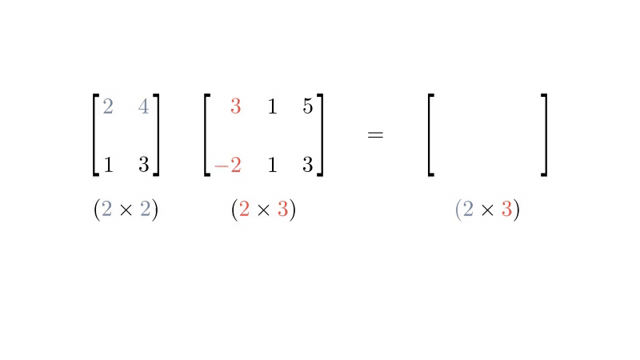

Matrix multiplication is a mathematical operation between 2 matrices that returns a matrix.

For each row in the first matrix, take the [Dot Product](dot-product.md) of each column in the second matrix. Place the results onto the corresponding row in a new matrix.



The size of the new matrix will be the row count from the first matrix by the column count from the second.

It is only defined when the number of columns from the first matrix equals the number of rows in the second.

In Numpy the `@` operator is used for matrix multiplication between 2 multi-dimensional arrays (matrices):

```python
from numpy import array

matrix1 = array([
    [2, 4],
    [1, 3]
])

matrix2 = array([
    [3, 1, 5],
    [-2, 1, 3]
])

matrix1 @ matrix2
```
<!-- nb-output hash="ae7d6d419bfc2b1b" format="html" -->
<div class="nb-output">
<pre class="nb-stream-stdout">array([[-2,  6, 22],
       [-3,  4, 14]])
</pre>
</div>
<!-- /nb-output -->
The same operator works in PyTorch:

```python
from torch import tensor

tensor(matrix1) @ tensor(matrix2)
```
<!-- nb-output hash="cc89355f1127cc83" format="html" -->
<div class="nb-output">
<pre class="nb-stream-stdout">tensor([[-2,  6, 22],
        [-3,  4, 14]])
</pre>
</div>
<!-- /nb-output -->