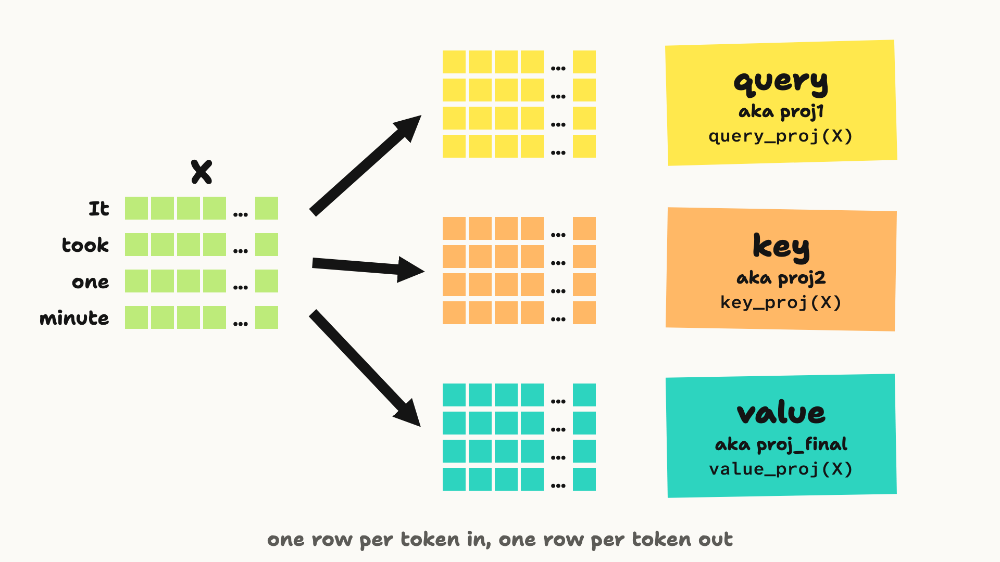
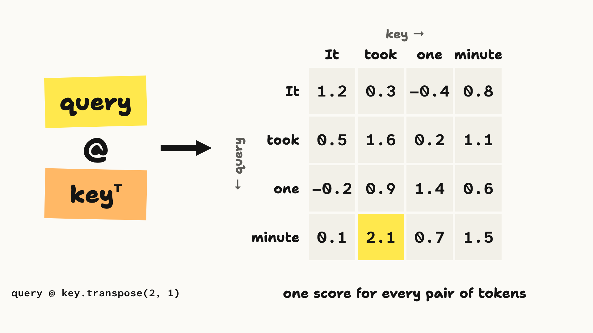
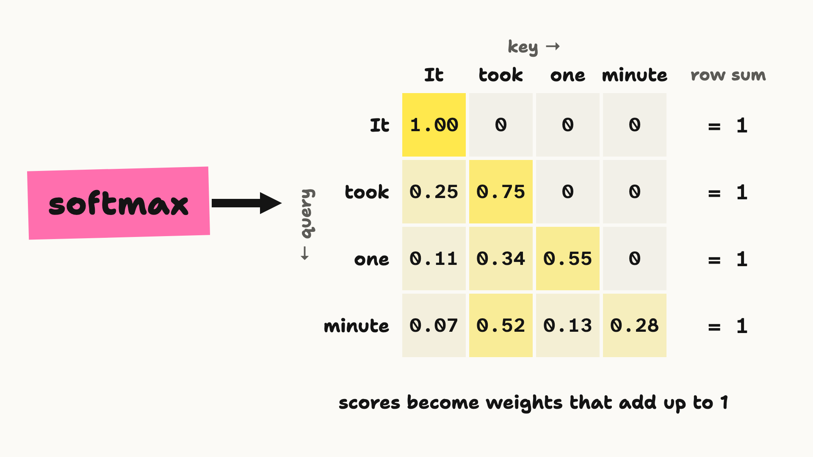
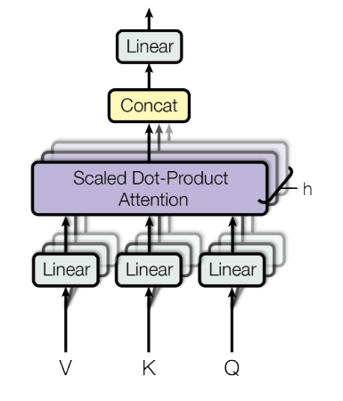

**Self-Attention**, sometimes called **intra-attention** or **vanilla attention**, is a form of [Attention Mechanism](attention-mechanism.md) that represents each token as a weighted average of all tokens in the sequence, where the weights reflect how relevant each token is to the others [@vaswaniAttentionAllYou2017].

It became the core building block of the [Transformer](transformer.md) architecture, introduced in the paper [Attention Is All You Need](attention-is-all-you-need.md).

In language models, we typically convert tokens (words or pieces of words) into a sequence of embeddings. However, some token embeddings will be ambiguous without the surrounding context.

Consider the word "minute" in these two sentences:

> "It took one **minute**."

and

> "The size was **minute**."

The word **minute** means very different things in each sentence - it's literally a different word, pronounced MIN-it and my-NOOT (English is weird like that), yet both use the same token and therefore the same embedding. The context of the words "took" and "size" tells us which version of minute we're using - whether it relates to time or size, respectively.

With that in mind, we need more than one embedding per token: we need to enrich each token's representation with information from the important tokens around it. We could simply take a weighted sum of all the surrounding tokens. However, how do we compute the weights? Could we use a neural network to calculate the weights for each other token in the sequence to get the most useful average representation? That's exactly what self-attention does.

Self-attention uses two learned projections, called the "queries" and "keys" - or, as I argue shortly, `proj1` and `proj2` - to score every token against every other token. Then, a softmax converts the scores to weights. A third projection, the values (or `proj_final`), gives the vectors that are combined using those weights. All the weights in the attention module are learned alongside the rest of the network.

The specific formulation from the Transformer paper is [Scaled Dot-Product Attention](scaled-dot-product-attention.md), which adds a scaling step to keep scores numerically stable.

Let's see how to compute it step by step.

## Self-Attention Step-by-step

### 0. Prepare Input

Though this step is technically not part of self-attention itself, we represent input tokens in the Transformer architecture using a standard token embedding (`nn.Embedding`) and a [Positional Encoding](positional-encoding.md), which we combine to create a final representation.

The positional encoding represents each token's position in the sequence. Without it, self-attention would treat the tokens as an unordered set, so "It took one minute" and "minute one took It" would look the same.

The dimensions of this input are batch, time, and embedding size. For example, with a batch size of 1, four input words (assuming word-level tokenisation) and an embedding dimension of 1024, the embeddings would have a shape of: `(1, 4, 1024)`. In practice, we typically process many passages at once as a batch, but the calculation is the same for each one.

[](../_media/self-attention/self-attention-step-0.png)

### 1. Create the query, key and value projections

Transform input embeddings into three matrices called *query*, *key*, and *value*. However, those names aren't particularly useful; they could also be called `proj1`, `proj2`, and `proj_final`. Many other articles on the web explain these names with an analogy to retrieval systems, like a database lookup, although I think it adds unnecessary confusion.

All you need to know is that query and key are used to compute a table of scores, with a row per token, and value holds what gets mixed together using those scores. The Transformer paper uses this particular method, but there are alternatives, such as additive attention [@bahdanauNeuralMachineTranslation2016].

We can do this in 6 lines of code:

```python {run=false}
# __init__
query_proj = nn.Linear(embedding_dim, attention_dim, bias=False)
key_proj = nn.Linear(embedding_dim, attention_dim, bias=False)
value_proj = nn.Linear(embedding_dim, attention_dim, bias=False)

# forward
query = query_proj(X)
key = key_proj(X)
value = value_proj(X)
```

Like any typical linear layer, the projection weights are learned during training.

[](../_media/self-attention/self-attention-step-1.png)

### 2. Compute scores as the dot product of query and key

Compute the scores as the dot product of each query with every key. For efficiency, we compute all the dot products for the sequence at once, as a matrix product of the query matrix and the transposed key matrix: $\text{scores} = QK^{T}$

```python {run=false}
scores = query @ key.transpose(2, 1)
```

In the code, `transpose(2, 1)` swaps the last two dimensions of key (tokens and features) and leaves the batch dimension alone.

[](../_media/self-attention/self-attention-step-2.png)

### 3. (Decoder only) Mask out any future tokens

In the decoder part of the Transformer, and in decoder-only models like GPT, the model must not "see" future tokens: when predicting the next token, it can only rely on the tokens before it. To achieve this, we mask the scores before applying the softmax. The mask sets the scores for future tokens to negative infinity (-inf), which become zeros after the softmax, blocking any information flow from future tokens.

We can use the [tril](https://pytorch.org/docs/stable/generated/torch.tril.html) function (short for "triangle, lower") to create a lower-triangular matrix of ones, covering each token and the tokens before it. Comparing it with `== 0` gives a mask where `True` marks the future positions, then [masked_fill](https://pytorch.org/docs/stable/generated/torch.Tensor.masked_fill.html) replaces those positions with `float("-inf")`.

```python {run=false}
attn_mask = torch.tril(torch.ones(*scores.shape)) == 0
scores = torch.masked_fill(scores, attn_mask, float("-inf"))
```

[](../_media/self-attention/self-attention-step-3.png)

### 4. Compute Softmax to convert scores into weights

Next, softmax converts each row of scores into weights between 0 and 1 that sum to 1. It exponentiates each score and divides by the row total, so larger scores get larger weights, and the -inf scores from the mask become 0. `dim=-1` applies it across each row: one query against every key.

```python {run=false}
weights = softmax(scores, dim=-1)
```

> [!note]
> A token's score against itself isn't automatically the highest: query and key are different projections, so in our example **minute** gives "took" more weight than itself. The first row is 1 only because "It" has no earlier tokens to attend to.

[](../_media/self-attention/self-attention-step-4.png)

### 5. Compute the output as a weighted sum of values

Finally, we multiply the weights by the value matrix. Each row of the output is a weighted sum of every row of value, so each token's new representation mixes in information from the tokens it attends to. In our example, the new representation of **minute** takes about half its information from "took", which tells the model we're talking about time.

```python {run=false}
out = weights @ value
```

[](../_media/self-attention/self-attention-step-5.png)

This module always applies the causal mask from step 3, as a decoder would. It also includes the scaling step from [Scaled Dot-Product Attention](scaled-dot-product-attention.md), which the steps above leave out.

Here's the full PyTorch module:

```python
import math

import torch
from torch import nn
from torch.nn.functional import softmax


class SingleHeadAttention(nn.Module):
    def __init__(self, embedding_dim, attention_dim):
        super().__init__()
        self.query_proj = nn.Linear(embedding_dim, attention_dim, bias=False)
        self.key_proj = nn.Linear(embedding_dim, attention_dim, bias=False)
        self.value_proj = nn.Linear(embedding_dim, attention_dim, bias=False)

    def forward(self, X):
        query = self.query_proj(X)
        key = self.key_proj(X)
        value = self.value_proj(X)

        scores = query @ key.transpose(2, 1)
        # Scaling from Scaled Dot-Product Attention, not covered in the steps above.
        scores = scores / math.sqrt(key.shape[-1])

        attn_mask = torch.tril(torch.ones_like(scores)) == 0
        scores = torch.masked_fill(scores, attn_mask, float("-inf"))

        weights = softmax(scores, dim=-1)

        out = weights @ value

        return out


torch.manual_seed(0)
X = torch.randn(1, 4, 1024)  # batch, tokens, embedding size
attention = SingleHeadAttention(embedding_dim=1024, attention_dim=64)
print(attention(X).shape)  # torch.Size([1, 4, 64])
```

In the Transformer architecture, several self-attention modules, called heads, run in parallel on the same input, each with its own query, key and value projections. Their outputs are concatenated and passed through a final linear projection. Together, these heads are called [Multi-head Attention](multi-head-attention.md).



*Multi-Head Attention diagram from [@vaswaniAttentionAllYou2017].*
