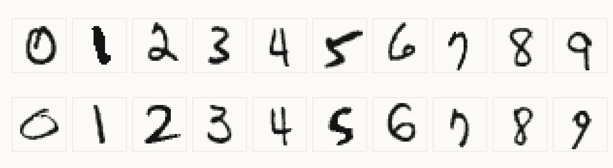
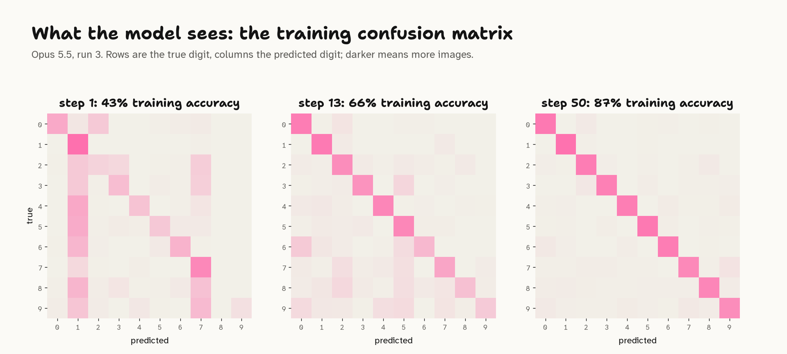
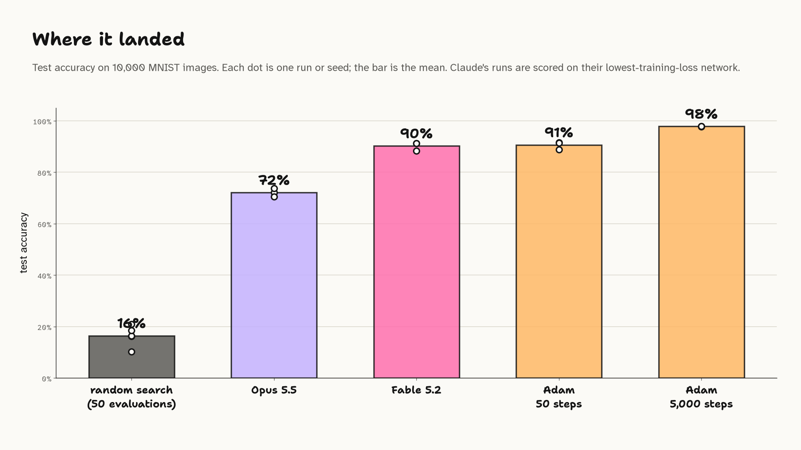

## Intro

[Weight-Space Programming](weight-space-programming.md) still has me pretty intrigued. The basic idea is that frontier LLMs can read, write and edit the weights of neural networks. There's nuance to what's going on, but it feels like there's a lot of new ground to explore.

In the [original blog post](https://rikiyat.github.io/blog/weight-space-programming/), beyond the reading and editing experiments, the authors had GPT-6 Astra build a network to play Go from scratch, then improve it by playing practice games, and editing the weights based on analysis of its losses. That loop of writing, testing and editing feels like a new way to train a network, something like *LLM Descent*. But is it?

In this article, I run my own weight-writing experiment with Claude Fable 5.2 on a familiar image classification problem. Look closely at what the model builds, and it turns out to be an interesting history lesson in hand-crafted, pre-deep-learning techniques. With that new lens on weight-space programming, I also study the Go network that Astra built in the original article, and find something very similar.

## Building an image classifier with LLM Descent

MNIST is the OG image classification problem. The goal is to label each handwritten digit, 0 to 9.

[](../_media/llm-descent/mnist-examples.png)

Similar to the Go test in the original Weight-Space Programming post, I built a test with a fixed CNN, then prompted Claude to write code that sets all its weights from scratch, with a few rules that include no fitting, regression, or searching. Drawing filters and templates by hand, from formulas or strokes, is explicitly allowed.

It's a considerably stricter setup than Astra had for Go, with no PyTorch and no practice games, only its training loss, accuracy and confusion matrix after each attempt. The tests in this blog post were run with Claude Fable 5.2, which performed considerably better than Opus 5.5.

Claude starts with no weights at all, and has to set every one of this network's 5,994 weights "by hand":

```python
model = nn.Sequential(
    nn.Conv2d(1, 8, 5),    # conv1: 1x28x28 -> 8x24x24
    nn.ReLU(),
    nn.MaxPool2d(2),       #        8x24x24 -> 8x12x12
    nn.Conv2d(8, 16, 5),   # conv2: 8x12x12 -> 16x8x8
    nn.ReLU(),
    nn.MaxPool2d(2),       #        16x8x8 -> 16x4x4
    nn.Flatten(),          #        16x4x4 -> 256
    nn.Linear(256, 10),    # fc:    256 -> 10 class logits
)
```

You can read [the whole prompt](https://github.com/lextoumbourou/weight-space-programming-experiments/blob/main/mnist-training/results/fable-a-1/prompt.md) on GitHub.

Claude's code runs in a sandbox that can only import NumPy, SciPy and math. Once it returns the weights, a test harness runs the network on the training and test images.

Claude has up to 50 steps, and at each one it sees all the feedback so far. The training set is 10,000 images from MNIST's official training split. Claude never sees the 10,000 official test images or how it scores on them, and the network with the lowest training loss gives us the final test score.

[](../_media/llm-descent/loop.png)

Here's an example of the feedback it gets after its first attempt:

```output
Step 1 of 50: training loss 1.0324, accuracy 0.7147.

Confusion matrix (rows: true digit, columns: predicted digit):

true \ predicted     0     1     2     3     4     5     6     7     8     9
               0   723     0    39     0     0    42   181     0     5     1
               1     4  1022    23     0     3     4     0     8     0     0
               2    30     5   461   176     3    12     9    13   271    10
               3     2     0     8   687     0   125    51     4   133    20
               4     7    19    14     6   768     0    35    10    22   102
               5    10     5    13    45     2   492   312     6    29     1
               6    41    17    19     1   266     8   603     0    10     2
               7     8     2    21    45     2     7    13   906    11    75
               8    15    19    86     5     5     4    60    27   714    74
               9    15     9     1     4     1    19    46    82    13   771

History (training set, 10,000 images):

step | loss | accuracy
---- | ---- | --------
1 | 1.0324 | 0.7147

At most 49 steps left. Reply with the complete build_weights() for step 2
in one Python code block.
```

### The descent

I ran it three times.

[](../_media/llm-descent/loss-by-step.png)

Though I have early stopping configured to stop when the training loss stops improving, all three runs descend for the full 50 steps, still improving when they run out, and land around 90% on the test set. Amazingly, that's close to where a training run with Adam gets to after 50 gradient steps.

### A 1990s computer-vision pipeline

In 1998, LeCun's paper that introduced MNIST described that era's approaches thus far as "a fixed feature extractor and a trainable classifier", where the feature extractor "is often entirely hand crafted" [@lecunGradientbasedLearningApplied1998]. Accuracy, he wrote, "is largely determined by the ability of the designer to come up with an appropriate set of features", which is "a daunting task which, unfortunately, must be redone for each new problem."

That daunting task is exactly what Claude takes on. All three runs built the same kind of pipeline, though not from the same parts:

| Technique | Run 1 | Run 2 | Run 3 |
|---|---:|---:|---:|
| Hand-drawn digit templates | step 1 | step 1 | step 1 |
| Log-odds (naive Bayes-style) scoring | step 1 | step 11 | step 2 |
| Loop or hole detectors | step 3 | step 3 | - |
| Corner or concavity detectors | step 3 | step 3 | - |
| Stroke-endpoint detectors | - | - | step 21 |
| First measurement step | step 4 | step 4 | step 5 |
| Classifier built from its measurements | step 5 | step 11 | step 13 |
| Measurement steps in total | 22 | 24 | 27 |

*The first step at which each run's network uses the technique.*

Let's follow run 1, step by step, based on Claude's replies and reasoning. It's the best of the three, at 91.3%, but the other two follow a similar path, measuring their way from hand-drawn templates to a classifier.

[](../_media/llm-descent/fable-run-1-story.png)

#### 1. Hand-drawn templates (steps 1 to 3)

Claude starts like a 1990s computer vision engineer. Its first layer is a set of line detectors at four angles, written from formulas. They're cousins of the [Sobel filter](https://en.wikipedia.org/wiki/Sobel_operator), a classic way to find edges in an image, which 1990s digit recognisers started with [@favataMultipleFeatureResolution1996].

[](../_media/llm-descent/filters-written-vs-learned.png)

Then it draws each digit by hand, as a few strokes, and turns each drawing into a table of how likely each stroke direction is in each part of the image. It scores every image against all ten tables.

> The weights are the log-odds of that table, scaled down by a temperature.

The log-odds turn each probability into a score that can simply be added up, and the temperature turns all the scores down, so the network isn't overconfident.

[](../_media/llm-descent/hand-drawn-templates.png)

This is [template matching](https://en.wikipedia.org/wiki/Template_matching) - one of the oldest approaches in character recognition [@moriHistoricalReviewOCR1992]. The scoring works like naive Bayes, which treats each feature as separate evidence for each digit. Bayesian rules for reading characters go back to 1957 [@chowOptimumCharacterRecognition1957].

Its first network gets 71% on the test set. Redrawing the digits the confusion matrix says are wrong brings it to 77%.

<details markdown="1">
<summary>See it for yourself: steps 1 to 3</summary>

| Step | What happened | Files |
|---:|---|---|
| 1 | Line detectors and hand-drawn templates, scored as log-odds | [reply](https://github.com/lextoumbourou/weight-space-programming-experiments/blob/68d663a/mnist-training/results/fable-a-1/steps/01/reply.md) · [thinking summary](https://github.com/lextoumbourou/weight-space-programming-experiments/blob/68d663a/mnist-training/results/fable-a-1/steps/01/thinking.md) · [code](https://github.com/lextoumbourou/weight-space-programming-experiments/blob/68d663a/mnist-training/results/fable-a-1/steps/01/submission.py) · [results](https://github.com/lextoumbourou/weight-space-programming-experiments/blob/68d663a/mnist-training/results/fable-a-1/steps/02/message.md) |
| 2 | Redraws the templates the confusion matrix says are wrong | [reply](https://github.com/lextoumbourou/weight-space-programming-experiments/blob/68d663a/mnist-training/results/fable-a-1/steps/02/reply.md) · [thinking summary](https://github.com/lextoumbourou/weight-space-programming-experiments/blob/68d663a/mnist-training/results/fable-a-1/steps/02/thinking.md) · [code](https://github.com/lextoumbourou/weight-space-programming-experiments/blob/68d663a/mnist-training/results/fable-a-1/steps/02/submission.py) · [results](https://github.com/lextoumbourou/weight-space-programming-experiments/blob/68d663a/mnist-training/results/fable-a-1/steps/03/message.md) |
| 3 | Adds a closed-loop detector built from four corner filters | [reply](https://github.com/lextoumbourou/weight-space-programming-experiments/blob/68d663a/mnist-training/results/fable-a-1/steps/03/reply.md) · [thinking summary](https://github.com/lextoumbourou/weight-space-programming-experiments/blob/68d663a/mnist-training/results/fable-a-1/steps/03/thinking.md) · [code](https://github.com/lextoumbourou/weight-space-programming-experiments/blob/68d663a/mnist-training/results/fable-a-1/steps/03/submission.py) · [results](https://github.com/lextoumbourou/weight-space-programming-experiments/blob/68d663a/mnist-training/results/fable-a-1/steps/04/message.md) |

</details>

#### 2. Unit-testing the loop detector (steps 4 to 9)

An old-school model engineer would have studied the digits to see where their features go wrong. We haven't given Claude the ability to do that in this test, but at step 4, it tries an interesting approach, where it stops classifying for a step and tests a loop detector (a feature for closed loops, like the ones in 0, 6, 8 and 9) on its own:

> I cannot tell that from a confusion matrix where everything is mixed together, so this step tests the detector on its own, like a unit test.

[](../_media/llm-descent/loop-detector.png)

It rewires the output layer so that each "predicted digit" means how strongly, and where, the loop detector fired. Each row of the confusion matrix then becomes a histogram of the loop detector for one true digit. One step later, it knows the detector fires on 83% of 8s. At steps 6 and 7, it tests its own drawings the same way, putting variants of each digit head to head.

[](../_media/llm-descent/probe-trick.png)

In a way, this is kinda cheating, but then again it doesn't break the rules. The code doesn't run the network or fit anything, or even see an image. And hey: the test set is untouched, so the scores are still honest.

<details markdown="1">
<summary>See it for yourself: steps 4 to 9</summary>

| Step | What happened | Files |
|---:|---|---|
| 4 | Tests the loop detector on its own | [reply](https://github.com/lextoumbourou/weight-space-programming-experiments/blob/68d663a/mnist-training/results/fable-a-1/steps/04/reply.md) · [thinking summary](https://github.com/lextoumbourou/weight-space-programming-experiments/blob/68d663a/mnist-training/results/fable-a-1/steps/04/thinking.md) · [code](https://github.com/lextoumbourou/weight-space-programming-experiments/blob/68d663a/mnist-training/results/fable-a-1/steps/04/submission.py) · [results](https://github.com/lextoumbourou/weight-space-programming-experiments/blob/68d663a/mnist-training/results/fable-a-1/steps/05/message.md) |
| 5 | Puts the loop detector back, weighted by what it measured | [reply](https://github.com/lextoumbourou/weight-space-programming-experiments/blob/68d663a/mnist-training/results/fable-a-1/steps/05/reply.md) · [thinking summary](https://github.com/lextoumbourou/weight-space-programming-experiments/blob/68d663a/mnist-training/results/fable-a-1/steps/05/thinking.md) · [code](https://github.com/lextoumbourou/weight-space-programming-experiments/blob/68d663a/mnist-training/results/fable-a-1/steps/05/submission.py) · [results](https://github.com/lextoumbourou/weight-space-programming-experiments/blob/68d663a/mnist-training/results/fable-a-1/steps/06/message.md) |
| 6 | Tests the size and slant of its drawings, head to head | [reply](https://github.com/lextoumbourou/weight-space-programming-experiments/blob/68d663a/mnist-training/results/fable-a-1/steps/06/reply.md) · [thinking summary](https://github.com/lextoumbourou/weight-space-programming-experiments/blob/68d663a/mnist-training/results/fable-a-1/steps/06/thinking.md) · [code](https://github.com/lextoumbourou/weight-space-programming-experiments/blob/68d663a/mnist-training/results/fable-a-1/steps/06/submission.py) · [results](https://github.com/lextoumbourou/weight-space-programming-experiments/blob/68d663a/mnist-training/results/fable-a-1/steps/07/message.md) |
| 7 | A tournament between variants of 2 and 3 | [reply](https://github.com/lextoumbourou/weight-space-programming-experiments/blob/68d663a/mnist-training/results/fable-a-1/steps/07/reply.md) · [thinking summary](https://github.com/lextoumbourou/weight-space-programming-experiments/blob/68d663a/mnist-training/results/fable-a-1/steps/07/thinking.md) · [code](https://github.com/lextoumbourou/weight-space-programming-experiments/blob/68d663a/mnist-training/results/fable-a-1/steps/07/submission.py) · [results](https://github.com/lextoumbourou/weight-space-programming-experiments/blob/68d663a/mnist-training/results/fable-a-1/steps/08/message.md) |

</details>

#### 3. Corners (steps 10 to 18)

Next, it turns the corner detectors inside its loop detector into features of their own: four corner shapes where strokes meet (┌ ┐ └ ┘). Handwriting recognisers relied on shape features like these [@trierFeatureExtractionMethods1996] [@favataMultipleFeatureResolution1996]. At first it guesses how often each one shows up in each digit. When that stalls at about 81%, it measures them instead, three steps in a row, and sets their weights from the results.

> Three measurement steps on the corners gave more than many steps of guessing, and they showed that some of my hand-drawn expectations were far off.

By step 18, it's at 83%. Pretty incredible, if you ask me.
<details markdown="1">
<summary>See it for yourself: steps 10 to 18</summary>

| Step | What happened | Files |
|---:|---|---|
| 10 | Adds the corner detectors as features of their own | [reply](https://github.com/lextoumbourou/weight-space-programming-experiments/blob/68d663a/mnist-training/results/fable-a-1/steps/10/reply.md) · [thinking summary](https://github.com/lextoumbourou/weight-space-programming-experiments/blob/68d663a/mnist-training/results/fable-a-1/steps/10/thinking.md) · [code](https://github.com/lextoumbourou/weight-space-programming-experiments/blob/68d663a/mnist-training/results/fable-a-1/steps/10/submission.py) · [results](https://github.com/lextoumbourou/weight-space-programming-experiments/blob/68d663a/mnist-training/results/fable-a-1/steps/11/message.md) |
| 13 | The first of three corner measurement steps | [reply](https://github.com/lextoumbourou/weight-space-programming-experiments/blob/68d663a/mnist-training/results/fable-a-1/steps/13/reply.md) · [thinking summary](https://github.com/lextoumbourou/weight-space-programming-experiments/blob/68d663a/mnist-training/results/fable-a-1/steps/13/thinking.md) · [code](https://github.com/lextoumbourou/weight-space-programming-experiments/blob/68d663a/mnist-training/results/fable-a-1/steps/13/submission.py) · [results](https://github.com/lextoumbourou/weight-space-programming-experiments/blob/68d663a/mnist-training/results/fable-a-1/steps/14/message.md) |
| 16 | Sets the corner weights from the measurements | [reply](https://github.com/lextoumbourou/weight-space-programming-experiments/blob/68d663a/mnist-training/results/fable-a-1/steps/16/reply.md) · [thinking summary](https://github.com/lextoumbourou/weight-space-programming-experiments/blob/68d663a/mnist-training/results/fable-a-1/steps/16/thinking.md) · [code](https://github.com/lextoumbourou/weight-space-programming-experiments/blob/68d663a/mnist-training/results/fable-a-1/steps/16/submission.py) · [results](https://github.com/lextoumbourou/weight-space-programming-experiments/blob/68d663a/mnist-training/results/fable-a-1/steps/17/message.md) |

</details>

#### 4. Measuring every stroke (steps 19 to 30)

So it measures everything else too. Over the next twelve steps, it reads out how often each of its 32 stroke features fires on each digit, three at a time. At step 24, it plugs in the first fifteen measurements to check they help, and accuracy jumps from 83% to 88%.

<details markdown="1">
<summary>See it for yourself: steps 19 to 30</summary>

| Step | What happened | Files |
|---:|---|---|
| 19 | Starts measuring the stroke features, and reflects on the corners | [reply](https://github.com/lextoumbourou/weight-space-programming-experiments/blob/68d663a/mnist-training/results/fable-a-1/steps/19/reply.md) · [thinking summary](https://github.com/lextoumbourou/weight-space-programming-experiments/blob/68d663a/mnist-training/results/fable-a-1/steps/19/thinking.md) · [code](https://github.com/lextoumbourou/weight-space-programming-experiments/blob/68d663a/mnist-training/results/fable-a-1/steps/19/submission.py) · [results](https://github.com/lextoumbourou/weight-space-programming-experiments/blob/68d663a/mnist-training/results/fable-a-1/steps/20/message.md) |
| 24 | Plugs in the first fifteen measurements | [reply](https://github.com/lextoumbourou/weight-space-programming-experiments/blob/68d663a/mnist-training/results/fable-a-1/steps/24/reply.md) · [thinking summary](https://github.com/lextoumbourou/weight-space-programming-experiments/blob/68d663a/mnist-training/results/fable-a-1/steps/24/thinking.md) · [code](https://github.com/lextoumbourou/weight-space-programming-experiments/blob/68d663a/mnist-training/results/fable-a-1/steps/24/submission.py) · [results](https://github.com/lextoumbourou/weight-space-programming-experiments/blob/68d663a/mnist-training/results/fable-a-1/steps/25/message.md) |

</details>

#### 5. Rebuilt from measurements (steps 31 to 40)

At step 31, it throws its hand-drawn templates away completely.

> rebuild the whole classifier from measured rates: 32 orientation cells, 8 corner zones and the loop detector. No hand-drawn stroke templates remain in the final layer.

What's left is a naive Bayes-style classifier, with every probability measured from the training set, one feature at a time, through the confusion matrix. In other words, it's fitting a classifier by hand. It reaches 89%, then 90% after tuning a few global settings. Then it spends steps 36 to 40 measuring the half of the stroke grid it hadn't covered yet.

[](../_media/llm-descent/measured-rates.png)

<details markdown="1">
<summary>See it for yourself: steps 31 to 40</summary>

| Step | What happened | Files |
|---:|---|---|
| 31 | Rebuilds the whole classifier from measured rates | [reply](https://github.com/lextoumbourou/weight-space-programming-experiments/blob/68d663a/mnist-training/results/fable-a-1/steps/31/reply.md) · [thinking summary](https://github.com/lextoumbourou/weight-space-programming-experiments/blob/68d663a/mnist-training/results/fable-a-1/steps/31/thinking.md) · [code](https://github.com/lextoumbourou/weight-space-programming-experiments/blob/68d663a/mnist-training/results/fable-a-1/steps/31/submission.py) · [results](https://github.com/lextoumbourou/weight-space-programming-experiments/blob/68d663a/mnist-training/results/fable-a-1/steps/32/message.md) |
| 36 | Starts measuring the half of the stroke grid it hadn't covered | [reply](https://github.com/lextoumbourou/weight-space-programming-experiments/blob/68d663a/mnist-training/results/fable-a-1/steps/36/reply.md) · [thinking summary](https://github.com/lextoumbourou/weight-space-programming-experiments/blob/68d663a/mnist-training/results/fable-a-1/steps/36/thinking.md) · [code](https://github.com/lextoumbourou/weight-space-programming-experiments/blob/68d663a/mnist-training/results/fable-a-1/steps/36/submission.py) · [results](https://github.com/lextoumbourou/weight-space-programming-experiments/blob/68d663a/mnist-training/results/fable-a-1/steps/37/message.md) |

</details>

#### 6. Calibration (steps 41 to 50)

The last ten steps are fine-tuning by hand, deciding how much to trust each kind of evidence and how confident its predictions should be. It also keeps track of exactly how it will be scored.

> if this step does not beat 0.3111, step 48 is the one that gets scored.

It finishes at 91.3% on the test set, which is roughly where 50 steps of training with Adam gets us. It's not quite a like-for-like comparison, though: Adam's 50 steps see 64 images each, 3,200 in total, while Claude gets scores over all 10,000 training images at every step.

[](../_media/llm-descent/confusion-over-steps.png)

<details markdown="1">
<summary>See it for yourself: steps 41 to 50</summary>

| Step | What happened | Files |
|---:|---|---|
| 41 | Rebuilds with 47 measured stroke cells | [reply](https://github.com/lextoumbourou/weight-space-programming-experiments/blob/68d663a/mnist-training/results/fable-a-1/steps/41/reply.md) · [thinking summary](https://github.com/lextoumbourou/weight-space-programming-experiments/blob/68d663a/mnist-training/results/fable-a-1/steps/41/thinking.md) · [code](https://github.com/lextoumbourou/weight-space-programming-experiments/blob/68d663a/mnist-training/results/fable-a-1/steps/41/submission.py) · [results](https://github.com/lextoumbourou/weight-space-programming-experiments/blob/68d663a/mnist-training/results/fable-a-1/steps/42/message.md) |
| 49 | Its best training loss so far | [reply](https://github.com/lextoumbourou/weight-space-programming-experiments/blob/68d663a/mnist-training/results/fable-a-1/steps/49/reply.md) · [thinking summary](https://github.com/lextoumbourou/weight-space-programming-experiments/blob/68d663a/mnist-training/results/fable-a-1/steps/49/thinking.md) · [code](https://github.com/lextoumbourou/weight-space-programming-experiments/blob/68d663a/mnist-training/results/fable-a-1/steps/49/submission.py) · [results](https://github.com/lextoumbourou/weight-space-programming-experiments/blob/68d663a/mnist-training/results/fable-a-1/steps/50/message.md) |
| 50 | The last step, keeping track of how it will be scored | [reply](https://github.com/lextoumbourou/weight-space-programming-experiments/blob/68d663a/mnist-training/results/fable-a-1/steps/50/reply.md) · [thinking summary](https://github.com/lextoumbourou/weight-space-programming-experiments/blob/68d663a/mnist-training/results/fable-a-1/steps/50/thinking.md) · [code](https://github.com/lextoumbourou/weight-space-programming-experiments/blob/68d663a/mnist-training/results/fable-a-1/steps/50/submission.py) |

</details>

### Earlier testing on Opus 5.5

Opus 5.5 reaches for the same toolbox, with stroke detectors, hand-drawn templates, nearest centroid (picking the closest template), naive Bayes, and loop and endpoint detectors. The difference seems to be how much it measures. Fable's runs spent 22 to 27 steps measuring. Opus's runs spent far less (none, three and one, respectively) and kept guessing instead. They stopped after 19 to 23 steps, at 70% to 74% on the test set. I also ran a few tests with Opus 5.5 that gave the model more feedback, including example digits, but they didn't make much difference, so I've left them out of this post.

[](../_media/llm-descent/final-scores.png)

<details markdown="1">
<summary>See it for yourself: the Opus 5.5 runs</summary>

[run 1](https://github.com/lextoumbourou/weight-space-programming-experiments/tree/68d663a/mnist-training/results/a-1/steps) · [run 2](https://github.com/lextoumbourou/weight-space-programming-experiments/tree/68d663a/mnist-training/results/a-2/steps) · [run 3](https://github.com/lextoumbourou/weight-space-programming-experiments/tree/68d663a/mnist-training/results/a-3/steps)

Each step folder has the reply, thinking summary, code and metrics.

</details>

### What about a harder problem?

I ran the same test on photos from Kaggle's famous [Dogs vs. Cats](https://www.kaggle.com/c/dogs-vs-cats) competition, with an image size of 64x64, using a slightly bigger fixed CNN (24,898 weights), the same rules and the same stopping rule. Here we can see some of the limitations of the hand-crafted feature approach, and some of the potential upper bounds of "weight-space programming".

Fable 5.2 takes the same initial approach as it did on MNIST, building a bank of hand-designed detectors, including pointed ears, an eyes-and-nose triangle and grass, then testing some of them one at a time. But those initial ideas don't bear much fruit:

> The ear probe showed the opposite of my guess

What does work is studying properties of the photo rather than the animal: dog photos have more green (grass and outdoor scenes), more texture, and more vertical edges. Its best network, at step 9, uses just those three. Nothing it adds after that does better, so the run stops at step 17.

[![Left: a dot plot of nine features Fable 5.2 tested one at a time on cats vs dogs, showing the share of cat photos and dog photos each one fires on. The pointed-ear detector fires on 58% of cats and 64% of dogs. The three features kept in its best network separate the classes most: green (35% of cats, 43% of dogs), texture (57% and 73%) and vertical minus horizontal edges (55% and 69%). Right: test accuracy. Random search 54%, Adam after 50 steps 51%, Adam after 500 steps 55%, Fable 5.2 62%, Adam after 5,000 steps 74%, against a coin flip at 50%.](../_media/llm-descent/cats-vs-dogs.png)](../_media/llm-descent/cats-vs-dogs.png)

It lands at 61.6% on the test set, where a coin flip gets 50%. It actually does better than 500 steps of Adam (55%), but this small network is slow to train, and after 5,000 steps Adam reaches 74%. Fable's run was also very expensive, at $8.08 for 17 steps.

<details markdown="1">
<summary>See it for yourself: cats vs dogs</summary>

| Step | What happened | Files |
|---:|---|---|
| 1 | Builds its detector bank and tests the pointed-ear detector | [reply](https://github.com/lextoumbourou/weight-space-programming-experiments/blob/68d663a/catdog-training/results/fable-1/steps/01/reply.md) · [thinking summary](https://github.com/lextoumbourou/weight-space-programming-experiments/blob/68d663a/catdog-training/results/fable-1/steps/01/thinking.md) · [code](https://github.com/lextoumbourou/weight-space-programming-experiments/blob/68d663a/catdog-training/results/fable-1/steps/01/submission.py) · [results](https://github.com/lextoumbourou/weight-space-programming-experiments/blob/68d663a/catdog-training/results/fable-1/steps/02/message.md) |
| 2 | Finds the ear detector points the wrong way, and tests green | [reply](https://github.com/lextoumbourou/weight-space-programming-experiments/blob/68d663a/catdog-training/results/fable-1/steps/02/reply.md) · [thinking summary](https://github.com/lextoumbourou/weight-space-programming-experiments/blob/68d663a/catdog-training/results/fable-1/steps/02/thinking.md) · [code](https://github.com/lextoumbourou/weight-space-programming-experiments/blob/68d663a/catdog-training/results/fable-1/steps/02/submission.py) · [results](https://github.com/lextoumbourou/weight-space-programming-experiments/blob/68d663a/catdog-training/results/fable-1/steps/03/message.md) |
| 9 | Its best network: texture, edge direction and green | [reply](https://github.com/lextoumbourou/weight-space-programming-experiments/blob/68d663a/catdog-training/results/fable-1/steps/09/reply.md) · [thinking summary](https://github.com/lextoumbourou/weight-space-programming-experiments/blob/68d663a/catdog-training/results/fable-1/steps/09/thinking.md) · [code](https://github.com/lextoumbourou/weight-space-programming-experiments/blob/68d663a/catdog-training/results/fable-1/steps/09/submission.py) · [results](https://github.com/lextoumbourou/weight-space-programming-experiments/blob/68d663a/catdog-training/results/fable-1/steps/10/message.md) |
| 17 | The last step, before the stopping rule ends the run | [reply](https://github.com/lextoumbourou/weight-space-programming-experiments/blob/68d663a/catdog-training/results/fable-1/steps/17/reply.md) · [thinking summary](https://github.com/lextoumbourou/weight-space-programming-experiments/blob/68d663a/catdog-training/results/fable-1/steps/17/thinking.md) · [code](https://github.com/lextoumbourou/weight-space-programming-experiments/blob/68d663a/catdog-training/results/fable-1/steps/17/submission.py) |

</details>

With this new perspective on how Weight-Space Programming builds an image classification model by hand-crafting it using known pre-deep-learning techniques, let's look at the Go network Astra built in the original article and see if there are any parallels.

## Reviewing the Go network

In the original article, Astra was given a 9x9 Go network with 1.5M parameters, all set to zero. It had a Python sandbox, but wasn't allowed to train, fit or search, and was told to make the network play Go as well as it could. In most runs, it could also use "passes": each pass plays a batch of up to 128 practice games and shows it the results. The authors ran it four times, with budgets of 0, 10, 25 and 50 passes.

And that seemed to work really well. With 50 passes, the Astra-built network beat two small networks trained with reinforcement learning (PPO), in 84% and 81% of games respectively. It also beat a PPO network of the same size, which was trained on 20.5 million games, 70% to 79% of the time. Actually, even with no practice games played at all, Astra managed to write a network that still won over half the games played against the smaller networks [@takehi2026weightspaceLogs].

Let's dig deeper into this result to try to understand what's going on.

Astra describes the final solution in its [output](https://github.com/RikiyaT/lm_understand-logs/blob/main/exp6_go_from_scratch/runs/budget_50/final_answer.md):

> The hand-coded, symmetry-preserving policy combines approximate group-liberty propagation, captures, connected-group rescues, self-atari and eye avoidance, and ko/snapback risk suppression.

I must disclose here that I don't know much about Go, or how Go-winning models are built. So this section was largely put together in consultation with Opus 5.5.

Apparently, every item on that list is a staple of classical Go programs, including counting "*liberties*" to tell which groups can be captured, recognising eyes to tell which groups live, handling ko, and estimating territory with an influence function, where each stone radiates influence that fades with distance. The first Go programs were built entirely on influence functions [@bouzyComputerGoAI2001] [@mullerComputerGo2002].

[](../_media/llm-descent/go-liberties-influence.png)

Additionally, behind those 1.48 million weights is a [config of 26 hand-set numbers](https://github.com/RikiyaT/lm_understand-logs/blob/main/exp6_go_from_scratch/runs/budget_50/work/final_policy_config.json), compiled into the network by a design script:

```json
{
  "capture": 9.0,
  "rescue": 8.0,
  "self_atari": 7.5,
  "eye": 11.0,
  "contact": 3.0,
  "own_adj": 0.8,
  ...
}
```

The design script builds the network layer by layer, like a hand-written board analysis. It starts with layer 1, which counts each stone's liberties. Then layers 2 and 3 spread that evidence through connected stones. Next, layer 4 flags groups in atari and self-atari. After that, layer 5 scores captures and rescues. And, finally, layer 6 combines tactics with connection, territory and eyes. The 26 numbers mostly set how much each rule counts.

Its improvement from practice games was tuning those numbers by hand. Between its first design and its final network, `rescue` went from 6.0 to 8.0, `contact` from 1.4 to 3.0 and `own_adj` from 0.25 to 0.8. Practice games also led it to add five new rules along the way, such as a penalty for ko repetition (`repeat_risk`) and a bonus for third-line frameworks (`framework_bonus`).

Play, diagnose, add a rule or retune one, which is basically how rule-based Go programs were built for decades [@mullerComputerGo2002], and shares a lot of parallels with the image classification approach described in the first section.

So the paper's most impressive from-scratch network is a rule-based Go program, compiled into weights. That is truly an incredible feat of engineering: a hand-written program that beats a PPO network trained on 20.5 million games.

## Conclusion

In this article, we've taken a closer look at how weight-space programming "writes" networks. On MNIST and in Go, the models drew on their extensive knowledge of classical techniques and combined them in sophisticated ways, guided by careful measurement of the feedback they were given. On more complex problems like cats vs dogs, we can see the limitations of hand-crafted features, however. So, it seems, from these experiments at least, LLMs aren't so much "writing in weight-space" as brilliantly chaining together hand-designed techniques.

---

Everything is in the [experiments repo](https://github.com/lextoumbourou/weight-space-programming-experiments): the prompts, every reply and thinking summary, the code and weights from every step, the [MNIST protocol](https://github.com/lextoumbourou/weight-space-programming-experiments/tree/main/mnist-training) and the [cats vs dogs run](https://github.com/lextoumbourou/weight-space-programming-experiments/tree/main/catdog-training).
