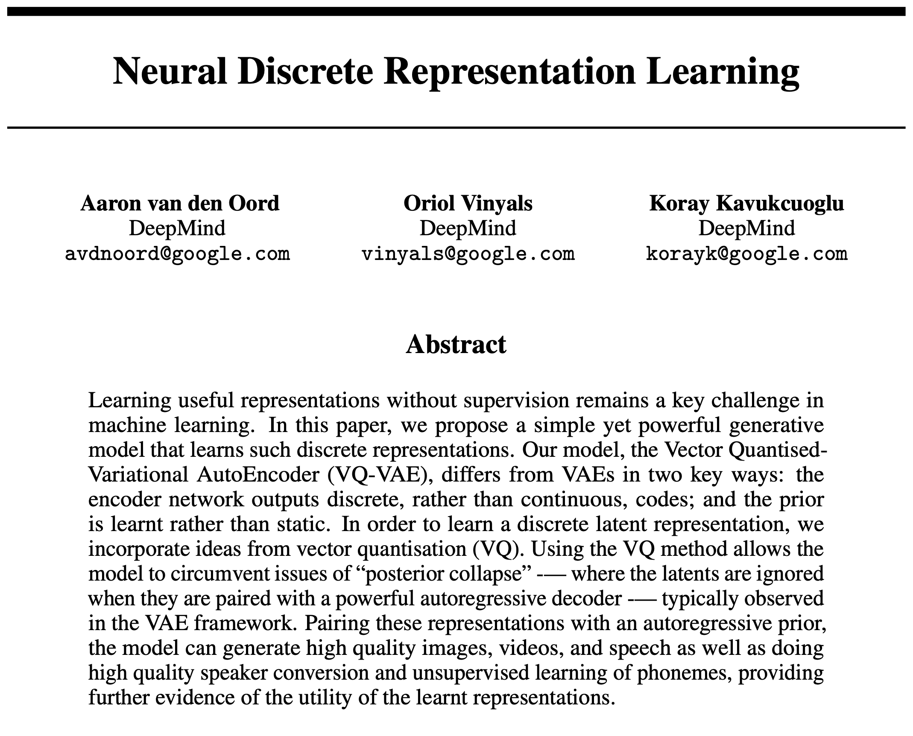
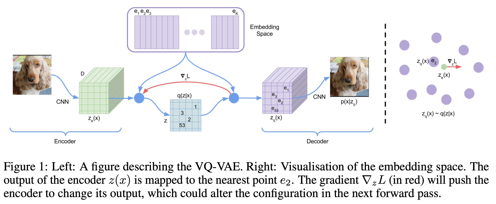
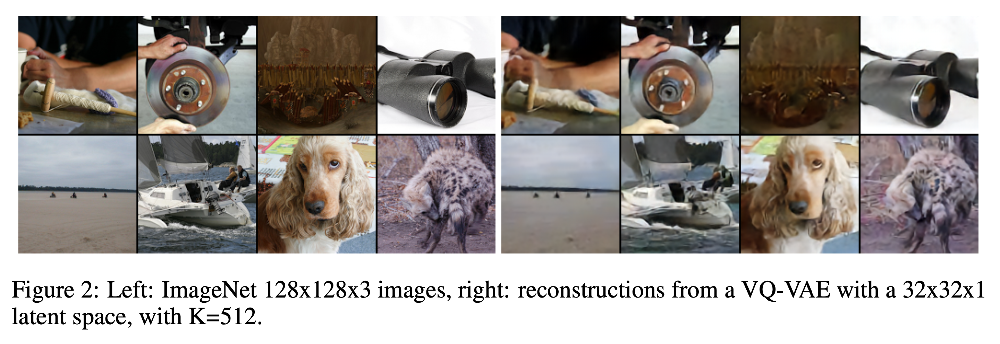
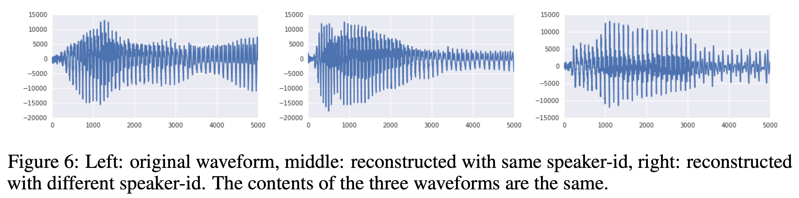
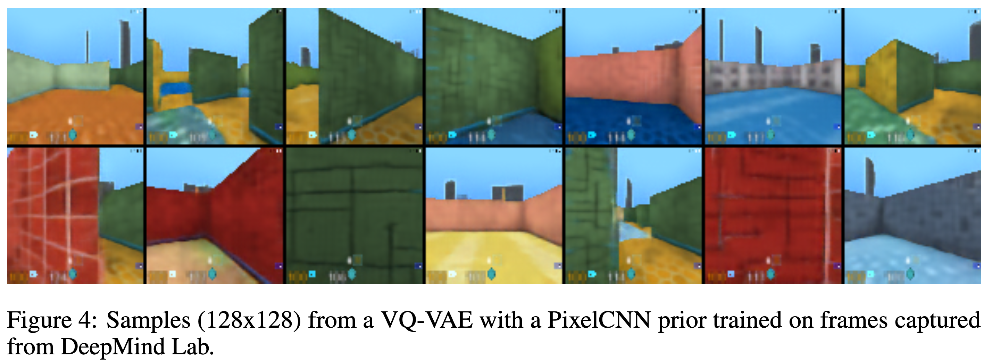
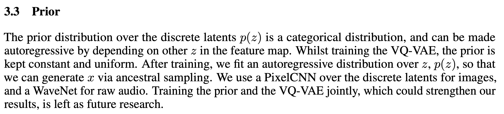

Learning useful representations without supervision remains a key challenge in machine learning. In this paper, we propose a simple yet powerful generative model that learns such discrete representations. Our model, the Vector Quantised-Variational AutoEncoder ([VQ-VAE](../permanent/vq-vae.md)), differs from VAEs in two key ways: the encoder network outputs discrete, rather than continuous, codes; and the prior is learnt rather than static. In order to learn a discrete latent representation, we incorporate ideas from vector quantisation (VQ). Using the VQ method allows the model to circumvent issues of “posterior collapse” (where the latents are ignored when they are paired with a powerful autoregressive decoder) typically observed in the VAE framework. Pairing these representations with an autoregressive prior, the model can generate high quality images, videos, and speech as well as doing high quality speaker conversion and unsupervised learning of phonemes, providing further evidence of the utility of the learnt representations.

